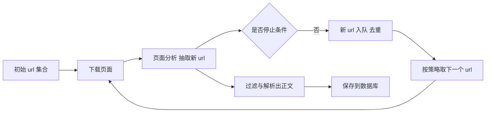
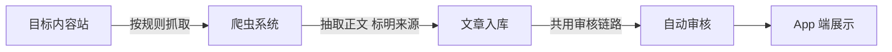

# 爬虫是什么：定义、工作循环与合规边界

> 🔒 安全提示：文中示例的口令/密钥均为课程教学环境演示口径，生产环境的安全要求见《安全与合规须知》。

聊起爬虫，很多人第一反应是灰色地带的抢票、刷量工具。放进工程语境里，它的本名其实很朴素：数据采集，把散落在万维网上的信息按规则自动搬回自己的系统。资讯平台的冷启动、比价系统的价格源、搜索服务的索引库，背后都是它在干活。爬虫的定义、工作循环、分类与合规边界，连同它在头条类资讯项目里承担的具体角色，下面一次讲清。

## 先给结论

- 定义一句话：网络爬虫是一种按照一定规则、自动抓取万维网信息的程序或脚本，本质是数据采集，功能上分为数据采集、处理、存储几个部分。
- 工作循环五步：从初始 url 出发，下载页面，抽取新 url 入队，按策略取出下一个，解析过滤后存储，循环往复直到满足停止条件。
- 按抓取范围分两类：通用爬虫面向全网无主题抓取，聚焦爬虫围绕特定主题定点抓取；资讯项目用的是聚焦爬虫。
- 合规边界有三条硬线：只抓公开内容、尊重目标站点的 robots 协议、控制抓取频率；越过这三条线，技术再干净也是滥用。
- 项目里爬虫的正经用途：从内容站采集文章、标明来源、落库后与自媒体稿件共用审核链路，定时任务放在深夜低峰窗口执行。

## 定义：程序化的访客

网络爬虫的英文叫 Web crawler，课件给的定义是「按照一定的规则，自动地抓取万维网信息的程序或脚本」。拆开看三个关键词：**按规则**，抓什么、抓多深、抓多快都由程序决定；**自动地**，它模拟人类请求网站的行为，却不需要人守着；**抓取信息**，产出是结构化或半结构化的数据，供后续处理与存储。通俗版本一句话：一个不知疲倦、行动完全按剧本执行的网站访客，请求网页、把数据抓下来、用规则提取出有价值的部分、存进数据库。

这个定义里藏着它的功能分层：采集负责把页面拿回来，处理负责从页面里挑出需要的内容，存储负责落库。后面搭爬虫系统时会看到，WebMagic 的四大组件正好对应这几层分工。

## 工作循环：从初始 url 到停止条件

传统爬虫的运行方式是一个不断自我喂养的循环。起点是一个或若干初始网页的 url，抓回页面后从中抽取新的 url 放进队列，再按一定的搜索策略从队列里挑下一个目标，对页面做分析、过滤掉无用链接，只留下需要的内容，如此循环直到满足停止条件。爬虫系统得到的分析结果还能反过来指导后续的抓取，哪些页面值得深挖、哪些链接是噪音，跑得越久越清楚。



关键路径在队列与去重上：队列决定「下一个抓谁」，去重决定「不重复劳动」，两者合在一起让循环既有方向又不空转。落到资讯项目的场景，初始 url 是内容站的栏目页与文章列表页，抽出来的新 url 是一篇篇文章的地址，解析出的正文才是真正要入库的东西。页面里往往混杂着导航、广告、推荐位，解析这一步只截正文，其余全部丢弃，这层过滤在工程上由 HTML 解析库承担。循环骨架写成伪代码是这样（示例按本课写法补全）：

```java
Queue<String> queue = initUrls();          // 初始 url 集合
Set<String> seen = new HashSet<>();        // 已见过的 url，去重用
while (!queue.isEmpty()) {                 // 停止条件：队列清空或达到限额
    String url = queue.poll();             // 按策略取出下一个
    Page page = download(url);             // 下载页面
    seen.add(url);
    queue.addAll(filter(newUrls(page)));   // 抽取新 url，过滤后入队
    save(parseContent(page));              // 解析出正文，存储
}
```

## 分类：通用与聚焦，项目选后者

按抓取范围，爬虫分两类。**通用爬虫**是搜索引擎的形态：从一个 url 池出发，尽量覆盖全网，不挑主题，抓回来的页面交给索引系统处理，量极大、面极广。**聚焦爬虫**反着来：围绕一个明确的主题或站点，只抓特定领域的内容，量小、目标精准。这个分类是业界通行口径，课件以聚焦场景展开，这里补全成对供对照。

资讯项目的诉求典型地属于聚焦爬虫：目标站点明确，课程里以技术社区的专栏文章为例；内容类型明确，文章标题、正文、配图、来源；用途明确，采集后标明来源落库，供平台用户阅读。范围收窄之后，解析规则可以针对目标站点的页面结构定制，抓取频率也可以压到对方无感的水平，这两点都是通用爬虫做不到的。

## 合规边界：robots 协议与三条硬线

robots 协议是站点与爬虫之间的君子协定：网站在根目录放一个 `robots.txt`，声明哪些路径允许哪些爬虫抓取、哪些禁止，格式大致如下（示例按通用格式补全）：

```text
User-agent: *
Disallow: /private/
Disallow: /search?
Crawl-delay: 5

User-agent: Googlebot
Allow: /
```

上面这段声明的含义是：除 Googlebot 外的所有爬虫不得抓取 `/private/` 与带搜索参数的路径，每次抓取间隔至少 5 秒；Googlebot 全站放行。合规的爬虫先读这份文件再决定抓什么，而不是假装看不见。

把边界收敛成三条硬线。**第一，只抓公开内容。** 需要登录、付费或绕过权限才能看到的页面不属于采集范围。**第二，尊重 robots 协议与站点规则。** 明令禁止的路径不碰，协议文件本身就是对方的意愿表达。**第三，控制频率。** 全速抓取会冲击对方服务的正常用户，轻则被封禁 ip，重则构成实质妨碍；限频与代理池轮换配合，把抓取压力摊平。越过这三条线去倒卖数据、绕过鉴权，就离开了正当用途的范畴。

## 资讯项目里的正当用法

回到项目，爬虫系统的需求在 day01 的功能结构图里就挂了名：内容来源除了自媒体平台，还有一条数据采集线。落地形态是这样一条链路：



链路上有三个设计点值得注意。**标明来源**是采集内容的身份证，文章出处跟着稿件走，作者与版权信息对用户透明。**共用审核链路**是合规的工程化落法：爬虫稿件与自媒体投稿走同一套自动审核，来源类型字段区分出身，审核通过才进 App 端，外部内容的质量与风险被同一道闸拦住。**定时抓取**是稳定性的运维手段：Quartz 定时任务把抓取窗口压在深夜十二点到清晨五六点，避开平台正常服务的高峰，五个小时的窗口里完成抓取、解析、入库，第二天用户刷新就能看到最新文章。

## 常见误区

- **把爬虫当成黑客工具。** 错例是觉得爬虫天然灰色，学了不敢用。正解是它就是数据采集手段，只抓公开内容、守 robots、限频时完全正当，灰色的是越界的用法不是技术本身。
- **拿到 url 就抓，不看来路与规则。** 错例是不读 robots.txt，登录态后的页面也想尽办法进。正解是采集前先摸清目标站点的规则与公开边界，禁抓路径直接排除。
- **全速抓取不限频。** 错例是多线程拉满冲对方服务器，很快被封，还影响对方正常用户。正解是限频加代理池轮换，把压力摊到对方无感，长期稳定比一时快重要。
- **抓下来的内容直接进 App 端。** 错例是采集完直接发布。正解是入库后走与自媒体稿件相同的审核链路，合规口径统一，外部内容的风险才有拦截点。
- **用通用爬虫的思路做聚焦场景。** 错例是铺开抓全网，什么都要。正解是聚焦爬虫围绕明确站点与主题定制解析规则，小而准才是资讯项目的解法。

## 面试可能被问到的问题

1. 面试官追问：「用一句话说清爬虫是什么，它的工作流程分几步？」
   答：爬虫是按一定规则自动抓取万维网信息的程序或脚本，本质是数据采集。流程五步：从初始 url 出发下载页面，从页面抽取新 url 入队，按策略取出下一个目标，解析过滤出需要的内容，存储后循环直到满足停止条件；队列负责方向，去重负责不空转。
2. 面试官追问：「通用爬虫和聚焦爬虫的区别是什么，你的项目用哪种？」
   答：通用爬虫面向全网无主题抓取，是搜索引擎形态，量大面广；聚焦爬虫围绕特定主题或站点定点抓取，量小且精准。资讯平台只用文章这一个主题，选聚焦爬虫，解析规则可以按目标站点页面结构定制，频率也能压低。
3. 面试官追问：「robots 协议是什么，工程上怎么遵守？」
   答：站点在根目录的 robots.txt 里声明允许与禁止的抓取路径、适用对象与建议间隔，是站点对爬虫的意愿表达。工程上抓取前先请求并解析该文件，禁抓路径直接从队列剔除，同时对 UA、频率一并尊重；协议之外再守住只抓公开内容这条底线。
4. 面试官追问：「爬虫采集的文章怎么进入你们的 App 端？」
   答：与自媒体稿件同路：抓取正文后标明来源落库，消息进审核链路，来源类型字段区分文章出身，自动审核通过才做 App 端落库与展示。两条内容线共用一套审核与消费设施，合规口径统一。
5. 面试官追问：「为什么抓取任务放在夜里跑？」
   答：抓取有耗时也有流量，放在平台低峰窗口既不影响白天的正常服务，目标站点的压力也小；定时任务把抓取、解析、入库编排成一个夜间批处理，清晨用户就能看到最新采集的文章。

## 配套资料

- 代码：本日无配套源码包，`materials/code/05/头条day08/` 资料目录为空，爬虫定义与循环的课件文本按画面线抄录，分类与 robots 部分为按主流写法补全的扩展，示例按本课写法补全。
- 参照：阶段三好客租房 day15 的资料里带有一份抓取完成的房源数据 `materials/code/03/day15-房源数据抓取以及实现房源搜索/day15-房源数据抓取以及实现房源搜索/资料/抓取的房源数据/data.json`，每条记录含标题、户型、租金与来源 url，是聚焦爬虫产出物的实物样例。
- 环境：课程集群 node01~node03，MySQL root/123456；目标站点清单与抓取频率在导入爬虫系统后按环境配置。
