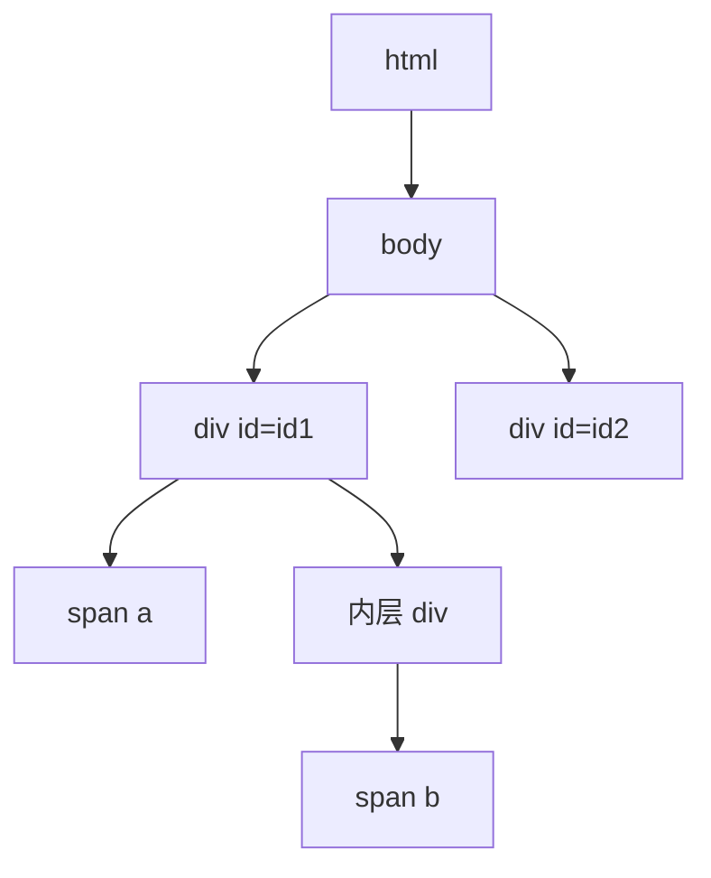

# Xpath 语法：解析页面时的定位语言

> 🔒 安全提示：文中示例的口令/密钥均为课程教学环境演示口径，生产环境的安全要求见《安全与合规须知》。

爬虫拿到页面之后，真正的工作才刚开始：页面里混着导航、广告、推荐位，要的只是标题与正文。怎么在成百上千个嵌套标签里精确指到目标节点？解析这一步靠的是 Xpath。WebMagic 的 process 方法里那句 `page.getHtml().xpath(...)`，用的就是这门语言。

## 先给结论

- Xpath 是一种在 XML 中查找信息的语言，普遍应用于 XML，在 HTML 中同样可用；项目解析 HTML 内容时主要用它快速定位元素。
- 定位能力由三部分组合而成：标签定位、路径定位、轴定位，外加筛选功能辅助，几乎可以定位到任意元素。
- 路径符号记五个：`/` 从根开始或作子元素分隔，`//` 表后代，`.` 表当前元素，`..` 表父元素，竖线 `|` 表多条路径同时查找。
- 筛选三板斧：属性 `[@class='x']`，文本 `contains(text(),'x')`，序号 `[1]`、`[last()]`、`[position()>2 and position()<7]`；序号从 1 起算，越界返回空。
- 代码里 WebMagic 的 `page.getHtml().xpath()` 开箱即用，底层是 Xsoup 让 Xpath 语法跑在 Jsoup 的解析引擎上。

## Xpath 是什么

Xpath 是在 XML 中查找信息的语言，XML 文档之外，HTML 文档同样适用，毕竟 HTML 本身就是一棵有规则的标签树。在 Selenium 自动化里它是脚本的基础，几乎每个操作都要先用 Xpath 把元素找出来；在爬虫里它的角色是解析规则的书写语言，定位越准，抓出来的字段越干净。

## 标签定位与路径定位

标签定位是最小单位：

```text
div      找到所有的 div 标签元素
input    找到所有的 input 标签元素
*        定位任意元素或属性
@属性名   找到指定名称的属性
```

路径定位决定从哪里找、往哪个方向找：

```text
/    从根路径开始，写在其他位置表示子元素或分隔符
//   表示后代元素
.    表示当前元素
..   表示父元素
```

竖线 `|` 表示多条路径同时查找，两条表达式并排写，命中结果合并返回。

组合起来的常见写法：

```text
/html                             找到根元素 html
//div                             找到所有的 div 元素
//div[@id='id1']/span             id 为 id1 的 div 元素的子元素 span
//div[@id='id1']//span            id 为 id1 的 div 元素下的所有后代 span
//div[@id='id1']/@class           id 为 id1 的 div 元素的 class 属性
```

单斜杠与双斜杠的差别值得专门看一眼，用一棵小树验证：



`//div[@id='id1']/span` 只命中 span a，`//div[@id='id1']//span` 把 span a 和内层 div 里的 span b 一起命中。一层斜杠之差，决定了查找深度是「直接子级」还是「全部后代」，解析规则的层级写错，命中数量翻倍或者为空都是常事。

## 轴定位与筛选

轴定位用「轴名称 + 双冒号 + 标签」的写法，比路径更精确地描述选取方向。常用轴一览：

| 轴名称 | 选取范围 |
|---|---|
| child | 当前节点的所有子元素 |
| parent | 当前节点的父节点 |
| descendant | 所有后代元素（子、孙等） |
| ancestor | 所有先辈（父、祖父等） |
| self | 当前节点本身 |
| attribute | 当前节点的所有属性 |
| following-sibling | 当前节点之后的所有同级节点 |
| preceding-sibling | 当前节点之前的所有同级节点 |
| following | 文档中当前节点结束标签之后的所有节点 |
| preceding | 文档中当前节点开始标签之前的所有节点 |

`//div[@id='id1']/child::span` 与 `//div[@id='id1']/span` 等价。日常写规则用的是简写语法，完整的轴描述更贴近自然语言，但啰嗦，工程里罕用。

真正高频使用的是筛选，三种武器：

```text
//div[@class='class1']                             筛选 class 属性等于 class1 的 div
//div[@height>10]                                  height 属性值大于 10 的 div，仅限数字
//div[contains(text(),'text')]                     文本中包含 text 的 div
//div[contains(text(),'text1') and @class='class1']    两个条件同时满足，or 同理，可加括号分组
//div[text()='text1' and not(@class)]              文本为 text1 且没有 class 属性的 div
```

序号筛选按位置取：

```text
//div[@id='id1']/span[1]                           后代中第一个 span，写 [4] 就是第四个
//div[@id='id1']/span[last()]                      最后一个 span
//div[@id='id1']/span[position()>2 and position()<7]   第三到第六个
//div[@id='id1']/text()[2]                         第二段文本节点
```

序号从 1 开始数。当前节点下没有对应位置的子元素时表达式无效，一共五个 span 却写 [6]，返回的是空结果而不是报错。

## 浏览器调试与代码落法

写解析规则不必闭眼盲试，浏览器就是最好的调试台。F12 打开开发者工具，在 Elements 面板选中目标节点，右键 Copy XPath 能拿到一份现成表达式；Console 里输入 `$x("//div[@class='article']")` 直接执行，回显命中的节点列表，命中几个一目了然。拿到的表达式先验证再精简：把绝对路径改成属性锚定的短路径，页面小改版时规则才抗得住。

代码里两条路。WebMagic 的 Html 对象内置 xpath 方法（day08 资料包为空，示例按本课写法补全）：

```java
package com.study.headline.crawler;

import us.codecraft.webmagic.Page;
import us.codecraft.webmagic.Site;
import us.codecraft.webmagic.processor.PageProcessor;

public class XpathArticleProcessor implements PageProcessor {

    private Site site = Site.me().setRetryTimes(3).setSleepTime(1000);

    @Override
    public void process(Page page) {
        // 文本：text() 取直接文本，get() 取命中的第一条
        page.putField("title",
                page.getHtml().xpath("//h1[@class='article-title']/text()").get());
        // 整块正文：allText() 把命中块里的全部文本拼接出来
        page.putField("content",
                page.getHtml().xpath("//div[@id='article-content']/allText()").get());
        // 属性：@href 直接取链接地址
        page.putField("authorHome",
                page.getHtml().xpath("//a[@class='author']/@href").get());
    }

    @Override
    public Site getSite() {
        return site;
    }
}
```

脱离框架单独用 Jsoup 时，Xsoup 把 Xpath 接到 Jsoup 的解析引擎上：

```java
Document doc = Jsoup.parse(html);
String title = Xsoup.compile("//h1[@class='article-title']/text()")
                    .evaluate(doc).get();
```

两条路底层是同一套东西：Xsoup 在 Jsoup 之上跑 Xpath 语法，表达力与解析速度兼得。解析规则与目标站点的页面结构一一对应，规则定义的落点在导入爬虫系统之后的文档处理环节。

## 常见误区

- **单斜杠双斜杠不分。** 错例是全用 `//` 一路到底，命中范围意外扩大，抓回来的字段混进脏数据。正解是层级关系想清楚，直接子级用 `/`，跨层才用 `//`。
- **序号从 0 起算。** 错例是沿用编程习惯写 `[0]`，Xpath 的序号从 1 开始，`[0]` 无效。
- **序号越界还期待报错。** 错例是写 `[6]` 而实际只有五个子元素，返回空结果，字段悄悄丢掉。正解是对可选字段做判空兜底。
- **把 contains 当精确匹配。** 错例是拿 `contains(text(),'x')` 做等值比较，包含匹配会误伤同类文本。精确相等写 `text()='x'`。
- **表达式贴着绝对路径写。** 错例是 `/html/body/div[2]/div[3]` 一长串，站点一改版全部失效。正解是优先用 id、class 等属性锚定，短表达式更稳。

## 面试可能被问到的问题

1. 面试官追问：「Xpath 是什么，爬虫解析为什么用它？」
   答：Xpath 是在 XML 中查找信息的语言，HTML 同样适用。页面标签嵌套复杂，Xpath 用路径加筛选的表达式精确指到目标节点，它也是 Selenium 自动化脚本的基础；表达式短、表达力强，是书写解析规则的标准语言。
2. 面试官追问：「`/` 和 `//` 的区别是什么？」
   答：`/` 从根路径开始，写在中间表示直接子元素；`//` 表示后代元素，跨任意层级查找。`//div[@id='id1']/span` 只找直接子级 span，把中间一层换成双斜杠就是找所有后代 span，命中范围完全不同。
3. 面试官追问：「常用的筛选手段有哪些？」
   答：三类。属性筛选 `[@class='x']` 与数值比较 `[@height>10]`；文本筛选 `contains(text(),'x')`，可与 `and`、`or`、`not` 组合；序号筛选 `[1]`、`[last()]`、`[position()>2 and position()<7]`，序号从 1 起算，越界返回空。
4. 面试官追问：「Xpath 表达式怎么快速调试？」
   答：浏览器开发者工具里选中节点右键 Copy XPath 拿初稿，Console 里用 `$x()` 执行验证命中数量，再把绝对路径精简成属性锚定的短路径。命中数量与预期一致才写进解析规则。
5. 面试官追问：「WebMagic 里的 Xpath 是怎么实现的？」
   答：Html 对象的 xpath 方法底层由 Xsoup 支持。Xsoup 是在 Jsoup 之上封装的选择器引擎，把 Xpath 语法适配到 Jsoup 的解析引擎上，兼顾 Xpath 的表达力与 Jsoup 的解析速度。

## 配套资料

- 代码：本日无配套源码包，`materials/code/05/头条day08/` 资料目录为空；标签、路径、轴与筛选的语法表按画面线（WebMagic 官方文档 Xpath 章节）抄录整理，Processor 与 Xsoup 示例按本课写法补全。
- 参照：阶段三好客租房 day15 的资料里带有一份抓取完成的房源数据 `materials/code/03/day15-房源数据抓取以及实现房源搜索/day15-房源数据抓取以及实现房源搜索/资料/抓取的房源数据/data.json`，每条记录里的标题、户型、租金字段，正是解析规则命中之后落库的字段形态。
- 环境：课程集群 node01~node03，MySQL root/123456；解析规则定义在导入爬虫系统后按目标站点的页面结构编写。
