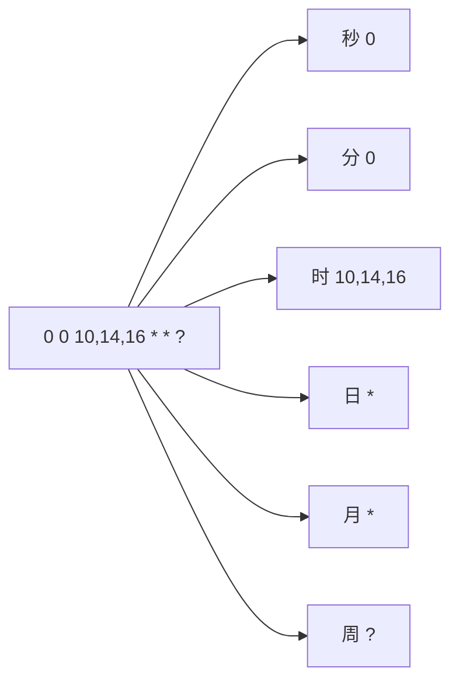
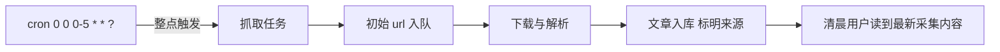

# cron 表达式：给定时抓取任务排一张时间表

> 🔒 安全提示：文中示例的口令/密钥均为课程教学环境演示口径，生产环境的安全要求见《安全与合规须知》。

抓取这件事不能想跑就跑。全速抓压目标站点，白天抓还要和自己平台的高峰抢资源，项目早有安排：抓取窗口压在深夜。让任务准点起床的机制是定时任务，头条类资讯项目的爬虫系统里用的是 Quartz，之前学过的 Spring Task 同理，两者的调度时间都用同一种语言书写：cron 表达式。表达式学一遍，两边通用。

## 先给结论

- cron 表达式由空格分隔的 6 或 7 个域组成：秒 分 时 日 月 周 [年]，年域一般省略，日常写的多是六位。
- `*` 表示任意值，`?` 表示放弃不指定；日（day of month）与周（day of week）两域互斥，一方指定另一方必须写 `?`。
- 逗号枚举多个值，连字符表范围（9-17 即 9 到 17 都有效），斜杠表步进；`0 0 10,14,16 * * ?` 就是每天 10 点、14 点、16 点各触发一次。
- Spring 里类交给 Spring 管理，方法标 `@Scheduled(cron = "...")`，再开 `@EnableScheduling`，任务就会准点触发；Quartz 的触发器吃的是同一份表达式。
- 项目夜间抓取窗口写成 `0 0 0-5 * * ?`，每天 0 点到 5 点整点各触发一轮抓取、解析、入库。

## 域结构：六位还是七位

```text
Seconds Minutes Hours DayOfMonth Month DayOfWeek Year
Seconds Minutes Hours DayOfMonth Month DayOfWeek
```

七域带年，六域省年。逐域含义与取值：

| 位置 | 域 | 含义 | 取值范围 |
|---|---|---|---|
| 1 | Seconds | 秒 | 0-59 |
| 2 | Minutes | 分钟 | 0-59 |
| 3 | Hours | 小时 | 0-23 |
| 4 | DayOfMonth | 月中的某一天 | 1-31 |
| 5 | Month | 月份 | 1-12 |
| 6 | DayOfWeek | 周中的某一天 | 1-7 或 SUN-SAT |
| 7 | Year | 年份，可省略 | 1970-2099 |

前三位管「一天里的几点几分几秒」，第五位管「哪个月」，第四与第六位管「哪些天」。这里藏着整张表达式里唯一的互斥规则：day of month 和 day of week 都在表达「某一天」，两者重复，所以规定互制，一方有值另一方必须放弃。

## 特殊符号与互斥规则

```text
*    任意值，该域所有可能的取值都命中
?    放弃，不指定该域，只用在日与周两个域
,    枚举多个值，10,14,16 表示三个时刻
-    范围，9-17 表示 9 到 17 之间的值都有效
/    步进，0/30 表示从 0 开始每 30 一个单位
L    last，用在日或周，表最后一天或一周最后一天
W    工作日，离指定日期最近的有效工作日
#    第几个星期几，如 6#3 表示第三个周五
```

`?` 只为互斥而生。拿 `0 0 10,14,16 * * ?` 这条每天上午 10 点、下午 2 点、下午 4 点触发的表达式拆开看：



日域写 `*` 表每天，周域就必须 `?` 放弃；反过来指定周几时，日域就得让位。一个表达式里两域只能有一方表态。

## 常用示例

```text
0 0 10,14,16 * * ?      每天 10 点、14 点、16 点各一次
0 0/30 9-17 * * ?       每天 9 点到 17 点，每半小时一次
0 0 12 * * ?            每天 12 点整
0 0 1 ? * MON-FRI       每周一到周五的凌晨 1 点
0 0 2 1 * ?             每月 1 日凌晨 2 点
0 0 0-5 * * ?           每天 0 点到 5 点，每小时整点一次
```

记法上抓住一句话：前三位管「一天里的什么时候」，后三位管「哪些天」。拿不准含义就用在线 cron 生成器点选时间生成，生成完直接拷走；拷来的表达式要按域逐位核对一遍，多勾一个选项含义就全变了。

## 与 Spring @Scheduled 配合

Spring 的用法三件套：类交给 Spring 管理、方法标注 `@Scheduled`、启用调度（day08 资料包为空，示例按本课写法补全）：

```java
package com.study.headline.crawler;

import org.springframework.scheduling.annotation.EnableScheduling;
import org.springframework.scheduling.annotation.Scheduled;
import org.springframework.stereotype.Component;

@EnableScheduling                       // 开启定时调度能力
@Component                              // 类交给 Spring 管理，注解才会生效
public class NightlyCrawlTask {

    @Scheduled(cron = "0 0 0-5 * * ?")  // 每天 0 点到 5 点，整点触发
    public void crawlArticles() {
        // 拉起抓取流水线：初始 url 入队、下载、解析、入库
    }
}
```

方法体里包住的就是整条抓取流水线。Quartz 的写法不同，job 与触发器分开定义，触发器里放的是同一份 cron，表达式知识完全复用。有一点差异要记住：Spring 的 `@Scheduled` 只认六位表达式，七位带年的写法贴进去会直接解析失败；Quartz 支持六位与七位，课程按七域口径讲清结构，落到 Spring 示例时去掉年域即可。

## 把夜间抓取计划写成 cron

项目既定的抓取窗口是深夜零点到清晨五点，翻译成表达式分三步。**第一，定时刻。** 前三位写 `0 0 0-5`，秒分固定在 0，小时走 0 到 5 的范围，等于整点触发。**第二，定日期。** 每天都跑，日域写 `*`，周域依互斥规则写 `?`，月域写 `*`。**第三，按窗口节奏微调。** 一轮抓取半小时能收工、想抓得更密，就写 `0 0/30 0-5 * * ?`，每半小时一轮；全量重建索引这类重活不必每夜做，写 `0 0 3 ? * SUN` 挑周日凌晨 3 点一次完成。



时间表写好之后，抓取的节奏就完全交给调度器，白天的系统高峰与夜里的抓取窗口互不打扰，第二天清晨用户刷新就能读到最新采集的文章。

## 常见误区

- **日与周同时指定。** 错例是 `0 0 12 1 * 1`，想表达「每月 1 号又是周一」，两域互斥，这样的表达式无效。正解是一方指定、一方 `?`。
- **六位七位混着抄。** 错例是把 Linux crontab 的五位写法（分 时 日 月 周）贴进 Java 代码，域整体错位。正解是 Java 系 cron 从秒开始共六到七域，跨环境拷贝先数域数。
- **七位表达式贴进 Spring。** 错例是把带年域的表达式交给 `@Scheduled`，直接解析失败。正解是 Spring 只收六位，Quartz 才收七位。
- **类没交给 Spring 管理或忘了启用调度。** 错例是方法上的 `@Scheduled` 怎么都不触发。正解是组件注解与 `@EnableScheduling` 缺一不可。
- **把 `?` 与 `*` 当同义。** 错例是图省事全写 `*`，在日周互斥的语境里 `*` 是「全都」，`?` 是「不表态」，含义并不等价。

## 面试可能被问到的问题

1. 面试官追问：「cron 表达式由哪几部分组成？」
   答：由空格分隔的 6 或 7 个域：秒、分、时、月中的某一天、月、周中的某一天，第七位年可省略。日与周两域互斥，指定一方时另一方必须写 `?`。
2. 面试官追问：「`*` 和 `?` 有什么区别？」
   答：`*` 表示该域取所有可能值，`?` 表示不指定该域。`?` 只能用在日和周两个域，专门配合互斥规则使用：日域有值周域写 `?`，反之亦然，两者语义并不等价。
3. 面试官追问：「写一个表达式，每天凌晨 1 点到 5 点每 30 分钟执行一次。」
   答：`0 0/30 1-5 * * ?`。秒位定 0，分位每 30 步进，小时走 1 到 5 的范围，日域 `*`、周域 `?`，月域 `*`。
4. 面试官追问：「Spring 里怎么用 cron 做定时任务？」
   答：三步：类加组件注解交给 Spring 管理，方法标 `@Scheduled(cron = "...")`，配置类或启动类加 `@EnableScheduling`。注意 Spring 只支持六位表达式，带年域的七位写法是 Quartz 的。
5. 面试官追问：「Linux crontab 和 Java 的 cron 有什么区别？」
   答：域结构不同。crontab 五位，从分钟开始；Java 系六到七位，从秒开始，多了秒与可选的年。表达式不能直接互相拷贝，迁移时要按域重新对位。
6. 面试官追问：「你们项目里定时抓取是怎么调度的？」
   答：调度器按 cron 在深夜 0 点到 5 点的窗口整点触发抓取任务，任务体拉起 WebMagic 流水线完成下载、解析、入库；白天高峰与夜间抓取窗口错开，目标站点与自身平台两边的压力都可控。

## 配套资料

- 代码：本日无配套源码包，`materials/code/05/头条day08/` 资料目录为空；域结构、特殊符号与示例按画面线整理，`@Scheduled` 示例按本课写法补全。
- 参照：阶段三好客租房 day15 的资料里带有一份抓取完成的房源数据 `materials/code/03/day15-房源数据抓取以及实现房源搜索/day15-房源数据抓取以及实现房源搜索/资料/抓取的房源数据/data.json`，批量采集成果的背后同样有定时任务按表调度。
- 环境：课程集群 node01~node03，MySQL root/123456；抓取窗口的具体表达式在导入爬虫系统后按环境确定。
