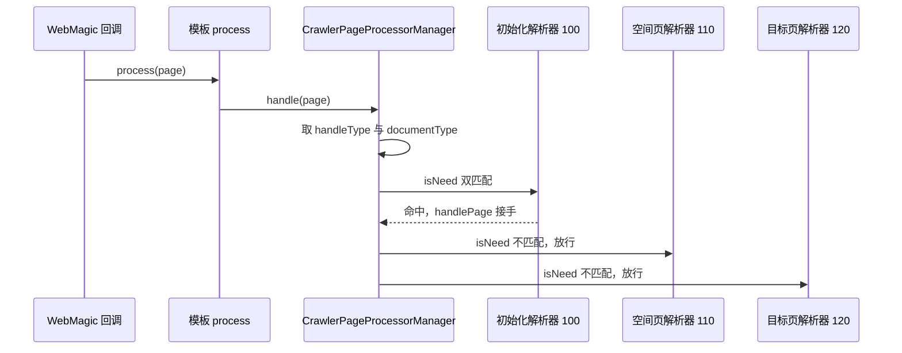

# 文档管理器：给三个页面解析器装一个统一调度台

> 🔒 安全提示：文中示例的口令/密钥均为课程教学环境演示口径，生产环境的安全要求见《安全与合规须知》。

三个解析器子类全部注册进 Spring 容器之后，一个新问题立刻浮出来：WebMagic 下载完页面触发回调时，这一页该交给谁处理？让每个解析器自己去抢，顺序没有保障；让调用方逐个写 if-else 判断，调用方就得认识每一个解析器，加一个子类就要改一圈调用代码。这一讲把调度收拢到一个管理器里：注入全部解析器，启动时按优先级排好序，回调来了统一分发。

## 先给结论

- `CrawlerPageProcessorManager` 持有 `List<AbstractCrawlerPageProcessor>` 集合，集合注入让 Spring 自动收集容器里全部解析器子类，新增子类管理器一行不改。
- `@PostConstruct` 标注的 `initProcessingFlow` 启动即排序，按 `getPriority` 升序排一次成型，之后全程只读遍历。
- `handle(Page)` 是统一入口：取处理方向与文档类型，循环做身份比对，双匹配才交棒 `handlePage`。
- `@Resource` 是 JDK 的注解，注入集合与 `@Autowired` 等效，工程里两种写法并存但习惯要统一。
- 管理器自身无状态、不暂存任何解析结果，天然线程安全。

## 管理器的定位与字段

视频标题里叫文档管理器，类名按画面线是 `CrawlerPageProcessorManager`，它管理的对象是三个页面解析器，类注释一句话：爬虫文档流程管理。字段只有两个：

```java
@Component
public class CrawlerPageProcessorManager {

    @Autowired
    private CrawlerHelper crawlerHelper;

    /** 集合注入：Spring 会把容器里全部 AbstractCrawlerPageProcessor 子类收进列表 */
    @Resource
    private List<AbstractCrawlerPageProcessor> abstractCrawlerPageProcessorList;
}
```

集合注入是这段代码的支点。注入目标写成 `List<AbstractCrawlerPageProcessor>` 时，Spring 容器会把该类型的全部 Bean 按某种默认顺序装进列表，初始化、空间页、目标页三个子类一个不落。管理器不写死任何子类名，路由的依据全部来自运行时的身份比对，这就是三个解析器零耦合的另一半：前面靠类型字段对话，这里靠集合注入收口，谁也不引用谁。

`@Resource` 与 `@Autowired` 值得单独说一句。`@Resource` 是 JDK 自带的注解，先按名称找、找不到再按类型；`@Autowired` 是 Spring 的注解，按类型匹配。两者打在集合字段上效果一致，都会触发集合注入。工程里两种写法并存没有功能问题，但新代码最好统一习惯，同一个类里一半一半，读代码的人会怀疑写法背后有深意，其实没有。

## 启动即排序：initProcessingFlow

集合装进来时的顺序取决于 Bean 的扫描顺序，这个顺序不可依赖，必须显式压序。排序动作放在初始化方法里：

```java
/**
 * 初始化注入的接口排序
 */
@PostConstruct
private void initProcessingFlow() {
    // 非 null 且非空集合才排序，两个条件少一个都会在边界翻车
    if (null != abstractCrawlerPageProcessorList && !abstractCrawlerPageProcessorList.isEmpty()) {
        abstractCrawlerPageProcessorList.sort(new Comparator<ProcessFlow>() {
            @Override
            public int compare(ProcessFlow p1, ProcessFlow p2) {
                if (p1.getPriority() > p2.getPriority()) {
                    return 1;
                } else if (p1.getPriority() < p2.getPriority()) {
                    return -1;
                }
                return 0;
            }
        });
    }
}
```

`@PostConstruct` 是 JDK 提供的生命周期注解，Spring 在完成依赖注入之后回调它，此时集合已经满员，排序拿到的是完整的解析器清单。比较器是标准的升序写法：前者大返回 1 排后面，前者小返回 -1 排前面，相等同位。排完的结果就是初始化 100 在最前、空间页 110 居中、目标页 120 收尾。顺带说一句底层：`List.sort` 落到 `Arrays.sort`，对象数组走的是 TimSort，归并与插入排序的混合实现，比冒泡高效得多，口播里把它顺口说成冒泡，结论不变，小的在前。

排序为什么放启动时而不是每次分发时：一次成型，后续只读遍历，分发路径上没有排序开销；集合排完不再变，多线程并发读也没有共享写的问题。若把排序挪进 handle，每次回调都排一遍纯属浪费，还凭空引入并发写风险。

## 统一入口：handle 的分发逻辑

WebMagic 的回调最终汇聚到这一个方法（分发接线的完成在组件整合那一讲，本讲先把管理器自身的逻辑立住）：

```java
/**
 * 统一处理入口：按方向与类型分发到匹配的解析器
 */
public void handle(Page page) {
    // 处理方向从请求属性上取
    String handleType = crawlerHelper.getHandleType(page.getRequest());
    // 文档类型同样挂在请求属性上
    String documentType = crawlerHelper.getDocType(page.getRequest());
    for (AbstractCrawlerPageProcessor abstractCrawlerPageProcessor : abstractCrawlerPageProcessorList) {
        boolean needHandleType = abstractCrawlerPageProcessor.isNeedHandleType(handleType);
        boolean needDocumentType = abstractCrawlerPageProcessor.isNeedDocumentType(documentType);
        // 双匹配才接手，其余数据滑给下一个解析器
        if (needHandleType && needDocumentType) {
            abstractCrawlerPageProcessor.handlePage(page);
        }
    }
}
```

两个类型都从请求属性上取，条目在链上流转时携带的标记在这里兑现。循环按启动时排好的优先级顺序走，每个解析器先报两个身份：认不认这个方向、认不认这个类型，双双命中才把页面交给它的 `handlePage`。循环里没有 break，类型互斥的设计下一个页面只会有一个解析器命中；不写 break 反而留了扩展口，某个解析器将来要同时接两类页面，照样能被循环放进来。

## 线程安全与结果的暂存分发

管理器被多线程回调是常态，它经得住的原因是结构性的：字段只有注入的两个对象，集合在启动时排序一次成型，handle 只做只读遍历与转发，没有共享可变状态，锁从根上就不需要。

解析结果同样不暂存在管理器里。子类抽出链接或字段后，直接经 `addSpiderRequest` 交给 `CrawlerHelper` 收口进 Spider 队列，管理器从头到尾不碰内容，它只认类型。暂存与分发这两件事要分开看：暂存交给框架的调度器与条目队列，分发只做路由，管理器掺和进去任何一桩，线程安全就得自己操心。

与 Pipeline 的衔接是另一个维度的事。解析完成的结构化数据最终要走 WebMagic 的管道落库，管道管的是「解析完怎么保存」，管理器管的是「这一页由谁解析」，两者在组件整合时各自接线，互不掺和。



关键路径读一处：回调永远只有一个入口，分发永远只有一个循环，三级解析器的先后由启动时那一次排序压住，运行期不再有任何顺序协商。

## 常见误区

- **判空只写一半。** 错例是只判 `null` 不判 `isEmpty`，或者写成 `null == list.isEmpty()` 的错位比较，空集合照样进排序，边界上抛异常或白算。正解是 `null != list && !list.isEmpty()` 两个条件都要。
- **排序放进 handle 每次执行。** 错例是每次回调重新排序，开销白付还引入并发写。正解是 `@PostConstruct` 里一次成型，之后只读。
- **在管理器里暂存解析结果。** 错例是给管理器加一个结果缓存字段，多线程回调立刻出现共享可变状态。正解是管理器保持无状态，结果由子类直接交收口方法。
- **以为循环命中多个解析器是 bug。** 类型互斥时只会有一个命中，不写 break 是为「一个解析器接多类页面」留的扩展口，命中即接手、其余放行正是责任链的走法。

## 面试可能被问到的问题

1. 面试官追问：「为什么用集合注入而不是逐个注入三个解析器？」
   答：集合注入让管理器与子类解耦，容器里有哪些解析器子类，列表里就有什么，新增一个子类管理器一行不改。逐个注入则每加一个解析器都要改管理器代码，扩展性差。
2. 面试官追问：「@Resource 与 @Autowired 有什么区别？」
   答：@Resource 是 JDK 注解，先按名称后按类型匹配；@Autowired 是 Spring 注解，按类型匹配。打在集合字段上两者都触发集合注入，效果一致，工程里统一用一种即可。
3. 面试官追问：「排序为什么放在 @PostConstruct 里？」
   答：注入完成后、对外服务前回调，此时集合已满员，排序拿到完整清单；启动时一次成型，运行期只读遍历，没有重复开销也没有并发写风险。
4. 面试官追问：「管理器怎么保证线程安全？」
   答：靠结构而不是锁。字段只有注入的只读对象，集合排序一次不再修改，handle 只读遍历与转发，没有共享可变状态，天然不需要同步。
5. 面试官追问：「这个管理器和责任链模式是什么关系？」
   答：结构上是责任链：请求（页面）沿一个有序的处理器序列传递，每个处理器按自身条件决定接不接手，接手处理、不接放行。与教科书责任链的差异在于链由优先级排序静态成型，且用类型比对代替链式调用。

## 配套资料

- 代码：本日无配套源码包，`materials/code/05/头条day09/` 资料目录为空，管理器按画面线整理，方法骨架与比较器写法按本课写法补全，示例站点一律以 example.com 占位。
- 参照：`materials/code/05/头条day07/` 资料目录（引用截至 dayNN 层级，内层目录含项目原名）里的封装工具类，可对照感受工程内组件封装与命名的组织方式。
- 环境：课程集群 node01~node03，MySQL root/123456；解析器优先级与类型常量集中在 `CrawlerEnum` 与各子类的 `getPriority` 中。
