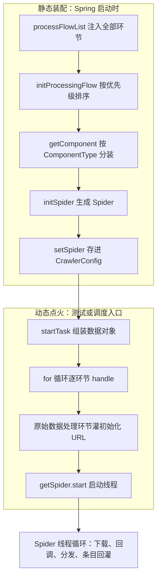
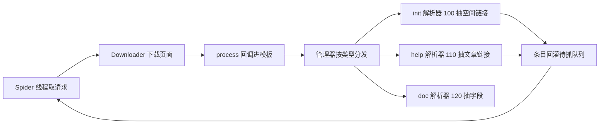

# 爬虫组件整合：流程管理器把散件串成一台引擎

> 🔒 安全提示：文中示例的口令/密钥均为课程教学环境演示口径，生产环境的安全要求见《安全与合规须知》。

下载、初始化、解析这些环节的代码写到这一讲，散件已经备齐：一个原始数据处理环节、一个下载器、三个页面解析器，外加解析器自己的管理器。可它们还各是各的 Bean，WebMagic 的 Spider 至今没影。写了几百行代码一次都没跑过，是时候回答整合的三个问题了：Spider 从哪来、组件怎么装、任务从哪点。

三讲的内容合并起来看，正好是「接线、组装、点火」三步：先把模板的 process 回调接上管理器，再由流程管理器把清单里的环节分装进组件载体并生成 Spider，最后用 startTask 灌种子、点火，抓取线程转起来。

## 先给结论

- 模板的 process 回调定稿：记时间、取方向、打日志，核心一行交给 `CrawlerPageProcessorManager.handle(page)`，路由职责从模板挪进管理器。
- `ProcessFlow` 接口补上 `getComponentType` 声明，每个流程环节向管理器上报自己对应 WebMagic 的哪一类组件。
- WebMagic 四大组件 Downloader、Scheduler、PageProcessor、Pipeline 先分装进 `CrawlerComponent` 载体，再由 `initSpider` 装上 Spider。
- 流程管理器 `ProcessingFlowManager` 是组装车间：`@PostConstruct` 里按优先级排序流程清单，生成 Spider 存进 `CrawlerConfig`。
- `startTask` 是点火按钮：组装 `ProcessFlowData`、顺序执行各环节 `handle`、`getSpider().start()` 启动抓取线程。
- 正向入口 `handle()` 允许条目传 null，初始化 URL 由原始数据处理环节自己从配置读取并灌队列。
- 调度器与管道还没有实现类，判空链让 Spider 先带「下载 + 解析」跑起来，后续组件即插即用。

## process 回调的最终形态

前置准备那一讲立模板时，process 的骨架只有一句「转交 handlePage」的占位写法。真正整合时发现，模板不该自己认路由：一页是入口页、空间页还是文章页，模板无从判断，判断的依据在请求属性上，判断的动作该在管理器里。占位写法升级成定稿：

```java
@Override
public void process(Page page) {
    // 起始时间，出口算耗时
    long currentTimeMillis = System.currentTimeMillis();
    // 处理方向从请求属性上取
    String handleType = crawlerHelper.getHandleType(page.getRequest());
    log.info("开始解析页面页。url: {}, handleType: {}", page.getUrl(), handleType);
    // 分发交给管理器，模板不再自己做路由
    crawlerPageProcessorManager.handle(page);
    log.info("解析页面完成。url: {}, handleType: {}, 耗时: {}",
            page.getUrl(), handleType, System.currentTimeMillis() - currentTimeMillis);
}
```

这段代码在 WebMagic 回调与业务分发之间钉了一颗钉子。框架每下载完一页就回调 process，模板只做三件轻活：记时间、取方向、打日志，然后把页面整只交给管理器。三个解析器子类的 process 全部继承自模板，回调进来殊途同归，真正的分流发生在管理器内部。日志一头一尾带耗时，整合测试时每一级解析花多久，从这里就能对上账。

管理器要按类型分流，可 `ProcessFlow` 接口此前没有上报类型的声明，这一讲把它补进接口：

```java
/** 上报本环节对应 WebMagic 的哪一类组件 */
CrawlerEnum.ComponentType getComponentType();
```

抽象类此前已经实现了这个方法，接口补上声明之后，全部实现类不用动一行，管理器拿着 `ProcessFlow` 引用就能统一问询每个环节的身份。

## WebMagic 四大组件与组件载体

Spider 是 WebMagic 的引擎，引擎转起来要四类组件各就各位：Downloader 负责下载页面；Scheduler 负责调度待抓请求，队列与去重都在它身上；PageProcessor 负责解析；Pipeline 负责把解析结果落库。框架的执行顺序就在这四个角色之间流转：请求先经调度器排队，下载器抓回页面，解析器抽内容，管道收尾保存。项目此刻的进度是下载与解析已经自己封装，去重与持久化还没排到，所以整合的目标很明确：把已有的装上去，没有的留好坑位。

组件从哪来？从流程清单来。容器里每个流程环节都实现了 `ProcessFlow`，其中下载环节同时实现 Downloader，解析环节同时实现 PageProcessor。Spider 要的却是四个散参数，清单给的是一整列，中间需要一层翻译，`CrawlerComponent` 载体应运而生：

```java
public class CrawlerComponent implements Serializable {
    // 页面处理类
    private PageProcessor pageProcessor;
    // pipelineList 处理
    private List<Pipeline> pipelineList = new ArrayList<Pipeline>();
    // 调度组件
    private Scheduler scheduler;
    // 下载组件
    private Downloader downloader;

    public void addPipeline(Pipeline pipeline) {
        pipelineList.add(pipeline);
    }
}
```

载体的四个字段与框架四大组件一一对应，管道是集合形态，配一个 `addPipeline`。清单到载体再到 Spider 的翻译链，让管理器面对的始终是「一列流程环节」，框架面对的始终是「四个组件参数」，两边谁也不用迁就谁。载体实现 `Serializable` 是为序列化留的口子，后续分布式扩展时组件描述可以跨进程传输。

四个角色里最容易被低估的是调度器。它不只是个队列：请求进出都要过它，进队时可以做去重，出队时可以按优先级挑活，抓取的节奏与重复度很大程度由它决定。项目里 `cl_news_url` 台账承担的是持久层的去重与状态回查，调度器承担的是内存队列层的快速去重，两层互为表里，缺了前者重启就断了线索，缺了后者每条 URL 都要打一次库，性能立刻垮掉。调度器自研实现被排到后面，正是要把这两层的分工先想清楚再动手。

## 流程管理器：整合的组装车间

```java
/**
 * 创建数据处理
 * 对 ProcessFlow 接口类型的类进行前置初始化的一些配置处理
 * 初始化 URL 与代理数据，生成 Spider 并自动启动，进程管理的入口
 */
@Component
@Slf4j
public class ProcessingFlowManager {

    @Autowired
    private CrawlerConfig crawlerConfig;

    /** 注入实现 ProcessFlow 接口的所有类 */
    @Resource
    private List<ProcessFlow> processFlowList;

    @Autowired
    private CrawlerNewsAdditionalService crawlerNewsAdditionalService;
}
```

类注释把职责交代得很直白：对实现 `ProcessFlow` 的类做前置初始化配置，初始化 URL 与代理数据，生成 Spider 并启动，是进程管理的入口。注入姿势与解析器管理器同款，范围更大：实现接口的环节全部进来，一共五个 Bean，原始数据处理、下载器、三个解析器。`CrawlerNewsAdditionalService` 是数据侧的附加服务，反向回抓与数据更新阶段才会用到，本讲先注入到位。

## initProcessingFlow：启动即排序、生成 Spider

```java
/**
 * Spring 启动时加载并进行调用
 */
@PostConstruct
private void initProcessingFlow() {
    if (null != processFlowList && !processFlowList.isEmpty()) {
        processFlowList.sort(new Comparator<ProcessFlow>() {
            @Override
            public int compare(ProcessFlow p1, ProcessFlow p2) {
                if (p1.getPriority() > p2.getPriority()) {
                    return 1;
                } else if (p1.getPriority() < p2.getPriority()) {
                    return -1;
                }
                return 0;
            }
        });
        // 排序完成即组装引擎，成品存进配置
        Spider spider = configSpider();
        crawlerConfig.setSpider(spider);
    }
}
```

这个方法做完两件事，整台引擎的静态装配就结束了。第一件是排序：比较器与解析器管理器同款，升序，数值小的在前。排完的清单顺序是原始数据处理环节的 10 在最前，下载环节跟在其后，三个解析器按 100、110、120 收尾，业务流的执行顺序在启动这一刻定死。第二件是组装：`configSpider` 生成引擎，`crawlerConfig.setSpider` 把成品存进配置，此后任何环节要拿 Spider，从配置里取，全工程面对的是同一台引擎。

两套优先级数字在这里各归各位：环节顺序决定 startTask 时谁先执行 handle，解析器之间的 100、110、120 决定页面回调时谁先被分发。前者是业务流队列的秩序，后者是页面解析的接力，排序一次，两边的秩序一并立住。

## getComponent：从流程清单到组件载体

```java
/**
 * 获取组件封装
 * @param processFlowList 流程清单
 * @return 组件载体
 */
private CrawlerComponent getComponent(List<ProcessFlow> processFlowList) {
    CrawlerComponent component = new CrawlerComponent();
    for (ProcessFlow processFlow : processFlowList) {
        if (processFlow.getComponentType() == CrawlerEnum.ComponentType.PAGEPROCESSOR) {
            component.setPageProcessor((PageProcessor) processFlow);
        } else if (processFlow.getComponentType() == CrawlerEnum.ComponentType.PIPELINE) {
            component.addPipeline(processFlow);
        } else if (processFlow.getComponentType() == CrawlerEnum.ComponentType.DOWNLOAD) {
            component.setDownloader((Downloader) processFlow);
        } else if (processFlow.getComponentType() == CrawlerEnum.ComponentType.SCHEDULER) {
            component.setScheduler((Scheduler) processFlow);
        }
    }
    return component;
}
```

读这段代码的钥匙是「一个对象两个身份」。清单里的每一项既是业务流程环节，又直接是 WebMagic 的组件，循环里按 `getComponentType()` 判断它扮演哪一类，强转回对应的框架接口装进载体。强转的安全边界由前面的类型判断保证，每个分支只处理自己认领的类型，判断不过就到不了转换那一行。

解析器有三个而 PageProcessor 只有一个坑位，`setPageProcessor` 在循环里会被调用三次，载体里留下的是排序后最后遍历到的那一个。这不是缺陷，反而是个巧设计：三个子类的 process 回调全部继承自模板、代码完全相同，回调进来都会转交管理器重新路由，坑位上坐谁，行为一模一样。真正的页面差异路由由管理器按文档类型完成，与坑位无关。下载器与调度器各只有一个实现，管道可能有多个，所以管道走 `addPipeline` 集合追加，其余走单件 set。

## initSpider：把组件装上 Spider

```java
private Spider initSpider() {
    Spider spider = null;
    CrawlerComponent component = getComponent(processFlowList);
    if (null != component) {
        PageProcessor pageProcessor = component.getPageProcessor();
        if (pageProcessor != null) {
            // 必选项：解析器，Spider.create 是 WebMagic 生成引擎的静态入口
            spider = Spider.create(pageProcessor);
            if (null != spider && null != component.getScheduler()) {
                spider.setScheduler(component.getScheduler());
            }
            if (null != spider && null != component.getDownloader()) {
                spider.setDownloader(component.getDownloader());
            }
            List<Pipeline> pipelineList = component.getPipelineList();
            if (null != spider && null != pipelineList && !pipelineList.isEmpty()) {
                for (Pipeline pipeline : pipelineList) {
                    spider.addPipeline(pipeline);
                }
            }
        }
    }
    return spider;
}
```

层层判空不是防御性编程的表演，此刻确实有组件没到位：调度器与管道还没有实现类，载体里这两个位置就是空的，判空让 Spider 带着解析器与下载器先跑起来。这也顺带验证了载体设计的另一个好处，等去重与持久化排上日程，新组件注册成 Bean、挂上对应的 ComponentType，清单自动带上、分流自动装上，`initSpider` 一行不改，即插即用。

`Spider.create(processor)` 是 WebMagic 生成引擎的静态入口，解析器是必选项，其余组件都能后装，代码里先 create 后 set 的次序正对应这个约束。`configSpider` 在外面包一层线程配置：

```java
/**
 * 生成 Spider：组件载体装齐后构建
 */
public Spider configSpider() {
    Spider spider = initSpider();
    // 抓取线程数定成 5，量级后续可抽配置
    spider.thread(5);
    return spider;
}
```

线程数 5 是跑通链路的起始值，抓取频率、站点承受力与代理池容量都观察稳定之后再抽成配置项，硬编码只属于调试期。

## 坑位留给了谁：去重与持久化

视频里反复交代，整合只是先测一部分：去重与「解析内容入库」这两块后续还会继续写。从框架视角看，这两块正好对应空着的两个坑位。

去重的落点是调度器。WebMagic 默认的调度器用内存集合去重，自研调度器则可以把去重口径与 `cl_news_url` 台账打通：进队前查台账，抓完改状态，跨轮次、可回查的去重就有地方落了。URL 台账此前一直在记录条目的推进位置，调度器一接上，它就从「被动记账」升级成「主动参与路由」。

持久化的落点是管道。解析器把字段挂进 page 结果集，管道在流程末端把结果集组装成 `CrawlerParseItem`，校验、补默认值、落库都在这一段完成。前置准备里说过的「解析不碰库」在整合之后依然成立：解析器抽字段，管道管落库，两者经结果集交接。去重与持久化补齐之后，四大组件的坑位全部坐满，执行顺序「下载、解析、去重、持久化」就从框架默认流程变成项目自己的完整闭环。

## startTask 与点火

静态装配结束，引擎还缺种子与点火，`startTask` 把这两件事一次做完：

```java
/**
 * 开始处理爬虫任务
 * @param parseItemList 初始化条目清单，正向入口可传 null
 * @param handleType 处理方向
 */
public void startTask(List<ParseItem> parseItemList, CrawlerEnum.HandleType handleType) {
    ProcessFlowData processFlowData = new ProcessFlowData();
    // 方向装进数据对象
    processFlowData.setHandleType(handleType);
    // 条目清单随数据对象流转，反向回抓时由外部喂入
    processFlowData.setParseItemList(parseItemList);
    // 顺序执行每个流程环节的 handle
    for (ProcessFlow processFlow : processFlowList) {
        processFlow.handle(processFlowData);
    }
    // 组件装齐，点火
    crawlerConfig.getSpider().start();
}
```

循环里五个环节的 handle 逐个执行，此刻只有一个环节有实质内容：原始数据处理。它从配置里读初始化 URL 清单、组装条目、灌进 Spider 的待抓队列，下载与解析的 handle 都是空实现。它们不被 startTask 驱动，而被 Spider 的回调驱动：调度器出队请求，下载器抓页面，回调进模板，管理器分发，解析器干活，抽出的新链接升格条目再回灌队列。末尾的 `getSpider().start()` 点火，Spider 起线程进入循环，抓取从此与 startTask 无关。

空实现不是偷懒，是调度契约的一部分。所有环节统一实现 `handle(ProcessFlowData)`，调度方才能不感知差异地顺序调用，谁该干活、谁在等回调，由各环节自己决定，契约不破坏，后面的环节怎么加都不影响调用方。数据对象 `ProcessFlowData` 是环节间的公共载体，方向与条目清单已经装进去，后续要带上下文（比如本轮任务的批次号）只扩对象字段，方法签名不动，这与前面 ParseRule 的设计思路一脉相承。



关键路径读两段：装配段在 Spring 启动时一次跑完，点火段由外部调用触发，两段之间靠 `CrawlerConfig` 里那只 Spider 衔接。装配决定引擎长什么样，点火决定引擎什么时候转，两件事彻底分开，才谈得上后面的按需调度。

## 正向入口与完整生命周期

为了方便测试，管理器再给一个无参的简化入口：

```java
/**
 * 测试入口：正向爬取
 */
public void handle() {
    // 条目传 null：初始化 URL 已由原始数据处理环节从配置读取并灌队列，无需重复设置
    startTask(null, CrawlerEnum.HandleType.FORWARD);
}
```

null 能走通的原因藏在原始数据处理环节的实现里：它的 handle 不依赖入参条目，自己读配置、自己组装、自己灌队列，正向场景外部什么都不用喂。反向回抓才需要外部喂条目清单，而反向路径依赖一个尚未编写的存储服务，本阶段先留白，测试只测正向。

整合的完整生命周期由此串成一条线。Spring 启动，容器装配全部 Bean，`@PostConstruct` 回调里排序并生成 Spider，这是静态装配期；外部调 handle，startTask 灌种子并点火，这是启动期；Spider 线程循环，回调驱动下载解析，管理器分发，条目回灌，这是运行期；停止与恢复依赖调度器与台账状态，属于后面的章节。三种设计手法在生命周期里各司其职：模板方法把 process 骨架钉死在模板里，责任链让五个环节按优先级顺序各认各的活，容器托管把装配、注入、生命周期回调全部交给 Spring，管理器只写业务编排。

装配期与运行期分开还有一个现实好处：抓取是周期性任务，今天跑一轮、明天再跑一轮，引擎不该每次重建。装配只发生一次，重启进程才会重来；运行期的每一轮 startTask 只喂新种子、点一次火，台账里上一轮留下的状态支撑断点续抓，已完成地址不再重复。调度入口将来接上定时任务，周期抓取就是把 handle 按计划反复调用，架构不需要为周期化做任何改动。



运行期的循环从图上读很清楚：队列驱动下载，下载驱动回调，回调驱动分发，分发产出新条目再回灌队列，环环相扣直到没有新链接。解析器内部各有各的钩子，但进入与退出都被模板与管理器固定住，这正是前面几讲铺垫的回报。

## 常见误区

- **以为三个解析器会挤爆 PageProcessor 的坑位。** 错例是看到 `setPageProcessor` 被调用三次就加去重逻辑，把前两个解析器排除掉。正解是理解路由在管理器不在坑位，三个实例的回调行为完全等价，谁占坑都不影响结果。
- **把 startTask 当成抓取主循环。** 错例是在 startTask 里写 while 循环逐条抓取，与 Spider 自己的线程循环打架。正解是 startTask 只负责灌种子与点火，主循环交给框架线程，入口方法立刻返回。
- **判空链当成多余的防御。** 错例是看到层层 `null !=` 就嫌啰嗦，删掉调度器与管道的判空，Spider 启动直接空指针。正解是判空对应「组件尚未实现」的真实现状，组件补齐后它们继续兜底配置失误。
- **compare 返回值方向写反。** 错例是 o1 大时返回 -1，降序生效，初始化解析器抢在下载后面跑，页面回调的接力顺序全部错乱。正解是升序语义：前者大返回 1 排后面，前者小返回 -1 排前面。
- **装配失败被静默吞掉。** 错例是 `initSpider` 返回 null 后 `thread(5)` 直接空指针，启动日志一片茫然。正解是解析器缺失这种装配失败要尽早暴露，打 error 并快速失败，别让引擎带病上岗。

## 面试可能被问到的问题

1. 面试官追问：「Spider 的四大组件在项目里分别对应什么？」
   答：下载组件对应自己封装的下载流程环节，HttpClient 优先、无头浏览器兜底；解析组件对应三个页面解析器，模板统一回调、管理器分发；调度组件与管道还没有自研实现类，装配时判空跳过，后续补齐后即插即用。组件载体 CrawlerComponent 负责把流程清单翻译成 Spider 需要的四个参数。
2. 面试官追问：「为什么流程清单要按优先级排序，而不是靠 Bean 注入顺序？」
   答：注入顺序取决于容器的扫描顺序，不可依赖也不可读。业务流的执行顺序（初始化、下载、三级解析）是硬约束，必须显式用 getPriority 表达，启动时排序一次成型，运行期只读遍历，顺序稳定且没有并发写。
3. 面试官追问：「getComponent 里把 ProcessFlow 强转成框架接口，安全吗？」
   答：安全。强转发生在类型判断的分支内，只有 getComponentType 匹配的环节才会进对应分支，运行期不会 ClassCastException。更规范的做法是让接口带泛型或拆成细粒度接口，但当前规模下类型判断加强转最直接。
4. 面试官追问：「startTask 的 for 循环和 Spider 的抓取循环是什么关系？」
   答：两个完全不同的循环。for 循环是同步的任务分发，把数据对象依次喂给各环节的 handle，只有原始数据处理环节有实质动作，灌入种子后循环就结束；Spider 的抓取循环在框架线程里异步进行，调度出队、下载、回调解析、条目回灌。startTask 是点火，不是主循环。
5. 面试官追问：「正向入口为什么传 null 就能跑通？」
   答：原始数据处理环节的 handle 不依赖入参条目，它自己从配置读初始化 URL、组装条目、灌进 Spider 队列，所以正向场景传 null 即可。反向回抓需要外部喂条目清单，它依赖尚未编写的存储服务，所以先留白，这体现了数据对象在环节间流转的设计余量。
6. 面试官追问：「这套整合里你用了哪些设计模式？」
   答：三种。模板方法固定 process 回调骨架与 getSite 站点参数，页面差异留在子类钩子；责任链让环节按优先级排序、按类型认领，不匹配就放行给下一个；单例与容器托管交给 Spring，装配与生命周期回调全部自动化。流程管理器是三者的汇合点，只做编排不做业务。

## 配套资料

- 代码：本日无配套源码包，`materials/code/05/头条day09/` 资料目录为空，流程管理器、组件载体与 startTask 编排按画面线整理，方法骨架与线程数等参数按本课写法补全，示例站点一律以 example.com 占位。
- 参照：`materials/code/05/头条day07/` 资料目录（引用截至 dayNN 层级，内层目录含项目原名）里的封装工具类，可对照感受工程内组件封装与命名的组织方式。
- 环境：课程集群 node01~node03，MySQL root/123456；初始化 URL 清单、线程数等键值在 `crawler.properties` 中配置，WebMagic 引擎与组件接口来自 `us.codecraft.webmagic` 依赖。
