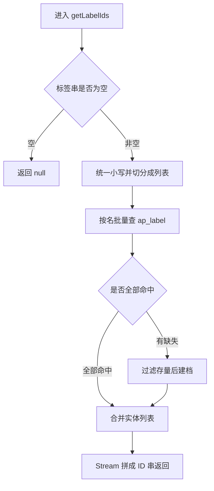

# 频道 Mapper 与标签查询服务：手写 XML 把标签串变成 ID 串

> 🔒 安全提示：文中示例的口令/密钥均为课程教学环境演示口径，生产环境的安全要求见《安全与合规须知》。

思路定了，落地时冒出来的是三个更具体的问题：Mapper 接口与 XML 文件怎么组织，批量查询的 SQL 怎么写，Service 里两个方法怎么接力才能把标签串变成 ID 串。这一讲把这三件事一次做完：先铺实体与 Mapper 家族，再写 XML 与批量查询，最后把 `getLabelIds` 的完整实现写出来。写完的东西下一讲直接进测试环节，那里还埋着一个真实的 bug 等着复现。

## 先给结论

- 实体两个：`ApLabel` 标签、`ApChannelLabel` 频道标签映射，放在 model 模块的后台 pojos 包；Mapper 接口收在 headline-crawler 模块的 `com.study.headline.crawler.mappers` 包，XML 放 `resources/mappers/crawler/` 目录。
- Mapper 家族的写法是「拷一份 CRUD 骨架再补业务方法」：增删改查六件套从既有模块照搬，业务方法只加按名批量查与按 ID 批量查两个。
- 手写 XML 有固定骨架：`namespace` 对准接口全名，`resultMap` 做列到属性的映射，`Base_Column_List` 收口列清单，`insertSelective` 用 `trim` 拼动态列。
- 按标签名批量查走 `where name in` 加 `foreach`，一条 SQL 带回全部命中行；新增标签靠 `useGeneratedKeys` 回填主键，否则 ID 串缺新标签那一截。
- `getLabelIds` 的链路是判空、统一小写、切分、批量查、过滤存量、缺失建档、Stream 拼 ID 串；查过的标签可以回填本地缓存，标签维度小、爬虫单机跑批，缓存收益直接。

## 实体与 Mapper 家族先摆开

两个实体对应上一讲的两张表。`ApLabel` 有 id、name、type、createdTime 四个字段，type 表达标签属性，爬虫补录的标签给固定值；`ApChannelLabel` 有 id、channelId、labelId、ord 四个字段，`ord` 是排序位，当前业务用不上但保留：

```java
package com.study.headline.model.admin.pojos;

import lombok.Data;
import java.util.Date;

/** 标签 */
@Data
public class ApLabel {
    private Integer id;
    private String name;
    private Boolean type;
    private Date createdTime;
}
```

```java
package com.study.headline.model.admin.pojos;

import lombok.Data;

/** 频道标签映射 */
@Data
public class ApChannelLabel {
    private Integer id;
    private Integer channelId;
    private Integer labelId;
    private Integer ord;
}
```

Mapper 接口按「拷贝骨架再补业务」的路子铺。CRUD 六件套的形态在工程的多个模块里已经反复出现过，直接照搬改掉实体类型，再补本课真正要用的两个查询方法：

```java
package com.study.headline.crawler.mappers;

import com.study.headline.model.admin.pojos.ApLabel;
import java.util.List;

public interface CrawlerLabelMapper {

    int deleteByPrimaryKey(Integer id);

    int insert(ApLabel record);

    int insertSelective(ApLabel record);

    ApLabel selectByPrimaryKey(Integer id);

    int updateByPrimaryKeySelective(ApLabel record);

    int updateByPrimaryKey(ApLabel record);

    /** 按标签名批量查询 */
    List<ApLabel> queryByLabelNames(List<String> labelNames);

    /** 按标签 ID 批量查询 */
    List<ApLabel> queryByLabelIds(List<String> labelIds);
}
```

```java
package com.study.headline.crawler.mappers;

import com.study.headline.model.admin.pojos.ApChannelLabel;

public interface CrawlerChannelLabelMapper {

    int insertSelective(ApChannelLabel record);

    ApChannelLabel selectByPrimaryKey(Integer id);

    /** 按标签 ID 查映射行 */
    ApChannelLabel selectByLabelId(Integer labelId);
}
```

同族还有两个 Mapper 在后两讲服务：`CrawlerChannelMapper` 管频道查询，按名称定位频道行、查 `status` 为 1 的默认频道；`CrawlerNewsMapper` 管 `cl_news` 台账，按 URL 定位文章行，频道映射算出的结果最终由它写进台账字段。接口与实体的摆位有一条理由：标签、频道这类维度数据是后台维护的资产，实体归 model 模块的后台 pojos 包，爬虫模块只是使用方；Mapper 接口是爬虫模块自己的数据访问代码，收在模块内的 mappers 包，不污染公共模块。

拷贝骨架不是偷懒，是工程惯例的延续。CRUD 六件套的签名在多个模块里已经反复校验过，参数顺序、返回值形态全部一致，新模块照搬可以保证同一套书写习惯贯穿全工程；业务方法只补真正需要的两个，接口保持小而准。删掉拷贝里用不上的方法还是全量保留，这里选了全量保留：基础操作在后续保存环节迟早用上，先留后用比用到再补少一次接口与 XML 的同步改动。

**接口只声明不实现，SQL 全部落在 XML。** 接口方法与 XML 语句靠 `namespace` 加语句 id 绑定，包名或语句名对不上，MyBatis 启动阶段就报绑定失败。课堂现场就因为 XML 里的实体包名写错排了一次错：`parameterType` 指向的 pojos 包与实体真实位置不一致，IDE 直接标红，改成真实包名后消失。这也是手写 XML 的第一守则：三处名字（接口包名、实体包名、语句 id）必须与工程一致，抄来的文件先改这三处再谈别的。

## XML 的固定骨架

一个 Mapper XML 的开头四件套是固定的，以 `CrawlerLabelMapper.xml` 为例：

```xml
<?xml version="1.0" encoding="UTF-8"?>
<!DOCTYPE mapper PUBLIC "-//mybatis.org//DTD Mapper 3.0//EN"
        "http://mybatis.org/dtd/mybatis-3-mapper.dtd">
<mapper namespace="com.study.headline.crawler.mappers.CrawlerLabelMapper">

    <resultMap id="BaseResultMap" type="com.study.headline.model.admin.pojos.ApLabel">
        <id column="id" property="id"/>
        <result column="name" property="name"/>
        <result column="type" property="type"/>
        <result column="created_time" property="createdTime"/>
    </resultMap>

    <sql id="Base_Column_List">
        id, name, type, created_time
    </sql>

    <select id="selectByPrimaryKey" resultMap="BaseResultMap" parameterType="java.lang.Integer">
        select
        <include refid="Base_Column_List"/>
        from ap_label
        where id = #{id}
    </select>
</mapper>
```

**resultMap 管「列名到属性名」的翻译。** 数据库列是 `created_time` 下划线风格，Java 属性是 `createdTime` 驼峰风格，`resultMap` 把两者对上，查询结果才能正确装进实体。列一多，这个映射的价值就显出来：SQL 里写列名，映射里写属性名，各归各的。

**Base_Column_List 管列清单的去重。** 列清单抽成 `<sql>` 片段，`select` 语句用 `<include>` 引用，改表结构时只动一处。这是手写 XML 里最不起眼却最防事故的一段：没有它，十个查询语句里列名改漏一处，运行时才报错。

**insertSelective 管动态列。** 它与 `insert` 的差别是只写非空字段，靠 `trim` 把列名与值两段各自拼起来，逗号尾巴用 `suffixOverrides` 削掉：

```xml
<insert id="insertSelective" parameterType="com.study.headline.model.admin.pojos.ApLabel"
        useGeneratedKeys="true" keyProperty="id">
    insert into ap_label
    <trim prefix="(" suffix=")" suffixOverrides=",">
        <if test="id != null">id,</if>
        <if test="name != null">name,</if>
        <if test="type != null">type,</if>
        <if test="createdTime != null">created_time,</if>
    </trim>
    <trim prefix="values (" suffix=")" suffixOverrides=",">
        <if test="id != null">#{id},</if>
        <if test="name != null">#{name},</if>
        <if test="type != null">#{type},</if>
        <if test="createdTime != null">#{createdTime},</if>
    </trim>
</insert>
```

开头两个属性是这一讲的关键增量：`useGeneratedKeys="true"` 让数据库自增主键回填，`keyProperty="id"` 指明回填到实体的哪个属性。标签建档后必须立刻拿到主键，ID 串才能拼上这个新标签，没有回填，返回串里就缺一截。`updateByPrimaryKeySelective` 与 `updateByPrimaryKey` 的关系同理：前者只更新非空字段，后者全量覆盖，按调用方的字段完整度选。

## 按标签名与标签 ID 批量查

两个业务查询方法只差一列，形态完全一致：

```xml
<select id="queryByLabelNames" resultMap="BaseResultMap" parameterType="list">
    select
    <include refid="Base_Column_List"/>
    from ap_label
    where name in
    <foreach item="item" index="index" collection="list" open="(" separator="," close=")">
        #{item}
    </foreach>
</select>

<select id="queryByLabelIds" resultMap="BaseResultMap" parameterType="list">
    select
    <include refid="Base_Column_List"/>
    from ap_label
    where id in
    <foreach item="item" index="index" collection="list" open="(" separator="," close=")">
        #{item}
    </foreach>
</select>
```

`foreach` 把传入集合摊开成 `(?, ?, ?)` 的占位序列，`open`、`separator`、`close` 三个属性分别管开头的左括号、项与项之间的逗号、结尾的右括号。占位符形式保留了预编译语义，外部传进来的标签名不会被当成 SQL 拼接执行，注入风险与转义问题一起挡掉。

**为什么一条 IN 而不是循环单查。** 一篇文章的标签通常两到五个，循环单查就是两到五次数据库往返，每次都要走一遍连接池取还与网络开销；IN 一条语句一次往返全部带回，还顺带保住了这批标签结果的整体性。爬虫是跑批任务，一天处理的文章量大，单篇省下的毫秒数乘上去就是可观的量。

中间表的查询方法 `selectByLabelId` 更简单，单条件单行返回，下一讲查频道时用它：

```xml
<select id="selectByLabelId" resultMap="BaseResultMap" parameterType="java.lang.Integer">
    select
    <include refid="Base_Column_List"/>
    from ap_channel_label
    where label_id = #{labelId}
    limit 1
</select>
```

`limit 1` 是防御性的：映射表设计上一个标签一行，但数据被人动过之后可能出现多行，取第一条并配合 `ord` 排序约定，行为仍然确定。

## Service 接口与实现骨架

Service 层两个方法，对应标签链路与频道链路各一段：

```java
package com.study.headline.crawler.service;

public interface CrawlerLabelService {

    /**
     * 按标签串查标签 ID 串，库里缺失的标签建档
     */
    String getLabelIds(String labels);

    /**
     * 按标签 ID 串查频道 ID，查不到默认 0 表示未归类
     */
    Integer getChannelIdByLabelIds(String labelIds);
}
```

实现类挂上 `@Service` 交给 Spring，`@Log4j2` 备好日志句柄，两个 Mapper 注入进来。`@SuppressWarnings("all")` 是课堂工程为压制 IDE 告警加的，属于工程取舍，生产代码更建议把告警范围收窄到确有依据的位置：

```java
package com.study.headline.crawler.service.impl;

@Service
@Log4j2
@SuppressWarnings("all")
public class CrawlerLabelServiceImpl implements CrawlerLabelService {

    @Autowired
    private CrawlerLabelMapper crawlerLabelMapper;

    @Autowired
    private CrawlerChannelLabelMapper crawlerChannelLabelMapper;

    @Override
    public String getLabelIds(String labels) {
        // 实现接在后面
        return null;
    }

    @Override
    public Integer getChannelIdByLabelIds(String labelIds) {
        // 下一讲展开
        return null;
    }
}
```

MyBatis 与 Spring 的整合由工程里的 starter 托管，Mapper 接口经扫描注册成代理 Bean，`@Autowired` 注入即可用，不需要手写 `SqlSession` 的开关。这套整合是数据保存环节能写得这么薄的前提：Service 只管业务编排，取连接、事务、会话生命周期都在框架层。

`getLabelIds` 的完整流程如下图：



关键路径在「有缺失」这一跳：查询与建档在同一次调用里完成，调用方拿到的 ID 串永远与传入标签串一一对应，不用关心哪些标签是新的。

## getLabelIds：从标签串到 ID 串

主方法按流程图逐段展开：

```java
@Override
public String getLabelIds(String labels) {
    long currentTimeMillis = System.currentTimeMillis();
    log.info("获取标签信息，标签: {}", labels);
    if (StringUtils.isBlank(labels)) {
        return null;
    }
    // 统一小写，避免 Java 与 java 被当成两条标签
    labels = labels.toLowerCase();
    // 切分成列表，建档环节要按项删除，重建为可变集合
    List<String> tmpLabels = new ArrayList<>(Arrays.asList(labels.split(",")));
    List<ApLabel> apLabelList = new ArrayList<>();
    // 按名批量查存量
    List<ApLabel> existList = crawlerLabelMapper.queryByLabelNames(tmpLabels);
    if (null != existList && !existList.isEmpty()) {
        apLabelList.addAll(existList);
        // 剔除已存在的，剩下的待保存
        tmpLabels = filterExists(tmpLabels, existList);
    }
    // 库里没有的标签建档
    if (null != tmpLabels && !tmpLabels.isEmpty()) {
        for (String label : tmpLabels) {
            apLabelList.add(saveLabel(label));
        }
    }
    // 实体列表转 ID 串
    String resultStr = apLabelList.stream()
            .map(label -> String.valueOf(label.getId()))
            .collect(Collectors.joining(","));
    log.info("获取标签信息完成，标签: {}, 返回: {}, 耗时: {}ms",
            labels, resultStr, System.currentTimeMillis() - currentTimeMillis);
    return resultStr;
}
```

**判空防线放在最前。** `StringUtils.isBlank` 把 null、空串、纯空格一起挡掉，这些入参在解析环节都可能产生：有的文章页就没有标签区。防线之后的所有逻辑不用再判空，方法主体保持干净。

**统一小写是标签一致性的第一道工序。** 外部站点的标签大小写随意，`Java`、`java`、`JAVA` 在标签语义上是同一个词，入库前统一转小写，标签表里就只有一行。这一步放在切分之前对整串做，切分后逐项处理反而多绕一圈。

**切分后立刻重建为可变集合。** `Arrays.asList` 返回的是定长列表， backing 数组不可伸缩，后面过滤环节要按项 `remove`，直接在它上面删会抛 `UnsupportedOperationException`。`new ArrayList<>(Arrays.asList(...))` 重建一份可变副本，删除操作才合法。这是个经典的集合陷阱，课堂代码里专门多写了这一行。

**返回串而不是集合。** 调用方是保存流程，它只把 ID 串透传进 `cl_news` 的标签字段，不做逐项处理，逗号分割的串正合适。`Collectors.joining` 在流式管道里一步完成拼接，省掉先收集成列表再转串的中间变量。

方法的对外契约由此固定：入参是逗号分割的标签名串，出参是逗号分割的标签 ID 串，顺序由合并顺序保证，存量在前、新建在后。保存流程对这个契约零感知，它不需要知道哪些标签是这一趟新建的，台账的标签字段照单全收。契约稳定之后，过滤与建档的实现怎么调整都不会波及调用方。

## 过滤存量与缺失建档

两个私有方法把「查回来的怎么合并」与「缺的怎么补」分开：

```java
/**
 * 过滤已存在的标签名，返回待保存部分
 */
private List<String> filterExists(List<String> tmpLabels, List<ApLabel> existList) {
    // 外层遍历不收缩的集合，内层对要删的集合按下标删
    for (ApLabel exist : existList) {
        for (int i = 0; i < tmpLabels.size(); i++) {
            // 切分项可能残留空格，用包含判断兜底
            if (tmpLabels.get(i).contains(exist.getName())) {
                tmpLabels.remove(i);
                break;
            }
        }
    }
    return tmpLabels;
}

/**
 * 单个标签建档，主键已回填进实体
 */
private ApLabel saveLabel(String label) {
    ApLabel apLabel = new ApLabel();
    apLabel.setName(label);
    apLabel.setType(true);
    apLabel.setCreatedTime(new Date());
    crawlerLabelMapper.insertSelective(apLabel);
    return apLabel;
}
```

**循环的方向有讲究。** 过滤要「边遍历边删除」，删除只发生在 `tmpLabels` 上。两个集合嵌套时，把不收缩的集合（已存在标签）放外层、要删的集合放内层，删除引发的下标位移只影响内层，且每命中一项立刻 `break`，不会漏比较。方向放反的后果下一讲的测试会现场演一遍：外层按下标推进、内层删除，删掉一项后紧跟其后的元素被跳过，该过滤的没过滤掉，建档时撞上标签名唯一索引。这里先立住原则：**谁收缩，谁进内层；外层只走不变的集合。**

**包含判断是对切分残留的兜底。** 标签串按逗号切分后，项里可能带着空格尾巴，`equals` 会因此失配，课程用 `contains` 做包含判断；更稳妥的做法是切分后逐项 `trim` 再比较，两种写法都成立，关键是要意识到这个残留的存在。

**建档三件套与主键回填。** 新标签填名字、置类型、记当前时间，`insertSelective` 入库。XML 上 `useGeneratedKeys` 与 `keyProperty` 已经配好，插入完成数据库生成的主键立刻回填进实体的 `id`，调用方拿到的实体直接可拼 ID 串。标签表上标签名建有唯一索引，重复插入会在数据库层被挡下，这是并发场景的最后一道防线。

## 首次查询与缓存思路

`getLabelIds` 的语义是「先查后补」：标签首次出现即在标签表建档，之后每次都是纯查询。它被调用的频率取决于文章量，而热门标签的重复率极高，一天下来同一个标签名可能被查上千次，这些查询绝大多数返回同一行。

在 Service 内加一层本地缓存可以把这部分查询吃掉：

```java
/** 标签名到实体的本地缓存，跑批进程内有效 */
private final Map<String, ApLabel> labelCache = new ConcurrentHashMap<>();

private ApLabel queryWithCache(String name) {
    ApLabel cached = labelCache.get(name);
    if (null != cached) {
        return cached;
    }
    List<ApLabel> list = crawlerLabelMapper.queryByLabelNames(
            Collections.singletonList(name));
    ApLabel result = (null != list && !list.isEmpty()) ? list.get(0) : null;
    if (null != result) {
        // 命中才回填，未命中的建档后由调用方补缓存
        labelCache.put(name, result);
    }
    return result;
}
```

缓存的适用边界要说清楚。爬虫是单机跑批进程，缓存生命周期与进程一致，标签又是几乎不变的小维度数据，本地缓存没有一致性负担。多实例部署时标签缓存也能容忍短暂不一致，最坏情况是某个实例多查一次库。缓存只做读加速，建档仍然走库，主键的唯一性由数据库兜底，缓存与库之间不会出现双向写入的纠缠。频道映射同理可以加一层「标签 ID 到频道 ID」的缓存，查频道比查标签更稳定，收益更高。

缓存键的选择还有一层考量。标签缓存以名字为键，建档完成后把新实体放进缓存，下一次同名词查询直接命中；频道映射缓存以标签 ID 为键，首次查询回填后，同 ID 的映射请求不再进库。两者都要防同一个坑：缓存里存的是对象引用，调用方直接改实体字段等于改了缓存对象，返回时最好转交副本，或者约定实体在缓存链路上只读。

## 常见误区

- **XML 三处名字抄完不改。** 错例是拷来的 XML 里 `namespace` 与 `parameterType` 还指着旧包名，启动时绑定失败或类型找不到。正解是拿到文件先改接口包名、实体包名、语句 id 三处，与工程对齐再运行。
- **在 `Arrays.asList` 的结果上直接删除。** 错例是 `labels.split(",")` 转出的列表直接进入过滤环节，`remove` 时抛 `UnsupportedOperationException`，因为它是定长列表。正解是先 `new ArrayList<>(...)` 重建可变副本。
- **新增建档忘了主键回填。** 错例是 `insert` 语句不配 `useGeneratedKeys`，保存成功但实体 `id` 还是 null，拼 ID 串时新标签那一截变成 `null` 字符串。正解是建档类插入统一配上主键回填。
- **过滤循环的方向放反。** 错例是外层按下标遍历要删的集合、内层做匹配删除，删一项后元素左移，紧跟其后的项被跳过，存量标签混进建档列表撞唯一索引。正解是外层走不变的集合，要收缩的集合放内层。
- **大小写不统一就入库。** 错例是标签串原样入库，`Java` 与 `java` 在表里两行并存，映射与统计口径全乱。正解是入库前统一转小写，配合标签名唯一索引双保险。

## 面试可能被问到的问题

1. 面试官追问：「foreach 拼 IN 为什么安全？字符串拼接 SQL 不行吗？」
   答：`foreach` 摊开的是 `#{}` 占位符，参数走 PreparedStatement 预编译，值与 SQL 结构分离，注入与转义问题一起解决。字符串拼接会把外部标签名直接写进 SQL，标签来自外部站点，内容完全不可控，等于把注入口开在明面上。
2. 面试官追问：「为什么手写 XML 而不用注解或者生成器？」
   答：XML 适合承载动态 SQL 与复杂查询，`trim`、`foreach`、`resultMap` 的表达能力在注解里写起来很别扭。CRUD 骨架可以拷贝生成，业务查询手写补充，SQL 留在 XML 里也便于 DBA 审查与统一管理，这是项目选择的手写风格。
3. 面试官追问：「insert 与 insertSelective 怎么选？」
   答：`insert` 全列写入，要求实体字段完整，省一次列清单的动态拼接；`insertSelective` 只写非空字段，适合字段残缺或需要沿用数据库默认值的场景。标签建档时主键交给数据库自增，走 `insertSelective` 更合适，配合 `useGeneratedKeys` 把主键回填到实体。
4. 面试官追问：「`Arrays.asList` 到底返回什么？有什么坑？」
   答：它返回定长列表，底层是原数组视图，`add`、`remove` 都会抛 `UnsupportedOperationException`。需要增删时用 `new ArrayList<>(Arrays.asList(...))` 重建可变副本，元素引用与原数组共享，改元素会互相影响，只读场景才直接用。
5. 面试官追问：「边遍历边删集合，正确姿势是什么？」
   答：单集合场景用 `Iterator` 的 `remove` 方法，它维护的是迭代器自己的游标，删除安全；双集合嵌套时把不收缩的集合放外层、要删的放内层，或者改用 `removeIf` 声明式删除。下标循环里边删边前进必然跳元素，位移补偿的写法可读性差，不建议。
6. 面试官追问：「标签映射加本地缓存，什么条件下才值得？」
   答：三个条件同时满足：数据几乎不变、读多写少、维度足够小能整个放进内存。标签与频道映射正好符合，爬虫单机跑批时缓存与进程同生命周期，没有跨实例一致性负担；写操作仍走库并由数据库唯一索引兜底，缓存只做读加速，失效策略用定时刷新或简单 TTL 就够。

## 配套资料

- 代码：`materials/code/05/头条day09/` 资料目录为空，实体、Mapper 与 Service 均按画面线整理、方法骨架与 SQL 按本课写法补全（引用路径截至 `头条dayNN/` 层级，内层目录名含项目原名，不进入正文）；示例站点一律以 example.com 占位。
- 参照：`materials/code/05/头条day01/`，数据库规范设计说明书，`ap_label` 标签名唯一索引的 `uk_` 前缀命名与字段注释口径出自它。
- 参照：`materials/code/05/头条day07/` 的 Kafka 封装工具类，可对照感受模块内工具类与 Mapper 一样按包分层组织的风格。
- 环境：课程集群 node01~node03，MySQL root/123456；运行示例前先确认标签表与映射表已建、MyBatis 扫描路径包含 `com.study.headline.crawler.mappers`。
