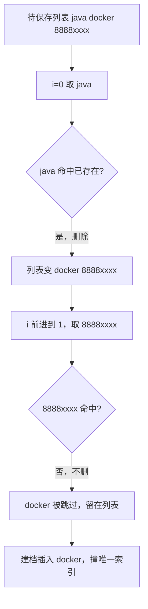

# 标签与频道查询测试：一次跳元素 bug 的完整复盘

> 🔒 安全提示：文中示例的口令/密钥均为课程教学环境演示口径，生产环境的安全要求见《安全与合规须知》。

代码写完只是半成品，测试一跑就见分晓。标签查询服务第一次执行就撞上数据库唯一索引，排查与修复的过程比写代码本身长得多，也值钱得多：它把集合边遍历边删的坑、唯一索引的防线价值、调试器逐帧看值的手段一次讲全。这一讲把标签查询测通、把频道查询写完并测通，最后补上频道归属的完整兜底链。

## 先给结论

- 测试类两件套起环境：`@RunWith(SpringRunner.class)` 让 JUnit 走 Spring 的测试执行器，`@SpringBootTest` 拉起完整应用上下文，`@Autowired` 注入被测 Service，测试跑的是真实数据库。
- 标签测试第一跑就撞标签名唯一索引：过滤循环方向放反，删一项后元素左移，紧跟其后的存量标签被跳过，混进建档列表重复插入。
- 修复口诀是把不收缩的集合放外层：外层遍历已存在标签，内层按下标删待保存列表，命中一项立即 `break`；修复后调试器里待保存列表从 3 项变 1 项，行为正确。
- 频道查询 `getChannelIdByLabelIds` 默认取第一个标签映射出的频道，查不到给 0 表示未归类；测试把映射表里的频道 ID 改成 1122 再跑，返回值跟着变，证明链路走的就是这张表。
- 兜底链完整口径分四级：作者自频道按名查 `ap_user_channel` 优先，其次标签映射，再兜底 `ap_channel.status` 标记的默认频道，最终 0 未归类。

## 测试类怎么搭

测试类放在爬虫工程的 test 目录下，与被测 Service 同包。两件套注解是 Spring Boot 测试的固定开局：

```java
package com.study.headline.crawler.service;

import org.junit.Test;
import org.junit.runner.RunWith;
import org.springframework.beans.factory.annotation.Autowired;
import org.springframework.boot.test.context.SpringBootTest;
import org.springframework.test.context.junit4.SpringRunner;

@SpringBootTest
@RunWith(SpringRunner.class)
public class CrawlerLabelServiceTest {

    @Autowired
    private CrawlerLabelService crawlerLabelService;

    @Test
    public void testGetLabelIds() {
        String labelIds = crawlerLabelService.getLabelIds("java,docker,8888xxxx");
        System.out.println(labelIds);
    }
}
```

`@RunWith(SpringRunner.class)` 换掉 JUnit 默认的执行器，让测试类的注解由 Spring 解析；`@SpringBootTest` 负责把整个应用上下文拉起来，数据源、MyBatis、组件扫描全部就位。缺了后一个，`@Autowired` 的字段注入进来是 null，测试方法一调用就是空指针，这是写测试最常见的开局失败。

测试参数是精心挑过的：`java` 与 `docker` 是库里已有的存量标签，`8888xxxx` 是库中不存在的全新标签。一次调用同时覆盖三条路径，两个命中、一个建档，返回的 ID 串里前两个 ID 来自存量行，第三个 ID 来自新建档并回填的主键。挑参数先想清楚要覆盖的路径，测试才不是走过场。

跑测试前确认 MySQL 已启动、数据源配置指向目标库，测试走的是真实数据库，连不上库时上下文直接启动失败。这类测试属于集成测试范畴，慢在环境启动，值在真实链路。

第一次执行会明显偏慢，控制台先滚过一大段 Spring 上下文与连接池初始化日志，这不是卡住：容器装配、数据源建连、Mapper 扫描注册都发生在这一次。理解这一点能省掉很多误判，慢是集成测试的一次性成本，同一个测试类里上下文是复用的，后续用例明显变快。

## 第一跑就撞唯一索引

执行测试，没等到打印结果，先收到数据库报错：`docker` 这个标签名违反唯一索引，插入被拒绝。现象与预期完全对不上：`docker` 明明在库里，按流程应该在过滤环节被剔除，怎么会进了建档列表。

带着问题进调试器。断点打在过滤方法入口，看到的值是：待保存列表 3 项 `java`、`docker`、`8888xxxx`，已存在列表 2 项 `docker`、`java`。单步往下走，问题浮出水面：



出错的写法外层按下标遍历待保存列表、内层遍历已存在标签，命中就 `remove(i)`。`i=0` 时取到 `java`，命中删除，`docker` 从下标 1 左移到 0；循环变量加一，`i=1` 取到的已经是 `8888xxxx`，`docker` 再没被比较过。删除引发的下标位移把一个元素偷走了，这就是跳元素。被跳过的 `docker` 留在待保存列表里，走到建档环节对同一个名字重复插入，唯一索引把它拦下。

排查的路径值得复述一遍。报错先指向插入语句，直觉上会怀疑 SQL 写错，检查后发现插入本身没有任何问题，问题在于它根本不该被执行。顺着调用链往回走，唯一执行插入的地方是建档方法，建档的前提是过滤后仍有剩余，焦点于是移到过滤方法。表设计这时提供关键证据：标签名的唯一索引确凿存在，重复插入在数据库层必被拒绝，应用层漏过滤成了唯一解释。

日志在这次排查里也出了力。进入与完成两条日志带着入参，完成日志没有出现，说明流程在中间断了，断点位置与日志缺口互相印证，方向很快收敛。写日志时多打一个入参，出问题时就少猜一分钟。

**唯一索引在这一局里是功臣。** 应用层的过滤逻辑漏了，数据库层的唯一索引把错误显性化，测试当场红掉。假如没有这条索引，`docker` 会被静默插成两行，标签 ID 出现两个值，映射关系从此分裂，问题要拖到统计或查询异常才暴露。建表时给标签名加唯一索引，正是把这类错误从线上拉回开发阶段的手段。

## 循环换位：修复与验证

修复不动数据结构，只换循环的站位：把不收缩的集合放外层，要收缩的集合放内层。

```java
/**
 * 过滤已存在的标签名：外层走不变的集合，内层收缩待保存列表
 */
private List<String> filterExists(List<String> tmpLabels, List<ApLabel> existList) {
    for (ApLabel exist : existList) {
        for (int i = 0; i < tmpLabels.size(); i++) {
            if (tmpLabels.get(i).contains(exist.getName())) {
                tmpLabels.remove(i);
                // 命中一项就换下一个已存在标签，避免同项被重复处理
                break;
            }
        }
    }
    return tmpLabels;
}
```

外层每轮处理一个已存在标签，内层在待保存列表里找它，找到删掉立即 `break`。删除确实会让内层元素左移，但外层的比较对象只与「下一个已存在标签」有关，内层下一轮从头按下标找，位移不会偷走任何比较机会。切分项可能残留空格，比较沿用 `contains` 做包含判断兜底，更稳妥的写法是切分后逐项 `trim` 再用 `equals`。

再进调试器验证：待保存列表初始 3 项，`docker` 命中删除后剩 2 项，`java` 命中删除后剩 1 项，最终只剩 `8888xxxx` 进入建档。放行跑完，控制台打出的 ID 串形如 `21,29,106`：前两个 ID 对应 `java` 与 `docker` 的存量行，第三个 ID 是这次新建档的 `8888xxxx`，而且它能出现在串里，说明上一讲配置的主键回填确实生效，建档完成实体上立刻有了数据库生成的主键。

原则收拢成一句：**谁收缩，谁进内层；外层只走不变的集合。** 单集合场景还有更声明式的 `removeIf` 与迭代器的 `remove`，双集合过滤里按站位原则写嵌套循环，逻辑最直观。

## 查频道信息：从 ID 串到频道 ID

标签链路通了，接口的第二个方法补上实现。入参是标签 ID 串，出参是频道 ID，默认 0 表示未归类：

```java
@Override
public Integer getChannelIdByLabelIds(String labelIds) {
    long currentTimeMillis = System.currentTimeMillis();
    log.info("获取频道信息，标签 ids: {}", labelIds);
    // 默认 0：未归类
    Integer channelId = 0;
    try {
        if (StringUtils.isNotBlank(labelIds)) {
            List<String> labelList = Arrays.asList(labelIds.split(","));
            // 按标签 ID 批量查回实体
            List<ApLabel> apLabelList = crawlerLabelMapper.queryByLabelIds(labelList);
            if (null != apLabelList && !apLabelList.isEmpty()) {
                // 多个标签只归一个频道，默认取第一个
                channelId = getChannelIdByLabelId(apLabelList.get(0).getId());
            }
        }
    } catch (Exception e) {
        log.error("获取频道信息失败，{}", e.getMessage());
        return null;
    }
    log.info("获取频道信息完成，标签 ids: {}, channelId: {}, 耗时: {}ms",
            labelIds, channelId, System.currentTimeMillis() - currentTimeMillis);
    return channelId;
}

/**
 * 按单个标签 ID 查频道 ID，走标签频道映射表
 */
private Integer getChannelIdByLabelId(Integer labelId) {
    Integer channelId = 0;
    ApChannelLabel apChannelLabel =
            crawlerChannelLabelMapper.selectByLabelId(labelId);
    if (null != apChannelLabel) {
        channelId = apChannelLabel.getChannelId();
    }
    return channelId;
}
```

主方法的结构与 `getLabelIds` 同构：入口日志与计时、判空防线、批量查、取值、出口日志带耗时。两个值得展开的点：

**取第一个是产品口径，不是随手为之。** 批量查回的标签列表可能有多项，映射出的频道候选也有多个，但一篇文章只归一个频道，约定取第一个。第一个是 `queryByLabelIds` 结果集的第一行，顺序由查询保证稳定，测试环节会专门锁住这个行为。产品口径落到代码上就是一个 `get(0)`，真正的功夫在把口径写进注释、写进测试，让后来者不敢乱动。

入参是 ID 串，为什么还要查一次标签表？串里只有 ID，频道映射要的是标签实体，`queryByLabelIds` 把 ID 还原成实体列表，顺带校验了这些 ID 在库里真实存在。已被删除或凭空构造的 ID 在这一步自然消失，映射查询拿不到空引用，`get(0)` 的空列表防御也由非空判断一并兜住。

**异常在这里被吃掉是有意设计。** `catch` 里记错误日志后返回 null，而不是把异常往上抛。调用方是保存流程，一篇文章的频道映射失败不该中断整批文章的保存，返回 null 后由调用方按兜底链处理。吃掉异常的前提是错误日志必须留全，入参、错误信息都在日志里，事后能定位；只 `return null` 不记日志的做法，出了问题连排查入口都找不到。

## 频道查询测试与兜底链

频道查询的测试方法沿用同一套骨架，方法名与被测方法对齐：

```java
@Test
public void testGetChannelIdByLabelIds() {
    Integer channelId = crawlerLabelService.getChannelIdByLabelIds("1,2");
    System.out.println(channelId);
}
```

入参传 `1,2` 两个标签 ID，库里这两个标签的映射都指向频道 1，执行结果打印 1，验证了「默认取第一个」。验证只到这里还不够，还要证明返回值真的来自映射表查询，而不是巧合。把映射表里该行的 `channel_id` 从 1 改成 1122，重跑测试，打印变成 1122，链路确凿；再把数据改回 1 恢复原状。改库验证是确认数据链路最直接的手段，但有一条例要守：**测试动过的数据要还原**，否则下一次测试的口径就漂了，`1122` 变成了新基准。

1122 这个数本身没有业务含义，它是随手挑的、与库里现值都不同的数，这一点恰好让它成为好探针：返回值从 1 变成 1122，只能是查询结果变了，任何缓存或巧合都解释不了。改数据、跑测试、看返回、还原，四步闭环，这种探针式验证在确认数据链路时比单纯的断言更有说服力。

到这一步，day09 实测覆盖的是兜底链的中间两级：标签映射与 0 未归类。完整口径还有两级，代码骨架如下（示例按保存流程口径补全）：

```xml
<select id="selectByName" resultMap="BaseResultMap" parameterType="java.lang.String">
    select
    <include refid="Base_Column_List"/>
    from ap_user_channel
    where name = #{name}
    limit 1
</select>
```

```xml
<select id="selectDefault" resultMap="BaseResultMap">
    select
    <include refid="Base_Column_List"/>
    from ap_channel
    where status = 1
    limit 1
</select>
```

```java
/**
 * 频道归属完整判定链示例，按保存流程口径补全
 */
private Integer resolveChannel(String labels, String channelName) {
    // 自频道优先：作者建有同名自频道直接挂
    ApUserChannel userChannel = crawlerUserChannelMapper.selectByName(channelName);
    if (null != userChannel) {
        return userChannel.getChannelId();
    }
    // 标签映射：取第一个标签映射出的频道
    Integer channelId = getChannelIdByLabelIds(labels);
    if (null != channelId && channelId > 0) {
        return channelId;
    }
    // 默认频道兜底，仍落空则 0 未归类
    ApChannel defaultChannel = crawlerChannelMapper.selectDefault();
    return null == defaultChannel ? 0 : defaultChannel.getId();
}
```

四级各管一段：自频道服务作者在平台建有频道的内容，按频道名冗余列直接查询；标签映射服务公共链路，是这一讲实测过的主干；默认频道由 `ap_channel.status` 为 1 的行承担，服务映射全部落空的冷门标签文章；0 是最后一级，语义是未归类，文章照常入库，归类问题留给运营修正。兜底链的每一级都有明确语义，返回 0 就不是异常，调用方不必为它做特殊处理。

## day09 的收口

到这一讲，day09 的内容全部落地：Mapper 家族建档、标签查询与建档、频道映射与兜底都经过测试验证，`cl_news` 台账的频道字段有了可依赖的取值来源。IP 代理池的笔记按课程安排整体挪到下一天，day10 从它的需求分析与实体定义开讲，数据保存的完整链路在下一节里闭环。

## 常见误区

- **测试类缺 `@SpringBootTest`。** 错例是只加了 `@RunWith(SpringRunner.class)`，上下文没起来，注入的 Service 是 null，一调用就空指针。正解是两件套配齐，让容器把数据源与 Mapper 全部装配好。
- **测试改库不还原。** 错例是改完 `channel_id` 验证完顺手关掉工具，下次测试拿 `1122` 当基准，结果全乱。正解是改库验证后立即还原，测试数据变更要么回滚要么写清口径。
- **把 channelId 为 0 当异常处理。** 错例是返回 0 就抛错或重试，把合法兜底值当成故障。正解是 0 表示未归类，属于正常分支；异常只有查询链路本身出错一种，走错误日志加返回 null。
- **`catch` 里只返回 null 不留日志。** 错例是异常被吞，调用方拿 null 走了兜底，表象是「都没归到频道」，根因查不到。正解是错误日志带上入参与异常信息，兜底可以，沉默不行。

## 面试可能被问到的问题

1. 面试官追问：「`@RunWith(SpringRunner.class)` 和 `@SpringBootTest` 各自做什么？」
   答：前者换掉 JUnit 默认执行器，让测试类的注解交给 Spring 测试框架解析；后者拉起完整应用上下文，按测试环境配置装配数据源、MyBatis 与各组件。两个都用，测试类里 `@Autowired` 注入的才是真实 Bean，注入失败时优先检查 `@SpringBootTest` 是否遗漏。
2. 面试官追问：「集合边遍历边删，有几种正确写法？」
   答：三种。单集合用 `Iterator` 的 `remove`，游标由迭代器维护，删除安全；条件明确时用 `removeIf` 声明式过滤；双集合嵌套过滤时把不收缩的集合放外层、要删的放内层并命中即跳出。下标循环里边删边前进必然跳元素，删一项后元素左移，紧跟其后的项被绕过。
3. 面试官追问：「为什么频道默认取第一个标签的映射？」
   答：多个标签会映射出多个候选频道，产品口径是一篇文章只归一个频道，避免频道页重复曝光与统计重复计数。取第一个要求查询结果顺序稳定，`queryByLabelIds` 的结果顺序由 SQL 保证，这个约定用测试锁住：入参传两个标签，断言返回的是第一个标签的频道。
4. 面试官追问：「频道查不到时，为什么不直接报错而要兜底？」
   答：频道映射的落空是数据问题不是程序故障，冷门标签没有映射行很正常。兜底链逐级消化：自频道、默认频道、最终 0 未归类，文章照常保存，归类修正留给运营。程序故障是另一回事，查询链路本身出错才走异常路径，记错误日志返回 null。
5. 面试官追问：「这种写真实数据库的集成测试，数据怎么管理？」
   答：测试指向专用测试库，不碰生产库；用例自备数据，参数挑成能覆盖命中、缺失、建档各路径的组合；用例动过的共享数据要还原，或者把用例包在事务里测试完回滚；断言不能只靠打印，关键返回值要有明确预期。环境启动慢是这类测试的代价，换来的是真实链路验证。
6. 面试官追问：「catch 之后返回 null，调用方要怎么配合？」
   答：返回值语义要先定清楚，null 表示链路故障、0 表示未归类，两回事。调用方拿到 null 不做业务处理而是按兜底口径走默认值，同时监控侧关注错误日志的量，null 突增说明查询链路出问题。吃异常可以，前提是日志完整且有监控兜住。

## 配套资料

- 代码：`materials/code/05/头条day09/` 资料目录为空，测试类、频道查询与兜底链均按画面线整理、按本课写法补全（引用路径截至 `头条dayNN/` 层级，内层目录名含项目原名，不进入正文）；示例站点一律以 example.com 占位。
- 参照：`materials/code/05/头条day01/`，数据库规范设计说明书，标签名唯一索引、映射表普通索引的命名口径与 `is_xxx` 字段约定出自它。
- 环境：课程集群 node01~node03，MySQL root/123456；跑测试前确认 MySQL 已启动、数据源指向目标库，改库验证后记得还原数据。
