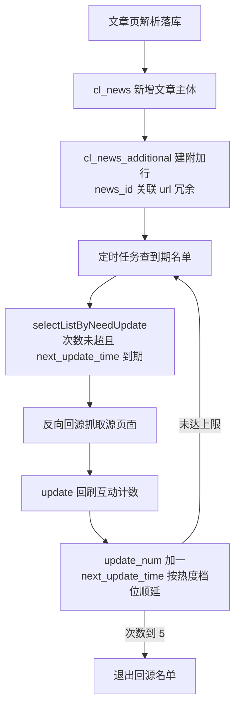
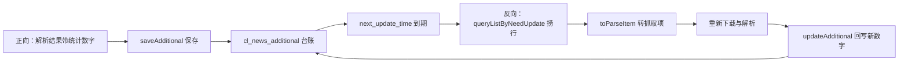
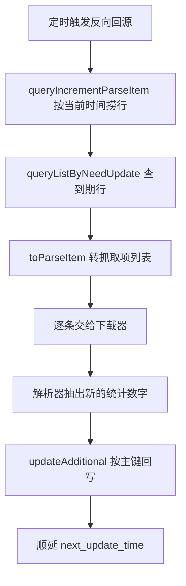
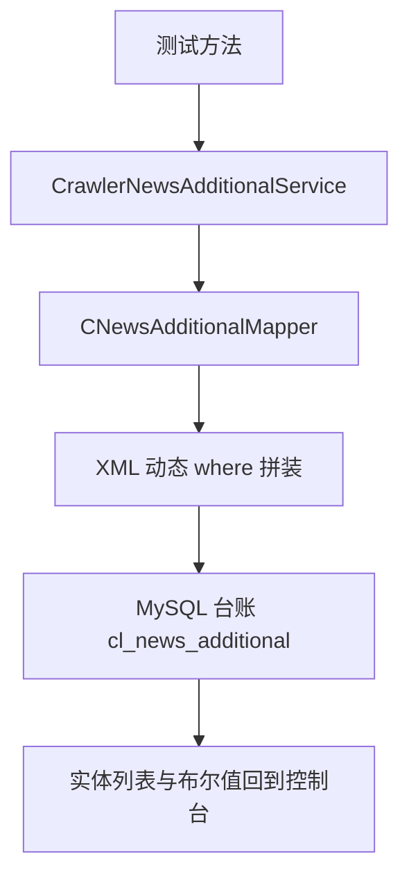
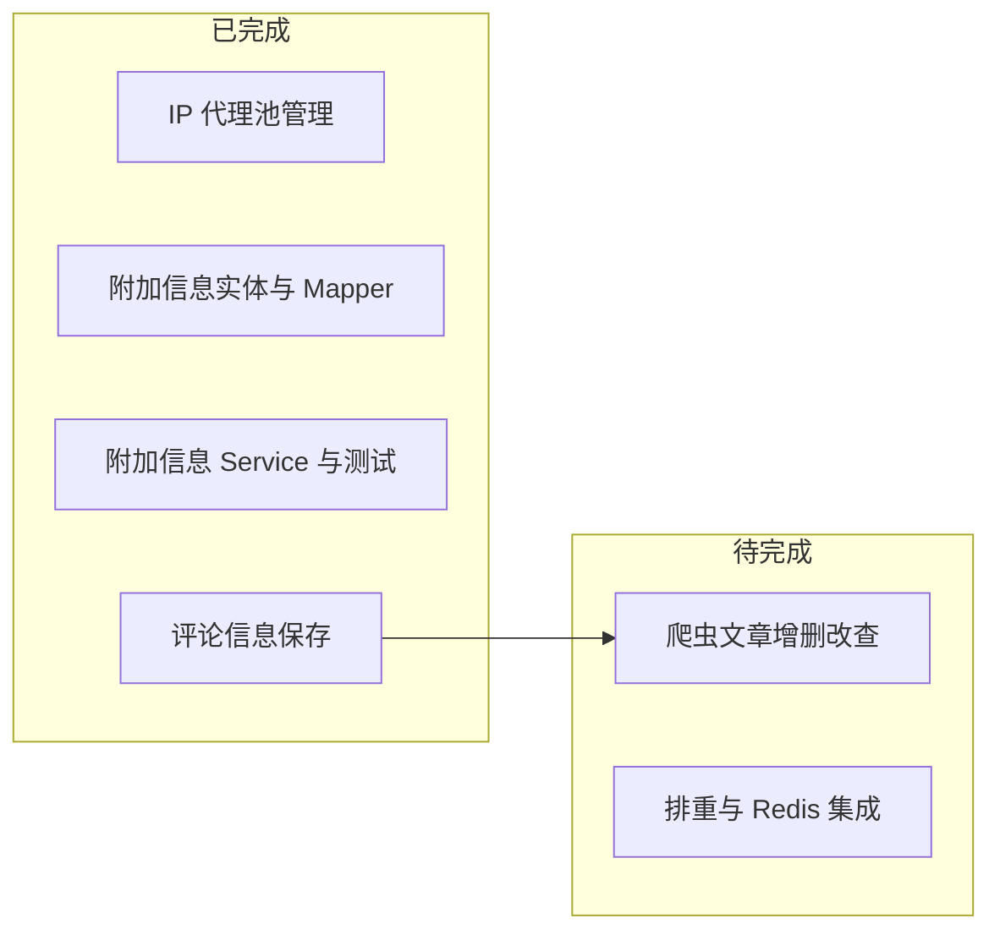
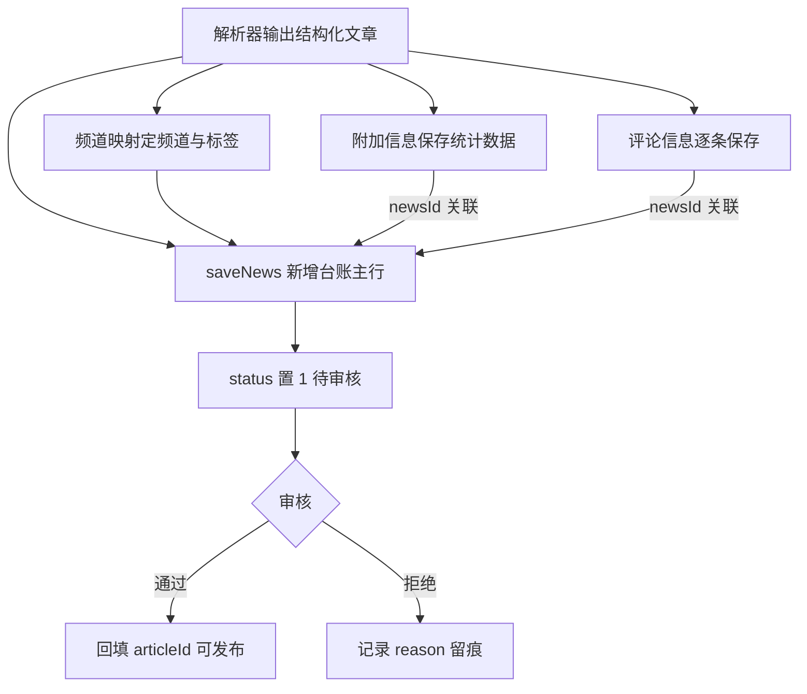

# 数据保存准备之爬虫文章：附加信息、评论与台账读写通道就位

> 🔒 安全提示：文中示例的口令/密钥均为课程教学环境演示口径，生产环境的安全要求见《安全与合规须知》。

## 先给结论

- 爬虫文章的来源是外部内容站，正文落库后故事没结束：源站的点赞阅读数是活的，系统里的数停在抓取那一刻就是假数据，靠反向爬取按周期回源更新。
- 反向回刷的落点是单独的附加信息表：cl_news 存基本不变的标题正文，cl_news_additional 存持续变化的阅读、点赞、评论、转发、不喜欢、收藏，回刷只打附加表。
- 回源名单由两个条件圈定：update_num 小于 5 限次止损，next_update_time 到期按阶梯周期放行，一条 SQL 捞出全部待更新行。
- 附加信息 Service 八个方法同时伺候两个方向：正向流程往里写，反向流程从里读；toParseItem 是反向回源的种子工厂，台账行里冗余的 url 单独就能还原出一个抓取项。
- 测试把查询与存在性判断两条链路验掉：checkExist 是数据库层的存在性兜底，与后面的 Redis 前置排重分工不同。
- 评论模块是最轻的一环：实体六个字段、Mapper 六件套加 XML 动态插入、Service 单方法，insertSelective 收口。
- 最后一块是文章本体 cl_news 台账：CNews 实体五组字段铺完一篇文章的一生，爬取入库 status 直接置 1 待审核，articleId 等审核通过后回填，爬虫库与 App 库之间隔着一道审核闸。
- 删除按 URL 而不是主键：URL 是台账的业务键，正向防重与反向回源都靠它定位一行；Service 四个方法全部透传，复杂度都攒在后续的解析保存编排里。

## 第1部分：数据保存准备_爬虫文章图文附加信息_需求分析及mapper定义

爬虫文章的来源是外部内容站，正文落库之后故事并没有结束。源站上的数据是活的：抓来时点赞是 100，第二天源站已经涨到 200，系统里的数要是停在 100，推荐与展示拿到的就是假数据。让系统跟上源站靠的是反向爬取，按周期回到源页面重新解析，把新的互动数更新到库里。更新的落点不能是文章主表，需要单独一张附加信息表，这一讲把它的需求、表结构、实体与 Mapper 铺平，反向流程的代码在后面的课里落到这张表上。

### 需求：点赞数是活的

课件对附加信息的存在理由一句话点透：爬虫文章的点赞、转发、评论这类数据方便后期追踪，需要反向爬取来更新。App 端的文章有两个来源，自媒体与爬虫，自媒体的数据在自己的库里天然新鲜，爬虫文章的互动数据却留在源站上。反向爬取只抓点赞、转发、评论这几个变化的维度，解析完更新到库里，主流程不重走。

**回刷为什么不能打在 `cl_news` 上。** 主表的字段群是一次落库基本不变的：标题、正文、作者、频道，写入一次长期稳定；互动数据则是高频小更新的反复写。两类写入混在一张表，反向流程的 update 语句要在主表上精准绕开标题与正文，稍有不慎就把好数据覆盖掉。分表之后，反向流程的全部写动作都关在附加表里，主表只进不出，风险面一下子收窄。读写频率不同、更新主体不同、出错影响面不同，三条理由合起来，分表是必然选择。

表、主表与回源循环的关系画成一张图：



图的右半边是回源循环：定时任务按两个条件捞出到期名单，回源抓取后回刷计数，次数与下次时间同步推进，次数到上限的行退出循环，不再消耗请求额度。左半边是写入起点：文章主体与附加行在一次保存里先后落库，`news_id` 把两行锁在一起。

### 表结构：四组字段各管一段

建表语句按画面线整理（day10 资料包未随带脚本，DDL 按本课写法补全）：

```sql
CREATE TABLE `cl_news_additional` (
  `id` int(11) unsigned NOT NULL AUTO_INCREMENT COMMENT '主键',
  `news_id` int(11) unsigned NOT NULL COMMENT '文章ID，关联 cl_news 主键',
  `url` varchar(512) DEFAULT NULL COMMENT '原文地址，冗余便于回源',
  `read_count` int(11) DEFAULT '0' COMMENT '阅读量',
  `likes` int(11) DEFAULT '0' COMMENT '点赞数',
  `comment` int(11) DEFAULT '0' COMMENT '评论数',
  `forward` int(11) DEFAULT '0' COMMENT '转发数',
  `unlikes` int(11) DEFAULT '0' COMMENT '不喜欢数',
  `collection` int(11) DEFAULT '0' COMMENT '收藏数',
  `update_num` int(11) DEFAULT '0' COMMENT '已回源更新次数',
  `updated_time` datetime DEFAULT NULL COMMENT '最近更新时间',
  `next_update_time` datetime DEFAULT NULL COMMENT '下次更新时间',
  `created_time` datetime DEFAULT NULL COMMENT '创建时间',
  PRIMARY KEY (`id`),
  KEY `idx_news_id` (`news_id`)
) ENGINE=InnoDB DEFAULT CHARSET=utf8mb4 COMMENT='爬虫文章附加信息表';
```

**身份组**三个字段决定这行附加数据是谁的。`news_id` 关联 `cl_news` 主键，类型与主表保持绝对一致，这是联表与索引生效的前提，配上 `idx_news_id` 让反向更新按文章定位时走索引；`url` 冗余原文地址，回源时直接取用不用回联主表，这正是规范里「不频繁修改的短字段允许冗余」的落地，源地址一次落库基本不变，符合冗余条件。

**计数组**六个字段是反向回刷的主角：阅读、点赞、评论、转发、不喜欢、收藏，全部 int 配默认 0，注释逐个写清。它们只被回源流程批量更新，App 端读文章时按 `news_id` 联表取用。**调度组**两个字段是反向流程的节拍器：`update_num` 记录已经回源过多少次，`next_update_time` 记录下次该回源的时间。需求分析里定下的阶梯更新周期 `crawler.nextupdatehours=4,16,64,128,256` 就落在这两个字段上：热度高的文章回源后顺延的间隔短，冷门的拉长，更新预算按价值分配。`updated_time` 与 `created_time` 记录行自身的新旧，配套而已。

### 实体与 Mapper：家底写法再走一遍

```java
package com.study.headline.model.crawler.pojos;

import lombok.Data;
import java.util.Date;

/** 爬虫文章附加信息，与 cl_news_additional 表列一一对应 */
@Data
public class ClNewsAdditional {
    private Integer id;
    /** 文章 ID，关联 cl_news 主键 */
    private Integer newsId;
    /** 原文地址 */
    private String url;
    /** 阅读量 */
    private Integer readCount;
    /** 点赞数 */
    private Integer likes;
    /** 评论数 */
    private Integer comment;
    /** 转发数 */
    private Integer forward;
    /** 不喜欢数 */
    private Integer unlikes;
    /** 收藏数 */
    private Integer collection;
    /** 已回源更新次数 */
    private Integer updateNum;
    /** 最近更新时间 */
    private Date updatedTime;
    /** 下次更新时间 */
    private Date nextUpdateTime;
    /** 创建时间 */
    private Date createdTime;
}
```

```java
package com.study.headline.crawler.mappers;

import com.study.headline.model.crawler.pojos.ClNewsAdditional;
import java.util.Date;
import java.util.List;

public interface ClNewsAdditionalMapper {

    int deleteByPrimaryKey(Integer id);

    int insert(ClNewsAdditional record);

    int insertSelective(ClNewsAdditional record);

    ClNewsAdditional selectByPrimaryKey(Integer id);

    int updateByPrimaryKeySelective(ClNewsAdditional record);

    int updateByPrimaryKey(ClNewsAdditional record);

    /** 按条件对象查询 */
    List<ClNewsAdditional> selectList(ClNewsAdditional record);

    /** 查出到期需要回源更新的行 */
    List<ClNewsAdditional> selectListByNeedUpdate(Date currentDate);
}
```

接口前六个方法是家底 CRUD，与代理池的 Mapper 同构；两个业务查询里，`selectList` 按条件对象查，`selectListByNeedUpdate` 按当前时间查到期名单，参数只需要一个 Date。XML 从模板拷来后，老规矩三处名字先对齐：`namespace` 对准接口全名，`parameterType` 对准实体真实包名，语句 id 与方法名一一对应，包名对不上 MyBatis 启动阶段就报绑定失败。

对齐名字之后还有一步：**字段以表为准逐列核对。** 拷来的 resultMap 多一列少一列，查询轻则字段装不进实体，重则直接报列不存在；表结构有调整时，实体、resultMap、列清单三处同步更新。这条要求课件里专门强调过：字段说不全的时候以表为准，实体缺了属性就补上。

### XML：到期名单一条 SQL

```xml
<resultMap id="BaseResultMap" type="com.study.headline.model.crawler.pojos.ClNewsAdditional">
    <id column="id" property="id"/>
    <result column="news_id" property="newsId"/>
    <result column="url" property="url"/>
    <result column="read_count" property="readCount"/>
    <result column="likes" property="likes"/>
    <result column="comment" property="comment"/>
    <result column="forward" property="forward"/>
    <result column="unlikes" property="unlikes"/>
    <result column="collection" property="collection"/>
    <result column="update_num" property="updateNum"/>
    <result column="updated_time" property="updatedTime"/>
    <result column="next_update_time" property="nextUpdateTime"/>
    <result column="created_time" property="createdTime"/>
</resultMap>

<select id="selectListByNeedUpdate" resultMap="BaseResultMap" parameterType="java.util.Date">
    select
    <include refid="Base_Column_List"/>
    from cl_news_additional
    <where>
        <![CDATA[
        and update_num < 5
        and next_update_time <= #{currentDate}
        ]]>
    </where>
</select>
```

两个条件的语义分开看。`update_num < 5` 是止损线：外部页面随时可能改版，某篇文章的源页一旦失效，无限回源只会白白烧请求额度还拖慢批次；限五次之后自动退出名单，把额度让给还活着的页面。`next_update_time <= 当前时间` 是放行线：没到点的行再热门也不动，到点的行一次捞齐，定时任务不用逐条判断。两个比较符都包在 `CDATA` 里，小于号在 XML 里是标签字符，不包会被解析器误读。

参数只有一个 Date 也说得通：名单的圈定与文章是谁无关，时间到了、次数没超，就该进名单。这个查询是反向流程的入口，后面的课里解析出的新互动数会由更新语句写回这些行，同时推进 `update_num` 与 `next_update_time`，循环在两个条件之间收敛。

## 第2部分：数据保存准备_爬虫文章图文附加信息_service接口定义

Mapper 铺完只说明「能读写」，Service 层要回答的是「读写来做什么」。图文附加信息这张表在爬虫工程里位置特殊：正向流程往里写，反向流程从里读，一个类要同时伺候两个方向。附加信息的实体与 Mapper 已按前一讲的口径备好，这一讲把 Service 的接口与实现一次写全。八个方法，每一个都有明确的调用主顾，到整合解析保存的那天全部派上用场。

### 台账长什么样：会过期的统计数据

图文附加信息表 `cl_news_additional` 存的是文章页上的统计数字：阅读数、点赞数、评论数、转发数、踩数、收藏数。这些数字有一个共同点，全都随时间变化，今天的快照明天就过期。所以这张表不只是结果台账，还是反向流程的调度依据：每一行带着 `created_time`、`updated_time` 与 `next_update_time` 三个时间字段（`count` 按画面线口径记录统计刷新的轮次），`next_update_time` 到期的行就是反向流程该回源的对象。

行与文章主记录的关联有两条线索。`news_id` 指向 `cl_news` 台账主行，是正规的外键式关联；`url` 是文章链接的冗余列，看着重复，实际上是反向流程的生命线：回源时只需要知道「去哪个地址重新抓」，转换方法仅凭这一列就能把台账行还原成抓取项，一次联表都省掉。冗余在这里不是偷懒，是按访问路径设计的数据摆放。

**统计数字为什么单独一张表，不直接塞进文章主表。** 两边的变化节奏完全不同。标题、正文、频道这些主表字段抓一次就基本定型，生命周期以天计；阅读数与评论数每小时都在动，生命周期以分钟计。混在一张宽表里，反向刷新一行就要锁住整篇文章的行，主表频繁被无关字段的重写扰动，索引与缓存的空间也被低频字段占满。拆表之后各管各的节奏，主表稳定，附加表高频更新，互不拖累。

还有一个务实的原因：不是每篇文章都有统计可抓。正文型文章页可能连阅读数都不展示，附加行在这一类文章上压根不会产生。独立成表让「有没有统计数据」成为可选事实，主表不必为缺数据的文章留一排空列。

保存走 `insertSelective`，动态列与非空判断由 XML 承担：

```xml
<insert id="insertSelective" parameterType="com.study.headline.model.crawler.pojos.CNewsAdditional"
        keyProperty="id" useGeneratedKeys="true">
    insert into cl_news_additional
    <trim prefix="(" suffix=")" suffixOverrides=",">
        <if test="id != null">id,</if>
        <if test="newsId != null">news_id,</if>
        <if test="url != null">url,</if>
        <if test="readCount != null">read_count,</if>
        <if test="likes != null">likes,</if>
        <!-- 其余列同构：comment、forward、unlikes、collection、
             created_time、count、updated_time、next_update_time -->
    </trim>
    <trim prefix="values (" suffix=")" suffixOverrides=",">
        <if test="id != null">#{id},</if>
        <if test="newsId != null">#{newsId},</if>
        <if test="url != null">#{url},</if>
        <if test="readCount != null">#{readCount},</if>
        <if test="likes != null">#{likes},</if>
        <!-- 值片段与列片段一一对应，此处同构省略 -->
    </trim>
</insert>
```

`trim` 把列名与值两段各自拼起来，`suffixOverrides` 削掉最后一颗逗号；`useGeneratedKeys` 与 `keyProperty` 联手把数据库自增主键回填进实体。附加行插入后马上要拿主键去和主记录对账，这个回填是保存链路的隐含契约。

附加信息在两个方向上的读写位置如下图：



图是闭环：正向写入是入口，到期捞行转抓取项再回写是出口，`cl_news_additional` 一张表串起两个方向。`news_id` 与 `url` 的双线索设计在这里兑现，回写按 `news_id` 定位主行，回源按 `url` 发请求，互不干扰。

### 接口先立契约：八个方法各管一段

Service 接口一次铺全，是这节课的方法论：整合解析保存时这些方法基本上都能用得着，与其用到再补，不如先把契约立起来，实现反倒简单。

```java
package com.study.headline.crawler.service;

import com.study.headline.model.crawler.pojos.CNewsAdditional;
import com.study.headline.model.crawler.pojos.ParseItem;

import java.util.Date;
import java.util.List;

public interface CrawlerNewsAdditionalService {

    // 保存图文附加信息
    void saveAdditional(CNewsAdditional cNewsAdditional);

    // 根据当前需要更新的时间查询列表
    List<CNewsAdditional> queryListByNeedUpdate(Date currentDate);

    // 根据条件查询
    List<CNewsAdditional> queryList(CNewsAdditional cNewsAdditional);

    // 根据 url 判断是否存在
    boolean checkExist(String url);

    // 根据 url 获取图文附加信息
    CNewsAdditional getAdditionalByUrl(String url);

    // 更新
    void updateAdditional(CNewsAdditional cNewsAdditional);

    // 转换数据为 parseItem
    List<ParseItem> toParseItem(List<CNewsAdditional> additionalList);

    // 查询增量的统计数据
    List<ParseItem> queryIncrementParseItem(Date currentDate);
}
```

八个方法按主顾分三组。**正向写入组**只有 `saveAdditional`，解析器抽出统计数字后由保存流程调用。**查询与判断组**四个：`queryList` 吃一个实体当条件盒子，多个非空字段拼成动态 where；`checkExist` 与 `getAdditionalByUrl` 都按 URL 定位，前者要结论、后者要数据；`queryListByNeedUpdate` 吃一个时间，把 `next_update_time` 已到期的行整批捞回，反向流程的入口就是它。**转换与更新组**三个：`updateAdditional` 把回源拿到的新数字写回台账，两个 `toParseItem` 重载负责台账行到抓取项的形态转换，`queryIncrementParseItem` 把查询与转换串成一趟。

接口里只有行内注释担纲语义说明，方法名因此取得偏长，`queryListByNeedUpdate` 直译就是「按需要更新的时间查列表」。读代码的时间远多于写代码的时间，长名字换来的自解释性是划算的，注释再把「为什么存在」补上，契约才算完整。

这份契约还有一个隐性的协作价值。接口落在 `com.study.headline.crawler.service` 包，实体归 model 模块的 crawler pojos 包，与频道映射服务的摆位完全同构：维度数据的实体放公共 model，爬虫模块自己的数据访问收在模块内。后面写文章与评论的 Service 时照这个同构继续摆，整个保存准备的代码风格就是一套模具里出来的，读一处就懂处处。契约先行还有协作上的意义：解析保存的整合是下一阶段的事，接口立住之后，谁先谁后互不阻塞。

### 实现类：注入 Mapper 后的薄写

实现类没有业务编排，八个方法全部是对 Mapper 的透传或轻包装。类上挂 `@Service` 交给容器，`@Log4j2` 备好日志句柄，唯一的依赖是附加信息 Mapper：

```java
package com.study.headline.crawler.service.impl;

import com.study.headline.crawler.mappers.CNewsAdditionalMapper;
import com.study.headline.crawler.service.CrawlerNewsAdditionalService;
import com.study.headline.model.crawler.pojos.CNewsAdditional;
import com.study.headline.model.crawler.pojos.ParseItem;
import lombok.extern.log4j.Log4j2;
import org.springframework.beans.factory.annotation.Autowired;
import org.springframework.stereotype.Service;
import org.springframework.util.StringUtils;

import java.util.ArrayList;
import java.util.Date;
import java.util.List;

@Service
@Log4j2
@SuppressWarnings("all")
public class CrawlerNewsAdditionalServiceImpl implements CrawlerNewsAdditionalService {

    @Autowired
    private CNewsAdditionalMapper cNewsAdditionalMapper;

    @Override
    public void saveAdditional(CNewsAdditional cNewsAdditional) {
        cNewsAdditionalMapper.insertSelective(cNewsAdditional);
    }

    @Override
    public List<CNewsAdditional> queryListByNeedUpdate(Date currentDate) {
        return cNewsAdditionalMapper.selectListByNeedUpdate(currentDate);
    }

    @Override
    public List<CNewsAdditional> queryList(CNewsAdditional cNewsAdditional) {
        return cNewsAdditionalMapper.selectList(cNewsAdditional);
    }
}
```

保存为什么选 `insertSelective` 而不是全量 `insert`？解析结果里统计数字残缺是常态：有的文章页根本没有评论区，转发数与收藏数无从抓起，硬走全列插入就得先补一堆默认值。`insertSelective` 只写非空字段，缺的列交给数据库默认值，调用方不用为字段完整度负责。代价是每次插入都要拼动态 SQL，爬虫是跑批场景，这点开销换灵活性值得。

`selectListByNeedUpdate` 的 SQL 按本课写法补全如下，到期判断就是一次普通比较：

```xml
<select id="selectListByNeedUpdate" resultMap="BaseResultMap" parameterType="java.util.Date">
    select
    <include refid="Base_Column_List"/>
    from cl_news_additional
    where next_update_time &lt;= #{currentDate}
</select>
```

`queryListByNeedUpdate` 与 `queryList` 长得像，语义完全不同：前者服务于反向回源的调度，按时间批量捞；后者服务于管理与校验，按条件精确查。两个入口分开，调用方读方法名就知道该用哪个，不会把到期语义错当成通用列表。

实现类上的 `@SuppressWarnings("all")` 与 `@Log4j2` 是课堂工程的固定搭配，前者压 IDE 告警，后者由 Lombok 生成日志句柄。跑批代码里日志句柄不该是摆设：保存了多少条附加行、哪一行转换失败被跳过，这些事件都值得在实现里打一条带上下文的日志，下一讲的测试与后续的整批跑批都要靠它们定位问题。告警压制则属于工程取舍，生产代码更建议把压制范围收窄到确有依据的位置。

### 两种出口：存在性检查与单条获取

`checkExist` 与 `getAdditionalByUrl` 底层是同一个 `selectList`，差别只在出口形态：

```java
@Override
public boolean checkExist(String url) {
    CNewsAdditional cNewsAdditional = new CNewsAdditional();
    cNewsAdditional.setUrl(url);
    List<CNewsAdditional> cNewsAdditionals = cNewsAdditionalMapper.selectList(cNewsAdditional);
    if (null != cNewsAdditionals && !cNewsAdditionals.isEmpty()) {
        return true;
    }
    return false;
}

@Override
public CNewsAdditional getAdditionalByUrl(String url) {
    if (StringUtils.isEmpty(url)) {
        return null;
    }
    CNewsAdditional query = new CNewsAdditional();
    query.setUrl(url);
    List<CNewsAdditional> list = cNewsAdditionalMapper.selectList(query);
    if (null != list && !list.isEmpty()) {
        // 按 url 定位，正常只应命中一行
        return list.get(0);
    }
    return null;
}

@Override
public void updateAdditional(CNewsAdditional cNewsAdditional) {
    cNewsAdditionalMapper.updateByPrimaryKeySelective(cNewsAdditional);
}
```

两个方法的防御强度刻意不同。`checkExist` 不判 URL 是否为空，直接把值塞进条件盒子查库，空列表即 false，语义上「空值不存在」恰好成立；它是保存流程的守门员，传入的 URL 必然来自解析结果，防线可以省。`getAdditionalByUrl` 面向的调用路径更杂，入口先打 `StringUtils.isEmpty` 防线，空值直接返回，不让无意义的查询进数据库。

`get(0)` 是这里的核心约定。URL 在台账上是业务键，按理命中一行，取首行保证行为确定；更硬的做法是给 URL 列建唯一索引，让数据库替代码挡住重复行。`updateAdditional` 走 `updateByPrimaryKeySelective`，只更新非空字段：回源场景里评论数没抓到就不动旧值。全字段版 `updateByPrimaryKey` 会把 null 写进数据库，旧数字被清掉，那是隐性数据丢失。

命中多行怎么办，这两个方法给出了同一种答案：静默取首行，不抛异常。这个选择站在跑批的角度：一篇文章真的混进了两行附加数据，抛异常会卡住整批任务，取首行让流程继续，数据质量问题留给日志与人工清理。判断的依据是发生概率与影响面的权衡，业务键冲突是低概率事件，为它设计停批流程不值当；把「命中多行」记进日志，等出现时再处理，是更经济的口径。

### toParseItem：反向回源的种子工厂

反向流程的起点是「把台账里到期的行重新变成可抓取的任务」。`ParseItem` 是解析环节的抓取项载体，记录要抓的 URL 与文档类型；`CrawlerParseItem` 是爬虫侧的子类。转换的核心认知是：附加行冗余的 `url` 单独就能构造出抓取项，其余信息留给下载与解析环节按页面真实特征补全。

```java
@Override
public List<ParseItem> toParseItem(List<CNewsAdditional> additionalList) {
    List<ParseItem> parseItemList = new ArrayList<>();
    if (null == additionalList || additionalList.isEmpty()) {
        return parseItemList;
    }
    for (CNewsAdditional cNewsAdditional : additionalList) {
        ParseItem parseItem = toParseItem(cNewsAdditional);
        if (parseItem != null) {
            parseItemList.add(parseItem);
        }
    }
    return parseItemList;
}

@Override
public ParseItem toParseItem(CNewsAdditional cNewsAdditional) {
    if (cNewsAdditional == null) {
        return null;
    }
    CrawlerParseItem crawlerParseItem = new CrawlerParseItem();
    crawlerParseItem.setUrl(cNewsAdditional.getUrl());
    return crawlerParseItem;
}

@Override
public List<ParseItem> queryIncrementParseItem(Date currentDate) {
    List<CNewsAdditional> additionalList = queryListByNeedUpdate(currentDate);
    return toParseItem(additionalList);
}
```

列表版与单对象版拆成两个重载，是标准的「复用最里层」结构：列表版管判空与循环，单对象版管转换规则，`queryIncrementParseItem` 再把查询与列表转换串起来。三层各自只做一件事，任何一层的规则变化都只改一处。

单对象版的 `null` 返回决定了列表版的过滤行为：转换失败返回 null，列表版跳过不装，坏行不会污染整批任务。转出来的抓取项只装 URL，这个最小信息量是刻意保持的：反向回源的本质是重新请求一次页面，发起请求只需要地址，正文与统计数字都要以最新页面为准，预填旧值反而可能与解析结果冲突。

`queryIncrementParseItem` 的命名值得专门解释。这里的增量指「统计数据的增量」：到期行的旧数字与回源后的新数字之间的差，不是数据库自增主键那个自增。方法按当前时间捞到期行，转成抓取项重新爬，爬回来的就是增量。名字容易让人联想到自增主键，所以接口注释必须把语义写死，避免后来者误读。

把反向回源的完整路径画出来：



关键路径在 D 到 G：台账行变成抓取项后，后续全部复用正向的下载与解析设施，到 G 才回到本模块的更新方法。反向流程不需要第二套解析器，这正是当初把解析能力抽成公共设施的红利。

与正向的抓取项来源对比一下，转换层的价值更清楚。正向的 `ParseItem` 从目标页解析规则里长出来，一条规则展开出成批的新链接；反向的抓取项从台账行里还原出来，一行就是一次回源任务。两个来源最终汇到同一个下载入口，靠的都是 `ParseItem` 这个统一载体。载体统一，下载与解析才不需要感知任务从哪来，这是整条爬虫链路能拼装起来的前提。

### 事务边界：薄写不负责编排

实现类上没有贴 `@Transactional`，这是刻意的。单表单条写库，MySQL 单条语句本身就是原子操作，事务注解贴上去没有收益，反而让每个调用点都挂着事务代理的空开销。事务的正确位置在保存编排层：一篇文章入库后拿主键，附加行与评论行都要靠这个主键做 `newsId` 关联，三张表的写入要么全成、要么全败，这个「要么」就是事务该管的事。

编排层的示例按本课写法补全如下：

```java
// 保存编排层示例：主记录与附加信息同事务提交，按本课写法补全
@Transactional
public void saveNewsWithAdditional(CNews cNews, CNewsAdditional additional) {
    // 文章主行先入库，主键回填进 cNews
    crawlerNewsService.saveNews(cNews);
    // 主键回填后再关联，附加行才有 newsId 可挂
    additional.setNewsId(cNews.getId());
    crawlerNewsAdditionalService.saveAdditional(additional);
}
```

编排层把 `saveAdditional` 与主记录的保存圈进同一个事务，Service 内部保持薄写。这套分工的判断标准是：事务边界画在「业务完整性」上，不画在「单条 SQL」上。附加行单独保存的场景（比如手工补偿一条漏掉的统计）不走编排层，直接调用 Service 即可，事务与否由调用方按业务定。

事务之外还有一层失败处置由时间字段承担。反向回源失败时，`next_update_time` 不应原地不动，否则下一轮调度会立刻把同一行再捞出来，失败的任务反复重试挤占额度。合理做法是失败也顺延：把到期时间推后一个周期再写回，行不会被丢掉，只是错峰重试。时间字段把「该不该再试」与「什么时候再试」都编码进了数据，调度逻辑因此可以保持简单。

## 第3部分：数据保存准备_爬虫文章图文附加信息_测试

Service 写完只是代码存在，测试跑通才是功能存在。这一讲做两件事：给图文附加信息的 Service 补上真实库上的测试用例，把查询与存在性判断两条链路验掉；然后把评论信息这个最轻的模块从实体到 Service 一口气写完。两件事分量都不重，合在一起刚好把保存准备推进到只剩文章本体的位置。

### 测试类：把 Spring 的环境借给 JUnit

测试类照旧放在爬虫工程的 test 目录，与被测 Service 同包，从既有测试类拷贝骨架再改注入对象，是这门课反复演示的测试起手式：

```java
package com.study.headline.crawler.service;

import com.study.headline.model.crawler.pojos.CNewsAdditional;
import org.junit.Test;
import org.junit.runner.RunWith;
import org.springframework.beans.factory.annotation.Autowired;
import org.springframework.boot.test.context.SpringBootTest;
import org.springframework.test.context.junit4.SpringRunner;

import java.util.List;

@SpringBootTest
@RunWith(SpringRunner.class)
public class CrawlerNewsAdditionalServiceTest {

    @Autowired
    private CrawlerNewsAdditionalService crawlerNewsAdditionalService;

    @Test
    public void testQueryList() {
        // 用例一：按条件查询
    }

    @Test
    public void testCheckExist() {
        // 用例二：存在性判断
    }
}
```

两件套注解的分工在频道测试那一讲已经展开：`SpringRunner` 换掉 JUnit 默认执行器，让测试类的注解交给 Spring 解析；`@SpringBootTest` 把完整应用上下文拉起来，数据源、MyBatis、组件扫描全部就位。缺了后一个，`@Autowired` 注入进来的是 null，用例一跑就是空指针。第一次执行会先滚过一大段容器装配日志，那是上下文启动的一次性成本，同一个测试类里后续用例明显变快。

从既有测试类拷贝骨架再改注入对象，不是抄近路，是让所有测试类保持同一副骨架：同包、同注解、同注入方式，读到任何一个测试类都不用重新理解结构。骨架定了之后，每个测试类的差异只剩用例本体，用例本体才是该花心思的地方。

测试的调用链比被测代码长，值得画一张图确认每一段都有据可查：



链路里任何一段断裂，现象都集中在控制台：绑定失败、SQL 异常或查空。报错的第一行指向哪一段，排查就从哪里开始，这也是集成测试的价值之一，它把整条链路当成被测对象。

动手之前还有两个环境前提要过一遍。MySQL 必须已经启动，测试走的是真实数据库，连不上库时上下文直接启动失败，报错会停在数据源初始化；数据源配置要指向目标库，指向错了轻则查空、重则写脏。这两条检查每次跑测试前过一遍，花十秒钟，省十分钟。

### 两条用例：一条查得回，一个判得出

`queryList` 的用例先写。条件盒子里只填一个 URL，模拟「查某一篇文章的附加数据」这个最常见的查询：

```java
@Test
public void testQueryList() {
    CNewsAdditional cNewsAdditional = new CNewsAdditional();
    // 台账里已有的一行，url 按库里真实记录填入
    cNewsAdditional.setUrl("https://example.com/articles/96971651.html");
    List<CNewsAdditional> out = crawlerNewsAdditionalService.queryList(cNewsAdditional);
    System.out.println(out);
}
```

执行，控制台没有报错，打回一行实体。这里的输出用 `System.out.println` 直接打印，属于验证性测试的临时手段：目标是看「查回了什么」，而不是断言「必须是什么」。打印的对象走实体的 `toString`，Lombok 生成的实现会把全部字段列出来，与库里数据逐列核对即可。正式的自动化断言在工程其他模块里另有用法，验证环节先求直给。到数据库里核对，这一行确实存在，关键列的值如下：

| 列 | 值 | 说明 |
|---|---|---|
| id | 7108 | 附加行主键 |
| news_id | 25111 | 关联的文章主行 |
| url | https://example.com/articles/96971651.html | 文章链接 |
| read_count | 29 | 抓取当天的阅读数 |
| likes、forward、unlikes、collection | 0 | 抓取当天均为 0 |
| comment | NULL | 页面上没有评论数据 |
| created_time | 2019-06-21 20:54:16 | 建行时间 |
| count | 1 | 统计刷新轮次 |

`comment` 列是 NULL 这一点恰好印证了上一讲的动态插入：`insertSelective` 只写非空字段，页面上没有的统计数字不入列，落库就是 NULL，数据库默认值接住了缺省。查询返回的实体与库里这一行完全对得上，`selectList` 的动态 where 拼装、resultMap 的列到属性翻译，整条链路一次验证完毕。

`checkExist` 的用例更短，同一个 URL，验证布尔出口：

```java
@Test
public void testCheckExist() {
    boolean exist = crawlerNewsAdditionalService.checkExist(
            "https://example.com/articles/96971651.html");
    System.out.println(exist);
}
```

执行，控制台打出 true。存在性检查是保存环节的守门动作：新解析出的统计数字要不要插入，先问一句库里有没有这条 URL 的行，有则更新、无则插入。数据库这一层的存在性兜底与后面的 Redis 前置排重不是一回事，也不冲突：Redis 挡的是「同一个 URL 不要重复下载」，数据库查的是「这条 URL 的附加数据是否已经落库」，一个在请求侧省钱，一个在数据侧防重，各司其职。

两条用例都跑完，Service 的查询面就算验过了。八个方法里没动的六个，覆盖思路同前：保存与更新的写路径在下一阶段整合时必然真实发生，转换方法吃的是查询结果，查询对了转换的输入就是真的。测试不必追求一次覆盖全部签名，把当下会发生的路径钉牢，其余的等场景出现。

两条用例的参数选择有同一个原则：**挑真实存在的数据，验证「查得回」，再考虑「查不到」的分支。** 库里有的数据打不回来，说明链路断了；链路通了之后，「查不到」的分支反而是低风险的，返回空列表或 false，语义自明。测试预算有限时，先把主链路钉死。

条件盒子还有潜力没被这两条用例覆盖。`queryList` 的动态 where 拼装吃实体的全部非空字段，拿 `newsId` 当条件能查出一张文章的全部附加行，拿 `readCount` 范围配 XML 里的比较条件能筛出热门文章。用例只验证了单条件路径，多条件组合的拼装正确性属于 XML 层的职责，真到管理端需要复杂筛选时再补用例即可。反向链路的 `queryListByNeedUpdate` 也没在这一讲实测，它需要库里有一行 `next_update_time` 已到期的数据，造数据与顺延逻辑留到反向流程整合时一并验证更划算。

### 评论模块：需求一句话，代码三件套

评论信息的需求一句话就能说完：爬虫文章的图文评论信息，只需要做一个保存。评论来自文章页的评论区，解析器把每条评论的评论人、评论内容、评论日期抽出来，保存环节原样入库。它是保存准备里最轻的模块，轻到 Mapper 家族里现成的方法已经够用，一个 `insertSelective` 就是全部业务。字段不多，主键、文章 id、评论人、评论内容、评论日期、创建日期，六个字段一张表：

```java
package com.study.headline.model.crawler.pojos;

import lombok.Data;
import java.io.Serializable;
import java.util.Date;

/** 爬虫文章评论 */
@Data
public class CNewsComment implements Serializable {

    /** 主键 */
    private Integer id;
    /** 文章 id，关联 cl_news */
    private Integer newsId;
    /** 评论人 */
    private String username;
    /** 评论内容 */
    private String content;
    /** 评论日期 */
    private Date commentDate;
    /** 创建日期 */
    private Date createdDate;
}
```

`newsId` 是这张表唯一的关联线索：评论跟着文章走，文章在 `cl_news` 台账上有主键，评论行靠它挂靠。`commentDate` 与 `createdDate` 并存也有讲究，前者是评论在源站点上的发生时间，属于业务事实；后者是这行数据落库的时间，属于工程事实。两个时间混用一个字段，日后想按「评论发生在什么时候」做统计就没了依据。

评论数据爬回来暂时不做展示，它在爬虫库里是素材。文章审核通过迁入 App 库时，评论的条数会参与热度计算，正文详情页将来也可能聚合评论摘录；爬虫侧的职责只是把事实原样存下来，加工与展示是 App 侧的事。想清楚数据的下游用途，字段该不该留、精度该多高就有了判断依据，这也是需求分析只用一句话却值得展开半页纸的原因。

Mapper 接口从既有家族拷贝 CRUD 六件套，改掉实体类型即可。评论当前只用保存，但六件套全量保留，与标签、频道 Mapper 的处理口径一致：基础操作先备齐，用到再补要同步改接口与 XML 两处：

```java
package com.study.headline.crawler.mappers;

import com.study.headline.model.crawler.pojos.CNewsComment;

public interface CNewsCommentMapper {

    int deleteByPrimaryKey(Integer id);

    int insert(CNewsComment record);

    int insertSelective(CNewsComment record);

    CNewsComment selectByPrimaryKey(Integer id);

    int updateByPrimaryKeySelective(CNewsComment record);

    int updateByPrimaryKey(CNewsComment record);
}
```

XML 文件建在 `resources/mappers/crawler/` 目录，与接口同名对应。骨架四件套加动态插入，评论表的完整映射如下：

```xml
<?xml version="1.0" encoding="UTF-8"?>
<!DOCTYPE mapper PUBLIC "-//mybatis.org//DTD Mapper 3.0//EN"
        "http://mybatis.org/dtd/mybatis-3-mapper.dtd">
<mapper namespace="com.study.headline.crawler.mappers.CNewsCommentMapper">

    <resultMap id="BaseResultMap" type="com.study.headline.model.crawler.pojos.CNewsComment">
        <id column="id" property="id"/>
        <result column="news_id" property="newsId"/>
        <result column="username" property="username"/>
        <result column="content" property="content"/>
        <result column="comment_date" property="commentDate"/>
        <result column="created_date" property="createdDate"/>
    </resultMap>

    <sql id="Base_Column_List">
        id, news_id, username, content, comment_date, created_date
    </sql>

    <insert id="insertSelective" parameterType="com.study.headline.model.crawler.pojos.CNewsComment"
            useGeneratedKeys="true" keyProperty="id">
        insert into cl_comment
        <trim prefix="(" suffix=")" suffixOverrides=",">
            <if test="id != null">id,</if>
            <if test="newsId != null">news_id,</if>
            <if test="username != null">username,</if>
            <if test="content != null">content,</if>
            <if test="commentDate != null">comment_date,</if>
            <if test="createdDate != null">created_date,</if>
        </trim>
        <trim prefix="values (" suffix=")" suffixOverrides=",">
            <if test="id != null">#{id},</if>
            <if test="newsId != null">#{newsId},</if>
            <if test="username != null">#{username},</if>
            <if test="content != null">#{content},</if>
            <if test="commentDate != null">#{commentDate},</if>
            <if test="createdDate != null">#{createdDate},</if>
        </trim>
    </insert>
</mapper>
```

字段少，XML 看着反而清爽：六列的 `if` 判断排下来一目了然，`useGeneratedKeys` 与 `keyProperty` 照例配上，评论行插入后主键回填，后续排查与关联都方便。

### 评论 Service：一个方法收口

Service 接口只有一个方法，这是整个保存准备里最小的接口：

```java
package com.study.headline.crawler.service;

import com.study.headline.model.crawler.pojos.CNewsComment;

public interface CrawlerNewsCommentService {

    // 保存评论
    void save(CNewsComment cNewsComment);
}
```

实现类照旧是薄写：`@Service` 注册、`@Log4j2` 备日志、注入 Mapper、透传 `insertSelective`：

```java
package com.study.headline.crawler.service.impl;

import com.study.headline.crawler.mappers.CNewsCommentMapper;
import com.study.headline.crawler.service.CrawlerNewsCommentService;
import com.study.headline.model.crawler.pojos.CNewsComment;
import lombok.extern.log4j.Log4j2;
import org.springframework.beans.factory.annotation.Autowired;
import org.springframework.stereotype.Service;

@Service
@Log4j2
@SuppressWarnings("all")
public class CrawlerNewsCommentServiceImpl implements CrawlerNewsCommentService {

    @Autowired
    private CNewsCommentMapper cNewsCommentMapper;

    @Override
    public void save(CNewsComment cNewsComment) {
        cNewsCommentMapper.insertSelective(cNewsComment);
    }
}
```

评论的测试课堂上没有现场跑，留作自行练习。这个省略有依据，不是偷懒：`save` 是纯透传，没有业务编排，出错的可能性集中在三处，namespace 与接口绑定失败、resultMap 列名映射错误、`newsId` 关联字段没设置。这三处各有便宜的发现手段，启动时绑定失败直接报错，列名映射错误在第一次查询即暴露，关联字段由保存流程的调用方负责。透传型代码的风险在编译期与首跑即可兑现，单独写测试用例的边际收益不高。

不现场测不等于不设防，透传型模块的自查清单值得留一份：

- **绑定三处名字核对一遍。** 接口全名、XML 的 `namespace`、实体包名，拷贝来的文件最容易在这三处带着旧包名。
- **列名与属性名逐列对。** 下划线列名对驼峰属性，六列不多，肉眼过一遍比事后调 SQL 异常快得多。
- **关联字段有赋值入口。** `newsId` 由谁设置、什么时候设置，注释里写清，避免将来出现孤儿评论行。
- **首跑必验。** 即便不写正式用例，整合解析保存后的第一次真实保存，要在库里确认评论行带着正确的 `newsId` 落地。

再往调用方看一眼，评论保存的量级就有了概念。一篇文章的评论区少则几条、多则上百条，解析器逐条吐出实体，保存流程逐条调 `save`，一篇文章就是几十次单条插入。跑批场景里这个量级可以接受，真遇到大评论区再考虑批量插入的改法，`foreach` 拼多值 `insert` 一条语句带回。当下先把语义做对，性能优化等真实的量级数据说话，这是保存准备阶段该有的克制。

### 保存准备的进度条

到这里，day10 保存准备的拼图还剩两块，进度如下：



左边的四块都经过验证：代理池可查可管，附加信息两条链路实测通过，评论保存就位。剩下文章本体这块分量最重的，写完它，`cl_news` 台账的写入通道才算齐备，之后转入排重，为「同一个 URL 只处理一次」铺路。

「准备」二字在这几讲里的含义值得回味。保存准备写的全是单表 CRUD 与透传 Service，没有一行是复杂的业务规则，看起来平淡，实际上是在为整合阶段清障：等解析保存正式接上，所有写入动作都有现成的通道可调，整合代码只做编排不做实现。准备阶段把能力摊开、把契约立住，整合阶段才能把注意力留给真正的编排与状态流转。这个节奏对任何多模块系统都适用，先铺能力，再拼流程。

回看这一讲的两件事，有一条共同的线索：**验证与实现的分工是按风险来的。** 附加信息的 Service 有查询与判断两种出口、有动态 where 的拼装，值得两条用例实测；评论的 Service 是纯透传，风险点在配置与绑定，自查清单加首跑验证就够。测试资源花在风险集中处，是这个原则的落地形态。

## 第4部分：数据保存准备_爬虫文章完成

保存准备的最后一块，也是分量最重的一块：文章本体。前面几讲备好了频道映射、附加信息与评论的通道，这一讲补上 `cl_news` 台账自己的读写能力。文章这一块的需求口径是做完整的增删改查，其中最主要的是新增，因为爬虫从源站点抓下一篇文章之后，落库的地方就是这张台账。

### 实体：一张表写完文章的一生

`CNews` 的字段可以按五组来读，读完这张表，文章从被抓到发布的完整状态机就有了数据载体：

```java
package com.study.headline.model.crawler.pojos;

import lombok.Data;
import java.util.Date;

/** 爬虫文章台账实体 */
@Data
public class CNews {
    private Integer id;
    /** 抓取任务 id，供后期调度使用 */
    private Integer taskId;
    /** 文章链接，台账业务键 */
    private String url;
    private String title;
    /** 作者名称 */
    private String authorName;
    /** 文章内容 */
    private String content;
    /** 文章类型，图文、图集等 */
    private String type;
    /** 频道 id，由频道映射服务写入 */
    private Integer channelId;
    /** 标签 id 串，逗号分割 */
    private String labels;
    /** 原文发布时间 */
    private Date originalTime;
    private Date createdTime;
    /** 提交审核时间 */
    private Date submittedTime;
    /** 文章状态，爬取入库即 1 待审核 */
    private Integer status;
    private Date publishTime;
    /** 审核拒绝理由 */
    private String reason;
    /** 审核通过后回填的 App 文章 id */
    private Integer articleId;
}
```

**抓取信息组**是 `taskId` 与 `url`：任务 id 为后期做调度留位，URL 是台账的业务键。**内容组**是标题、作者名称与正文，全部来自解析结果。**归类组**是 `channelId` 与 `labels`，正好承接 day09 与 day10 前几讲的成果：标签映射服务算出的频道 id、标签 id 串，在保存编排里写进这两列。**生命周期组**是三个时间加状态与发布时间，**审核回填组**是 `reason` 与 `articleId`。

状态与 `articleId` 的语义要点一下。爬取入库 `status` 直接是 1，表示已保存待审核；文章不会直接进 App 库，App 库是给用户看的，爬来的内容必须过审核这道闸。审核通过后 `articleId` 回填 App 侧文章的 id，两库由此打通；拒绝则把理由写进 `reason` 留痕。台账的建表语句里自增值已经到三千多，说明这套状态机早就带着历史数据在跑，字段语义是经过验证的。

### Mapper 与 XML：骨架照搬，删除按 URL

Mapper 接口照搬 CRUD 六件套，再补两个业务方法：

```java
package com.study.headline.crawler.mappers;

import com.study.headline.model.crawler.pojos.CNews;
import java.util.List;

public interface CNewsMapper {

    int deleteByPrimaryKey(Integer id);

    int insert(CNews record);

    int insertSelective(CNews record);

    CNews selectByPrimaryKey(Integer id);

    int updateByPrimaryKeySelective(CNews record);

    int updateByPrimaryKey(CNews record);

    /** 按条件查询 */
    List<CNews> selectList(CNews cNews);

    /** 按 URL 删除 */
    int deleteByUrl(String url);
}
```

XML 建在 `resources/mappers/crawler/` 目录，骨架语句与前几张表同构，唯一的新语句是按 URL 删除：

```xml
<delete id="deleteByUrl" parameterType="java.lang.String">
    delete from cl_news
    where url = #{url}
</delete>
```

删除为什么按 URL 设计？台账的业务键就是 URL：正向流程拿它防重，反向流程拿它定位回源对象，管理场景里「删掉某篇文章」自然也以 URL 表达。主键 id 是数据库视角的标识，业务操作全部围绕 URL 展开，两个视角各留一个删除入口，按需取用。

### Service：四个方法全部透传

接口四个方法，覆盖增删改查四个动作：

```java
package com.study.headline.crawler.service;

import com.study.headline.model.crawler.pojos.CNews;
import java.util.List;

public interface CrawlerNewsService {

    // 保存文章
    void saveNews(CNews cNews);

    // 更新文章
    void updateNews(CNews cNews);

    // 按 URL 删除
    void deleteByUrl(String url);

    // 按条件查询
    List<CNews> queryList(CNews cNews);
}
```

实现类与评论 Service 同一副骨架，四个方法对 Mapper 透传：

```java
package com.study.headline.crawler.service.impl;

import com.study.headline.crawler.mappers.CNewsMapper;
import com.study.headline.crawler.service.CrawlerNewsService;
import com.study.headline.model.crawler.pojos.CNews;
import lombok.extern.log4j.Log4j2;
import org.springframework.beans.factory.annotation.Autowired;
import org.springframework.stereotype.Service;
import java.util.List;

@Service
@Log4j2
@SuppressWarnings("all")
public class CrawlerNewsServiceImpl implements CrawlerNewsService {

    @Autowired
    private CNewsMapper cNewsMapper;

    @Override
    public void saveNews(CNews cNews) {
        cNewsMapper.insertSelective(cNews);
    }

    @Override
    public void updateNews(CNews cNews) {
        cNewsMapper.updateByPrimaryKeySelective(cNews);
    }

    @Override
    public void deleteByUrl(String url) {
        cNewsMapper.deleteByUrl(url);
    }

    @Override
    public List<CNews> queryList(CNews cNews) {
        return cNewsMapper.selectList(cNews);
    }
}
```

这一块没有业务编排，也没有现场测试，原因与评论模块相同：透传代码的风险在绑定与映射，整合时的第一次真实保存自然验证。真正的文章保存远比 `insertSelective` 一行复杂，标签建档、频道映射、附加信息、评论落库都要在编排层串起来，那些逻辑放在解析保存的章节展开。

### 与前面几块的拼装关系

台账的写入通道就位后，一篇文章在保存环节的完整拼装如下图：



主行是拼装的轴心：先入库拿主键，附加行与评论行再用 `newsId` 挂上来，频道与标签的归类结果写进主行的归类字段。状态从 1 出发，审核把文章分成通过与拒绝两路，`articleId` 与 `reason` 分别记录两路的结局。至此保存准备全部完成，排重接棒，决定哪些 URL 有资格走到这个拼装流程。

## 常见误区

- **互动字段直接加在主表上。** 错例是给 `cl_news` 加一排计数列，反向 update 与主体落库共用一张表，一次误操作就把正文覆盖。正解是分表，回刷动作全部关在附加表里。
- **关联键用 url 不用主键。** 错例是拿 url 字符串关联两张表，源站给文章换一次带参数的地址，关联就断。正解是 `news_id` 关联主键并建索引，url 只做回源用的冗余。
- **next_update_time 只在查询里用，不在更新里维护。** 错例是回源后不顺延下次时间，同一行被每轮任务反复捞出，重复抓取。正解是回源更新时把 `updated_time`、`next_update_time`、`update_num` 一起推进，查询与维护成对出现。
- **resultMap 拷来不改。** 错例是模板里的列名残留，查询报列不存在或字段静默丢失。正解是拷骨架后按表逐列核对，实体属性与列清单同步调整。
- **保存与更新无脑用全量版。** 错例是保存走 `insert`、更新走 `updateByPrimaryKey`，统计字段残缺时要么补一堆默认值，要么把 null 覆盖进库清掉旧数字。正解是统一走 Selective 系动态 SQL，非空才写，缺省交给数据库默认值与原值。
- **把 `queryListByNeedUpdate` 当普通条件查询用。** 错例是管理端分页列表也调它，到期语义与列表需求拧着，分页还得再包一层过滤。正解是按主顾选方法：反向调度用到期查询，管理查询用 `queryList`。
- **在实现类上贴 `@Transactional` 当护身符。** 错例是八个方法全贴事务注解，单表透传多挂一层代理，真正的跨表编排反而没人管。正解是事务画在编排层的业务完整性边界上，单表薄写不贴。
- **转换抓取项时顺手补一堆字段。** 错例是在 `toParseItem` 里臆造文档类型或频道，解析器重新识别时与之打架。正解是只装 `url`，其余字段交给下载与解析环节按页面真实特征填。
- **测试参数随手编一个不存在的 URL。** 错例是拿 `https://test.com/abc` 去跑 `queryList`，查空了不知道是链路问题还是没数据，白绕一圈。正解是先挑库里真实存在的行验证「查得回」，再补「查不到」的分支。
- **把 `checkExist` 的 true 当排重成功的全部。** 错例是以为存在性检查做了排重，实际上它只回答「库里有没有」，Redis 侧的「下载过没有」是另一层。正解是两层分工记清楚：请求侧排重靠 Redis，数据侧防重靠台账。
- **评论时间只留一个字段。** 错例是 `commentDate` 与 `createdDate` 合并成一个，想按评论发生时间做统计时发现依据早丢了。正解是业务时间与工程时间分开存，含义在注释里写死。
- **透传模块连绑定都不核对。** 错例是拷贝完 Mapper 与 XML 不改 `namespace`，以为代码简单不会错，启动时绑定失败才回来排错。正解是拷贝三查：接口全名、实体包名、语句 id。
- **认为爬来的文章可以直接进 App 库。** 错例是保存即发布，用户立刻看到未审核的外部内容。正解是台账 `status` 置 1 先入库，审核通过回填 `articleId` 后才具备发布资格，两库之间的闸不能省。
- **删除与查询按主键设计对外接口。** 错例是暴露 `deleteById` 给业务方，调用方还得先查一次 id。正解是业务键 URL 对外，主键 id 只留给数据库与内部操作。
- **状态值散落各处硬编码。** 错例是 `status` 的 1、2、3 含义全凭记忆，改一处漏三处。正解是状态常量或枚举收口，注释里写清每个值的语义。
- **标签 id 串当成数字列处理。** 错例是给 `labels` 建数值索引或做数值运算，逗号分割的串不是数字。正解是按字符串存储与检索，需要按标签查文章时用字符串匹配或拆表设计。

## 面试可能被问到的问题

1. 面试官追问：「为什么互动数据单独建表？」
   答：写入频率与更新主体不同：标题正文一次落库长期不变，互动数据被反向流程反复更新。分表后高频 update 不打主表，反向流程的写动作范围明确，主表数据安全，读侧按 news_id 联表取计数，职责清楚。
2. 面试官追问：「selectListByNeedUpdate 的两个条件各防什么？」
   答：next_update_time 到期防「不该动的被动」，按阶梯周期放行，热门文章短周期、冷门长周期；update_num 小于 5 防「抓不到的无限抓」，源页失效的行限次后退出名单，请求额度不浪费。
3. 面试官追问：「回源之后这些调度字段怎么推进？」
   答：updated_time 写当前时间，update_num 加一，next_update_time 按文章热度档位顺延，比如四小时、十六小时一路到二百五十六小时。三件事在同一条更新里完成，名单状态与回源动作保持一致。
4. 面试官追问：「news_id 关联要注意什么？」
   答：类型与主表主键绝对一致，这是联表与索引生效的前提；附加表上建 news_id 普通索引，反向更新按它定位；写入顺序上先有 cl_news 行再建附加行，避免孤儿数据。
5. 面试官追问：「url 冗余了就不怕数据不一致吗？」
   答：冗余的适用条件是字段不频繁修改且短小，文章源地址一次落库基本不变，符合条件。真发生源站换址时，以台账或主表的最新值为准回填，冗余列允许滞后更新。
6. 面试官追问：「为什么接口一次铺八个方法，而不是用到再加？」
   答：这批方法在后续整合解析保存时全部会用到，且彼此有复用关系，比如存在性检查与单条获取共用一个 selectList。契约先立起来，实现与调用方可以并行推进，方法语义也能在注释里一次写清；用到再加的接口容易长成补丁摞补丁的形状。
7. 面试官追问：「insertSelective 和 insert 怎么选？」
   答：实体字段完整且稳定时用全量 insert，省掉动态拼接；字段可能残缺或想沿用数据库默认值时用 insertSelective。爬虫解析出的统计数字天然残缺，动态插入让调用方不用补默认值，配合 useGeneratedKeys 把自增主键回填进实体，后续关联才有键可用。
8. 面试官追问：「单表单条插入需要开事务吗？」
   答：不需要。单条 SQL 在 InnoDB 下本身就是原子的，加事务注解只增加代理开销。事务应该画在跨表业务完整性上，比如文章主行、附加行、评论行要一起成功或一起失败，这类编排放在上层一个事务方法里收口。
9. 面试官追问：「按 URL 查询单条，怎么保证取到的是正确的一行？」
   答：约定上 URL 是业务键、台账只应有一行，查询后取首行并在注释里写明约定；更硬的做法是给 URL 列建唯一索引，让数据库替代码挡住重复行。查询侧再对空列表与 null 入参做防御，行为就完全确定。
10. 面试官追问：「台账行转抓取项时为什么只装 URL？」
   答：反向回源的本质是重新请求一次页面，发起请求只需要地址；正文、频道、统计数字都要以最新页面为准，预填旧值反而可能与解析结果冲突。转换保持最小信息量，解析设施按页面真实特征重新识别，两个方向共用一套解析代码才不产生分叉。
11. 面试官追问：「queryIncrementParseItem 里的增量指什么？」
   答：指统计数据的增量，不是数据库自增。按到期时间捞出需要刷新的附加行，转成抓取项重新抓取，回源得到的新数字与旧数字之间的差异就是增量。命名容易让人联想到自增主键，所以接口注释必须把语义写死，避免误读。
12. 面试官追问：「`@SpringBootTest` 测试连真实数据库，数据安全怎么保证？」
   答：测试环境指向专用测试库，绝不碰生产配置；用例挑只读查询优先，写操作用例自备数据并在结束时还原；共享数据被改动过的，要么回滚要么把口径写进用例注释。集成测试的信任来自环境隔离，不是来自小心操作。
13. 面试官追问：「为什么评论模块不写测试，附加信息却要写两条用例？」
   答：按风险分配测试资源。附加信息的 Service 有条件查询、存在性判断两种出口，动态 where 与映射都值得实测；评论是纯透传，出错点集中在 namespace 绑定、列名映射这些配置项，启动与首跑即可暴露，单独写用例收益低。测试跟着风险走，不跟着代码量走。
14. 面试官追问：「存在性检查在数据库层做，会不会成为性能瓶颈？」
   答：单条 URL 的等值查询走索引，成本可控；跑批场景里同一批文章的存在性检查高度重复，可以在 Service 内加一层本地缓存或在 Redis 做前置判断，数据库只处理缓存未命中的部分。分层兜底的思路是：快的先挡，准的最后兜底。
15. 面试官追问：「评论表的 newsId 关联设计有什么隐患？」
   答：评论先于文章保存或文章行被删时会出现孤儿评论，引用完整性靠应用层保证而不是外键。爬虫场景刻意不用数据库外键，为的是写入吞吐与批量删除的灵活，代价是必须在保存编排里严格设置 newsId，并定期巡检孤儿行。
16. 面试官追问：「insertSelective 插入后 comment 字段为 NULL，查询侧怎么处理？」
   答：查询返回的实体该字段就是 null，展示侧做缺省展示，统计侧用 ifnull 之类的函数把 null 归零，避免 null 参与运算产生 null 传播。更根本的处理是在解析侧给统计数字定缺省口径，能确定是 0 的就写 0，确实无数据的才允许 NULL。
17. 面试官追问：「爬虫文章为什么单独建 `cl_news` 表，不直接写 App 的文章表？」
   答：两个库的职责不同。爬虫库是采集暂存区，数据未经审核，字段服务于抓取与回源；App 库面向用户，对内容质量与格式有要求。中间隔一道审核闸，审核通过才迁移并回填关联 id，脏数据永远到不了用户面前。
18. 面试官追问：「status 字段的状态机怎么设计？」
   答：入库即 1 表示待审核，审核通过进入可发布状态并回填 App 文章 id，拒绝则记录理由留痕，发布后可再记发布时间。状态机的关键是每个状态都有明确的下一步与触发者，状态流转只发生在编排层，散落在代码各处的硬编码值要收口成常量或枚举。
19. 面试官追问：「按 URL 删除有什么风险，怎么防？」
   答：URL 是业务键，删除影响面大，误删一行等于丢掉一篇文章的全部关联数据。防护手段是删除前先确认存在并留操作日志，批量删除走条件校验；数据量大、怕误删的场景可以改软删除，加删除标记列，物理删除交给定期清理任务。
20. 面试官追问：「文章主表为什么把频道与标签冗余成列？」
   答：信息流按频道取文章是最高频的查询，把归属结果直接落在主表列上，取列表不用联映射表。归类的计算成本在保存时一次性付出，查询侧零成本，这是典型的写时计算、读时直取的冗余设计，代价是归类变化时要记得回写主表。
21. 面试官追问：「四个透传方法没有测试，质量怎么兜底？」
   答：兜底在两层。第一层是工程一致性，CRUD 骨架与 XML 模板在前几张表反复验证过，拷贝改型的出错面很小；第二层是整合首跑，解析保存第一次真实运行必然触发保存与查询，异常当场暴露。透传代码的测试收益低，工程惯例与首跑验证的组合更经济。

## 配套资料

- 代码：`materials/code/05/头条day10/` 资料目录为空，表结构、实体与 Mapper 按画面线整理，SQL 按本课写法补全（引用路径截至 `头条dayNN/` 层级，内层目录名含项目原名，不进入正文）。
- 参照：`materials/code/05/头条day01/`，数据库规范设计说明书，默认值与注释、join 字段类型一致、被关联字段需有索引的口径出自它。
- 环境：课程集群 node01~node03，MySQL root/123456；附加信息表与 `cl_news` 在同一爬虫库中查验，回源目标站点一律以 example.com 占位。
- 代码：`materials/code/05/头条day10/` 资料目录为空，Service 接口、实现类与 XML 语句按画面线整理、按本课写法补全（引用路径截至 `头条dayNN/` 层级，内层目录名含项目原名，不进入正文）；编排层事务示例为补全代码。
- 参照：`materials/code/05/头条day01/`，数据库规范设计说明书，附加表时间字段与冗余列的设计口径出自它。
- 环境：课程集群 node01~node03，MySQL root/123456；运行前确认 MyBatis 扫描路径包含 `com.study.headline.crawler.mappers`，XML 位于 `resources/mappers/crawler/`。
- 代码：`materials/code/05/头条day10/` 资料目录为空，测试类、评论实体、Mapper 与 XML 均按画面线整理、按本课写法补全（引用路径截至 `头条dayNN/` 层级，内层目录名含项目原名，不进入正文）；示例站点以 example.com 占位。
- 参照：`materials/code/05/头条day01/`，数据库规范设计说明书，业务时间与工程时间分列、`cl_` 台账前缀的口径出自它。
- 环境：课程集群 node01~node03，MySQL root/123456；跑测试前确认 MySQL 已启动、数据源指向目标库，核对 `cl_news_additional` 里已有 7108 这条附加记录再执行用例。
- 代码：`materials/code/05/头条day10/` 资料目录为空，实体、Mapper 与 Service 按画面线整理、按本课写法补全（引用路径截至 `头条dayNN/` 层级，内层目录名含项目原名，不进入正文）。
- 参照：`materials/code/05/头条day01/`，数据库规范设计说明书，台账表字段命名与状态字段口径出自它。
- 环境：课程集群 node01~node03，MySQL root/123456；`cl_news` 表以导入脚本生成的结构为准，历史数据自增值三千余，动手前先看一眼真实字段。
