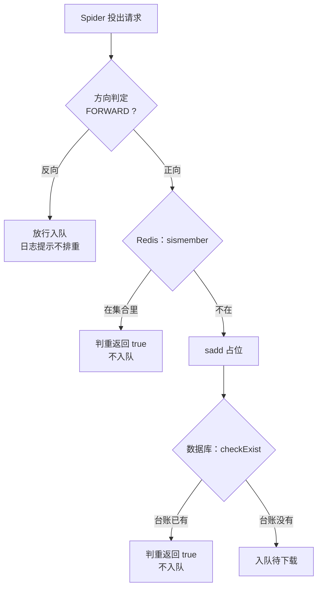

# 排重代码收口：DBAndRedisScheduler 把两层挡在同一道闸口

> 🔒 安全提示：文中示例的口令/密钥均为课程教学环境演示口径，生产环境的安全要求见《安全与合规须知》。

Redis 集成进工程之后，排重还差最后一块实体代码。落点很讲究：排重不该散落在下载或解析里，它长在调度器上，在请求入队之前就完成裁决。WebMagic 自带的 RedisScheduler 已经把 Redis 判重写好，缺的是方向判定与数据库兜底，缺的部分全部收口在一个类里：`DBAndRedisScheduler`。这一讲把这个类写完，排重从设计变成能跑的闸门。

## 先给结论

- 排重收口在调度器环节：`DBAndRedisScheduler` 继承 WebMagic 的 `RedisScheduler` 并实现 `ProcessFlow`，重复 URL 在入队之前就被挡下，不占下载线程。
- 方向判定从请求属性上取：`crawlerHelper.getHandleType(request)`，只有 FORWARD 才排重，反向直接放行并记日志，day10 目标课定的不对称规则在代码里兑现。
- Redis 层不重造轮子：父类内部用 Redis 的 Set 结构判重，`sismember` 判断加 `sadd` 占位，与上一讲 exists 加 setnx 的语义一脉相承。
- Redis 说不存在才查数据库：`crawlerNewsAdditionalService.checkExist(url)` 做最终兜底，两层结论任何一次为真都按重复处理。
- 调度器以 `ProcessFlow` 环节身份被 `processFlowList` 清单收编，`getComponentType` 上报 SCHEDULER，组件整合时由流程管理器装进 Spider 的调度器坑位。

## 排重为什么长在调度器上

WebMagic 四大组件里，调度器管请求进出：Spider 每发现一个新链接，先交调度器入队，而入队动作的第一件事就是问一句 `isDuplicate`，这条 URL 处理过没有。排重写在这里，拦截时点最早，重复 URL 连待抓队列都进不去，下载线程、代理额度、解析算力一分不花。若把排重下沉到下载器或解析器，请求已经发出去了，成本已经发生，判断再准也只是事后补救。

实现层面还有一笔现成的账。`RedisScheduler` 把 Redis 判重与请求队列封装在同一条继承链上，继承它等于同时拿到两件武器。上一讲预演的 `hasKey` 加 `setIfAbsent` 是字符串键方案，每个 URL 一把键；工程落地选了 Set 结构，一个抓取任务一个集合，判重对象天然是集合，`SCARD` 一看就知道这一轮抓过多少条，`SMEMBERS` 能直接翻记录，运维观测的粒度从散落成千上万个键收敛成一个键。两种方案语义同源，集合形态更适合跑批场景。

## 类骨架：继承位被框架占用之后

```java
package com.study.headline.crawler.process.scheduler;

import com.study.headline.crawler.helper.CrawlerHelper;
import com.study.headline.crawler.process.ProcessFlow;
import com.study.headline.crawler.process.entity.ProcessFlowData;
import com.study.headline.crawler.service.CrawlerNewsAdditionalService;
import com.study.headline.model.crawler.enums.CrawlerEnum;
import lombok.extern.log4j.Log4j2;
import org.springframework.beans.factory.annotation.Autowired;
import redis.clients.jedis.JedisPool;
import us.codecraft.webmagic.Request;
import us.codecraft.webmagic.Task;
import us.codecraft.webmagic.scheduler.RedisScheduler;

/** 数据库与 Redis 双层排重调度器，正向排重、反向放行 */
@Log4j2
public class DBAndRedisScheduler extends RedisScheduler implements ProcessFlow {

    @Autowired
    private CrawlerHelper crawlerHelper;

    @Autowired
    private CrawlerNewsAdditionalService crawlerNewsAdditionalService;

    /** 按 host 构造，连接池走默认配置 */
    public DBAndRedisScheduler(String host) {
        super(host);
    }

    /** 按连接池构造，host、端口、超时与密码全部由调用方装配 */
    public DBAndRedisScheduler(JedisPool jedisPool) {
        super(jedisPool);
    }
```

这个类有一个结构上的取舍值得说透。下载器与解析器环节都继承了流程基类 `AbstractProcessFlow`，一边拿统一调度资格，一边拿请求头、请求封装这些下沉的通用方法。调度器这个类不行：唯一继承位被 `RedisScheduler` 占了，Java 单继承，流程基类给不了。补偿办法是直接实现 `ProcessFlow` 接口，三个契约方法 `handle`、`getComponentType`、`getPriority` 自己补齐。通用方法的缺口恰好无碍，调度器不构造请求、不设请求头，它只做判断，那批下沉方法一个都用不上。

两个构造器是父类的固定写法：一个吃 host 字符串，内部按默认配置建 `JedisPool`；一个直接吃连接池，连接参数由调用方说了算。工程里用第二个，连接信息统一放在 common 模块的 `redis.properties`，装配动作留给 `CrawlerConfig`，测试一讲专门处理。

## isDuplicate：两层判定按顺序收口

```java
    @Override
    public boolean isDuplicate(Request request, Task task) {
        // 处理方向挂在请求属性上，先看这条数据是正向还是反向
        String handleType = crawlerHelper.getHandleType(request);
        boolean isExist = false;
        if (CrawlerEnum.HandleType.FORWARD.name().equals(handleType)) {
            log.info("url排重开始 url：{} handleType：{}", request.getUrl(), handleType);
            // 第一层：Redis 前置判重，父类用 Set 的 sismember 判断加 sadd 占位
            isExist = super.isDuplicate(request, task);
            // 第二层：Redis 说不存在，再交给数据库台账兜底
            if (!isExist) {
                isExist = crawlerNewsAdditionalService.checkExist(request.getUrl());
            }
            log.info("url排重结束 url：{} handleType：{} isExist：{}",
                    request.getUrl(), handleType, isExist);
        } else {
            log.info("反向爬取，不进行url排重 url：{}", request.getUrl());
        }
        return isExist;
    }
```

方法不长，四个动作各有分工。

**第一，方向判定。** `crawlerHelper.getHandleType` 从请求属性上取回处理方向，判断口径沿用 day09 解析器的约定：枚举的 `name()` 字符串用 `equals` 比对。方向不匹配的分支直接返回 false 并记日志，反向回源允许反复抓取，这条放行规则是需求，不是遗漏。

**第二，Redis 快挡。** `super.isDuplicate` 调回父类实现：以任务标识拼出集合键，`sismember` 判断 URL 在不在集合里，不在就 `sadd` 占位再返回 false，在就直接返回 true。判断与占位背靠背发生在同一次调用里，上一讲强调的「判断与占位合一」在这里以 Set 的形式兑现，同一个 URL 第二次到达时必然命中。

**第三，数据库兜底。** Redis 说没见过，才轮到 `checkExist` 查库。这个方法在保存准备阶段就铺好了契约：按 URL 判存在，查的是附加信息台账 `cl_news_additional`，一行对应一篇已保存的文章，行在即文章处理完成。台账族里 `cl_news_url` 记地址的推进过程，附加信息表记保存结果，判断「处理完成与否」以结果侧为准，两份记录各司其职。顺序不能颠倒，数据库查询是磁盘动作，每次入队都打库，快挡就名存实亡；Redis 是内存动作，挡下大多数重复之后，只有漏网的新 URL 才会走到库。

**第四，日志三点位。** 开始、结束、反向提示各一条，全部带上 url 与 handleType，结束日志再多带一个结论位 isExist。爬虫是多线程异步的，出问题先看日志，这三条日志就是联调阶段的观察窗口。

## 接入点：以 ProcessFlow 环节身份进清单

```java
    @Override
    public void handle(ProcessFlowData processFlowData) {
        // 调度器的驱动来自 Spider 的入队与出队循环，流程入口保持空实现
    }

    @Override
    public CrawlerEnum.ComponentType getComponentType() {
        // 上报本环节对应框架的调度组件
        return CrawlerEnum.ComponentType.SCHEDULER;
    }

    @Override
    public int getPriority() {
        // 排序数值大于既有环节的 12 即可，本环节在 startTask 里没有实质动作
        return 123;
    }
}
```

组件整合那一讲立过规矩：`processFlowList` 收编全部 `ProcessFlow` 实现，启动时按 priority 排序，流程管理器再按 `getComponentType` 把各环节装进 Spider 对应的坑位。`DBAndRedisScheduler` 实现了接口就自动进清单，上报 SCHEDULER 就坐进调度器的坑位，Spider 的 `setScheduler` 接到的不再是框架默认的内存调度器，而是带双层排重的自研实现。`handle` 保持空实现与解析器同一道理，调度器的真正驱动是框架的入队与出队循环，不归 startTask 管；priority 只是排序数值，与既有环节的 12 不冲突即可，取 123 排在队尾正合适。

排重的完整裁决路径如下：



关键路径在 D 到 I：Redis 挡下绝大多数重复，`sadd` 占位保证同一 URL 第二次到达时在 D 就被拦下；数据库只接 Redis 放行的新 URL，兜住 Redis 记录丢失、进程重启这类场景。两层结论任何一次为真，请求都到不了下载线程。

## 常见误区

- **把排重拦截当成排重日志的反面。** 错例是只写正向判定分支，反向放行不留任何痕迹，回源任务静默通过，出问题时无迹可查。正解是放行也留痕，反向日志带上 URL，排查时能对上账。
- **先查数据库再查 Redis。** 错例是图省事把 `checkExist` 提到前面，每条请求都先打一次库，跑批场景数据库先被压垮，快挡形同虚设。正解是 Redis 在前、数据库只兜底，顺序就是性能。
- **重写 isDuplicate 却不调 super。** 错例是自写一套 `sismember` 又不 `sadd`，Redis 集合永远不记账，每轮跑批都全量查库。正解是复用父类实现，它把判断与占位一起做了。
- **用 == 比较方向字符串。** 错例是 `handleType == CrawlerEnum.HandleType.FORWARD.name()`，`==` 比较引用，常量池之外的对象一律不等，正向请求被整批误放。正解是 `FORWARD.name().equals(handleType)`，与解析器侧的比对口径一致。

## 面试可能被问到的问题

1. 面试官追问：「排重为什么放在调度器，放到下载器或解析器不行吗？」
   答：调度器是请求入队的必经点，在入队前裁决，重复请求连队列都进不去，下载线程、代理额度、解析算力全部保住。放到下载器，请求已经发出，成本已经发生；放到解析器浪费更大。拦截越早，代价越小。
2. 面试官追问：「两层排重的顺序能颠倒吗？」
   答：不能。Redis 是内存查询，挡在前面把绝大多数重复请求消化掉，数据库只在 Redis 放行后才被访问，查询量降到最低。颠倒后每次入队都先打一次库，跑批场景数据库先出问题，快挡失去意义。
3. 面试官追问：「RedisScheduler 判重用什么数据结构，为什么不用字符串键 setnx？」
   答：用的是 Redis 的 Set，一个抓取任务一个集合，`sismember` 判断加 `sadd` 占位。选 Set 是因为判重对象天然成集合，整批可观测，`SCARD` 与 `SMEMBERS` 直接做核查；字符串键方案语义相同，但粒度是单个 URL，键数量随 URL 线性膨胀，观测与清理都麻烦。两者是同一语义的两种落地，按场景选形态。
4. 面试官追问：「单继承被 RedisScheduler 占了，流程基类的通用方法怎么办？」
   答：直接实现 ProcessFlow 接口，三个契约方法自己补齐。调度器实际用不到 AbstractProcessFlow 下沉的那批通用方法，它不构造请求、不设请求头，只做判断，缺口可接受。真有共享需求时优先考虑组合，或者把方法再下沉到工具类，而不是硬塞继承。
5. 面试官追问：「Redis 与数据库的结论不一致时，以谁为准？」
   答：以数据库为准。Redis 是易失的前置快挡，重启、淘汰都可能丢记录；台账是持久事实，行存在即文章保存完成。Redis 丢记录的后果只是把请求放行到数据库再拦一次，多花一次查询，不会重复入库；反过来若以 Redis 为准，丢了记录就是真的重复抓取。

## 配套资料

- 代码：`materials/code/05/头条day10/` 资料目录为空，`DBAndRedisScheduler` 与包结构按画面线整理、按本课写法补全（引用路径截至 `头条dayNN/` 层级，内层目录名含项目原名，不进入正文）。
- 参照：`materials/code/05/头条day01/`，数据库规范设计说明书，台账按 URL 冗余、一行对应一篇文章的口径出自它。
- 参照：`materials/code/03/day07-完善前端功能以及WebSocket入门/day07-完善前端功能以及WebSocket入门/资料/RedisCacheInterceptor.java`，Redis 模板注入与业务键拼接的真实工程用法。
- 环境：课程集群 node01~node03，MySQL root/123456；Redis 连接参数以 common 模块 `redis.properties` 为准，Bean 装配在下一讲的 `CrawlerConfig` 完成。
