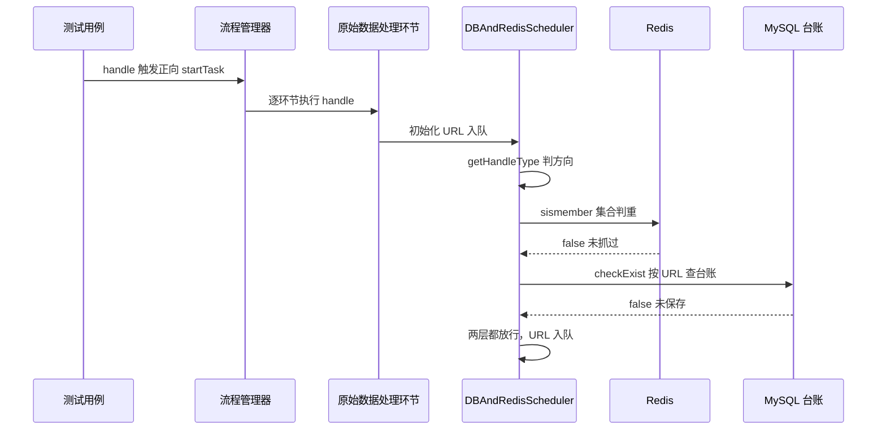

# 排重联调：从 Bean 装配到断点验证双层闸门

> 🔒 安全提示：文中示例的口令/密钥均为课程教学环境演示口径，生产环境的安全要求见《安全与合规须知》。

排重代码写完了，但它现在还只是个孤立的类：没有贴 `@Component`，Spring 容器并不认识它。测试之前的这一步装配，恰好暴露了调度器这类「需要参数初始化」组件的通用问题：host、端口、超时、密码都要求在构造时给定，容器不能替它做主。这一讲把它装配进容器，沿用整体测试的用例跑一遍正向抓取，断点加日志加 Redis 客户端，三路证据交叉验证排重闸门真的在工作。

## 先给结论

- `DBAndRedisScheduler` 不贴 `@Component`，在 `CrawlerConfig` 里用 `@Bean` 手工装配：连接参数从 common 模块的 `redis.properties` 读入，`JedisPool` 构造后传入调度器。
- 密码要与环境对齐：Redis 设了密码就传密码，没设密码就传 null，传了不匹配的值会直接连接失败。
- 测试沿用 `ProcessFlowManagerTest`：正向 startTask 触发抓取，断点确认 `processFlowList` 清单里多出了 `DBAndRedisScheduler`，排在队尾。
- 每条 URL 入队前都会走一遍 `isDuplicate`，日志三点位加 Redis 集合观察，两层判定的每次结论都有据可查。
- 边界要分清：同一 URL 二次抓取被拦；不同 URL 相同内容当前拦不住，内容指纹是扩展方向；反向全放行。

## 装配：没有 @Component 的 Bean 怎么进容器

`DBAndRedisScheduler` 的类体上没有 `@Component`，这是刻意的。它需要 host 与连接池两组初始化参数，注解扫描没法替它决定参数从哪来；把装配动作交给配置类，参数来源就一目了然。`CrawlerConfig` 是爬虫工程的装配中枢，Spider 引擎与解析规则都在这里管理，调度器也归它。装配是在既有配置类里追加一段：

```java
// 在 CrawlerConfig 中追加，连接参数从 common 模块的 redis.properties 读入
@Value("${spring.redis.host}")
private String host;
@Value("${spring.redis.port}")
private int port;
@Value("${spring.redis.timeout}")
private int timeout;
@Value("${spring.redis.password}")
private String password;

@Bean
public DBAndRedisScheduler dbAndRedisScheduler() {
    JedisPoolConfig poolConfig = new JedisPoolConfig();
    poolConfig.setMaxTotal(8);
    poolConfig.setMaxIdle(8);
    // 密码与环境对齐：未设密码时传 null，传了不匹配的值会连接失败
    JedisPool jedisPool = new JedisPool(poolConfig, host, port, timeout, password);
    return new DBAndRedisScheduler(jedisPool);
}
```

`@Value` 能取到值，靠的是上一讲集成 Redis 时埋好的线：common 模块的 `RedisConfiguration` 用 `@PropertySource` 把 `redis.properties` 读进了环境，crawler 模块扫描到它之后，这套配置对整个上下文可见。装配走的是 `DBAndRedisScheduler(JedisPool)` 这个构造器，上一讲留的两个构造器在这里各就各位：host 版本给快速试验用，连接池版本给正式装配用。

密码这个参数最容易踩坑。本机 Redis 若没有设密码，password 传 null；设了密码就传真实值。若 Redis 本身没有密码，装配时却给了一个非空值，Jedis 建连时会带着密码去握手，服务端直接报错，现象是连接池取连接全部失败，报错信息却指向连接超时，绕人半天。参数与真实环境对齐，比任何调试技巧都省时间。

## 测试用例与断点清单

测试沿用整体测试那一讲的用例，正向触发一次抓取：

```java
@RunWith(SpringRunner.class)
@SpringBootTest
public class ProcessFlowManagerTest {

    @Autowired
    private ProcessFlowManager processFlowManager;

    @Test
    public void handle() {
        // 正向爬取：条目清单传 null，走初始化 URL 配置清单
        processFlowManager.startTask(null, CrawlerEnum.HandleType.FORWARD);
    }
}
```

debug 方式启动，断点先打在 startTask 上。`processFlowList` 是第一观察点：实现了 `ProcessFlow` 接口的 Bean 都会被清单收编，鼠标停在变量上翻内容，最后一位就是新加入的 `DBAndRedisScheduler`，它实现接口后自动进队，priority 给了 123 排在队尾；清单里还能看到系统代理初始化这类辅助环节。成员齐了，才谈得上验证行为。

## 单步跟一遍 isDuplicate

断点移到 `isDuplicate` 方法入口，放行测试用例，抓取发起后每条 URL 都会走到这里。单步执行的顺序与上一讲的代码逐段对应：先取 handleType，当前是正向任务，`FORWARD.name()` 比对通过；跟进 `super.isDuplicate`，Redis 集合里没有这个 URL，返回 false；条件不成立，进入 `checkExist` 查数据库台账，也是 false；两层都放行，方法返回 false，URL 正常入队。

跑批把日志打出来，开始与结束成对出现，结论位一目了然：

```text
url排重开始 url：https://news.example.com/article/1001.html handleType：FORWARD
url排重结束 url：https://news.example.com/article/1001.html handleType：FORWARD isExist：false
url排重开始 url：https://news.example.com/article/1001.html handleType：FORWARD
url排重结束 url：https://news.example.com/article/1001.html handleType：FORWARD isExist：true
```

第二次出现同一条 URL 时 isExist 已经是 true，方法直接返回，请求不会再发出。这就是「同一个 URL 只处理一次」在运行期的样子：拦截发生在入队前，日志里只有排重记录，没有下载记录。

整个联调的调用链如下图：



图里的关键分岔在方向判定之后：反向任务从 sismember 那一步就短路，直接放行；正向任务走满两层才拿到放行结论。

## Redis 侧的记录观察

断点看的是过程，Redis 客户端看的是结果。排重记录落在父类维护的集合里，键名是 `set_` 前缀加 Spider 的任务标识（观察命令按主流写法补全，键的实际名称以启动日志为准）：

```bash
redis-cli -a 123456
SCARD set_crawlerSpider
SRANDMEMBER set_crawlerSpider 3
SISMEMBER set_crawlerSpider https://news.example.com/article/1001.html
```

`SCARD` 报出已记录的 URL 总数，`SRANDMEMBER` 随机抽几条核对格式，`SISMEMBER` 对指定 URL 给出存在性结论。跑完一轮正向批次，集合成员数与台账新增行数应当对得上，两个口径交叉核对，比单一来源可信得多。集合没有设过期时间，记录长期有效，这正是排重需要的语义：跨轮次的「抓过就是抓过」。

## 边界：什么会误拦，什么会漏放

排重闸门立起来之后，边界值得专门过一遍。**放行侧的三种情况**都属正常：反向任务整体放行，回源是需求；Redis 记录丢失后放行，数据库台账会再拦一次，代价只是一次查询；全新 URL 放行，这是爬虫的本职。

**误拦与漏放的讨论集中在内容维度。** 当前判据是 URL，同一篇文章换一个地址（转载页、带渠道参数的变体地址）在两层判定里都是新面孔，会被完整抓取并入库，这是漏放；反过来，URL 相同但内容已更新（作者改了正文），闸门会拦下重抓，这是刻意设计，正向增量抓取不需要刷新旧文。想把内容维度也管起来，思路是加内容指纹：标题加正文哈希入库，入库前比对指纹，更省内存的方案是布隆过滤器，允许极小概率的误判换空间效率。指纹方案的代价要想清楚：指纹碰撞会误拦新文章，URL 重复只是脏数据，新文章被误拦却是真丢失，所以指纹只适合做第二道参考，不能替代 URL 判据。

## 常见误区

- **给类贴上 @Component 就以为装配完了。** 错例是注解一贴，参数没人传，容器用无参构造直接报错。正解是需要初始化参数的组件用 `@Bean` 手工装配，参数来源写在配置类里。
- **密码参数随手复制粘贴。** 错例是没有密码的 Redis 配了非空 password，连接全部失败，报错却像超时。正解是密码与真实环境对齐，未设密码传 null。
- **断点全程单步跟进多线程。** 错例是在 Spider 的抓取循环里逐帧走，线程时序被打乱，现象越来越怪。正解是断点只看 startTask 与 isDuplicate 入口的静态状态，节奏交给日志。
- **拿 Redis 集合数当唯一验收口径。** 错例是 `SCARD` 数字对上就收工，台账侧的重复行没查。正解是 Redis 记录数与台账新增行数交叉核对，两层各验各的。

## 面试可能被问到的问题

1. 面试官追问：「为什么这个调度器不贴 @Component，而要用 @Bean 装配？」
   答：它需要 host、端口、超时、密码这些构造期参数，注解扫描无法提供参数来源。@Bean 方法把参数读取与对象构造放在一处，来源清晰、便于替换，也顺势利用了两个构造器的分工：快速试验走 host 版本，正式装配走连接池版本。
2. 面试官追问：「测试时怎么确认排重组件真的被容器接管了？」
   答：三路证据。断点看 processFlowList 清单，确认实现接口的 Bean 被收编且类型正确；日志看 isDuplicate 的开始与结束成对输出，结论位符合预期；Redis 客户端看集合成员与台账行数交叉对账。三路一致才算闸门生效。
3. 面试官追问：「同一篇内容换了 URL，排重拦得住吗？」
   答：拦不住。两层判定都以 URL 为判据，地址一变就是新面孔。要覆盖内容维度需要加指纹判据，比如标题加正文哈希或布隆过滤器，但要权衡误判代价：URL 重复入库是脏数据，新文章被指纹误拦是真丢失，所以指纹只做参考判据，URL 仍是主判据。
4. 面试官追问：「排重记录不设过期时间，集合会不会无限膨胀？」
   答：会持续增长，规模靠台账与集合的分工消化。Redis 集合是前置快挡，丢了记录有台账兜底，所以可以按业务周期对集合做定期清理或重置；更精细的方案是给记录加时间维度，用带分数的结构按周期衰减，或按批次分集合轮转，量级到亿级再引入布隆过滤器。
5. 面试官追问：「联调时排重全部返回 false，闸门像不存在一样，先查什么？」
   答：按装配链倒推。先看 Bean 是否真的装配进了容器，processFlowList 里有没有它；再看 handleType 取到的方向是不是预期值，方向判定错了会整批走放行分支；然后确认 Redis 连接参数与真实环境一致，连不上时父类判重会异常，日志里必有痕迹；最后核对集合键名，键名对不上等于判重在另一个集合里空转。

## 配套资料

- 代码：`materials/code/05/头条day10/` 资料目录为空，装配配置与测试用例按画面线整理、按本课写法补全（引用路径截至 `头条dayNN/` 层级，内层目录名含项目原名，不进入正文）；Redis 观察命令与日志样例为按主流写法补全的演示。
- 参照：`materials/code/05/头条day01/`，数据库规范设计说明书，台账 URL 业务键口径出自它。
- 环境：课程集群 node01~node03，MySQL root/123456；Redis 连接参数以 common 模块 `redis.properties` 为准，本机 Redis 未设密码时装配处传 null。
