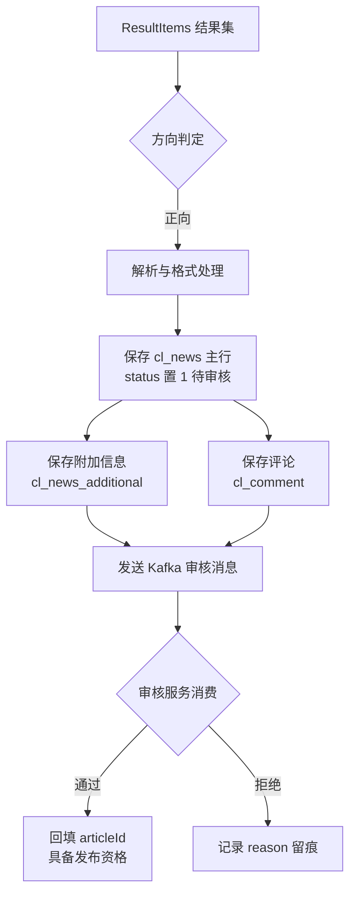

# 解析保存的作战地图：从结果集到台账与审核消息

> 🔒 安全提示：文中示例的口令/密钥均为课程教学环境演示口径，生产环境的安全要求见《安全与合规须知》。

下载与解析把页面变成了字段，数据此刻还躺在 WebMagic 的结果集里，离「能在 App 上被用户看到」还差一整段路。day10 的最后一个模块解析保存，负责把结果集变成台账里的行、变成审核队列里的消息。动手写代码之前先把执行思路画清楚：正向怎么编排、反向怎么更新、失败怎么办，这三件事想透了，后面十几讲的代码才有骨架可挂。

## 先给结论

- 解析保存是爬虫链路的收尾环节，对应 WebMagic 的 Pipeline 组件，入口吃的是 `ResultItems` 结果集，本质一个 Map 结构，键是解析规则名，值是抽取结果。
- 正向四步编排：解析与格式处理、保存 `cl_news` 台账主行、附加信息与评论落表、发 Kafka 消息触发文章审核，审核通过回填 `articleId` 后文章才具备发布资格。
- 反向只动一张表：`cl_news_additional` 的统计数字，阅读、点赞、评论、转发按主键回写，主表一行不碰。
- 编排涉及的服务在 `CrawlerHtmlParsePipeline` 的类头已经挂好：`KafkaSender`、`CrawlerNewsService`、`CrawlerNewsCommentService`。
- 失败处置分三层：请求级重试、台账状态断点续抓、回源时间顺延，每层管一种失败。

## 结果集为什么要再处理一次

解析器抽出的字段挂在 `ResultItems` 上，这个结构只是「按规则抽到了什么」的原始记录，与「入库要长什么样」之间还有距离。目标页正文带着站点自己的 CSS 与脚本，直接入库 App 端渲染就乱了；统计数字可能是「3.2 万」这类带单位的展示文案，得还原成数值；评论往往藏在页面的异步接口里，要按文章标识单独补抓。所以这个模块的总纲是先解析再保存：解析做格式归一化与数据补充，保存才是落库动作，两步在编排层串行完成。

格式归一化里有个细节类别的活：站点样式与文章存储的映射。样式对象按键值对收纳样式规则，`addStyle` 攒、`getCssStyle` 出，保存正文前把目标站的样式翻译成本工程能渲染的形态。这类代码不复杂，但它解释了为什么解析与保存不能捏成一步：归一化的输入是页面特征，输出的才是入库形态，中间隔着一层明确的翻译。

编排主体是个 `@Component`，挂在 `com.study.headline.crawler.process.parse` 包下，类头把用得着的服务全部注入：

```java
// 按画面线整理，泛型参数沿用 CrawlerParseItem 载体
@Component
public class CrawlerHtmlParsePipeline extends AbstractHtmlParsePipeline<CrawlerParseItem> {

    @Autowired
    private KafkaSender kafkaSender;
    @Autowired
    private CrawlerNewsService crawlerNewsService;
    @Autowired
    private CrawlerNewsCommentService cNewsCommentService;
```

三个服务三个主顾：`crawlerNewsService` 管台账主行，`cNewsCommentService` 管评论，`kafkaSender` 管审核消息。类头即目录，编排层要动的资源一眼看尽。

## 正向：四步编排一条龙

正向流程从结果集出发，四步各有落点：



**主行先行。** 文章主行落 `cl_news`，走 `saveNews` 的 `insertSelective`，入库即 `status` 置 1 待审核，主键由数据库自增回填。这一步必须排在最前：附加行与评论行都要拿 `newsId` 做关联，主行不落库，后面的关联全是空谈。

**关联行随后。** 附加信息把阅读数、点赞数、评论数、转发数写进 `cl_news_additional`，评论逐条进 `cl_comment`，两处都以 `newsId` 挂靠主行。标签与频道在解析环节已经换成 ID 串与频道归属，直接写进主行的归类字段，day09 的映射成果在这里兑现。

**消息收尾。** 三张表落定后发一条 Kafka 消息，让文章进入审核流程。审核是异步的：保存侧消息即忘，不等审核结果；审核通过后回填 `articleId`，爬虫库与 App 库由此打通，拒绝则把理由写进 `reason` 留痕。发送用的是 day07 就封装好的 `KafkaSender`，核心一行：

```java
// KafkaSender 核心片段，源自课程资料 kafka 封装工具类，包名按本课规范改写
public void sendMesssage(String topic, String key, KafkaMessage<?> message) {
    try {
        this.kafkaTemplate.send(topic, key, mapper.writeValueAsString(message));
    } catch (Exception e) {
        logger.error("send message to [{}] error:", topic, e);
    }
}
```

消息体统一包成 `KafkaMessage` 再序列化成 JSON，topic 与 key 由调用方给定，异常只记日志不向外抛。这个设计放在保存链路里读，意图很清楚：消息发送失败不能拖垮已经落库的成果，台账里的行是事实，审核消息可以靠台账补偿重发。

## 反向：只动一张表

反向流程不走四步。文章主行早已存在，标题与正文不需要重抓，要刷新的只有随时间变化的统计数字：转发量涨了、评论数变了、点赞量动了。落点是 `cl_news_additional` 这一张表，`updateAdditional` 按主键回写非空字段，主表一行不碰。

反向的调度依据就在这张表自己身上：`next_update_time` 到期的行被 `queryListByNeedUpdate` 整批捞出，转成抓取项回源重新解析，新数字写回台账，再把到期时间顺延一个周期。正向写入与反向回写在同一张表上交汇，一张表串起两个方向，这是保存准备阶段拆表设计换来的红利：变化节奏不同的数据各归各表，刷新动作就可以只打高频表，主表的索引与缓存不被低频字段的重写扰动。

## 失败重试与状态回滚的三层设计

跑批链路这么长，失败是常态，工程把失败处置分了三层，每层管一种失败。

**请求层管抖动。** 下载偶发超时、代理失联，`Site` 的 retryTimes 给两次补试，重试间隔一秒，大多数瞬时失败在这一层消化，台账无感知。

**台账层管断点。** 补试仍失败的地址，状态留在 `cl_news_url` 上，本轮批次直接越过，下一轮调度从台账里的未完成状态续跑。状态字段就是断点，批次的可恢复性不靠内存里的任务队列，靠数据库里的持久状态。中途失败的文章可能出现「主行已落、关联行缺失」的中间态，处置口径是状态回退：把该 URL 的台账状态回拨到未完成，下一轮重跑时重新走完整编排，已存在的行靠 URL 判据与 Selective 写入保证不重复、不覆盖。

**回源层管周期。** 反向回源失败时，`next_update_time` 也要顺延一个周期再写回，失败任务错峰重试，不与到期队列挤在同一个时间窗。若失败行原地不动，下一轮调度立刻把它再捞出来，反复撞墙的请求挤占额度还容易触发目标站的反爬。

**消息层的兜底是幂等。** 保存成功但消息发送失败，靠台账补发；消息重试导致重复发送，审核服务按台账文章标识做幂等消费，同一篇文章审核两次与一次的结果一致。异步链路上每一方都假设对方可能重复，事实以台账为准。

## 常见误区

- **解析与保存捏成一步。** 错例是抽取结果直接入库，站点样式原样进了正文，App 端渲染失控。正解是先解析后保存，格式归一化与数据清洗在保存前完成。
- **关联行抢在主行之前落库。** 错例是附加信息与评论先写，`newsId` 没着落，只能回头补关联。正解是主行先行拿主键，关联行随后挂靠，顺序由依赖关系决定。
- **反向也走四步编排。** 错例是回源结果再走一遍新增，台账被同一篇文章塞进重复行。正解是反向只更新附加信息表，主行与评论保持不动。
- **保存线程同步等审核结果。** 错例是发送消息后阻塞等待审核通过才返回，抓取节奏被审核时长绑架。正解是消息即忘，审核结果经 `articleId` 回填异步兑现。

## 面试可能被问到的问题

1. 面试官追问：「为什么保存收尾用 Pipeline，不在解析器里直接存库？」
   答：解析器面对的是页面结构，职责是把字段抽干净；保存面对的是数据完整性，要做格式归一化、跨表编排与状态管理。两者混在一个类里，页面改版与保存逻辑变更互相牵连。Pipeline 作为独立环节收口保存，解析器保持纯抽取，职责边界与复用性都在。
2. 面试官追问：「保存四步的顺序依据是什么，事务边界怎么画？」
   答：顺序由数据依赖决定，主行拿主键，关联行靠主键挂靠，消息在事实落定后发。事务画在主行加关联行的业务完整性上，一个事务方法收口，要么全成要么全败；消息发送在事务提交之后，避免库已回滚、消息已发出的脏消息。
3. 面试官追问：「审核为什么走 Kafka 异步消息，保存时同步调用不行吗？」
   答：审核涉及文本与图片的机器审核，耗时不可控，同步等待会把保存线程吊在审核上，跑批吞吐被拖垮。异步消息让两侧按各自节奏工作，审核慢就慢，台账事实不变；代价是要处理消息丢失与重复，靠台账补发与消费端幂等收口。
4. 面试官追问：「反向更新的表为什么只有附加信息一张？」
   答：反向的目的是刷新会变化的数据，阅读、点赞、评论、转发这些统计数字全在附加信息表，主表的标题、正文、频道在抓取时已定型。只动一张高频表，更新语句短、锁范围小，主表稳定性不受影响，这正是当初按变化节奏拆表的设计意图。
5. 面试官追问：「保存中途失败出现半篇文章，怎么处理？」
   答：两层兜底。事务层把主行与关联行圈在一起，中途失败整体回滚，不留半篇；跨越事务边界的动作（消息发送）失败时，台账状态回退到未完成，下一轮调度重新走完整编排，入库侧用 URL 判据与 Selective 写入保证重跑不产生重复行。半篇状态的根除靠重跑幂等，不靠人工修数。

## 配套资料

- 代码：`materials/code/05/头条day10/` 资料目录为空，编排类与流程图按画面线整理、按本课写法补全（引用路径截至 `头条dayNN/` 层级，内层目录名含项目原名，不进入正文）。
- 参照：`materials/code/05/头条day07/`，kafka 封装的工具类，`KafkaSender` 的发送姿势与异常处理出自它。
- 参照：`materials/code/05/头条day01/`，数据库规范设计说明书，`cl_news`、`cl_news_additional`、`cl_comment` 的字段口径出自它。
- 环境：课程集群 node01~node03，MySQL root/123456；Kafka 以集群环境为准，topic 与消费端在后续课程的审核环节接入。
