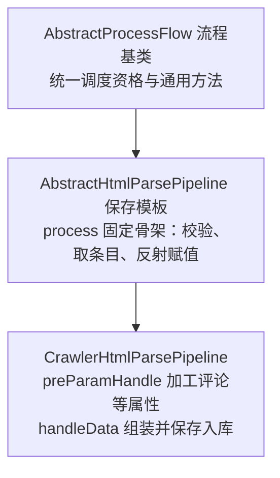
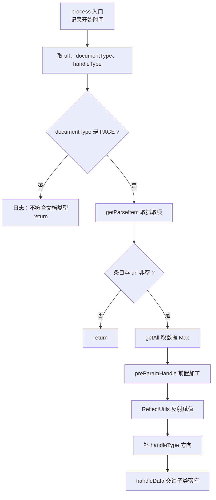

# 管道环节的模板：AbstractHtmlParsePipeline 把保存骨架定下来

> 🔒 安全提示：文中示例的口令/密钥均为课程教学环境演示口径，生产环境的安全要求见《安全与合规须知》。

思路地图铺完，解析保存开始落代码，动手前先立模板。解析侧在 day09 用 `AbstractCrawlerPageProcessor` 搭过一次模板方法，公共骨架上提、页面差异下沉，三个解析器往钩子里填血肉；保存侧面对的是同构的问题：类型校验、数据组装、方向补全这些动作每个保存场景都要做一遍，真正不一样的只有「数据加工成什么形态、落到哪张表」。day10 按同一手法立起保存侧的模板 `AbstractHtmlParsePipeline`，管道环节的骨架从这一讲定下来。

## 先给结论

- 模板类是 `AbstractHtmlParsePipeline<T>`，落在 `com.study.headline.crawler.process.parse` 包，继承流程基类 `AbstractProcessFlow`，同时实现 WebMagic 的 `Pipeline` 接口，与页面处理器模板一个手法。
- WebMagic 自带的管道只有「输出到控制台」与「保存到文件」两种，落库需求要自定义 Pipeline；对这类需求一般只写一个 Pipeline，本工程就是 `CrawlerHtmlParsePipeline` 一个类兜住全部保存。
- 核心方法 `process(ResultItems, Task)` 是保存侧总入口：取 url、文档类型、方向，类型不符直接 return，取抓取项、前置处理、反射赋值、补方向，最后把成型的抓取项交给抽象钩子。
- 两个抽象钩子留给子类：`preParamHandle` 做评论等属性的前置加工，`handleData` 做最终组装与落库。
- 与 day09 处理器模板的分工：一个吃 Page 页面源码管「抽什么」，一个吃 ResultItems 字段集管「存成什么」。

## Pipeline 是什么，为什么自定义

`Pipeline` 是 WebMagic 的管道接口，负责抽取结果的处理，包括计算、持久化到文件、数据库等。框架默认给了两种实现：输出到控制台与保存到文件，教学演示够用，生产落库都不合适。接口的定位是「定义结果保存的方式」，要把数据存进指定数据库，就编写对应的 Pipeline；而且这类需求一般只需要写一个，管道在全链路只有末端一站，一个类接住全部文档类型的保存，按类型分流的活交给钩子内部处理。

与 day09 的页面处理器模板对照着看，继承结构几乎复制了一遍：



两个身份再次捏在一个类里：继承 `AbstractProcessFlow` 拿到流程队列的调度资格与通用方法，实现 `Pipeline` 拿到框架的回调资格。少了哪一个都玩不转，不继承流程基类，环节进不了 `processFlowList` 清单，流程管理器装配 Spider 时没有它的坑位；不实现 Pipeline，框架把结果集递过来时没有方法可回调。模板类声明如下：

```java
package com.study.headline.crawler.process.parse;

import com.study.headline.crawler.helper.CrawlerHelper;
import com.study.headline.crawler.process.AbstractProcessFlow;
import com.study.headline.model.crawler.enums.CrawlerEnum;
import com.study.headline.utils.ReflectUtils;
import lombok.extern.log4j.Log4j2;
import org.springframework.beans.factory.annotation.Autowired;
import org.springframework.util.StringUtils;
import us.codecraft.webmagic.Request;
import us.codecraft.webmagic.ResultItems;
import us.codecraft.webmagic.Task;
import us.codecraft.webmagic.pipeline.Pipeline;

import java.util.Map;

/**
 * html 解析抽象类，定义了公用的方法以及抽象模板
 * Pipeline 负责抽取结果的处理，包括计算、持久化到文件、数据库等
 * WebMagic 默认提供「输出到控制台」与「保存到文件」两种方案，落库需求需自行编写
 * @param <T> 抓取项类型
 */
@Log4j2
public abstract class AbstractHtmlParsePipeline<T> extends AbstractProcessFlow implements Pipeline {

    @Autowired
    protected CrawlerHelper crawlerHelper;

    @Override
    public void handle(ProcessFlowData processFlowData) {
        // 管道的驱动来自框架的 process 回调，流程入口保持空实现
    }

    @Override
    public CrawlerEnum.ComponentType getComponentType() {
        // 上报本环节对应框架的管道组件
        return CrawlerEnum.ComponentType.PIPELINE;
    }

    /** 子类钩子：结果数据前置处理，评论等属性需要单独加工 */
    public abstract void preParamHandle(Map<String, Object> item);

    /** 子类钩子：把处理后的数据组装成待保存形态并落库 */
    public abstract void handleData(T parseItem);
}
```

`handle` 空实现是老规矩：流程管理器的 startTask 按清单逐环节调用 handle，管道的真实驱动是框架回调，startTask 到它这里没有活可干。`getComponentType` 返回 PIPELINE，流程管理器装配时按它把本环节装进 Spider 的管道坑位。泛型 `<T>` 声明抓取项类型，具体落到 `CrawlerParseItem`；排序值 `getPriority` 留给子类上报，管道在流程清单里的位置由那个数值决定，模板不越俎代庖。

## process：保存侧的总入口

`process(ResultItems, Task)` 是 Pipeline 接口约定的回调方法，传入的是处理好的对象，对抽取的数据进行清洗和存储。两个参数各有含义：`ResultItems` 是抽取结果集，本质一个 Map，键是解析规则名，值是抽到的内容；`Task` 是任务上下文。骨架逐段写下来：

```java
    @Override
    public void process(ResultItems resultItems, Task task) {
        // 传入处理好的对象，对抽取的数据进行清洗和存储，这里是保存侧的总入口
        long startTime = System.currentTimeMillis();
        Request request = resultItems.getRequest();
        String url = request.getUrl();
        String documentType = crawlerHelper.getDocumentType(request);
        String handleType = crawlerHelper.getHandleType(request);
        log.info("开始解析抽取后的数据 url：{} handleType：{}", url, handleType);

        // 目标页数据才走保存，其他类型到不了管道
        if (!CrawlerEnum.DocumentType.PAGE.name().equals(documentType)) {
            log.info("不符合文档类型 url：{} handleType：{} documentType：{}",
                    url, handleType, documentType);
            return;
        }

        // 抓取项此时只有 url，字段要靠后面的组装补齐
        T parseItem = (T) crawlerHelper.getParseItem(request);
        if (null == parseItem || StringUtils.isEmpty(url)) {
            return;
        }

        // 结果集本体是一个 Map，键是解析规则名
        Map<String, Object> item = resultItems.getAll();
        // 前置处理：评论等属性单独加工，抽象方法留给子类
        preParamHandle(item);

        // 键名与实体属性名对号入座，反射批量赋值
        ReflectUtils.setProperties(parseItem, item);
        // 解析抽不出方向，处理方向从请求属性上取回补上
        parseItem.setHandleType(crawlerHelper.getHandleType(request));

        // 数据还不是最终保存形态，核心钩子交给子类
        handleData(parseItem);
    }
```

骨架内部分五段。**入口先登记。** 起始时间记下来，url、文档类型、处理方向一次取齐，这三样是后续所有判断与组装的依据，全部从请求属性上取，请求自带上下文的老约定在这里继续生效。

**类型先把关。** 只有目标页（PAGE）的数据才走保存，其他类型直接 return，日志里带全 url、handleType、documentType 三件套。这道闸放在模板入口而不是子类里，正是模板方法的价值：写钩子的人不需要记得校验类型，骨架保证混不进脏数据。

**条目与数据到手。** `crawlerHelper.getParseItem(request)` 按请求取回抓取项，此刻它基本是个空壳，只有 url 一个字段；`resultItems.getAll()` 把结果集整体取出，Map 的键就是 day09 注册解析规则时的规则名。

**加工与赋值。** `preParamHandle` 先行，评论这类需要单独处理的属性在这一步加工，方法体留给子类；然后 `ReflectUtils.setProperties` 用反射把 Map 里的数据批量装进抓取项，对号入座的约定是键名与实体属性名同名，解析规则名当初就按入库字段命名，两边天然对得上。方向字段是例外，解析抽不出它是正向还是反向，值要从请求属性上取回补进抓取项，反向更新靠这个字段定位自己的身份。

**交给子类。** 到 `handleData` 为止，抓取项还是「字段齐了但没进表」的形态，怎么组装、调用哪些服务、写哪几张表，全部下沉给子类。骨架管秩序，子类管业务，一处不动另一处的红利再次兑现。



关键分岔在第一道闸：类型不符的请求在这里静默退出，保存链路只服务目标页数据；通过之后一路到 `handleData`，子类拿到的抓取项类型正确、字段就位、方向齐全。

## 与 day09 处理器模板的分工

两套模板并排看，差异立刻清楚。**驱动的回调不同**：页面处理器实现 `PageProcessor`，框架下载完一页回调 `process(Page page)`，进来的是页面源码；管道实现 `Pipeline`，解析器把字段挂进结果集后回调 `process(ResultItems, Task)`，进来的是字段集。一个在数据链的源头，一个在末端。

**模板管的骨架不同。** 处理器模板固定的是站点参数与页面分发：getSite 的重试与超时、handlePage 的页面差异、isNeed 双钩子的身份验证；管道模板固定的是数据验收与组装：类型校验、条目获取、反射赋值、方向补全。前者回答「抽什么」，后者回答「存成什么」。

**钩子的产出不同。** 处理器钩子抽出链接与字段，经 `addSpiderRequest` 升格成新条目回灌队列，数据继续往前流；管道钩子把成型抓取项落进 `cl_news` 表族并发审核消息，数据在它手里落地。一进一出，链路两端各有一个模板镇场。

两套模板共享同一批底层设施：流程基类的调度资格、`CrawlerEnum` 的类型口径、`CrawlerHelper` 的上下文读取。同一套词汇表贯穿首尾，读代码的人从解析侧走到保存侧不需要换脑子，这正是把公共概念抽到底层换来的连贯性。

## 常见误区

- **把保存逻辑全写进 process。** 错例是模板里直接调 Service 落库，抽象类膨胀成上帝类，子类无事可做。正解是骨架只做校验、取数与组装，落库动作全部进 `handleData` 钩子。
- **省掉文档类型判断。** 错例是入口不验类型，列表页结果混进管道，保存出大量脏数据。正解是 PAGE 之外的类型在模板入口直接 return，日志带全三件套留痕。
- **忘补 handleType。** 错例是反射赋值后就交棒，抓取项方向缺失，反向更新对不上身份，正向入账也少了上下文。正解是方向从请求属性取回显式补上。
- **把反射赋值当万能搬运。** 键名与属性名对不上的字段会静默丢失，不报错。正解是守住「解析规则名与实体属性名同名」的约定，新增字段两侧同步改，关键落库字段在钩子里补一道非空校验。

## 面试可能被问到的问题

1. 面试官追问：「WebMagic 的 Pipeline 承担什么职责，为什么不用默认实现？」
   答：Pipeline 负责抽取结果的处理，包括计算与持久化，框架默认提供输出到控制台与保存到文件两种。生产需求是把数据落进指定数据库并触发后续流程，需要自定义 Pipeline；这类需求一般只写一个，本工程用 AbstractHtmlParsePipeline 定骨架、CrawlerHtmlParsePipeline 落实现。
2. 面试官追问：「保存模板和页面处理器模板都是模板方法模式，差异在哪？」
   答：回调源与骨架内容不同。处理器吃 Page 页面源码，骨架管站点参数与页面分发，钩子回答抽什么；管道吃 ResultItems 字段集，骨架管类型校验与数据组装，钩子回答存成什么。一个在数据链源头，一个在末端，手法相同、职责互补。
3. 面试官追问：「documentType 的校验为什么放在模板入口而不是子类？」
   答：校验是所有保存场景的公共前提，放模板里写一次，子类不可能忘；放子类里每个实现自己写一遍，漏一处就混进脏数据。模板方法模式的要义就是把不变的动作焊死在骨架上，可变的动作才开放给钩子。
4. 面试官追问：「反射赋值的前提与风险是什么？」
   答：前提是键名与实体属性名同名，解析规则名当初就按入库字段命名，两边对得上才能装进去。风险是名字对不上的字段静默丢失、类型不匹配时抛异常，所以约定要写进文档并守住，新增字段两侧同步改，落库关键字段在钩子里再补一道非空校验。
5. 面试官追问：「handle 方法空实现会不会显得多余？」
   答：不多余，它是统一调度契约的一部分。流程管理器按清单逐环节调用 handle，不需要感知哪个环节有实质动作；管道与解析器的 handle 都是空的，只有原始数据处理环节真正干活。契约统一，新增环节才不需要改动调度方，空实现是低成本换扩展性。

## 配套资料

- 代码：`materials/code/05/头条day10/` 资料目录为空，`AbstractHtmlParsePipeline` 与包结构按画面线整理、按本课写法补全（引用路径截至 `头条dayNN/` 层级，内层目录名含项目原名，不进入正文）；两个钩子方法名与签名按画面线口径补全，具体实现待下一讲的框架代码与保存代码展开。
- 参照：`materials/code/05/头条day01/`，数据库规范设计说明书，抓取项字段与台账列的同名口径出自它。
- 环境：课程集群 node01~node03，MySQL root/123456；模板中用到的 `CrawlerHelper`、`CrawlerEnum`、`ReflectUtils` 均为工程内既有类，见 day08 与 day09 各讲。
