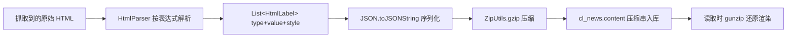

# 正向保存的主干：内容整形、台账落库与 articleId 之前的全部组装

> 🔒 安全提示：文中示例的口令/密钥均为课程教学环境演示口径，生产环境的安全要求见《安全与合规须知》。

正向流程把一篇文章送到解析管道时，`addParseItemMessage` 是总调度：存文章、存附加、存评论、发审核消息四步串成一趟。这一讲把四步中的主干写透，即文章本体怎么从一坨抓取结果变成 `cl_news` 台账里的一行：内容先整形成固定格式再压缩，图文类型一次算清，URL 判重决定走不走，字段组装两级翻译，最后落库拿回主键。附加与评论两步属于挂载件，放到下一讲展开。

## 先给结论

- 正向编排四步走：`addCNewsData` 存文章，成功后 `addNewsAdditionalData` 存附加，评论数大于 0 才存评论，最后 `sendSubmitArticleMessage` 把文章 id 发给审核通道。
- 内容整形是硬约定：HTML 按 `p,pre,h1~h5` 表达式解析成 `HtmlLabel`（type、value、style）列表，转 JSON 后 gzip 压缩入库，读时解压即前端渲染格式。
- 图文类型在整形时一次算清：0 无图、1 单图、2 多图，两图以上一律记 2，后续审核与展示都吃这个结论。
- 幂等靠附加表判重：`getAdditionalByUrl` 命中即整篇跳过，返回 null 让编排短路，二次保存不会产生重复行。
- 字段组装在 `toCNews` 里完成两级翻译：标签名称串换标签 id 串，标签 id 串再换频道 id，`status` 置 1 进待审核，发布时间字符串转 Date。

## 总调度：四步编排与 null 守门

骨架方法在上一讲立了空壳，现在填上主干。方法开头取一次时间戳，结尾统一算耗时：

```java
private void addParseItemMessage(CrawlerParseItem parseItem) {
    long currentMillis = System.currentTimeMillis();
    String url = null;
    String handleType = null;
    if (null != parseItem) {
        url = parseItem.getUrl();
        handleType = parseItem.getHandleType();
        log.info("开始添加数据, url: {}, handleType: {}", url, handleType);
        // 第一步：保存文章信息，拿到台账主行
        CNews cNews = addCNewsData(parseItem);
        if (null != cNews) {
            // 第二步：保存附加信息，需要文章主键
            addAdditionalData(parseItem, cNews);
            // 第三步：评论数大于 0 才抓取保存评论
            if (null != parseItem.getComment() && parseItem.getComment() > 0) {
                addCommentData(parseItem, cNews);
            }
            // 第四步：发送消息，交给文章审核微服务
            crawlerMessageHelper.sendSubmitArticleMessage(cNews.getId());
        }
    }
    log.info("添加数据完成, url: {}, handleType: {}, 耗时: {}ms",
            url, handleType, System.currentTimeMillis() - currentMillis);
}
```

这段编排里藏着三个设计决策。**第一，四步的次序是依赖链，不能乱。** 附加与评论都要挂文章主键，文章不落库它们无处可挂；审核消息要等文章完整成形，早了发出去的是半篇文章。存文章永远排第一，消息永远排最后，中间两步的先后可以按业务调整，但都不得越过两端。**第二，`cNews` 为 null 是整篇跳过的信号。** `addCNewsData` 里判重失败或数据残缺时返回 null，附加、评论、消息三步全部短路，日志只留一条「URL 已存在」的记录。守门条件放中间而不是每步都判，让失败路径集中在一个出口。**第三，评论是条件执行。** 评论数是文章页解析时顺手抽到的统计值，为 0 或缺失说明评论区不存在或没抓到，此时发起评论抓取是白费一次请求，条件判断把无意义网络开销挡在编排层。

审核消息为什么要等最后一步？消息的语义是「文章已完整入库，请审核」，附加与评论没挂完就发消息，审核服务读到的是半篇文章。消息携带的是台账主键 `cNews.getId()`，这个 id 由落库时的主键回填产生，也是附加与评论两步的关联钥匙。

## 内容整形：HTML 变固定格式再压缩

文章正文的入库形态不是原始 HTML。前端详情页的渲染约定从自媒体发布文章那时就定了：内容是一组块对象，每块有 `type`（text 或 image）、`value`（文本或图片地址）与 `style`（样式），前端按块遍历渲染。爬虫文章要过审核迁进 App 库，入库时就按同一格式整形，审核通过后前端零适配直接渲染：

```java
private CNews addCNewsData(CrawlerParseItem parseItem) {
    log.info("开始添加文章");
    CNews cNews = null;
    if (null != parseItem) {
        // 内容整形：HTML 文本转固定格式
        HtmlParser htmlParser = HtmlParser.getHtmlParser(getParseExpression(), getDefHtmlStyleMap());
        List<HtmlLabel> htmlLabels = htmlParser.parseHtml(parseItem.getContent());
        // 图文类型：0 无图 1 单图 2 多图
        int type = getDocType(htmlLabels);
        parseItem.setDocType(type);
        // 标签列表转 JSON 再压缩，入库存压缩串
        String jsonStr = JSON.toJSONString(htmlLabels);
        parseItem.setCompressContent(ZipUtils.gzip(jsonStr));
        // 判重通过才落库
        cNews = checkAndSaveNews(parseItem);
    }
    return cNews;
}
```

`HtmlParser` 是工程里的整形工具，`getHtmlParser` 传两个参数：解析表达式与默认样式表，都是抽象管道里定义好的方法。`parseHtml` 底层用 jsoup 按表达式遍历节点，每命中一个节点产出一个 `HtmlLabel`。这个载体类只有三个字段：

```java
/** 解析的标签类型：text 或 image */
private String type;
/** 内容：文本内容或图片地址 */
private String value;
/** 样式：标题块从样式表继承，图片块带高度 */
private String style;
```

整形后的内容序列化出来长这样，块与块的顺序就是阅读顺序：

```json
[
  { "type": "text", "value": "6月27日，该剧正式播出，一周内讨论热度持续攀升。" },
  { "type": "image", "value": "https://www.example.com/images/pgc-001.jpg", "style": { "height": "176px" } },
  { "type": "image", "value": "https://www.example.com/images/pgc-002.jpg", "style": { "height": "211px" } }
]
```

对照这个结构能看清整形的两个动作：正文文本归成 text 块，段落与标题一一对应，标题块从样式表继承字号行高；`img` 标签归成 image 块，地址进 value，原图尺寸里的高度进 style。图片地址此刻还是源站地址，是否在保存阶段替换为自有存储地址，取决于图片是否随文章一起被抓取落盘；替换动作一旦发生，读者看到的就永远是自有存储地址，源站失效也不影响阅读。整形完成的链路如下：



压缩这一步不是过度设计。正文动辄几十 KB，台账与 App 内容表都是长文本列，压缩串能把体积压去大半；App 端文章详情接口读取时用 `ZipUtils.gunzip` 还原，两端共用一套工具类，口径天然一致。

## 图文类型：数一遍图片就够了

`getDocType` 接收整形后的标签列表，遍历数图片：

```java
private int getDocType(List<HtmlLabel> htmlLabels) {
    int type = 0;
    int num = 0;
    if (null != htmlLabels && !htmlLabels.isEmpty()) {
        for (HtmlLabel htmlLabel : htmlLabels) {
            // 命中图片标签即计数
            if (CrawlerEnum.HtmlLabelType.IMAGE.name.equals(htmlLabel.getType())) {
                num++;
            }
        }
    }
    if (num >= 1) {
        type = 1;
    }
    if (num >= 2) {
        type = 2;
    }
    return type;
}
```

三档语义分别是无图、单图、多图。多图不再细分三张五张，信息流的卡片位只关心有没有图、是几张的量级，细分到具体张数对展示与审核都没有增量价值，类型值越粗，下游判断越简单。类型算完立刻写回解析项 `setDocType`，因为字段组装、审核流转、前端样式选择三处都要吃它，入口算一次全链路复用。

## 判重：附加表就是已处理标记

落库前的判重用的是附加信息的查询方法：

```java
private CNews checkAndSaveNews(CrawlerParseItem parseItem) {
    // 用附加台账按 URL 判存在，命中说明整篇已处理过
    CNewsAdditional additional = crawlerNewsAdditionalService.getAdditionalByUrl(parseItem.getUrl());
    if (null != additional) {
        log.info("文章 URL 已存在, 不能重复添加, url: {}", parseItem.getUrl());
        return null;
    }
    // 字段组装后落库
    CNews cNews = toCNews(parseItem);
    long startTime = System.currentTimeMillis();
    log.info("开始插入新的文章, url: {}", parseItem.getUrl());
    crawlerNewsService.saveNews(cNews);
    log.info("插入新的文章完成, url: {}, 耗时: {}ms", parseItem.getUrl(),
            System.currentTimeMillis() - startTime);
    log.info("添加文章内容完成");
    return cNews;
}
```

为什么判附加表而不是台账主表？附加行与主行在同一趟编排里写入，附加行存在等价于「该文章的处理流程完整走过一遍」，拿它当已处理标记，正好复用了保存准备章节备好的 `getAdditionalByUrl` 方法，一个查询方法两个用途。代价是两条 insert 不同时成功时会出现口径缝隙：主行写完附加行失败，重跑时判重命中会跳过补写。更严格的替代口径是按 URL 查 `cl_news` 主表判重，两种方案选哪个都能跑，关键是全链路统一成一种，别让两处判重各说各话。再往硬里做，是给 URL 列建唯一索引，让数据库在最后一线挡住重复行，应用层判重负责快挡，唯一约束负责兜底，两层结构与排重的 Redis 加台账组合一脉相承。

判重通过后，`toCNews` 组装、`saveNews` 落库两步连发。日志在插入前后各打一条，耗时单独算：落库是编排里最慢的一步，它的耗时曲线是后续压测调优的第一手数据。

## 字段组装：两级翻译与状态置位

`toCNews` 是解析项到台账实体的搬运工，字段多但每个都有来历：

```java
private CNews toCNews(CrawlerParseItem parseItem) {
    CNews cNews = new CNews();
    cNews.setUrl(parseItem.getUrl());
    cNews.setTitle(parseItem.getTitle());
    cNews.setAuthorName(parseItem.getAuthorName());
    // 标签名称串换标签 id 串
    String labels = parseItem.getLabels();
    cNews.setLabels(labels);
    String labelIds = adLabelService.getLabelIds(labels);
    // 标签 id 串再换频道 id
    cNews.setChannelId(adLabelService.getChannelId(labelIds));
    // 图文类型写入类型列
    cNews.setType(String.valueOf(parseItem.getDocType()));
    // 内容列存压缩后的固定格式 JSON
    cNews.setContent(parseItem.getCompressContent());
    // 爬取入库即待审核
    cNews.setStatus(1);
    cNews.setCreatedTime(new Date());
    // 发布时间字符串转 Date
    String releaseDate = parseItem.getReleaseDate();
    if (StringUtils.isNotEmpty(releaseDate)) {
        cNews.setOriginalTime(DateUtils.parse(releaseDate, DateUtils.DATE_TIME_FORMAT));
    }
    return cNews;
}
```

组装里有两组翻译值得单说。**标签的两级翻译**：源站抓回来的是标签名称串，台账存标签 id 串，频道 id 又从标签 id 串二次翻译而来。频道标签映射服务在保存准备章节已经建好四张映射表，`getLabelIds` 与 `getChannelId` 两个查询方法在这里兑现价值：信息流按频道取文章是最高频查询，归类成本在保存时一次付清，查询侧直取。翻译不中时映射服务返回空，频道留空的文章会在管理端显式暴露，等人工归一次类，映射表随之变厚。

**状态与时间**：`status` 置 1 表示已保存待审核，App 库与爬虫库之间的审核闸在这一步生效，爬来的内容永远不会直接出现在用户时间线。`createdTime` 记入库时刻，`originalTime` 记源站发布时间，两者语义不同：前者是台账生命周期起点，后者保留原文的时间属性，排序与版权核对都用得上。发布时间是字符串，先判空再转 Date，残缺页面的缺省处理就靠这一道判断。

## 落库与主键回填：id 是后面三步的钥匙

`saveNews` 底层是 Mapper 的 `insertSelective`，动态列与非空判断由 XML 承担，主键回填是它的隐含契约：

```xml
<insert id="insertSelective"
        parameterType="com.study.headline.model.crawler.pojos.CNews"
        keyProperty="id" useGeneratedKeys="true">
    insert into cl_news
    <trim prefix="(" suffix=")" suffixOverrides=",">
        <if test="taskId != null">task_id,</if>
        <if test="url != null">url,</if>
        <if test="title != null">title,</if>
        <!-- 其余列同构：author_name、content、type、channel_id、
             labels、original_time、created_time、status -->
    </trim>
    <trim prefix="values (" suffix=")" suffixOverrides=",">
        <if test="taskId != null">#{taskId},</if>
        <if test="url != null">#{url},</if>
        <if test="title != null">#{title},</if>
        <!-- 值片段与列片段一一对应，此处同构省略 -->
    </trim>
</insert>
```

`useGeneratedKeys` 与 `keyProperty` 联手把数据库自增主键回填进实体的 `id` 字段。回填发生在 insert 执行完的那一瞬间，之后编排代码里拿到的 `cNews` 就带着主键：附加行靠它挂 `newsId`，评论行靠它挂 `newsId`，审核消息靠它告诉审核服务该审哪一篇。四步编排里第一步的返回值被后面三步反复消费，这就是为什么编排代码对 `cNews` 的 null 判断卡得那么严，主键不在，后面三步全是无根之木。

走 `insertSelective` 而不是全量 `insert`，理由与保存准备章节一致：解析结果天然残缺，源站页面少一个字段，实体里就多一个 null，动态插入让缺省列交数据库默认值，调用方不用为字段完整度负责。台账列多、来源杂，这个灵活性在爬虫场景里是刚需。

把台账每个字段的来源摆到一张表里，组装逻辑就一目了然：

| 台账列 | 取值来源 | 说明 |
|---|---|---|
| `task_id` | 抓取任务上下文 | 供后期调度回溯这一批的来源 |
| `url` | `parseItem.getUrl()` | 业务键，判重与反向回源都靠它定位 |
| `title` | `parseItem.getTitle()` | 页面标题抽取结果 |
| `author_name` | `parseItem.getAuthorName()` | 源站作者名 |
| `content` | 整形后 JSON 的 gzip 压缩串 | 读时解压即渲染格式 |
| `type` | `getDocType` 算出的 0、1、2 | 图文类型，整形时一次定稿 |
| `channel_id` | `getChannelId(labelIds)` | 标签二级翻译的结果 |
| `labels` | `getLabelIds(labels)` | 标签名称串换 id 串 |
| `original_time` | `releaseDate` 解析成 Date | 源站发布时间，判空防残缺 |
| `created_time` | `new Date()` | 台账生命周期起点 |
| `status` | 固定 1 | 爬取入库即待审核 |
| `article_id`、`reason`、`publish_time` | 审核环节回填 | 保存阶段全部留空 |

表里最后三行是保存阶段不碰的字段，留空等审核。一张表读下来会发现台账把「抓取侧能定的」与「审核侧才有的」分得很开，中间的过渡带就是 status 与 submittedTime 这类生命周期字段，这正是保存与审核两个微服务分工的数据边界。

## 事务口径：单步原子加幂等兜底

## 事务口径：单步原子加幂等兜底

编排层四步没有圈显式事务，这是本课的取舍。正向链路的失败处置靠两层兜底：单条 insert 在 InnoDB 里本身原子，不存在半行；整篇流程失败后重跑，判重命中会让已完成的部分跳过，未完成的部分续上，幂等替代了事务回滚。代价是主行成功而附加失败时，台账里会短暂存在一篇缺统计数据的文章，反向回源下一轮就把数字补齐。

更严格的方案是把编排主体圈进一个 `@Transactional` 方法，主行、附加、评论要么全成要么全败。两者不是对错之分：事务边界画进去，失败语义更干净但方法变长、锁持有时间变长；幂等兜底方案下每一步都可独立重试，更贴合跑批场景的续传需求。面试里把两套方案的适用条件讲清楚，比背一个标准答案有价值。

还有一处实现层面的考虑：编排方法与它的四步全部收成私有方法，不对外暴露 Service。这套逻辑只在管道这一个调用点使用，暴露出去反而给了别的组件绕过判重直接落库的口子。可见范围收得越小，口径被破坏的概率越低；真有第二个调用方的需求出现时，再把它提升成编排 Service 并把判重、事务一起带上，升级路径是通的。

## 常见误区

- **原始 HTML 直接入库。** 错例是 content 列存整页 HTML，前端渲染时还要再做一遍清洗，样式乱、体积大。正解是整形、序列化、压缩三步走完再入库，与自媒体文章共用渲染口径。
- **判重方法选错返回值。** 错例是判重命中后抛异常，整批任务被一篇文章卡死。正解是返回 null 让编排短路，跑批的失败单位是单篇文章，不是整批任务。
- **图文类型在多处重复计算。** 错例是组装时数一次图，审核时再数一次，两处口径漂移后同一篇文章类型对不上。正解是整形时算一次写回解析项，全链路取同一份结论。
- **标签名称串直接写进台账。** 错例是 `labels` 列存源站的标签原文，后续按标签检索全部依赖模糊匹配。正解是入库前过映射服务换 id 串，翻译不中的暴露给人工，映射表越用越准。

## 面试可能被问到的问题

1. 面试官追问：「正文为什么压缩存储，直接存明文不行吗？」
   答：正文是长文本，长文本列既占行空间又拖慢传输，gzip 对 HTML 类文本的压缩比通常在五倍以上。读侧统一走 `gunzip` 还原，成本是一次固定开销。压缩的隐含前提是正文几乎不做列内检索，真要检索走 ES 建索引，不在数据库列上做文章。
2. 面试官追问：「判重为什么查附加表而不是文章主表？」
   答：附加行与主行同趟写入，它的存在标记整条保存流程完整走过，等价于已处理标记；同时复用了现成的按 URL 查询方法，不新增接口。这个方案对「主行成功附加失败」的缝隙缺少覆盖，严格场景可以改成按 URL 查主表，或者给 URL 列建唯一索引让数据库兜底，方案可以换，口径必须统一。
3. 面试官追问：「status 置 1 的状态机怎么流转，谁负责改状态？」
   答：入库即 1 待审核，审核服务消费消息后把文章推到通过或拒绝，通过回填 `articleId` 打通两库，拒绝写 `reason` 留痕。状态只流转在编排与审核服务两处，数据库里的状态列是唯一事实源，改状态的代码位置固定，杜绝散落的硬编码。
4. 面试官追问：「标签到频道的两级翻译为什么放在保存时做？」
   答：翻译结果写进台账列是一次性成本，查询是高频动作，写时计算换读时直取，信息流按频道取列表就不用联映射表。放查询侧翻译则每读一次算一次，映射表还要跟着读请求扩容，得不偿失。冗余的代价是映射变更时要回写存量文章，这个补偿动作要有脚本兜底。
5. 面试官追问：「编排四步没有事务，数据不一致怎么兜底？」
   答：两层。单条 SQL 原子保证没有半行；流程级靠判重幂等，重跑时已完成部分跳过、失败部分续传，跑批场景的最终一致由下一轮调度收敛。附加数据缺失这类缝隙由反向回源定期刷新补齐。要更强的一致性就把主干圈事务，代价是锁窗口变长，按业务对不一致的容忍度选型。
6. 面试官追问：「评论数大于 0 才抓评论，会不会漏数据？」
   答：会漏一种边缘情况：页面解析时评论数是 0，用户随后评论了，文章的评论要等反向回源刷新统计后才能发现增量。正向判空省掉的是当时无意义的请求，增量靠反向流程补偿，正向求快、反向求全，两边分工而不是单边求完美。

## 配套资料

- 代码：`materials/code/05/头条day10/` 资料目录为空，编排方法、内容整形、判重与字段组装代码按画面线整理、按本课写法补全（引用路径截至 `头条dayNN/` 层级，内层目录名含项目原名，不进入正文）。
- 参照：`materials/code/05/头条day01/`，数据库规范设计说明书，`cl_news` 字段语义、状态口径与内容压缩存储出自它。
- 参照：`materials/code/05/头条day07/`，kafka 封装的工具类目录下 `KafkaSender.java` 真实实现，审核消息的发送组件基础出自它。
- 环境：课程集群 node01~node03，MySQL root/123456；验证安排在本章末尾的综合测试，重点看 `cl_news` 新增行的 status、type 与 content 压缩串。
