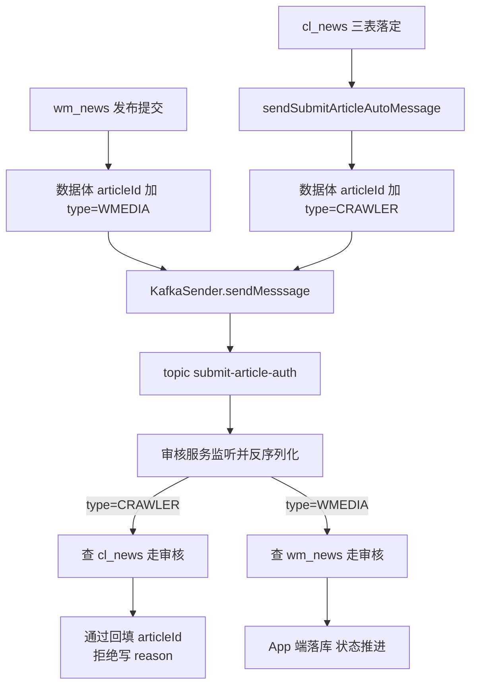

# 保存收尾发审核消息：爬虫文章接入自媒体同一条审核通道

> 🔒 安全提示：文中示例的口令/密钥均为课程教学环境演示口径，生产环境的安全要求见《安全与合规须知》。

三张表落库只是把事实记进了爬虫库，此刻 App 端的用户依然看不到它：爬虫库与 App 库之间横着审核这道闸，闸门开启的信号是一条 Kafka 消息。正向编排走到第四步，真正要回答的问题浮出来：消息里装什么、topic 沿用还是新开一条、发丢了算谁的、重发了怎么兜底。自媒体发布审核那一课已经把消息体系完整跑通，爬虫侧的接入正好检验那套设计的扩展性。动手前还留着一个编译错误的小尾巴：评论地址方法在 IDE 里提示缺 return，根因是替换动作直接写在了模板字段上，方法结尾没有返回值。修法是把模板复制进局部变量、替换在局部变量上完成、结尾返回局部变量，模板字段常驻内存，不被任何一篇文章的拼接结果污染。上一讲已经按修好的形态给出代码，这里只交代结论，重心放到审核消息上。

## 先给结论

- 消息数据体 `SubmitArticleAuto` 与自媒体审核共用，只有两个字段：文章 id 与来源类型，爬虫侧把 type 从 `WMEDIA` 换成 `CRAWLER`，自媒体发布审核时预留的扩展位在这里兑现。
- 信封继承 `KafkaMessage`，`getType()` 返回的串与 topic 配置同源；`MessagesRegister` 启动时扫描所有信封子类按串注册，消费端凭串反序列化。
- topic 直接复用自媒体审核那条通道：同一套三道审核没必要分家，隔离需求出现时再新增 topic，配置加一行、配置类加一个字段、监听器换一个 `topic()` 各是三个动作。
- 发送用 Kafka 封装那一课的 `KafkaSender`，异常只记日志不外抛，保存成果不被发送失败拖垮，事实始终在台账里。
- 幂等两头收口：key 用文章 id 让同篇消息进同一分区，消费端按文章 id 幂等审核；发送点唯一，重跑正向被判重短路，不会重复发消息。

## 消息怎么组装：数据体加信封

消息分两层，内层是业务数据体，外层是封装体系的通用信封。数据体在自媒体发布审核那一课已经建好，爬虫侧直接 new，字段只填两个：

```java
/** 提交自动审核的数据体，自媒体侧与爬虫侧共用 */
public class SubmitArticleAuto {
    /** 文章 id，审核侧凭它回查台账 */
    private Integer articleId;
    /** 文章来源：WMEDIA 自媒体发布，CRAWLER 爬虫抓取 */
    private ArticleType type;
    public enum ArticleType { WMEDIA, CRAWLER }
    // getter 与 setter 省略
}
```

为什么消息只带 id 不带标题正文？审核侧拿到 id 回查台账再开工，消息本身不承载业务数据，被重投、乱序都不影响正确性；消息轻，序列化与传输的代价也小。这是审核流程设计那一课就定下的口径，发送侧照办即可。编排类里的发送方法把组装与发送收在一处：

```java
@Autowired
private KafkaSender kafkaSender;
@Autowired
private KafkaTopicConfig kafkaTopicConfig;

/**
 * 发送消息，触发文章自动审核
 * @param id 台账主键，即爬虫文章 id
 */
private void sendSubmitArticleAutoMessage(Integer id) {
    log.info("开始发送自动审核文章消息, id: {}", id);
    // 数据体：文章 id + 来源类型，爬虫文章标记为 CRAWLER
    SubmitArticleAuto submitArticleAuto = new SubmitArticleAuto();
    submitArticleAuto.setArticleId(id);
    submitArticleAuto.setType(SubmitArticleAuto.ArticleType.CRAWLER);
    // 信封：同一个消息族，type 串与 topic 配置同源
    SubmitArticleAutoMessage message = new SubmitArticleAutoMessage(submitArticleAuto);
    // 复用自媒体审核同一条通道，key 用文章 id 让同篇消息进同一分区
    kafkaSender.sendMesssage(kafkaTopicConfig.getSubmitArticleAuth(),
            String.valueOf(id), message);
    log.info("发送自动审核消息完成, id: {}", id);
}
```

信封子类把数据体装进去并报出自己的名字：

```java
/** 信封子类，继承 KafkaMessage 通用信封 */
public class SubmitArticleAutoMessage extends KafkaMessage<SubmitArticleAuto> {

    public SubmitArticleAutoMessage() {}

    public SubmitArticleAutoMessage(SubmitArticleAuto data) {
        super(data);
    }

    @Override
    public String getType() {
        return "submit-article-auth";
    }
}
```

信封基类里的 `retry`、`time`、`data` 字段出自 Kafka 封装那一课的真实工具类，消费失败重试时调 `addRetry()` 计数，`getType()` 是启动扫描的注册键。骨架阶段预留的发送占位调用，本讲落地成编排类内的私有方法；如果工程里已经抽了独立的消息助手类，把这段组装逻辑平移过去即可，发送点保持唯一比放哪个类更重要。

## topic 复用还是新增

topic 名不进代码，统一配在 properties 里，由 `KafkaTopicConfig` 读成字段：

```properties
# 单通道消息：提交文章审核，自媒体发布与爬虫保存共用
kafka.topic.submit-article-auth=submit-article-auth
```

这条配置与字段 `submitArticleAuth` 在自媒体发布审核那一课已经存在，爬虫侧复用意味着配置类一行都不用加。判断复用还是新增的依据有三条：消费逻辑是否同一套、消息量级是否需要隔离、失败重试策略是否不同。爬虫文章与自媒体文章走同一套三道审核（标题匹配度、文本云审核、图片云审核），量级在项目阶段也压不垮单个消费组，复用是最短路径。什么时候该新增？爬虫抓取放量后，审核消息洪峰可能阻塞自媒体发布的审核时效，此时给爬虫单独开通道，改动收敛在三处：`kafka.properties` 加一行 topic 配置，`KafkaTopicConfig` 加一个字段，消费端实现封装的 `KafkaListener` 接口时 `topic()` 返回新名字，生产端把 `getSubmitArticleAuth()` 换成新字段。封装接口里 `topic()`、`factory()`、`group()` 三个方法决定了监听通道、容器工厂与消费组，新增通道对既有代码零侵入。

## 与自媒体发布审核消息的对照

两条业务线汇进同一条通道，分流靠消息里的来源类型：



关键路径在 I 节点：同一个消费者按 type 分流后，两侧回查的是各自的台账，审核动作与结果处理各自走各自的口径。两条线的差异摆到一张表里：

| 维度 | 自媒体发布 | 爬虫保存 |
|---|---|---|
| 触发点 | media 微服务提交文章接口 | 编排收尾，三表落定后 |
| 数据体 | `SubmitArticleAuto` | 同一个类 |
| 来源类型 | `WMEDIA` | `CRAWLER` |
| topic | `submit-article-auth` | 同一条通道 |
| 消息 key | UUID 随机串 | 文章 id |
| 审核数据源 | `wm_news` | `cl_news` |
| 通过后的动作 | App 端落库、状态推进 | 回填 `articleId` 打通两库 |

key 的差异值得单独解释。自媒体文章单篇单发，消息先后无所谓，key 用随机串让负载均匀摊到各分区；爬虫侧同一篇文章可能因补偿对账多次发消息，key 换成文章 id，同篇消息固定进同一分区，分区内的顺序性给「后发的消息反映最新状态」提供了保障，与消费端幂等互相配合。

## 幂等发送：丢了怎么办，重了怎么办

**发送侧的语义是消息即忘。** `KafkaSender` 的发送方法把序列化与投递包在 try-catch 里，异常只记日志不向外抛，方法名 `sendMesssage` 三个 s 是资料原样。这个设计放在保存链路里读意图很清楚：三张表已经落定，发送失败不能让编排抛异常回滚，台账里的行是事实，消息只是通知。

**丢了靠对账补发。** 补发的候选怎么找？台账状态列就是依据：`status` 长期停在待审核的行，意味着消息大概率没送达或审核没完成，定时对账扫出这批行重发消息即可。重跑正向编排不会自动补发，因为判重命中会整篇短路，这也是发送点必须唯一的原因：补发走专门的对账入口，不走业务编排，避免与判重逻辑互相缠绕。

**重了靠消费端幂等。** 消息重试、对账补发都会造成同一篇文章的消息到达两次，审核本身是状态迁移：同一篇文章审核两遍，得到的状态与只审一遍一致，回填 `articleId` 与写 `reason` 都按文章 id 定位，天然幂等。信封里的 `retry` 字段为消费失败的重试留了计数，重试几次、最后一次何时发生，日志里可查。

## 常见误区

- **消息体塞全文。** 错例是把标题、正文、图片全塞进消息，审核侧不查库直接用消息内容审核，消息一重投就出现新旧数据打架。正解是消息只带 id 与来源类型，事实以台账为准。
- **发送失败抛异常中断编排。** 错例是 try-catch 往外抛，前三步的落库成果被一次网络抖动连累。正解是异常吞掉记日志，靠台账对账补发，编排照常收尾。
- **topic 硬编码在调用处。** 错例是字符串常量散落各处，换通道要全文搜索替换。正解是 topic 进配置类字段，`getType()` 返回串与 topic 同源，换通道只改配置与字段。
- **来源类型漏设或写死。** 错例是组装时忘设 type，消费端拿不到类型无法分流；或图省事写死 `WMEDIA`，爬虫文章被当成自媒体文章回查 `wm_news`，查了个寂寞。正解是 `CRAWLER` 枚举显式设置，消费端对未知类型拒绝处理并留日志。

## 面试可能被问到的问题

1. 面试官追问：「为什么爬虫和自媒体共用一条 topic，不分开？」
   答：两条线的审核动作是同一套三道关，共用通道意味着一个消费者、一份审核配置，运维面最小。消息体里的来源类型已经把分流信息带上了，消费端按类型回查不同的台账即可。分开的理由只有一个：量级大到互相拖累审核时效，那时再新增 topic，改动收敛在配置、字段与监听器三处，复用期不欠账。
2. 面试官追问：「消息 key 用文章 id 还是 UUID，怎么选？」
   答：看是否需要同键有序。单篇单发、无顺序诉求的业务用 UUID，负载均匀；同一业务键可能多次发送的场景用业务 id，同键进同一分区，分区内 FIFO 保证后到的消息反映最新状态。爬虫文章存在补偿重发，选文章 id；自媒体发布单发一次，选 UUID，两种选择都有各自的道理。
3. 面试官追问：「消息发出去了但审核服务挂了，文章会永远停在待审核吗？」
   答：不会。消息在 broker 里持久化，服务恢复后继续消费，这是消息队列的基本盘。真正的风险窗口是发送本身就失败，兜底是台账对账：定时扫 status 停留在待审核且超时的行，重发消息。台账是事实源，消息只是触发器，事实在，通知随时可以重放。
4. 面试官追问：「消费端怎么保证审核幂等？」
   答：审核是纯状态迁移，按文章 id 回查后推状态，重复消费执行两遍与一遍结果相同。要防的是并发重复：同一篇文章的两条消息被两个消费线程同时拿到，加分布式锁按文章 id 串行化，或者让状态机本身只允许合法跃迁，已完成状态再收到消息直接确认跳过。锁与状态机双保险，幂等就不依赖单点假设。
5. 面试官追问：「信封模式套一层 KafkaMessage 有什么好处？」
   答：信封统一携带 retry 与 time 元数据，消费失败重试的计数与排序有据可依；getType 提供消息类型注册键，消费端按串找到信封类再反序列化，新消息类型只需加一个子类，收发两端靠约定而不是 if-else 堆判断。泛型把 data 的类型钉死，取数据不用强转。扩展性与类型安全都在这一层里。

## 配套资料

- 代码：`materials/code/05/头条day07/`，kafka 封装的工具类目录下 `KafkaSender.java`、`KafkaMessage.java`、`KafkaTopicConfig.java`、`MessagesRegister.java` 为真实实现，包名按本课规范改写为 `com.study.headline.common.kafka`；信封子类与发送方法按画面线整理、按本课写法补全。
- 代码：`materials/code/05/头条day10/` 资料目录为空，发送方法、数据体与对照说明按画面线整理、按本课写法补全（引用路径截至 `头条dayNN/` 层级，内层目录名含项目原名，不进入正文）。
- 参照：`materials/code/05/头条day01/`，数据库规范设计说明书，`cl_news` 状态列与 `article_id`、`reason` 的回填口径出自它。
- 环境：课程集群 node01~node03，MySQL root/123456；Kafka 以集群环境为准，消费端在 day11 的文章审核环节接入。
