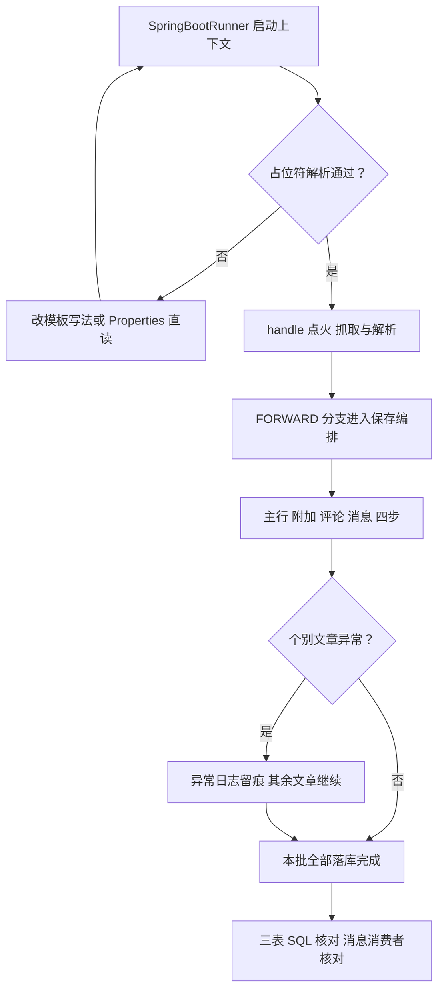

# 综合测试收官：正向保存链路端到端跑通与三表核对

> 🔒 安全提示：文中示例的口令/密钥均为课程教学环境演示口径，生产环境的安全要求见《安全与合规须知》。

代码写完与功能跑通之间隔着一次端到端验证。解析保存横跨下载、解析、落库、发消息四个环节，任何一环的配置缺口都会让文章停在半路，而且停得悄无声息。综合测试不写新业务代码，目标是让正向保存全链路真实跑一遍，用数据库三张表与消息两端的结果反推代码正确性，顺带把测试中暴露的两个真实错误当场解决：一个是启动即失败的占位符冲突，一个是单篇文章的 URI 非法字符异常。反向回写的调度接入留给 day11，本讲先把正向的验收标准立起来。

## 先给结论

- 测试基座沿用组件整合测试那一课的点火方式：`@SpringBootTest` 启动完整容器，注入 `ProcessingFlowManager` 调 `handle()`，主线程挂住等待抓取完成。
- 依赖服务先起：MySQL 与 MyCat、Redis（排重）、Kafka（审核消息）、ChromeDriver（Selenium 渲染动态页），缺一样链路就断在那一段。
- `@Value` 注入评论地址模板会让应用启动失败：模板值里的 `${authorId}` 被当成嵌套占位符递归解析，改成 Properties 直读 `crawler.properties` 绕开，或把模板占位符换成单花括号写法。
- 正向核对三条线：`cl_news` 新行 `status=1` 且 `article_id` 为空、`cl_comment` 评论行挂上 `news_id`、发送日志里的 id 与台账主键一致。
- 个别文章失败属正常现象：URL 拼上中文等未编码字符触发 `URISyntaxException`，单篇失败被线程池隔离，不拖垮整批，批量失败才需要排查。

## 测试基座与环境清单

测试类复用既有的点火入口，断点提前打在解析管道入口与保存编排处，观察 handleType 与解析项字段的完整性：

```java
@SpringBootTest
@ContextConfiguration(classes = SpringBootRunner.class)
public class ProcessingFlowManagerTest {

    @Autowired
    private ProcessingFlowManager processingFlowManager;

    @Test
    public void test() {
        processingFlowManager.handle();
    }
}
```

`handle()` 一路走到 `getSpider().start()` 点火，主线程按组件整合测试那一课的口径挂住，测试方法一返回容器就销毁，抓取线程跟着陪葬，这条纪律在整合测试时已经付过学费。环境依赖按启动顺序核对：数据库侧 MySQL（root/123456）在线、MyCat 数据源可用；Redis 在线，排重靠它挡重复 URL；Kafka 集群在线（node01~node03），审核消息要发往 broker；ChromeDriver 就位，评论这类动态接口的抓取走 Selenium 渲染，控制台出现 ChromeDriver 启动日志属正常。为了核对方便，课程演示把 `cl_news` 台账清空后重跑，新行与旧数据不再混淆；动手测试时清空或换一批测试 URL，二选一。

## 启动即失败：占位符撞了 Spring 语法

debug 启动第一脚就踢到铁板，测试直接失败，控制台报 `PropertySourcesPlaceholderConfigurer` 无法解析属性。定位到评论地址模板的注入处：`@Value("${crawler.comment.url}")` 拿到的原始值里带着 `${authorId}`、`${articleId}` 这样的槽位，占位符解析器把外层 `${crawler.comment.url}` 解析完之后，继续把值里残留的 `${...}` 当嵌套占位符向配置环境索要 `authorId`，配置里当然没有这个键，解析器对不可解析占位符零容忍，启动直接终止。问题不是配置写错，是模板语法与 Spring 的占位符语法撞了车。

修复有两条路。**治本的一条：错开语法。** 模板占位符改成单花括号 `{authorId}`，替换逻辑按单花括号匹配，值里不再出现 `${`，Spring 就不会越权解析。**课程演示选的一条：绕开注入。** 模板不走 `@Value`，用 `Properties` 直读配置文件，`Properties.load` 对值不做任何占位符解析，原样返回：

```java
/** 直接读 crawler.properties，Properties.load 不做占位符解析 */
private String loadCommentUrlTemplate() {
    try (InputStream in = getClass().getClassLoader()
            .getResourceAsStream("crawler.properties")) {
        Properties properties = new Properties();
        properties.load(in);
        return properties.getProperty("crawler.comment.url");
    } catch (IOException e) {
        log.error("读取 crawler.properties 失败", e);
        return null;
    }
}
```

两条路选其一即可。绕开的代价要说清楚：这批配置不再享受 Spring 的配置刷新与环境隔离，值变更要跟着应用重启，多个类都要读时收口到一个配置工具类，别让 `Properties` 加载散落各处。模板值与占位符语法不能撞车，才是这个错误的真正教训。

## 正向链路核对：三表与一条消息

错误修完，断点放行，日志按固定节奏刷出：开始添加数据、开始插入新的文章、插入完成、开始处理附加、获取评论、发送自动审核消息。核对动作从日志转进数据库，三条 SQL 一次拉平：

```sql
SELECT id, url, title, type, channel_id, status, article_id
FROM cl_news ORDER BY created_time DESC LIMIT 20;

SELECT news_id, url, read_count, comment, likes, count, next_update_time
FROM cl_news_additional ORDER BY created_time DESC LIMIT 20;

SELECT news_id, user_name, content, comment_date
FROM cl_comment ORDER BY created_time DESC LIMIT 20;
```

核对点逐列过：主行 `status=1` 待审核、`article_id` 为空说明审核闸门还没放行，`channel_id` 非空说明标签两级翻译成功；附加行与主行 `news_id` 对齐，`count` 从 0 起步，`next_update_time` 已按首轮间隔顺延；评论行 `news_id` 与台账主键一致，评论内容不是整页 HTML 而是剥好的字段。三张表对齐，正向落库半边验收完毕。

消息这半边核对两处。日志行里的 id 与台账主键一致，开始与完成成对出现；审核服务尚未接入时，用命令行消费者确认消息真实到达了 broker：

```bash
kafka-console-consumer.sh --bootstrap-server node01:9092 \
  --topic submit-article-auth --from-beginning --max-messages 5
```

打出来的 JSON 里 `type` 是 `CRAWLER`、`articleId` 与台账主键一致，消息体核对通过。命令行核对是审核服务接入前的补充手法，day11 消费端上线后，这段验证交给审核日志。

测试的执行路径与两条错误分支画在一起：



关键路径在 G 节点的分流：单篇异常只带走单篇，线程池里的其他文章照常走完四步，这正是把解析落库放进独立线程池的回报。

## 个别失败属正常：URI 非法字符

跑批中途控制台抛出 `java.net.URISyntaxException: Illegal character in path`，位置指向评论地址：目标站的文章页地址或作者标识里带着中文等未编码字符，拼进评论接口地址后，URI 构造器对非法字符零容忍，单篇文章的评论抓取当场失败。这个现象要建立正确的心理预期：爬虫做不到百分之百成功，源站改版、字符编码差异、反爬策略都会造成个别失败，失败不等于代码有错。工程目标从来不是消灭失败，而是把失败限制在单篇范围并留下可追溯的日志。判断标准看两个量：失败率与失败分布。多数文章成功、零星失败，属于正常的源站差异；同一规则成批失败，才是解析规则或编码处理出了问题，要回头排查。观察的入口就是贯穿链路的带 url 日志，一条 grep 拉全单篇的处理轨迹，成功与失败一目了然。

## day10 收官清单

解析保存模块到此收官，九个环节的成果对齐一遍：

- 思路分析：正向四步、反向单表、失败三层处置的作战地图。
- 解析抽象类与子类框架：模板方法留洞，方向分流就位。
- 工具与线程池：整形、压缩、反射、日期、字符串工具与异步底座配齐。
- 保存骨架：内容整形、图文类型、判重、字段组装、主键回填。
- 附加与评论：统计数据一行、评论多行，指数退避种子埋下。
- 审核消息：数据体加信封，复用同一条审核通道，幂等口径收口。
- 反向更新：只动附加表，轮次递增与时间顺延成对出现。
- 综合测试：端到端跑通，三表与消息双端验收。
- 遗留事项：反向回源的调度入口在 day11 接入，审核消费端同日上线。

## 常见误区

- **环境不齐就开跑。** 错例是 Redis 没启动，排重失效，同一篇文章反复入库；MyCat 没启动，数据源连不上，链路死在最前面。正解是按依赖清单逐项确认再点火，启动日志里逐个看到依赖就绪的标志。
- **模板值与占位符语法混用。** 错例是值里留 `${槽位}` 又走 `@Value` 注入，嵌套解析启动即炸。正解是语法错开或绕开注入，选一条路走到底。
- **追求测试全绿。** 错例是看到个别 URISyntaxException 就回头大改代码，把偶发失败当成系统性故障。正解是看失败率与分布，零星失败记录在案，批量失败才升级排查。
- **测试库带着旧数据跑。** 错例是不清台账直接测，判重命中后新数据全被跳过，误以为保存功能坏了。正解是清空台账或换测试 URL，让本轮结果可辨认。

## 面试可能被问到的问题

1. 面试官追问：「端到端测试你怎么设计核对点？」
   答：从数据流的两端反推。落库端按表的依赖关系核对：主行的状态与关联列、附加行与评论行的外键对齐、调度种子的初值；消息端核对发送日志与 broker 里的真实消息体。每列核对点都能回答「这一列是谁在哪个环节写的」，写不出答案的列就是潜在断点。日志里的 url 串起单篇轨迹，是两端之外的第三条证据链。
2. 面试官追问：「@Value 的嵌套占位符报错怎么定位？」
   答：报错栈里出现 PropertySourcesPlaceholderConfigurer 与一个找不到的属性名，而那个属性名恰好出现在另一个配置的值里，就是嵌套解析。占位符解析器对值里的 `${...}` 会递归求值，解析不到且不容忍未解析占位符时就抛异常。修复方向是让值里不再出现 `${`，换占位符写法或改用 Properties 直读，验证方式是启动通过加值原样可用。
3. 面试官追问：「爬虫的失败治理怎么做，个别失败要不要修？」
   答：先把失败分类：源站差异类（编码、改版）零星出现，记录后定期观察；规则缺陷类成批出现，必须修。监控口径是失败率与失败分布，单篇失败被线程池隔离不拖累整批，带 url 的日志让失败可归因。治理目标是失败率收敛与可追溯，不是零失败，源站在变，零失败的目标本身不现实。
4. 面试官追问：「消息发没发出去，你怎么验证？」
   答：三层证据。应用日志里发送开始与完成成对出现且带文章 id；broker 侧用命令行消费者抽样打印消息体，核对类型与 id；消费端上线后看审核服务的消费日志与台账状态推进。三层分别对应「代码发了」「broker 收了」「下游用了」，任何一层断掉都能定位到具体环节。
5. 面试官追问：「为什么把解析落库放进独立线程池，同步做不行吗？」
   答：管道入口跑在抓取线程上，落库、二次请求、发消息都是慢操作，同步做会把 WebMagic 的抓取节奏拖住，下载等解析、解析等落库，吞吐塌方。独立线程池让下载与落库流水并行，单篇异常在池内消化不波及抓取线程。代价是异步后的可观测性变差，所以进入与结束两条日志、异常日志留痕成了纪律，测试时断点也要打在线程池任务内部。

## 配套资料

- 代码：`materials/code/05/头条day10/` 资料目录为空，测试基座、配置直读与核对 SQL 按画面线整理、按本课写法补全（引用路径截至 `头条dayNN/` 层级，内层目录名含项目原名，不进入正文）。
- 参照：`materials/code/05/头条day01/`，数据库规范设计说明书，三张台账的列口径与状态语义出自它。
- 参照：`materials/code/05/头条day07/`，kafka 封装的工具类目录下 `KafkaSender.java`，消息发送与命令行核对的通道基础出自它。
- 环境：课程集群 node01~node03，MySQL root/123456；示例站点一律以 example.com 占位，动手时替换为实际配置的目标站点。
