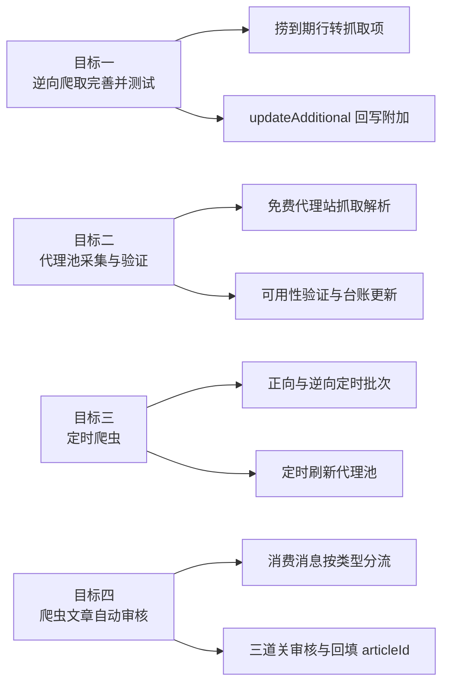

# day11 的目标地图：代理池自给自足、定时调度与爬虫文章审核

> 🔒 安全提示：文中示例的口令/密钥均为课程教学环境演示口径，生产环境的安全要求见《安全与合规须知》。

day10 收官时链路有了骨架：正向四步能端到端跑通，反向回写方法就位，审核消息通道打通。但三个缺口摆在明面上：代理池里的 IP 是手工导入的存量，数量少、可用性没验证过，真挂上去请求多半打水漂；抓取与回源全靠手动点火，文章的统计刷新与增量抓取还谈不上「系统」；审核消息发出去之后没人消费，文章永远停在待审核。day11 的四个目标正好逐个补缺口，画面线里把当天内容归成「爬虫系统完善」与「文章审核」两大块，前三个目标属于完善，第四个目标开新篇。把目标与技术点先对上号，后面每一讲才知道自己站在地图的哪个位置。

## 先给结论

- 目标一，逆向爬取完善并测试：把回源链路的缺口接上，捞到期行、重新解析、回写附加，与正向共用下载解析设施。
- 目标二，IP 代理池管理与更新：爬虫采集免费代理站，更新时同步验证可用性，代理池从人工导入转为自采自用，画面线口径叫「增加代理下载」。
- 目标三，定时爬虫：正向批次、逆向回源、代理池刷新与验证三类调度统一由 cron 驱动，手动点火升级为定时运转。
- 目标四，爬虫文章自动审核：消费审核消息按来源类型分流，审核链与自媒体发布审核同构，爬虫侧流程更简单。

## 四个目标逐条拆

课件目标四条不是并列关系，是一条链：代理池供给抓取的出口（目标二），抓取由调度驱动（目标三），抓到的文章经审核进入 App 端（目标四），逆向爬取的完善（目标一）是链路上承上启下的一段。映射成图：



图里 B 与 C 的关系最值得盯：代理池的采集与验证本身就是一种爬虫，目标二给目标三提供了第三个被调度的对象；D 依赖 day10 打通的消息通道，消费端一接上，保存与审核两段才算真正握手。

## 目标一：逆向爬取的完善与测试

反向链路目前的进度是：回写方法 `updateAdditional` 已经填实，附加台账的更新次数与下次更新时间成对推进。缺口在链路的两端：谁把 `next_update_time` 到期的行捞出来？捞出来的行怎么变成回源抓取项交给下载与解析？day11 把这段接上，调度侧用 `queryListByNeedUpdate` 把到期行整批捞出，转成抓取项后复用既有的下载与解析设施，解析项带着 REVERSE 标记到达编排层，走的就是已经在跑的反向分支。

测试口径与正向对称：正向测「新文章能进店」，逆向测「旧文章的数字能刷新」。改一条台账行的下次更新时间到当前时刻之前，触发回源，验证三个点：该行统计数字被新解析结果覆盖、更新次数加一、到期时间按新轮次顺延。反向抓取在源站的表现比正向挑剔，已入库文章的评论区、统计区随时间变化，解析规则的容错要经得起这个检验，这正是把「完善」与「测试」放在同一个目标里的原因。

## 目标二：IP 代理池的自采与验证

代理池的现状按目标的说法是「维护着一个池子，但不能直接使用」：里面的 IP 来自手工导入，来源不可控，可不可用全凭运气。day11 的升级路径是把代理的来源也交给爬虫：免费代理发布站本身就是目标站点，抓回来解析出主机与端口，验证合格后落台账。这一套正好复用爬虫工程的全部既有设施，目标页解析规则抽字段，代理工厂把代理对象翻译成 HttpClient 能用的形态。

配置装配按画面线的代码来，代理供给者在配置类里成 Bean，补货回调指向代理池服务：

```java
@Autowired
private CrawlerIpPoolService crawlerIpPoolService;

@Bean
public CrawlerProxyProvider getCrawlerProxyProvider() {
    CrawlerProxyProvider crawlerProxyProvider = new CrawlerProxyProvider();
    crawlerProxyProvider.setUsedProxyIp(usedProxyIp);
    // 随机代理回调：池内补货与状态维护交给代理池服务
    crawlerProxyProvider.setProxyProviderCallback(new ProxyProviderCallback() {
        @Override
        public void callback(ProxyInfo proxyInfo) {
            // 按回调结果更新代理的可用状态，失效即移除
        }
    });
    return crawlerProxyProvider;
}
```

这段装配把三件事钉在一起：启用开关 `usedProxyIp` 决定抓取是否挂代理；回调把「怎么补货、怎么记账」交给 `CrawlerIpPoolService`，判重、落库、更新状态的八方法在保存准备阶段就备好了；供给者内部的读写锁与补货阈值维持 day08 的口径，可用数掉到阈值之下自动触发拉新。验证环节是采集侧的新增点：候选代理要挂上去发一次真实请求，响应合格才算入库，免费代理失效率极高，不验证的采集等于往池子里倒沙子：

```java
/** 候选代理可用性验证，目标站以 example.com 占位，按本课写法补全 */
private boolean validateProxy(CrawlerProxy proxy) {
    try {
        // 挂代理请求轻量地址，超时时间短，验完即走
        HttpResponse response = proxyHttpClientDownloader
                .fetchThroughProxy("https://www.example.com/health", proxy, 3000);
        return null != response
                && response.getStatusLine().getStatusCode() == 200;
    } catch (Exception e) {
        log.info("代理验证失败, proxy: {}", proxy.getProxyStr());
        return false;
    }
}
```

验证通过走 `saveCrawlerIpPool` 落台账，已存在的走 `updateCrawlerIpPool` 刷新状态；运行期代理请求失败，`unavailableProxy` 把它标记为不可用，池子的进与出两个口都闭环，代理下载能力（讲义口径「增加代理下载」）才真正可用。

## 目标三：把调度串起来

目标三的表述是「完成定时爬虫文章」，定时的范围覆盖正向与逆向，还包括定时更新与验证 IP 代理池。三类调度统一由 cron 驱动，cron 表达式的语法在爬虫概念阶段讲过，这里落进工程配置：

```yaml
# 三类定时调度示例，间隔按课程节奏给出，按本课写法补全
crawler:
  cron:
    crawl-forward: "0 0 2 * * ?"     # 定时正向批次，抓新文章
    crawl-reverse: "0 0 4 * * ?"     # 定时逆向回源，刷统计
    ip-pool-refresh: "0 30 3 * * ?"  # 定时采集并验证代理池
```

调度能安心定时跑的前提是幂等。正向批次重复发起，判重把已抓过的 URL 挡在门外；逆向重复捞行，台账的到期时间顺延机制保证一行不会被连刷两次；代理池重复采集，判重加验证让重复 IP 进不了台账。三层幂等都在前面各讲备好，调度层只管按点发起。错峰也在这层做：正向放凌晨、代理池刷新错开半小时、回源再往后，三类任务的请求高峰互相错开，源站与代理站都不会在同一个时刻被集中轰炸。

## 目标四：爬虫文章自动审核

第四个目标在当天分量最重：爬虫文章的自动审核。逻辑与自媒体文章审核类似，且按课程的判断，比自媒体那条更简单。消费端复用 Kafka 封装体系的监听注册，实现 `KafkaListener` 接口把 `topic()` 指向 `submit-article-auth`，`onMessage` 里反序列化信封、校验来源类型是 `CRAWLER`、取文章 id 回查 `cl_news`，然后走三道关：标题与内容匹配度、文本云审核、图片云审核。审核通过迁入 App 端文章表并回填 `articleId`，爬虫库与 App 库由此真正打通；拒绝把理由写进 `reason` 留痕，等待人工复核。

爬虫侧更简单的理由有三条。文章在保存时已按前端约定整形，审核侧拿到解压后的块结构直接送审；标签与频道在保存时已完成两级翻译，审核结果落地不需要再归类；自媒体那条链上还有作者身份校验、发布时间处理这类与作者强相关的动作，爬虫文章没有作者体系，这些环节整体消失。消息体、通道、信封在 day10 已经备齐，day11 的工作集中在消费侧的分流与审核编排，两条业务线在同一个审核服务里汇流。

## 常见误区

- **免费代理不验证直接入库。** 错例是采集到主机端口就落台账，池子里混进大量死代理，下载失败率飙升还误伤正常抓取。正解是验证合格才入库，运行期失败标记不可用，进出两个口都闭环。
- **把逆向当成正向的复制粘贴。** 错例是回源流程照抄正向编排，判重挡路、消息重发、重复落库三个坑全踩。正解是反向只更新附加表，复用的是下载解析设施与间隔计算，编排各走各的分支。
- **定时任务无幂等裸跑。** 错例是 cron 到点无条件发起，上一轮没跑完下一轮又叠上来，同一批数据被处理两遍。正解是判重、台账状态、到期顺延三层幂等兜底，调度只管发起。
- **爬虫审核另写一套。** 错例是为爬虫文章复制一份审核代码，两套标准并存，同一篇文章两边审核结论不一致。正解是复用三道关审核链，按消息里的来源类型分流，差异只在数据源与流程长短。

## 面试可能被问到的问题

1. 面试官追问：「免费代理池怎么保证可用率？」
   答：入口验证加运行期闭环。采集时挂代理发真实请求，响应合格才入库，把失效率在进池前压掉一轮；运行期请求失败即标记不可用并移除，可用数低于阈值触发补货，池子保持滚动。免费代理天然不稳，可用率的正确目标不是高留存，而是快速淘汰与持续补充，台账记录失败原因供后续调整采集源。
2. 面试官追问：「正向调度和逆向调度的触发机制差别在哪？」
   答：正向由 cron 周期发起批次，从初始化 URL 清单出发沿链接推进，靠排重挡增量重复；逆向不是按 cron 直接扫文章，而是附加台账里的 next_update_time 到期行构成天然队列，调度只需要定期捞到期行，频率策略由指数退避的轮次机制自管理。正向的节奏在调度配置里，逆向的节奏在数据行上，两者由同一套定时入口驱动。
3. 面试官追问：「爬虫文章审核和自媒体文章审核共用什么、差异在哪？」
   答：共用消息通道与信封、三道关审核逻辑、状态机与回填机制，消息里的来源类型决定回查哪张台账。差异集中在审核前的数据准备：爬虫文章在保存时已完成内容整形与标签翻译，作者体系缺失让相关校验整体消失，所以流程更短。差异被压缩到数据源一层，审核核心不分家，这是消息体设计时预留来源类型字段的回报。
4. 面试官追问：「定时任务在集群里部署，怎么避免重复执行？」
   答：几个层次可选：调度配置收敛到单一实例，简单但失去高可用；分布式锁按任务键抢锁执行，锁持有方跑批，其余节点跳过；或者用支持分片的调度框架把批次拆给多实例。项目阶段用的思路是幂等优先，判重与台账状态让重复发起无害，锁只是减少无谓竞争。设计原则是先保证重复执行不产生脏数据，再谈执行效率。

## 配套资料

- 代码：`materials/code/05/头条day11/` 资料目录为空，代理池采集验证、定时调度与审核消费的示例按画面线整理、按本课写法补全（引用路径截至 `头条dayNN/` 层级，内层目录名含项目原名，不进入正文）。
- 参照：`materials/code/05/头条day07/`，kafka 封装的工具类，消费端 `KafkaListener.java`、`MessagesRegister.java` 为真实实现基础，包名按本课规范改写为 `com.study.headline.common.kafka`。
- 参照：`materials/code/05/头条day01/`，数据库规范设计说明书，`cl_ip_pool` 台账与 `cl_news` 状态列的字段口径出自它。
- 环境：课程集群 node01~node03，MySQL root/123456；代理示例地址一律以 127.0.0.1 占位，验证目标站以 example.com 占位，动手时替换为实际配置。
