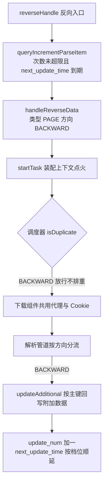

# 逆向抓取实现：增量回源从附加台账出发

> 🔒 安全提示：文中示例的口令/密钥均为课程教学环境演示口径，生产环境的安全要求见《安全与合规须知》。

正向流程把文章采回来入库之后，抓取并不算完。阅读数、点赞数、评论数天天在变，一篇上周的热文这周的统计已经换了一批数字，爬虫若只会往前抓，库里的互动数据永远停留在采集当天。需求里那句话就是为这时准备的：点击量高的文章按周期反向重抓，回刷阅读与评论数据。这一讲把反向入口写进流程管理器，让同一台引擎既能向前采新，也能回头刷新。

## 先给结论

- 反向入口是 `ProcessingFlowManager` 的 `reverseHandle` 方法：查增量名单、重设条目方向、点火，动作编排与正向的 `handle` 同构。
- 增量名单由 `CrawlerNewsAdditionalService.queryIncrementParseItem` 提供，到期的附加台账行被转成抓取条目，反向抓取的种子不靠配置拼 URL，而是从已有数据里长出来。
- `handleReverseData` 逐条重设两个枚举：文档类型回 `PAGE` 才能走页面解析，处理方向标 `BACKWARD` 才能在下游进反向分支。
- 点火复用正向的 `startTask`，五个流程环节、下载组件原样共用，反向只是参数不同。
- 排重闸门对反向放行：只有 FORWARD 才排重，BACKWARD 直接入队，这条不对称规则在调度器里已经写好。

## 反向抓取的定位：主行不动，附加回刷

反向与正向的差别不在「抓」这个动作，而在抓回来干什么。正向抓新文章，标题正文解析入库走审核；反向回源老文章，页面还是那个页面，要的只是页面上的统计数字。所以反向流程的落点只有一张表：`cl_news_additional` 附加台账，按主键回写阅读、点赞、评论这些随时间变化的字段，文章主表一行不碰。

抓哪些文章也不是拍脑袋。附加台账每行都带着 `next_update_time` 与 `update_num` 两个调度字段：到期时间按热度档位顺延，回源次数设了止损上限。`queryIncrementParseItem` 一次查询把「次数未超限且到期」的行全捞出来，这就是反向流程的增量名单。名单里的行本身存着文章 URL，转换方法把它装进抓取条目，种子数据信手拈来，不需要任何额外配置。

## reverseHandle：三步编排

```java
@Autowired
private CrawlerNewsAdditionalService crawlerNewsAdditionalService;

/**
 * 逆向处理：抓取增量文章，回刷附加数据
 */
public void reverseHandle() {
    //获取已经存在的数据：到期待回源的增量文章
    List<ParseItem> parseItemList =
            crawlerNewsAdditionalService.queryIncrementParseItem(new Date());
    handleReverseData(parseItemList);
    log.info("开始进行数据逆向更新，增量数据数量为：{}", parseItemList.size());
    if (null != parseItemList && !parseItemList.isEmpty()) {
        startTask(parseItemList, CrawlerEnum.HandleType.BACKWARD);
    } else {
        log.info("增量数据为空，不能进行数据更新");
    }
}
```

编排三步一目了然。第一步查增量，参数是当前时间，SQL 里 `next_update_time <= 当前时间` 的行全部命中，到期没到期的判断留给数据库，代码不逐条比较。第二步 `handleReverseData` 重设条目属性，下一节展开。第三步判空点火：名单非空交给 `startTask`，方向参数从正向默认换成 BACKWARD；名单为空只打一条日志，不点火、不抛错，定时任务空转一圈是常态，不值得惊动调用方。日志把名单大小打了出来，跑批时看一眼这个数字就知道这一轮回源的规模，连续几轮为零就要回头检查台账的调度字段有没有在正常顺延。

## handleReverseData：方向写在条目上

```java
/**
 * 设置反向抓取的类型与处理方向
 */
private void handleReverseData(List<ParseItem> parseItemList) {
    if (null != parseItemList && !parseItemList.isEmpty()) {
        for (ParseItem parseItem : parseItemList) {
            //反向也要抓详情页，类型设为 PAGE 才能走页面解析
            parseItem.setDocumentType(CrawlerEnum.DocumentType.PAGE.name());
            //强调这条数据是逆向抓取
            parseItem.setHandleType(CrawlerEnum.HandleType.BACKWARD.name());
        }
    }
}
```

两行赋值各有一个理由。文档类型设 `PAGE` 是因为反向抓的是文章详情页，解析链路按文档类型分发解析器，只有 PAGE 才会进正文解析与字段抽取；附加台账行里记录的地址就是详情页地址，类型不重设，下游分发器找不到对应解析器，数据半路就丢了。处理方向设 `BACKWARD` 是反向流程的身份证，方向一旦标定，后面每个环节都靠它做决策：调度器据此放行排重，解析管道据此把数据送进更新分支而不是保存分支。

方向判定用枚举的 `name()` 字符串比对，与解析器侧、调度器侧的口径完全一致。`BACKWARD` 与 URL 台账里 `handle_type` 字段注释的正反两种方向是同一套词汇，数据库语义与运行时语义对得上，排查问题时台账里的方向值可以直接对进代码分支。

## startTask 复用：同一台引擎，不同参数

点火方法原样复用正向的 `startTask`：

```java
public void startTask(List<ParseItem> parseItemList, CrawlerEnum.HandleType handleType) {
    ProcessFlowData processData = new ProcessFlowData();
    processData.setHandleType(handleType);
    processData.setParseItemList(parseItemList);
    for (ProcessFlow processFlow : processFlowList) {
        processFlow.handle(processData);
    }
    crawlerConfig.getSpider().start();
}
```

上下文对象装着方向与条目清单，流程环节按优先级逐个 `handle`，末尾点火让 Spider 起线程进入抓取循环。反向与正向在这里只差一个参数，组件清单、优先级排序、下载组件、解析管道全部原样共用。正向反复打磨的下载兜底、Cookie 管理、代理供给，反向直接受益，一套设施两个方向，维护成本没有翻倍。



图的关键在两处分流。调度器那一关，反向名单里的 URL 全是处理过的老地址，正向的排重规则会把它们全数拦下，所以判定方向为 BACKWARD 时直接放行，这是需求而不是漏洞。解析管道那一关，同一个入口按方向分成两条业务线，BACKWARD 进 `updateAdditional`，抓回页面重新解析出新的统计数字，按主键回写非空字段，回写完成顺延下一次到期时间，下一轮名单自然滚动起来。

## 常见误区

- **反向入口另起炉灶写一套抓取流程。** 错例是给反向单独组装一个 Spider、单独配下载与解析，两套流程各自维护，正向修个反爬漏洞反向感知不到。正解是复用 `startTask` 与全部流程环节，反向只改方向参数。
- **忘了重设文档类型。** 错例是条目带着台账行转换出来的默认类型进链路，分发器匹配不到 PAGE 解析器，抓回来的页面无人处理。正解是 `handleReverseData` 里类型与方向成对设置，两行赋值一个都不能少。
- **把反向数据也送去排重。** 错例是调度器不分方向一律判重，反向名单在入队前就被拦光，回源永远跑不起来。正解是先取方向再判定，BACKWARD 分支直接放行并记日志。
- **空名单还点火。** 错例是查回空列表也调 `startTask`，Spider 空跑一轮占住线程与代理额度。正解是判空在前，空名单只记日志。

## 面试可能被问到的问题

1. 面试官追问：「反向抓取的名单怎么生成，为什么不重新配置一批 URL？」
   答：名单由 `queryIncrementParseItem` 从附加台账查出，条件是回源次数未超限且 `next_update_time` 到期。台账行本来就存着文章地址，转换成抓取条目即可，配置零成本；调度字段让热门文章回得勤、冷门文章回得慢，抓取预算按数据价值分配。
2. 面试官追问：「方向信息在链路里怎么传递？」
   答：条目上先标 `BACKWARD`，进调度器后随请求属性流转，调度器用 `crawlerHelper.getHandleType` 取回判定是否排重，解析管道从解析项上取回决定走保存还是更新分支。方向挂在数据上而不是线程上下文里，多线程抓取不会串线。
3. 面试官追问：「反向为什么不做 URL 排重？」
   答：排重的语义是同一条地址不重复处理，反向恰恰要反复处理同一条地址，回刷统计数字本来就是按周期重抓。若把反向也排重，名单里的老地址第一次就全被拦下。所以调度器只对 FORWARD 排重，反向放行是业务需求。
4. 面试官追问：「反向流程抓回的页面为什么不更新文章主表？」
   答：标题与正文一旦发布基本不变，重抓重写主表收益为零还引入覆盖风险；真正变化的是阅读、点赞、评论这些统计数字，落点只有附加台账。按主键选择性回写非空字段，主表一行不碰，变更面收敛到最小。
5. 面试官追问：「回源次数为什么要设上限？」
   答：外部页面随时可能改版或下线，某篇源页一旦失效，按周期无限回源只会白烧请求额度还拖慢批次。台账里 `update_num` 记次数，超过上限自动退出名单，把额度让给还活着的页面，这是更新任务的止损设计。

## 配套资料

- 代码：`materials/code/05/头条day11/` 资料包为空，`reverseHandle` 与 `handleReverseData` 按画面线整理、按本课写法补全（引用路径截至 `头条dayNN/` 层级，内层目录名含项目原名，不进入正文）。
- 参照：`materials/code/05/头条day01/` 的数据库规范设计说明书，附加台账调度字段与 URL 台账方向字段的注释口径出自它；`startTask`、调度器放行规则与解析管道分流见 day09、day10 各讲。
- 环境：课程集群 node01~node03，MySQL root/123456；验证反向流程前确认 Redis 与 Mycat 已启动，附加台账里已有到期待回源的数据行。
