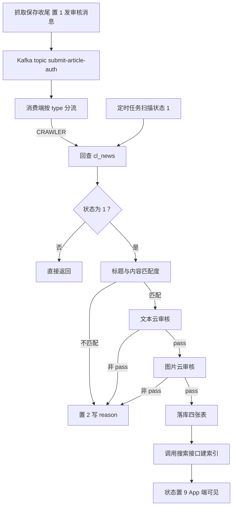

# 爬虫文章的自动审核：同一套审核思路的简化落地

> 🔒 安全提示：文中示例的口令/密钥均为课程教学环境演示口径，生产环境的安全要求见《安全与合规须知》。

自媒体文章审核那条链刚在 admin 端跑顺，爬虫侧的稿件就排着队进来了：每篇抓取保存完成后，编排层都会发一条审核消息，消息体里的来源类型是 CRAWLER，这是保存收尾那一讲定好的口径。顺手的问题立刻浮出来：能不能把自媒体审核的 `ReviewMediaArticleService` 整套拿来复用？答案是不能整套搬，但也不必从零想：审核动作同源，状态字典、决策分支、落库清单三处全变了。这一讲把流程图摊开，把「哪些照搬、哪些砍掉」讲透，后面几讲照着图填代码。

## 先给结论

- 爬虫文章的状态字典收窄成三个值：1 待审核（抓取入库即置 1）、2 审核失败、9 已发布；自媒体侧的草稿、人工通过、待人工、待发布在爬虫链上都不存在。
- 砍状态的理由来自来源性质：源站内容抓来时已经是发布态，没有定时发布的场景；也不会有人修改重提一篇爬来的文章，人工复审环节随之省去。
- 审核动作仍是三道关：标题与内容匹配度、文本云审核、图片云审核，与自媒体侧同源；合并规则从三态简化成两态，非 pass 即失败。
- 审核通过落库四张表：`ap_article`、`ap_article_config`、`ap_article_content`、`ap_article_label`，比自媒体侧多一张标签关联表、少一次作者档案的查无则插。
- 双入口驱动：Kafka 消息单篇触发是主路，定时任务扫状态 1 批量重入是兜底，两个入口汇到同一个核心方法。

## 状态字典为什么砍掉一半

自媒体审核链的状态字典有八个值，因为自媒体稿件有完整的生命周期：作者可以存草稿、可以指定发布时间、机器拿不准的内容可以转人工。爬虫文章没有这个生命周期，它的起点是「源站已发布」，终点是「本站可检索」，中间只隔一道机器复核闸。

**待发布（8）没有存在的前提。** 待发布的语义是审核通过但发布时间未到，等发布任务到点再推 App 端。爬虫文章抓取入库时源站已经发布过，源站的发布时间记录在台账的 original_time 列里，本站的发布决策只有「过审即见」一种，时间维度在这条链上消失了。

**人工环节（4 与 5）不设出口。** 源站公开内容在源站侧已经走过一轮内容管理，本站的机器审核是复核而不是首发裁定；机器判失败就直接失败，原因写进 `reason` 列留痕。灰色地带怎么办？爬虫链的处置是运营在台账里人工排查、修状态重跑，不占状态机的正式出口，这正是状态字典敢收窄的底气。

失败与通过各有一个落点：失败写 `reason`，通过回填 `article_id` 打通爬虫库与 App 库，这两个列在保存收尾那一讲就预留好了。三个状态值集中定义成常量类：

```java
/** 爬虫文章状态字典：这条链上只有三个合法取值 */
public class CrawlerNewsConstants {

    /** 1 待审核，抓取保存入库即置 1 */
    public static final byte PENDING_REVIEW = 1;
    /** 2 审核失败，原因写 reason */
    public static final byte FAIL_REVIEW = 2;
    /** 9 已发布，审核通过且已迁入 App 端 */
    public static final byte PUBLISHED = 9;
}
```

消息进来先按来源类型分流。保存收尾那一讲说过，爬虫与自媒体共用同一条审核 topic，分流信息全在消息体的 type 字段上：

```java
// 消费端按来源类型分流，骨架示意，按本课写法补全
if (SubmitArticleAuto.ArticleType.CRAWLER == submitArticleAuto.getType()) {
    // 爬虫文章：转交爬虫审核服务，回查 cl_news
    reviewCrawlerArticleService.autoReviewArticleByCrawler(submitArticleAuto.getArticleId());
} else if (SubmitArticleAuto.ArticleType.WMEDIA == submitArticleAuto.getType()) {
    // 自媒体文章：走既有的自媒体审核主链，回查 wm_news
    reviewMediaArticleService.autoReviewArticleByMedia(submitArticleAuto.getArticleId());
}
```

分流写在最前面是硬纪律：类型不认识的消息直接拒绝处理并留日志，宁可漏处理也不能错处理，拿爬虫文章的 id 去查 `wm_news`，查出来的永远是空。

## 与自媒体审核的三处差异

**第一处差异是回查对象。** 台账的角色两边相同，都是事实源；列结构不同：`cl_news` 的 labels 存的是标签 id 串，content 存的是 gzip 压缩串。后一个差异会直接影响审核的第一步动作，专门留到审核落地那一讲展开。

**第二处差异是合并规则。** 自媒体侧云审核三态合并：block 判死、review 转人工、pass 才放行。爬虫侧状态机里没有「待人工」这个位子，三态被迫并成两态：等于 pass 放行，其余（block、review、返回 null、调用异常）一律判失败写原因。简化不是偷懒，是状态机约束下的必然选择。

**第三处差异是落库清单。** 自媒体侧落 App 端三张内容表，作者走查无则插；爬虫侧落 `ap_article`、`ap_article_config`、`ap_article_content`、`ap_article_label` 四张表，作者不建档案，源站的作者名直接挂在 `ap_article` 的 author_name 列上。多出来的标签关联表是关键差异：自媒体发文时标签从系统已有标签里挑，主表的 labels 冗余列就够用；爬虫文章的标签来自源站，系统里可能根本没有这些标签，解析侧已经动态补建了标签记录，文章与标签的关联就得逐条落进关联表，App 端按标签聚合文章的查询全靠它。

## 全链路图

把上面三处差异装回一张图，消息主路与定时兜底汇流、三道关短路、落库收尾的路径一目了然：



关键路径在 E 节点与三道关的短路链上：状态 1 是唯一的准入门票，三道关任何一道不过都当场进失败分支，四张表落库与建索引只有全过才够得着。定时入口与消息入口汇到同一个回查点，它是消息丢失时的补审通道，两个入口共用同一个核心方法，准入语义只有一份。

## 常见误区

- **状态字典整套照搬。** 错例是复制自媒体侧八个值的常量类，爬虫链上 4、5、8 永远不会被写进去，多出的分支是死代码，还误导后来者以为存在人工与定时发布的场景。正解是按链路性质收窄到 1、2、9。
- **消费端不区分来源类型。** 错例是拿到消息直接按文章 id 查 `wm_news`，爬虫文章查了个寂寞。正解是按 type 分流前置，未知类型拒绝处理并留日志。
- **合并规则照抄三态。** 错例是云审核返回 review 时把文章置成「待人工」，爬虫字典里没有这个值，写入非法状态把台账搞脏。正解是两态合并，非 pass 即失败，拿不准的按失败留痕走人工排查。
- **失败不写原因。** 错例是只置状态 2，reason 列空着，排查与统计都没有抓手。正解是失败原因逐条写进 reason，这是爬虫链上唯一的留痕位置。

## 面试可能被问到的问题

1. 面试官追问：「爬虫文章审核为什么不能直接复用自媒体审核服务？」
   答：审核动作同源但状态机不同，自媒体链八个状态、三态合并、落库带作者档案，爬虫链三个状态、两态合并、落库带标签关联。硬套会让大量分支成为死代码，还要为不存在的人工环节留口子。合理切面是共享底层工具（匹配度算法、云审核封装、压缩工具），主链各自实现。
2. 面试官追问：「爬虫文章为什么不需要人工审核环节？」
   答：来源性质决定了风险与责任结构，源站内容已经过源站侧内容管理，本站机器审核是复核；爬虫链没有作者交互，转人工之后「修改重提」的闭环不存在。灰色地带走台账人工排查与状态回滚，不占状态机出口。
3. 面试官追问：「审核通过后为什么还要建索引，落库不就够了吗？」
   答：落库写的是主库四张表，App 端搜索查的是 ES 索引，两者是副本关系。索引不建，文章搜不到，「已发布」对用户就是不完整的。索引可重试可重建，放在审核收尾一步完成，让已发布状态与可检索事实同时成立。
4. 面试官追问：「消息丢了，爬虫文章会永远停在待审核吗？」
   答：不会。兜底是定时任务扫描状态 1 的台账行批量重审，消息只是触发器，台账里的行是事实。发送点唯一、消费端按状态幂等，两个机制配合让消息的 at-least-once 语义不产生重复发布。
5. 面试官追问：「爬虫文章的标签处理和自媒体有什么不同？」
   答：自媒体发文的标签从系统已有标签中选，主表冗余 labels 列就够；爬虫文章的标签来自源站，系统里可能没有，解析侧动态补建标签记录，审核通过后文章与标签的关联要逐条落进 ap_article_label，App 端按标签聚合文章才有关联可查。

## 配套资料

- 代码：`materials/code/05/头条day11/`。该日资料包目前为空，状态字典、分流骨架与全链路图按画面线整理、按本课写法补全为可编译示例，包名统一为 `com.study.headline`；引用路径截至 `头条dayNN/` 层级，内层目录名含项目原名，不进入正文。
- 参照：`materials/code/05/头条day07/`，kafka 封装的工具类目录，消息信封、topic 配置与发送姿势的口径出自它。
- 参照：`materials/code/05/头条day01/`，数据库规范设计说明书，`cl_news` 与 `ap_article` 系列表的建表规约可对照核对。
- 环境：课程集群 node01~node03，MySQL root/123456。
