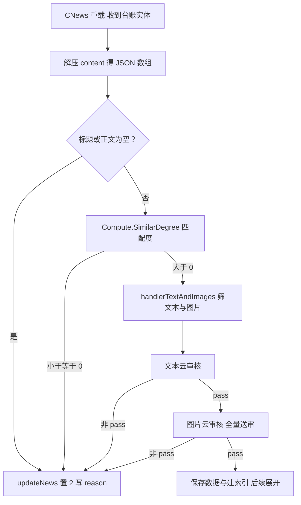

# 三道关落进爬虫链：解压、匹配度、文本与图片云审核

> 🔒 安全提示：文中示例的口令/密钥均为课程教学环境演示口径，生产环境的安全要求见《安全与合规须知》。

核心重载的空壳还等着填肉。动笔前先把思路抄在方法上方：第一步标题与内容匹配度，第二步审核文本与图片，两关全过说明文章合规，通过之后保存文章、配置、内容、作者与标签五类数据，再建检索索引，状态改 9。这一讲填到图片审核为止，保存与索引是后面几讲的事，先把三道关打穿。

## 先给结论

- 审核第一步永远是解压：`cl_news.content` 存的是 gzip 压缩串，`getUnCompressContent()` 还原出 JSON 数组字符串，标题正文才可比。
- 匹配度复用 `Compute.SimilarDegree`，content 在前 title 在后，比值小于等于 0 判「文章与标题不匹配」，口径与自媒体审核一致。
- 文本与图片从同一份 JSON 里筛出：text 节点拼进 StringBuilder，image 节点的地址收进 List，`handlerTextAndImages` 一个方法产两组结果。
- 云审核判断简化为是否等于 pass：爬虫链没有转人工的状态位，block 与 review 一律进失败分支。
- 图片全部送审：抽五张代表的方案评估过，最终选全审，漏审一张的风险大于多花的调用费。
- 失败统一收口在 `updateNews`：状态置 2、原因写 reason，方法 return 即终止，保存与索引永远够不着。

## 先解压再审核

核心方法开工先记时间戳、结尾算耗时，这是编排层的老惯例。进来第一个动作不是审内容，而是还原内容：

```java
@Override
public void autoReviewArticleByCrawler(CNews cNews) throws Exception {
    long currentMillis = System.currentTimeMillis();
    log.info("开始自动审核流程");
    if (null != cNews) {
        // content 入库时是 gzip 压缩串，审核前先解压
        String content = cNews.getUnCompressContent();
        String title = cNews.getTitle();
        // 标题或正文缺失，机器没有审核的原料，直接判失败
        if (content == null || title == null) {
            updateNews(cNews, "文章内容或标题为空");
            return;
        }
        // 1. 标题与内容匹配度
        // 2. 解析文本与图片
        // 3. 文本云审核
        // 4. 图片云审核
    }
    log.info("自动审核流程完成, 耗时: {}ms",
            System.currentTimeMillis() - currentMillis);
}
```

为什么库里存的是压缩串？保存那一讲的整形约定：正文 HTML 按块级表达式解析成块对象列表，转 JSON 后 gzip 压缩入库。压缩省的是 text 大字段的存储与传输，代价是直接打开 `cl_news` 看 content 列是一串看不懂的乱码。实体上的 `getUnCompressContent()` 把解压动作封装掉了，调用侧拿到的一定是解压后的 JSON 数组字符串，前端渲染与机器审核吃同一份还原结果，格式不需要两套。

空判断放在解压之后、审核之前，语义是「没有原料就没有审核」：标题或正文任一缺失，直接进失败分支写原因。这与自媒体侧的容错不同：自媒体稿件缺内容是作者手误，退回重填即可；爬虫文章缺内容说明解析侧出了问题，这条失败记录就是给抓取链路的报警。

## 匹配度：第一道关

匹配度算法与阈值口径全部复用自媒体侧的那把尺子，参数顺序也是约定的 content 在前、title 在后：

```java
// 1. 标题与内容匹配度：自实现规则粗筛，content 在前 title 在后
double degree = Compute.SimilarDegree(content, title);
if (degree <= 0) {
    updateNews(cNews, "文章与标题不匹配");
    return;
}
```

最长公共子串占比、剔除标点空白、阈值定为大于 0 放行，这三个要点在匹配度那一讲已经拆透，这里补一句爬虫语境的差异。爬虫文章的标题与正文都来自源站页面，源站发布时两者本是对齐的，零交集的文章要么是源站本身的极端标题党，要么是解析环节抓错了字段，两种情况都不该放进 App 端。这道关在爬虫链上的价值反而更高：它是解析事故最便宜的探测器。

## 解析文本与图片：一份 JSON 两组产出

过了匹配度，把正文拆成审核原料。爬虫侧与自媒体侧的 content 结构不同：自媒体的文本节点把内容装在 text 键、图片装在 value 键；爬虫的整形格式统一用 value 装内容，文本与图片都一样，style 键挂样式。解析方法三个入参，图片列表、文本缓冲、JSON 数组：

```java
// 2. 解析文本与图片：text 节点拼串、image 节点收地址
List<String> images = new ArrayList<>();
StringBuilder sb = new StringBuilder();
handlerTextAndImages(images, sb, JSONArray.parseArray(content));
```

```java
/** 从 content 的 JSON 数组里筛出文本与图片：文本拼进 sb，图片地址收进 images */
private void handlerTextAndImages(List<String> images, StringBuilder sb, JSONArray jsonArray) {
    for (int i = 0; i < jsonArray.size(); i++) {
        JSONObject obj = jsonArray.getJSONObject(i);
        if ("text".equals(obj.getString("type"))) {
            // 文本块：拼进缓冲串，整篇一起送文本审核
            sb.append(obj.getString("value"));
        } else if ("image".equals(obj.getString("type"))) {
            // 图片块：爬虫侧存的是网络地址，拿去即审
            images.add(obj.getString("value"));
        }
    }
}
```

两个细节值得停一下。**文本为什么要拼串而不攒列表？** 文本审核按任务送审，整篇正文拼成一个字符串一次送出，比逐段送省调用次数；段与段之间的衔接对违规判定几乎没有影响。**图片为什么不用拼前缀？** 自媒体侧图片存文件 ID，送审前要拼文件服务器前缀还原网络地址；爬虫侧解析时存的就是源站图片的网络地址，拿去即用。同一个 value 字段在两条链上含义不同，送审前的准备动作也不同，这是两套主链不能合并的又一处实证。

图片数量上有一个现场决策：抽五张代表性的审，还是全审？抽样的逻辑是省调用费，但一张漏审的违规图就是一次发布事故；全审的代价只是费用。课程最终选了全审，判断标准是风险不对称：漏审的损失远大于多审的成本。

## 文本与图片的云审核：两态合并

云审核封装复用自媒体侧的两个类，送出去的是文本串与图片地址列表：

```java
// 3. 文本云审核：整篇正文一个任务送出
String textResponse = aliyunTextScanRequest.textScanRequest(sb.toString());
if (null == textResponse || !textResponse.equals("pass")) {
    updateNews(cNews, "文本内容审核失败");
    return;
}

// 4. 图片云审核：全部图片一次送出
String imageResponse = aliyunImageScanRequest.imageScanRequest(images);
if (null == imageResponse || !imageResponse.equals("pass")) {
    updateNews(cNews, "图片内容审核失败");
    return;
}

// 两关全过：保存数据、建索引、状态置 9，后续几讲展开
```

判断式里藏着爬虫链的合并规则：`null == response` 与 `!response.equals("pass")` 两个条件合起来，把「调用失败」「返回异常」「结论是 block」「结论是 review」全部折进失败分支。自媒体侧的三态合并（block 判死、review 转人工、pass 放行）在这里被压缩成两态，原因上一讲说过：状态机里没有待人工的位子，机器拿不准的结论无处安放，只能按失败处理留痕排查。

两道关的顺序是文本在前、图片在后，顺序本身也有讲究：文本审核只送一个字符串，快且便宜，先跑能把大多数问题挡在图片审核（按张计费）之前；失败短路让后续关卡不产生任何调用，最贵的关压在收尾位置。

失败处理收口在 `updateNews`，两个入参，台账实体与原因文案：

```java
/** 审核失败：状态置 2，原因写进 reason 列（方法体与保存数据一起在后续几讲实现） */
private void updateNews(CNews cNews, String message) {
    // 按主键更新：status 置 2，reason 记 message
}
```

方法体留到保存数据那一讲与状态回写一起实现，这里先把契约立住：所有失败路径都走它，原因文案说人话，进库就能读懂。

三道关的完整流转画出来是这样：



关键路径在三条汇入失败分支的边上：空原料、零交集、非 pass，任何一条触发都当场终止，方法后半段的保存动作在失败路径上完全不可达。

## 常见误区

- **忘了解压直接审。** 错例是拿 content 原始压缩串去算匹配度或送云审核，比值恒为 0、结论全错。正解是 `getUnCompressContent()` 先行，机器与前端吃同一份还原结果。
- **照搬自媒体侧的解析键名。** 错例是按 text 节点取 text 字段，爬虫格式里文本装在 value 键，取出来全是 null。正解是两条链的整形格式各自记清：自媒体 text 与 value 分键，爬虫统一用 value。
- **云审核异常另起第三种处理。** 错例是给 null 响应单独写重试逻辑，把两态合并又拆回三态。正解是 null 与非 pass 同罪，失败留痕，重试交给兜底任务下一轮。
- **原因写技术黑话。** 错例是 reason 存响应 JSON 原文，排查时还得人肉解析。正解是 `updateNews` 统一写业务文案，机器结论转译成业务语言。
- **图片抽样审核。** 错例是图省事抽五张送审，漏审的违规图直接进 App 端。正解是全量送审，费用换确定性。

## 面试可能被问到的问题

1. 面试官追问：「content 为什么要压缩存储，审核时又解压，不折腾吗？」
   答：正文是大字段，gzip 压缩把 text 列体积压掉一个量级，列表查询、主从同步、备份都受益。审核与渲染是低频读，解压的 CPU 开销毫秒级，读写两头的收益不对称，压缩是划算的。工程要点是把解压封装进实体的访问器，调用侧永远拿不到压缩串。
2. 面试官追问：「匹配度阈值为什么沿用了大于 0 放行的口径？」
   答：短标题长正文的占比天然极低，比例式阈值必然误杀；爬虫文章的正文由解析拼装，零交集意味着字段抓错或极端标题党，两种都不该放行。这道关的职责是拦极端错配，精判断交给云审核，口径与自媒体侧一致还能少记一套规则。
3. 面试官追问：「爬虫链的云审核为什么把三态压成两态？」
   答：自媒体链有转人工的状态位与人工复审的操作闭环，review 结论有着落；爬虫链没有作者交互也没有人工状态，review 无处安放。压缩成两态后，机器拿不准的内容按失败处理留痕，运营按 reason 排查，闭环走台账而不是状态机。
4. 面试官追问：「文本审核拼成一个字符串送出，会不会漏掉分段信息？」
   答：违规判定看的是内容片段本身，段间衔接对结论影响极小，整篇一个任务省掉按段计费的调用次数。真有按段定位违规位置的需求，再把段列表拆成多个任务送出，封装层加一个参数的事，课程量级下不值得。
5. 面试官追问：「图片全审还是抽样，怎么决策？」
   答：看风险不对称性。漏审一张违规图的代价是一次发布事故与平台声誉损失，抽样省下的只是按张计费的小额成本，损失与收益不成比例时选保守的全审。反过来，海量 UGC 图床场景下抽样加事后全量复核的组合更现实，决策依据是损失期望而不是费用直觉。

## 配套资料

- 代码：`materials/code/05/头条day11/`。该日资料包目前为空，核心方法、解析方法与云审核调用按画面线抄录整理，`updateNews` 的方法体留待保存数据环节展开，按本课写法补全为可编译示例，包名统一为 `com.study.headline`；录屏中匹配度分支的条件写作小于 0，正文与自媒体审核链的口径统一为小于等于 0；引用路径截至 `头条dayNN/` 层级，内层目录名含项目原名，不进入正文。
- 参照：`materials/code/05/头条day01/`，数据库规范设计说明书，`cl_news` 的 content 与 reason 列口径出自它。
- 环境：课程集群 node01~node03，MySQL root/123456。
