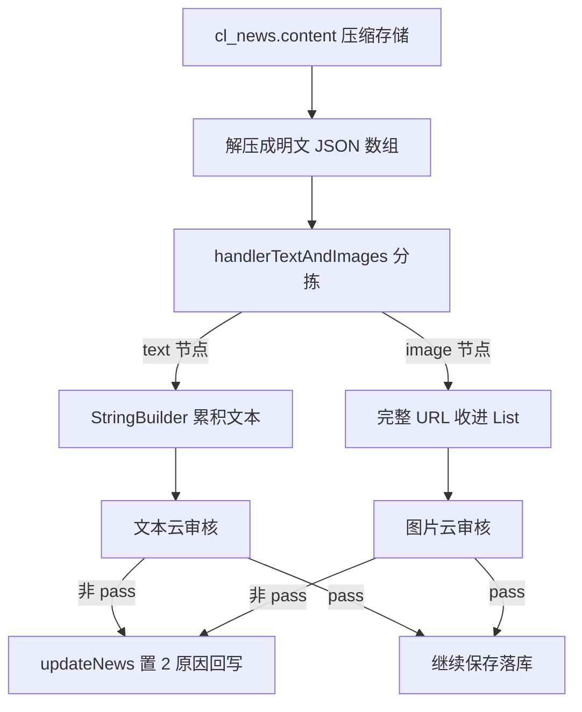

# 爬虫文章审核：失败结论回写台账与正文文本、图片的解析分拣

> 🔒 安全提示：文中示例的口令/密钥均为课程教学环境演示口径，生产环境的安全要求见《安全与合规须知》。

爬虫文章的自动审核链路推进到收口阶段：标题与内容的匹配度关、文本与图片两道云审核的调用骨架都已经立起来，还剩两个支撑动作没补齐。一个是审核不通过时的「修改文章」，把失败结论写回爬虫文章台账 `cl_news`；另一个是正文解析，从压缩存储的富文本里把文本段与图片地址拆出来，交给两个云审核组件。这两个方法体量不大，却决定了审核失败之后数据还能不能被运营接得住、解析出来的待审数据干不干净。

## 先给结论

- 审核失败统一收口到一个私有方法：`updateNews` 把状态置 2、原因写进 `message` 列，一次 update 完成回写，各失败出口只负责传原因文案。
- 爬虫文章的状态字典只有三档：1 待审核、2 审核失败、9 审核成功。自媒体链路里的待人工复审与待发布两个中间态在这里不存在，爬虫文章没有人在旁边守着复审。
- 正文解析与自媒体链路同构：`content` 是 JSON 数组，一次遍历按 `type` 分拣，`text` 节点取值拼进 `StringBuilder`，`image` 节点取值收进 `List`，取值键统一走 `value`。
- 两处差异要分清：爬虫文章的图片是抓取页面时落下的完整 URL，送审不必拼文件服务器前缀；`content` 压缩存储，解析前先解压成明文。
- 失败回写让台账形成闭环：运营按原因在后台修正稿件，状态复位 1，下一轮定时扫描自动把它重新送进审核链。

## 失败回写：状态与原因一次落台账

审核链路上每一个不通过的出口（内容或标题为空、匹配度不达标、文本不合规、图片不合规）都要做同一件事：改状态、写原因、更新台账。这件事若在每个出口各写一遍 set 加 update，原因文案会散落在几十行代码里，漏写一处就产生一条「没有原因的失败」，运营在后台看到灰色的失败记录却无从下手。收口成一个私有方法，失败出口只做一件事，把原因传进来：

```java
/** 审核不通过：状态置 2，原因回写 message，台账留痕 */
private void updateNews(ClNews clNews, String message) {
    // 爬虫文章没有人工复审环节，机器不通过就是终态
    clNews.setStatus((byte) 2);
    clNews.setMessage(message);
    clNewsMapper.updateNews(clNews);
}
```

对应的 mapper 更新语句按需只改两列，不碰台账上其他字段：

```xml
<update id="updateNews">
    update cl_news
    set status = #{status},
        message = #{message}
    where id = #{id}
</update>
```

以图片审核出口为例，调用点只有三行：

```java
String imageResponse = aliyunImageScanRequest.imageScanRequest(images);
if (null == imageResponse || !"pass".equals(imageResponse)) {
    updateNews(clNews, "图片内容审核失败");
    return;
}
```

这段条件里藏着一条纪律：结论为 null 与结论不是 `pass` 同样处理。图片审核返回 null 通常意味着云服务没能取到图、给不出可判定的结论，这类「没有结论」不能默认放行，宁可判失败让爬取侧排查地址，也不给风险内容留通道。

`message` 列的价值不在存储，在追溯。`cl_news` 是爬虫文章的台账，来源字段与去重标识在爬虫入库环节已经落好，审核侧不重复维护，只负责把结论追加在台账上。运营复盘时按状态 2 一筛，每条失败都带着一句人话原因，是标题的问题还是图片的问题一目了然。

失败之后还有一条回流路径。后台把稿件的标题或内容修正之后，状态复位为 1，剩下的交给定时任务：

```sql
-- 后台修正稿件后复位重审，原因清空留待新一轮结论
update cl_news set status = 1, message = null where id = 35181;
```

定时扫描只认状态 1 的台账记录，复位过的稿件下一轮自然重入审核链。修正、复位、重审三个动作把「机器判死」变成「机器判死后可申诉」，台账的闭环就靠这两列字段撑起来。

## 正文解析：一次遍历分拣两组待审数据

爬虫入库时正文按富文本 JSON 数组存储并压缩，审核链路前段已经解压出明文。解析方法与自媒体链路同构，两个容器进、两个容器出：

```java
/**
 * 解析文本和图片
 * @param images     图片地址容器
 * @param sb         文本累积容器
 * @param jsonArray  正文 JSON 数组
 */
private void handlerTextAndImages(List<String> images, StringBuilder sb, JSONArray jsonArray) {
    if (null != jsonArray) {
        for (Object obj : jsonArray) {
            JSONObject jsonObject = (JSONObject) obj;
            // 每个节点带 type 与 value 两个键
            String type = (String) jsonObject.get("type");
            if ("image".equals(type)) {
                String value = (String) jsonObject.get("value");
                // 爬虫抓回来的就是完整地址，直接可用
                images.add(value);
            }
            if ("text".equals(type)) {
                String value = (String) jsonObject.get("value");
                sb.append(value);
            }
        }
    }
}
```

调用侧在审核方法里先备好两个容器，解析一次填满两边：

```java
log.info("开始文本内容的审核");
List<String> images = new ArrayList<>();
StringBuilder sb = new StringBuilder();
JSONArray jsonArray = JSON.parseArray(content);
handlerTextAndImages(images, sb, jsonArray);
```

两个容器对应两种计费模型。文本用 `StringBuilder` 累积成一段，整篇文本作为一个任务送审一次，文本审核按任务计费，合并送审最省调用次数，代价是失去段落级定位，违规结论只知道命中在整篇里。图片逐条收进 `List`，云服务按地址列表取图识别。爬虫链路对图片采取全量送审，不做抽样：一篇文章多几张图的调用成本可控，图库风险漏网一条的代价却不成比例，这笔账在爬虫场景下永远算得过来。

## 与自媒体链路的同与不同

两套审核的解析与回写骨架完全同构，差异集中在数据形态上。一张图把爬虫链路从台账到结论的走向说全：



关键路径在分拣与回写两步：解析一次产出两组待审数据，失败出口共用一个回写方法。差异有两处值得专门点出。**图片地址形态不同。** 自媒体文章的 `content` 里存文件 ID，送审前要拼上文件服务器前缀还原成网络地址；爬虫文章从源站页面抓下来的本来就是完整 URL，入列即用。若把自媒体的前缀逻辑照搬过来，完整地址前面再叠一层前缀，云服务取不到图，结论为 null 又被当成失败，整条链路就绕死了。**中间态被裁掉。** 自媒体链路的 review 结论转人工、发布时间未到先挂待发布，爬虫链路里都没有：爬虫文章无人值守，机器结论直接落到终态，误杀的稿件靠修正复位这条回流路径兜底，状态机从五个态砍成三个态，维护成本随之下降。

## 常见误区

- **每个失败出口各写一遍回写逻辑。** 错例是在匹配度、文本、图片三个出口各自 set 状态加 update，原因文案零散且容易漏写。正解是收口到 `updateNews` 一个方法，出口只传原因。
- **解析前忘了解压。** 错例是把压缩串直接 `JSON.parseArray`，要么抛解析异常要么得到空数组，文本图片双双空审后直接放行。正解是链路前段先解压出明文，解析只面对可读的 JSON。
- **图片地址照搬前缀拼装。** 错例是给完整 URL 再叠文件服务器前缀，云服务按拼出来的错误地址取图，全部判失败。正解是按数据形态分流，爬虫 URL 直接入列。
- **只置状态不写原因。** 错例是回写时漏掉 `message`，运营看到一排失败记录却查不出原因。正解是状态与原因在同一列 update 里成对落库，回写后查一次台账确认。

## 面试可能被问到的问题

1. 面试官追问：「爬虫文章审核失败之后，这批数据就死掉了吗？」
   答：不是。失败回写把状态置 2 并把原因落进台账的 message 列，运营在后台按原因修正标题或内容，再把状态复位为 1，定时任务扫描状态 1 的记录时会把它重新送进审核链。机器判死加人工修正复位，构成失败后的申诉闭环。
2. 面试官追问：「为什么爬虫链路不设人工复审的中间态？」
   答：爬虫文章是机器批量抓取的，没有人会守在复审队列旁，加一个待人工状态只会让大量稿件永久滞留。机器结论直接落终态，把纠错责任放在失败原因追溯与修正复位上，状态机简单且每条数据都有出口。
3. 面试官追问：「文本和图片为什么在一次遍历里分拣，而不是解析两遍？」
   答：content 是一个 JSON 数组，文本节点与图片节点混排在其中，一次遍历同时填充两个容器，解析成本只有一遍；分两次遍历则要解析数组两遍，且两份结果还可能因中途修改代码而口径不一致。分拣逻辑独立成方法，也让自媒体链路的同构实现可以直接对照复用。
4. 面试官追问：「图片审核返回 null 应该当通过处理吗？」
   答：不应该。null 意味着云服务没能取到图或没给出可判定的结论，原因通常是地址不可达或内容为空，这类无结论状态默认放行等于给风险内容开通道。工程上的取舍是把 null 与非 pass 同样判失败并回写原因，宁可让爬取侧排查地址，也不让异常路径滑向通过。
5. 面试官追问：「失败原因写在数据表里，而不是只打日志，图什么？」
   答：日志会滚动、会丢失，查询要跨系统；台账上的 message 列与数据同生命周期，管理端列表直接可见，运营按状态加原因两个字段就能完成筛选与统计。失败原因本质是业务数据而非运行日志，落库才是它的正确归宿。

## 配套资料

- 代码：`materials/code/05/头条day11/`。该日资料包目前为空（仅含解压元信息文件），审核服务的失败回写与正文解析代码未随包提供，文中代码按画面线抄录整理并按本课写法补全为可编译示例，包名统一改写为 `com.study.headline`；失败状态值按口播与整体测试口径整理为 2（画面抄录曾显示 0，以讲解与终测口径为准），失败出口的条件判断按 null 与非 pass 同判的语义整理并已注明；引用路径截至 `头条dayNN/` 层级，内层目录冠以项目原名，正文统一以「头条类资讯项目」指代。
- 代码：`materials/code/05/头条day07/`，Kafka 封装工具类（KafkaSender、KafkaConsumerConfig、KafkaListener 等），爬虫端发送审核消息与 admin 端监听共用这一套封装。
- 代码：`materials/code/05/头条day01/`，内层资料目录含数据库规范设计说明书与项目原型，`cl_news` 台账的状态与原因字段语义可对照核对。
- 环境：课程集群 node01~node03，MySQL root/123456；云内容安全服务为阿里云内容安全，密钥在配置文件中打码管理。
