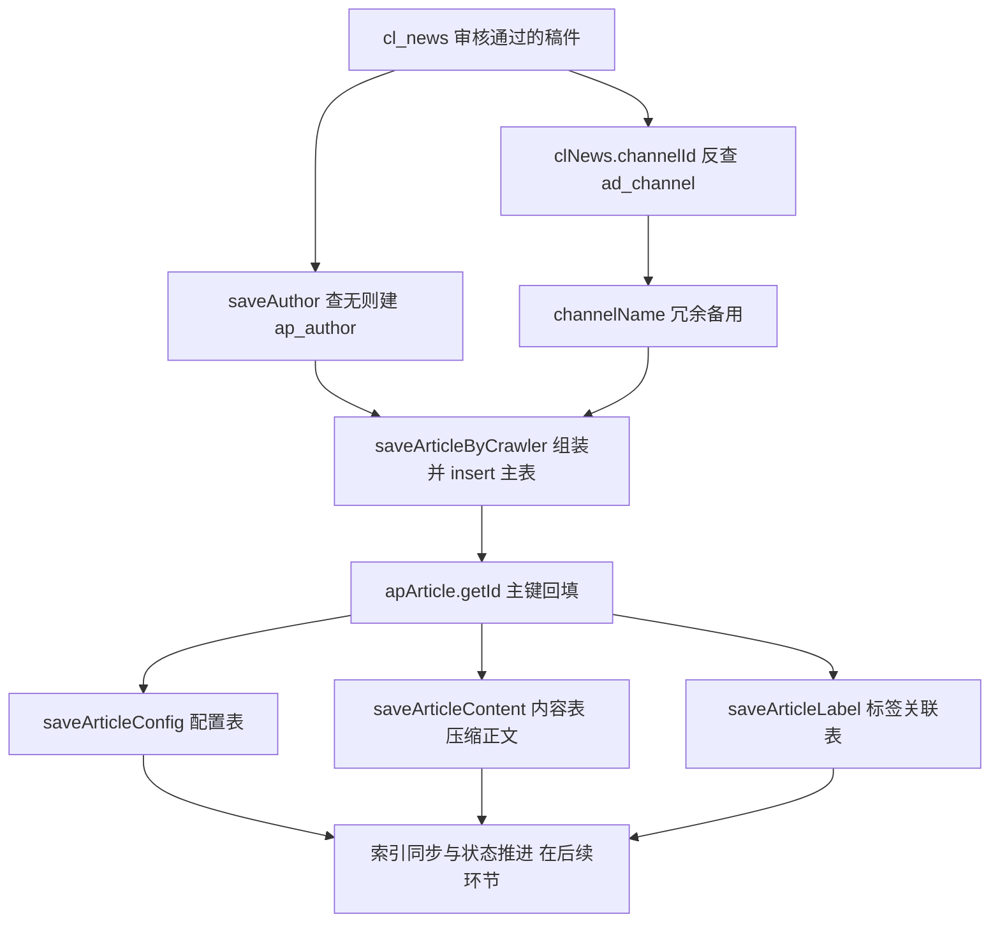

# 审核通过之后的落库：爬虫文章搬进 App 端五张表

> 🔒 安全提示：文中示例的口令/密钥均为课程教学环境演示口径，生产环境的安全要求见《安全与合规须知》。

爬虫文章的三道审核关（匹配度、文本、图片）全过之后，数据还躺在爬虫台账 `cl_news` 里，App 端的读者什么都看不到。接下来是一次跨库搬运：文章主表、配置表、内容表、作者表，外加一张自媒体链路没有的标签关联表。搬运的骨架与自媒体文章那条链路高度相似，可以对照着写，但差异也实实在在：作者是从源站页面解析出来的陌生名字，图片是源站的完整地址，标签是源站自定义的 ID 串。这一课把骨架与实现一次写透，重点讲清五个方法为什么这样排、每个字段从哪来、以及两个容易在整体测试时才现形的坑。

## 先给结论

- 落库顺序由依赖决定：作者先建档，文章主表才有 `author_id` 可挂；主表拿到主键，配置、内容、标签三张子表才挂得上 `article_id`。频道名称反查放最前面，因为主表组装就要用它。
- 爬虫作者走「查无则建」：按 `cl_news` 里的作者名查 `ap_author`，查到复用，查不到新建一条 `type = 0` 的爬虫作者，insert 必须配主键回填，主表等着用作者 id。
- 主表字段三条来路：标题、排版、发布时间、标签串从 `cl_news` 透传，作者归属来自作者记录，`images` 从正文图片列表取前三张逗号拼接，`origin` 记录源站出处。
- 内容落库前必须压缩：`ZipUtils.gzip` 过一遍再进 `ap_article_content`，与自媒体链路同一口径；初版漏了这一步，整体测试当场现形。
- 标签关联表按 `(article_id, label_id)` 查重，已有则 `count` 加一更新，没有才插入 `count = 1` 的新行，重复执行不产生重复关联。
- 五张表的写入是一个本地事务的内部动作；云审核、索引同步这类远程调用留在事务之外，失败不回滚落库。

## 保存的骨架：先排顺序，再填实现

动手之前先把动作清单列出来。这一段代码在审核入口里承接三道关全过之后的分支，骨架把每个动作独立成方法，调用序列本身就是一份依赖说明：

```java
// 频道名称反查放在最外面，主表组装要用
String channelName = "";
if (clNews.getChannelId() != null) {
    AdChannel adChannel = adChannelMapper.selectByPrimaryKey(clNews.getChannelId());
    if (adChannel != null) {
        channelName = adChannel.getName();
    }
}
// 作者先就位，主表才有归属
ApAuthor apAuthor = saveAuthor(clNews);
// 文章主表落库，返回带主键的实体
ApArticle apArticle = saveArticleByCrawler(images, clNews.getChannelId(),
        channelName, apAuthor.getId(), clNews);
// 配置与内容挂主表主键
saveArticleConfig(apArticle);
saveArticleContent(content, apArticle);
// 标签关联最后补齐
saveArticleLabel(apArticle);
```

六个动作的先后不是代码风格问题，是数据依赖问题。频道反查要产出 `channelName`，主表组装时直接取用；作者建档要产出 `author_id`，主表落库时挂接；主键回填后的 `apArticle.getId()`，是后面三张子表共同的挂接点。把这张依赖图看明白，写的时候就不会出现「先插文章再补作者」的顺序事故：



配置、内容、标签三个动作彼此不依赖，先后可以互换；作者与主表的先后不能动，反查与主表的先后不能动。骨架立好之后，剩下的是把五个私有方法逐个填实。

## 频道反查：冗余一列，免掉列表页联查

频道信息在 `cl_news` 上只有 id，App 端列表页却要展示频道名。主表设计里冗余了 `channel_name` 一列，按建表规约「字段允许适当冗余」的条款，这种低频变更的短字段冗余是教科书场景。反查动作本身很朴素，判空意识要有：频道可能被运营下线，反查为 null 时不能让空指针打断审核，频道名留空串落库即可，频道 id 依然保留，归属信息不丢。

```java
String channelName = "";
if (clNews.getChannelId() != null) {
    AdChannel adChannel = adChannelMapper.selectByPrimaryKey(clNews.getChannelId());
    if (adChannel != null) {
        channelName = adChannel.getName();
    }
}
```

这个反查放在保存序列的最前面而不是主表方法内部，是个值得留意的取舍：主表方法已经收了五个参数，再把反查逻辑塞进去，方法职责就从「组装落库」膨胀成「查加组装落库」。骨架层先算好再传参，每个方法保持单一职责，出问题时断点一眼能定位到层。

## 作者映射：给源站作者在 App 端建档

爬虫从源站页面解析出来的作者是一个纯名字，背后没有自媒体账号，也没有 App 端用户。但 App 端文章主表必须有 `author_id` 与 `author_name`，读者点进作者页要有归处。做法与自媒体链路的「查无则建」同构，差别在字典取值与关联字段：

```java
/** 爬虫作者查无则建：源站作者名在 App 端补一条作者档案 */
private ApAuthor saveAuthor(ClNews clNews) {
    ApAuthor apAuthor = apAuthorMapper.selectAuthorByName(clNews.getName());
    if (apAuthor == null || apAuthor.getId() == null) {
        apAuthor = new ApAuthor();
        apAuthor.setCreatedTime(new Date());
        // 作者名取自爬虫解析出的源站作者
        apAuthor.setName(clNews.getName());
        // 类型落 0：爬虫导入的作者，与自媒体作者档位区分
        apAuthor.setType((short) 0);
        apAuthorMapper.insert(apAuthor);
    }
    return apAuthor;
}
```

三个细节值得展开。**查在前、插在后。** 同一个源站作者会源源不断产出新文章，绝大多数审核请求查一次就命中已有档案，直接复用；只有首次出现的名字才补插。查插顺序保证了重复执行不产生重复作者。**`type` 落 0。** 作者类型是个字典字段，爬虫导入、自媒体作者、签约合作方各占一档，爬虫链路落 0。这个档位后续可以做文章推荐时的作者权重、作者页的来源标识，取值语义以表注释字典为准。**主键回填不能省。** 主表组装需要 `apAuthor.getId()`，insert 必须配 `useGeneratedKeys` 回填，少了这个配置，查空新建的作者永远拿不到 id，第一篇首发文章的主表落库当场报错：

```xml
<insert id="insert" useGeneratedKeys="true" keyProperty="id">
    insert into ap_author (name, type, created_time)
    values (#{name}, #{type}, #{createdTime})
</insert>
```

与自媒体作者相比，爬虫作者的关联字段是空的：没有自媒体用户可挂，`user_id` 与 `wm_user_id` 都不落值，归属语义靠 `type` 档位区分。两条链路共用一张作者表，靠类型分档而不是靠字段猜，这是字典字段的价值。

「查无则建」还有一个并发口子要堵：两篇文章恰好同时过审、作者又是同一个新名字时，两个请求都在查询阶段落空，各自插入一条同名作者，查重逻辑形同虚设。审核是低频动作，这个窗口很窄，但爬虫批量过审时并非不可能撞上。工程上的兜底是给 `ap_author.name` 加唯一索引，插入冲突时捕获异常回查一次，把复用逻辑再走一遍；查插与唯一索引配合，单机与集群形态下都不产生重复档案。

## 文章主表：十几个字段的来路清点

主表组装是最容易「想当然有值」的环节，组装前对着列清点一遍。`ap_article` 在爬虫链路里的字段来源是这张表：

| ap_article 字段 | 来源 | 说明 |
|---|---|---|
| channel_id / channel_name | 入参透传 | 反查已在骨架层完成，这里只赋值 |
| author_id / author_name | 作者记录、`cl_news.name` | 作者建档后必有 id，名字直接取台账 |
| layout | `cl_news.type` | 源站的排版类型透传为 App 端布局 |
| publish_time | `cl_news.publishTime` | 源站发布时间随爬取落下，不落当前时间 |
| origin | `cl_news.origin` | 源站出处，爬虫文章的来源留痕 |
| labels | `cl_news.labels` | 标签 ID 逗号串，标签关联表的数据源 |
| images | 图片列表前三张 | 完整 URL 逗号拼接，列表页封面用 |
| created_time | `new Date()` | 落库时间 |
| 阅读量、评论量等统计列 | 暂不设 | 新文章从零起步 |

对照着表写实现，每赋一个字段都知道值从哪来：

```java
private ApArticle saveArticleByCrawler(List<String> images, Integer channelId,
                                       String channelName, Integer authorId, ClNews clNews) {
    ApArticle apArticle = new ApArticle();
    apArticle.setChannelId(channelId);
    apArticle.setChannelName(channelName);
    // 作者 id 由调用方从建档结果传入
    apArticle.setAuthorId(authorId);
    apArticle.setAuthorName(clNews.getName());
    // 源站排版类型透传为 App 端布局
    apArticle.setLayout(clNews.getType());
    // 发布时间用源站时间，保留文章的原始时序
    apArticle.setPublishTime(clNews.getPublishTime());
    // 来源出处：爬虫文章的留痕位
    apArticle.setOrigin(clNews.getOrigin());
    // 标签 ID 逗号串，标签关联表按它拆解
    apArticle.setLabels(clNews.getLabels());
    apArticle.setCreatedTime(new Date());
    // 列表封面只取前三张，完整 URL 逗号拼接
    if (null != images && !images.isEmpty()) {
        StringBuilder sb = new StringBuilder();
        for (int i = 0; i < images.size() && i < 3; i++) {
            if (i > 0) {
                sb.append(",");
            }
            sb.append(images.get(i));
        }
        apArticle.setImages(sb.toString());
    }
    apArticleMapper.insert(apArticle);
    return apArticle;
}
```

两处与自媒体链路的差异是理解重点。**图片不拼前缀。** 自媒体文章的图片存的是文件服务器 ID，落库前要逐段拼上服务器地址；爬虫文章的图片本来就是源站完整 URL，取前三张直接拼接。取三张而不是全塞，是因为主表的 `images` 服务于列表页封面位，三图布局最多三张，剩下的图片正文里都有，全塞只会撑大列表查询的行宽。**发布时间用源站时间。** 自媒体文章的发布时间来自作者的发布动作，爬虫文章没有这个动作，源站的发布时间随爬取落下，落库时透传保留原始时序；搜索排序、时间线展示都吃这个字段，落成当前时间会把源站几个月前的旧文顶到最新。

insert 沿用自增回填口径；`ap_article` 切到分片环境后，主键改为应用侧取号再 insert，切换点只在「insert 之前有没有 setId」，子表挂接逻辑一行不用改。这套口径与自媒体落库那一次完全一致，不再展开。

## 配置表与内容表：开关默认值与压缩红线

配置表四个开关的语义与默认值在自媒体链路已经定过，爬虫链路照抄默认口径：可评论、可转发开启，未下架、未删除。新文章发布即具备完整互动能力，运营的干预是对单篇的例外，不该由代码默认替运营做：

```java
private ApArticle saveArticleConfig(ApArticle apArticle) {
    ApArticleConfig apArticleConfig = new ApArticleConfig();
    apArticleConfig.setArticleId(apArticle.getId());
    // 默认全开：可评论、可转发；未下架、未删除
    apArticleConfig.setIsComment(true);
    apArticleConfig.setIsForward(true);
    apArticleConfig.setIsDown(false);
    apArticleConfig.setIsDelete(false);
    apArticleConfigMapper.insert(apArticleConfig);
    return apArticle;
}
```

内容表只有一个大字段，却压着一条红线：富文本 JSON 必须先压缩再入库。

```java
private void saveArticleContent(String content, ApArticle apArticle) {
    ApArticleContent apArticleContent = new ApArticleContent();
    apArticleContent.setArticleId(apArticle.getId());
    // 富文本压缩后再入库，与自媒体链路同一把钥匙
    apArticleContent.setContent(ZipUtils.gzip(content));
    apArticleContentMapper.insert(apArticleContent);
}
```

这条红线在整体测试时被验证过一次。初版实现直接把明文 JSON 塞进了 `content`，单方法看似乎没毛病，跑到内容保存这一步就出问题：详情接口读侧按约定先解压再返回，拿到一段没压缩过的明文去 gunzip，还原出来的东西必然不可读；明文的体积也远超压缩后的行宽预算。修法是对照自媒体链路同位置的代码，补上 `ZipUtils.gzip` 再重跑。这个坑的教训值得记牢：读写两侧的编解码约定不在单方法的视野里，只有链路测试能验出来，压缩与解压必须共用 `ZipUtils` 的成对方法，谁写谁读都要过一遍约定。

## 标签关联表：自媒体链路没有的一张表

自媒体发文章时作者会指定频道与标签，标签随文章一路带过来；爬虫文章的标签是源站自己定义的 ID 串，系统里没有现成的文章标签关联。day11 为此补了 `ap_article_label` 表（`article_id`、`label_id`、`count`）与配套的实体、mapper、XML，保存逻辑按 `(article_id, label_id)` 的粒度逐条处理：

```java
private ApArticle saveArticleLabel(ApArticle apArticle) {
    if (apArticle != null && StringUtils.isNotEmpty(apArticle.getLabels())) {
        // labels 是逗号分隔的标签 ID 串，逐个拆开处理
        String[] labelArray = apArticle.getLabels().split(",");
        for (String labelId : labelArray) {
            ApArticleLabel param = new ApArticleLabel(apArticle.getId(),
                    Integer.parseInt(labelId));
            List<ApArticleLabel> list = apArticleLabelMapper.selectList(param);
            if (list != null && !list.isEmpty()) {
                // 已有关联：计数加一，不插重复行
                ApArticleLabel exist = list.get(0);
                exist.setCount(exist.getCount() + 1);
                apArticleLabelMapper.update(exist);
            } else {
                // 首次关联：计数从 1 起步
                ApArticleLabel apArticleLabel = new ApArticleLabel();
                apArticleLabel.setArticleId(apArticle.getId());
                apArticleLabel.setLabelId(Integer.parseInt(labelId));
                apArticleLabel.setCount(1);
                apArticleLabelMapper.insert(apArticleLabel);
            }
        }
    }
    return apArticle;
}
```

这段逻辑的查重结构比插入本身更有价值。`count` 的语义是这对关联的出现次数，可以当作标签权重参与排序。审核链路一旦因为重试、复位重审而重入，同一篇文章的标签关联不该越插越多：查到了就更新计数，查不到才插入，重复执行落在同一个行上。这种「按业务键查重、有则更新无则插入」的写法，是手工实现幂等的最朴素形态，在标签、收藏、点赞这类关联表里都能复用。

把五张表的写入整体看，它们应当抱在一个本地事务里：作者、主表、配置、内容、标签任何一条失败，已执行的回滚，App 端不会留下「主表有、子表无」的半成品。事务里不碰任何远程调用，云审核已经出结果，索引同步还没开始，这段恰好是纯数据库写入的窗口，事务的持锁时间短且可控。

事务之外还剩一个更隐蔽的问题：保存链被重复进入怎么办。爬虫文章的状态复位重审、审核消息重投，都会让同一份台账再次跑完三道关、再次走进保存序列。标签关联天然扛得住，按业务键查重的结构保证重复执行只更新计数；作者建档也扛得住，同名复用；主表却扛不住，再走一遍就是新插一行，App 端出现两篇同标题文章，子表还各挂各的行。课程实现按「单次通过」设计，没有处理这个场景，工程化落地时要在保存序列入口加一道映射判重：按台账主键查 `ap_article` 是否已有对应行（台账加一列 `article_id` 回填，或按来源地址加唯一约束），有映射就跳过落库直接补齐索引与状态，让重复进入收敛为幂等操作。这一道判重的成本极低，换来的是整条审核链可以被放心地重放。

## 常见误区

- **先插主表再补作者。** 错例是按书写顺序先写主表 insert，作者建档放后面，`author_id` 拿不到值。正解是按依赖排时序，作者就位再组装主表，骨架方法本身就是依赖清单。
- **作者 insert 漏配主键回填。** 错例是查空新建作者后没配 `useGeneratedKeys`，`getId()` 恒为 null，首篇文章落库报错。正解是凡下游要用主键的 insert 都回填，写完当场断点验证一次。
- **图片地址照搬拼前缀逻辑。** 错例是给完整 URL 再叠文件服务器前缀，列表页图全裂。正解是按数据形态分流，爬虫 URL 直接拼接，文件 ID 才需要拼前缀。
- **content 落库前忘压缩。** 错例是明文 JSON 直接入内容表，读侧解压失败或长度超限，单方法测试还发现不了。正解是压缩与解压共用 `ZipUtils` 成对方法，整体链路测试验一遍可读性。
- **标签关联无脑 insert。** 错例是重审场景下同一 `(article_id, label_id)` 反复插入，关联表越堆越多。正解是按业务键查重，有则计数更新，无则插入。

## 面试可能被问到的问题

1. 面试官追问：「五张表的写入顺序是怎么定的，打乱会怎样？」
   答：按数据依赖排：作者先建档产出主键，主表落库挂 `author_id` 并回填文章主键，三张子表再按主键挂接；频道反查在主表组装前完成。打乱顺序会出现 `author_id` 或 `article_id` 为空的孤儿数据，配置与内容之间没有依赖可以互换，但作者与主表、反查与主表的先后不能动。
2. 面试官追问：「爬虫作者和自媒体作者共用一张表，会不会互相污染？」
   答：共用表靠 `type` 字典分档，爬虫导入落 0，自媒体作者落自己的档位，互不干扰；爬虫作者没有用户体系可挂，关联列留空，语义靠 type 表达。分档共用的好处是作者主页、文章归属这类读逻辑一套代码通吃，代价是要在所有写入口严格落对 type。
3. 面试官追问：「主表 images 为什么只存三张，其余图片丢了吗？」
   答：没丢。主表 `images` 服务于列表页的封面位，三图布局最多三张；正文所有图片都在内容表的富文本里，详情页渲染时从正文取。列表与详情的读写模式不同，列表要行宽紧凑，详情才需要全量图集，按访问模式决定存什么。
4. 面试官追问：「发布时间为什么用源站时间而不是落库时间？」
   答：源站发布时间代表文章的真实时序，推荐流、时间线、搜索排序都依赖它；落库时间只代表系统处理时刻。旧文重爬、批量补录的场景里，落库时间会把几个月前的内容顶到最新，时间线失真，统计口径也被污染。
5. 面试官追问：「压缩存储这一步漏了，为什么单方法测试发现不了？」
   答：压缩是读写两侧的编解码约定，写入不压缩不会在写入时报错，行也落得进去；问题在读侧 gunzip 拿到明文还原出乱码，或者超长文本撑爆列宽。这类跨方法的契约只有把整条链路跑起来才能验证，单方法单测的视野覆盖不了约定类缺陷。
6. 面试官追问：「标签关联表为什么不直接用主表的 labels 逗号串，还要再建一张表？」
   答：逗号串只能服务展示，无法支撑按标签聚合的查询，比如一个标签下有哪些文章、某标签被关联了多少次，用串查要走全表模糊匹配，索引也建不起来。关联表把多对多关系落到行级，`count` 还能积累权重参与排序，串与表各管各的读法。

## 配套资料

- 代码：`materials/code/05/头条day11/`。该日资料包目前为空（仅含解压元信息文件），审核服务的保存骨架与五个落库方法未随包提供，文中代码按画面线抄录整理并按本课写法补全为可编译示例，包名统一改写为 `com.study.headline`；主表来源列 `origin` 与标签串字段按画面线整理，作者类型字典取值以表注释为准，图片取前三张、压缩落库等语义按口播与整体测试口径整理并已注明；引用路径截至 `头条dayNN/` 层级，内层目录冠以项目原名，正文统一以「头条类资讯项目」指代。
- 代码：`materials/code/05/头条day02/`，mycat 配置四件套（schema.xml、rule.xml 等），可对照 `ap_article` 的分片口径与主键发号前提。
- 代码：`materials/code/05/头条day01/`，内层资料目录含数据库规范设计说明书与项目原型，冗余字段条款、`is_xxx` 布尔命名规约与 `ap_author` 字段语义可对照核对。
- 环境：课程集群 node01~node03，MySQL root/123456。
