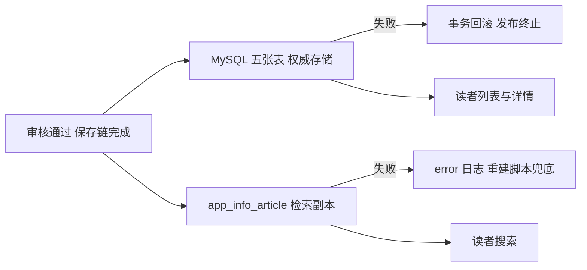

# 爬虫文章的检索索引同步：审核通过即写入 app_info_article

> 🔒 安全提示：文中示例的口令/密钥均为课程教学环境演示口径，生产环境的安全要求见《安全与合规须知》。

五张表落稳，文章在 MySQL 里已经是权威数据，但 App 端读者的入口还有一个搜索框。刚发布的爬虫文章要能被搜到，检索索引必须同步跟上。这一步与自媒体文章审核链路的索引同步几乎同款：同一个 Jest 客户端、同一份索引常量、同一个文档实体，写法可以直接对照。真正值得讲的是三件事：构建动作怎么拆、文档字段怎么喂、失败怎么降级。

## 先给结论

- 索引同步拆成两个私有方法：`createEsIndex` 负责构建请求并执行，`saveEsIndexEntity` 负责把两个实体拼成索引文档，构建与组装分离，各自可读可测。
- 文档 id 用文章主键，重复同步是覆盖更新而不是追加；`refresh(true)` 立即刷新，刚发布的文章马上可搜。
- `content` 必须喂解压后的明文：`title` 与 `content` 是配了 ik 分词器的 text 域，压缩串进去只能切出噪声 token，检索等于失效。
- 爬虫链路的文档字段口径：文章主键、频道 id、标题、明文正文、源站发布时间、状态固定落 1 表示上架有效；`userId` 留空，爬虫文章没有站内用户归属。
- 失败降级只记日志：封装方法把索引失败抛成异常，调用点 try-catch 接住打 error 日志，落库不回滚，索引靠重建脚本兜底。

## 构建过程：Action 接口与 Index 实现

Jest 客户端把对 Elasticsearch 的每类操作抽象成一个 `Action` 接口，请求参数、目标索引、响应类型都由实现类携带。写索引用的是它的实现类 `Index`，类名同名不同包，选实现类的时候按操作语义在 `io.searchbox.core` 下挑：

```java
private void createEsIndex(ApArticle apArticle, ClNews clNews) {
    // 文档组装独立成方法，构建与执行分离
    EsIndexEntity esIndexEntity = saveEsIndexEntity(apArticle, clNews);
    Index.Builder builder = new Index.Builder(esIndexEntity);
    // 文档 id 用文章主键，重复同步是覆盖更新
    builder.id(apArticle.getId().toString());
    // 立即刷新，发布即可搜
    builder.refresh(true);
    Index index = builder.index(EIndexConstants.ARTICLE_INDEX)
            .type(EIndexConstants.DEFAULT_DOC)
            .build();
    JestResult result = null;
    try {
        result = jestClient.execute(index);
    } catch (Exception e) {
        throw new RuntimeException("创建索引请求失败：" + e.getMessage());
    }
    if (result != null && !result.isSucceeded()) {
        throw new RuntimeException(result.getErrorMessage() + "，插入更新索引失败");
    }
}
```

四个构建点各有讲究。**`Index.Builder` 接文档实体。** Jest 按实体序列化出文档体，实体字段与索引 mapping 一一对应，多出来的字段要么 mapping 动态接收要么被丢弃，口径要在实体上对齐。**`builder.id()` 一行不能省。** 缺了它，Elasticsearch 自动生成随机文档 id，同一篇文章重同步一次就多一份重复内容；用文章主键做文档 id，同一 id 的写入天然是覆盖，幂等性是主键换来的。**`refresh(true)` 是有代价的即时可见。** Elasticsearch 写入默认近实时，文档等后台刷新才可搜索；发布是低频动作，读者又期待刚发布的文章立刻能搜到，这点写放大划算，高频批量导入反而不要开。**两层失败判定。** 抛异常是请求级失败（连不上、超时），`isSucceeded()` 为 false 是响应级失败（写入被拒），两层都归成异常上抛，交给调用点统一处置。

## 文档组装：字段口径逐个对齐

`saveEsIndexEntity` 把 `ApArticle` 与 `ClNews` 两个实体拼成索引文档：

```java
private EsIndexEntity saveEsIndexEntity(ApArticle apArticle, ClNews clNews) {
    EsIndexEntity esIndexEntity = new EsIndexEntity();
    // 文档实体吃 Long，文章主键做转换
    esIndexEntity.setArticleId(apArticle.getId() == null
            ? null : apArticle.getId().longValue());
    // 正文喂解压后的明文，压缩串进分词域等于检索失效
    esIndexEntity.setContent(clNews.getUnCompressContent());
    esIndexEntity.setTitle(clNews.getTitle());
    // 1 表示上架有效
    esIndexEntity.setStatus(1L);
    // 发布时间沿用主表落好的源站时间
    esIndexEntity.setPublishTime(apArticle.getPublishTime());
    // 频道判空后再落，频道被删时不至于空指针
    if (apArticle.getChannelId() != null) {
        esIndexEntity.setChannelId(apArticle.getChannelId() == null
                ? null : apArticle.getChannelId().longValue());
    }
    return esIndexEntity;
}
```

字段口径里有两条纪律。**明文入索引。** 落库时压缩省的是存储，进索引的正文却必须是解压后的明文，`title` 与 `content` 两个 text 域配了 ik 分词器，分词器需要可切词的原文，gzip 后的字节流切出来的全是噪声 token，搜索等于白建。压缩适合 MySQL 存储层，不适合要参与检索的域。**状态固定落 1。** 文档能进索引就说明审核已通过，`status` 落 1 表示上架有效，与自媒体链路的口径一致，搜索侧按这个字段过滤下架内容时两条链路的行为才统一。`userId` 在爬虫链路留空，源站作者不是站内用户，硬造一个 id 反而污染用户维度的过滤逻辑；后续要做作者搜索，用作者名或另建作者索引都是更干净的出路。

调用点接住异常，降级只做一件事：

```java
// 索引写入失败不阻断收尾：落库已生效，记日志交给重建
try {
    createEsIndex(apArticle, clNews);
} catch (Exception e) {
    log.error("创建索引失败，articleId: {}", apArticle.getId(), e);
}
```

MySQL 是权威存储，索引是可重建的副本，一次发布不该因为检索副本的抖动而回滚。失败记日志告警，量级大时靠重建脚本从库里重灌，三条落点的分工是这张图：



权威与副本角色分明：库里的失败回滚重来，索引的失败记日志重灌，两种失败走两条恢复路径，互不传染。

## 与自媒体链路：同一入口，两份口径

两条审核链在索引同步上是同一套零件：同一个 Jest 客户端 bean、同一份 `EIndexConstants` 常量、同一个 `EsIndexEntity` 文档实体、同样的主键文档 id 与刷新策略。差别只在字段来源与个别档位：自媒体链路的 `content` 取自媒体稿件的明文富文本，`userId` 落作者的用户 id，来源标记 `tag` 区分 media 与站内导入；爬虫链路的 `content` 取台账解压明文，`userId` 留空，`tag` 按站内导入口径落值。零件共用意味着 mapping 变更、分词器调整只动一处，两条链路同步受益；口径分开意味着搜索侧的来源过滤、加权策略有了抓手。写第二条同构链路时，能复用的零件全部复用，不能复用的口径逐条想清楚再落，这本身就是一次很好的架构练习。

## 常见误区

- **压缩串直接进索引。** 错例是把台账里的压缩 content 原样塞进文档，ik 分词切出噪声，搜索结果驴唇不对马嘴。正解是索引域喂解压明文，压缩只留在 MySQL 存储层。
- **文档 id 交给 Elasticsearch 自动生成。** 错例是省掉 `builder.id()`，重试或重审场景下索引堆出多份同文。正解是文档 id 用文章主键，写入即覆盖。
- **索引失败回滚落库。** 错例是把索引写进保存事务，ES 一抖五张表跟着回滚，文章莫名其妙消失。正解是远程动作出事务，失败记日志靠重建兜底。
- **发布时间随手 new Date()。** 错例是文档的发布时间落成同步时刻，源站旧文的时序在搜索排序里失真。正解是沿用主表落好的源站发布时间，保持两条链路同一口径。

## 面试可能被问到的问题

1. 面试官追问：「MySQL 与 Elasticsearch 的数据一致性怎么保证？」
   答：发布动作里落库与索引同步是先后两步，落库是权威、索引是副本；同步失败不回滚落库，记日志告警，靠重建脚本从库里重灌。文档 id 用文章主键保证覆盖幂等，重试安全。规模上来后可演进为消息异步同步或监听 binlog，一致性语义从同步写换成最终一致，幂等锚点不变。
2. 面试官追问：「为什么 content 进库要压缩，进索引却要明文？」
   答：两个存储的优化目标不同。MySQL 的内容表追求省存储与 IO，gzip 对重复结构字符压缩率很高；Elasticsearch 的 text 域要过 ik 分词器，分词器吃可读原文，压缩字节流切不出有效词项。同一份数据在两个存储层各自按最优形态存放，读侧各自还原。
3. 面试官追问：「refresh(true) 每次发布都开，会有什么问题？」
   答：refresh 把内存缓冲的文档刷成可搜索的段，代价是写放大与段合并压力。发布是低频操作，开一次换即时可搜很划算；若把它放进高频批量导入，段会碎、合并会频繁，写入吞吐明显下降。按操作频率决定刷新策略，而不是一刀切。
4. 面试官追问：「两条审核链写同一个索引，怎么区分文章来源？」
   答：mapping 里留了来源标记字段，keyword 类型不分词，自媒体审核通过标 media，站内与爬虫导入按同档口径标记。搜索侧按标记做来源过滤或加权，排序策略、内容分发都能区分对待，同一份索引服务多种内容形态。
5. 面试官追问：「索引文档的实体字段和 mapping 对不上会怎样？」
   答：mapping 已定的字段按类型解析，实体多出的字段要么被动态映射接收要么被忽略，实体缺的字段落 null。口径漂移的典型症状是搜索能返回但字段值是空的，排查要对照索引 mapping 与文档实体逐字段核。工程上让实体与 mapping 由同一份定义生成，或上线前用样例文档试写一次。

## 配套资料

- 代码：`materials/code/05/头条day11/`。该日资料包目前为空（仅含解压元信息文件），索引同步代码未随包提供，文中代码按画面线抄录整理并按本课写法补全为可编译示例，包名统一改写为 `com.study.headline`；索引与文档常量沿用搜索模块建好的 `EIndexConstants`、`EsIndexEntity`，失败分支按口播「不成功即抛出、调用点记录」的语义整理并已注明，台账明文正文的读取方法按画面线口径整理，`tag` 取值与明文正文口径按两条链路统一的工程口径补全；引用路径截至 `头条dayNN/` 层级，内层目录冠以项目原名，正文统一以「头条类资讯项目」指代。
- 代码：`materials/code/05/头条day07/`，Kafka 封装工具类（KafkaSender、KafkaConsumerConfig 等），爬虫审核消息链路的共用封装。
- 环境：课程集群 node01~node03，MySQL root/123456；Elasticsearch 与 Kibana 装在本机开发环境（`localhost:9200`），用于索引核对与查询验证，创建索引前需先启动。
