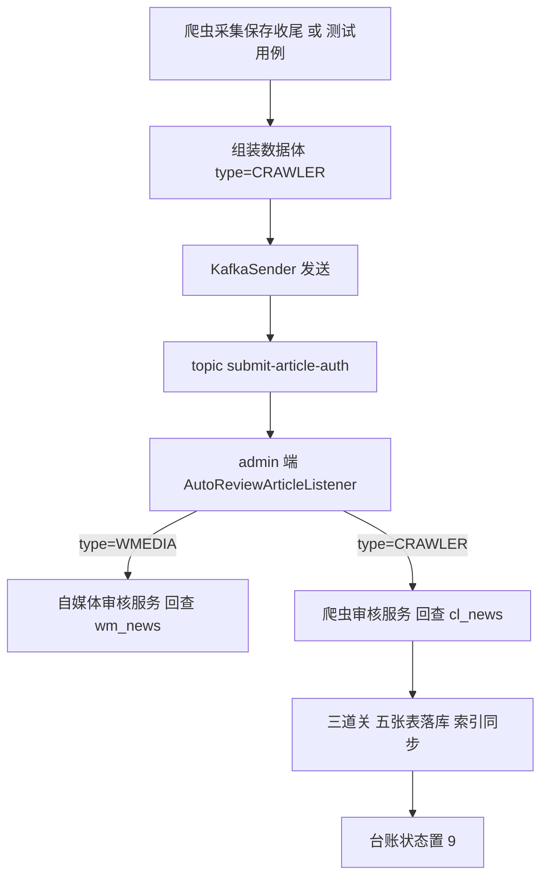

# 爬虫与 admin 系统整合测试：一条 Kafka 消息打通采集侧与审核侧

> 🔒 安全提示：文中示例的口令/密钥均为课程教学环境演示口径，生产环境的安全要求见《安全与合规须知》。

单元测试把审核服务本身验通了，但那是拿测试类顶替了真实调用方。生产形态里，爬虫审核服务的调用方是 admin 端的 Kafka 监听器：爬虫采集保存收尾发一条消息，admin 消费后按来源类型分流，再进审核链。两端接上之后有三件事要验证：消息能不能走到监听器、类型分流会不会把爬虫消息送错服务、跨库的最终数据能不能对上。整合测试就是把这三件事在两个真实服务之间过一遍。

## 先给结论

- 监听器不新建：自媒体审核那一课的 `AutoReviewArticleListener` 直接加一个 CRAWLER 分支、注入爬虫审核服务，type 分流是唯一增量。
- topic 复用 `submit-article-auth` 一条通道，分流信息全在消息体的 type 字段上，这是当初消息设计预留的扩展位在爬虫链兑现。
- 正式形态是双端常驻、边采边审；课程演示用简化形态：爬虫端测试用例手发一条消息，admin 端断点观测。
- 断点观测三处：入口的原始 JSON、反序列化后的 type 与文章 id、审核服务进链后的日志。
- 对账三处：爬虫库台账状态置 9、App 端文章表有行、检索索引可搜，三处齐了跨服务一致性才算成立。

## 监听器只加一个分支

admin 端的监听器是现成的。自媒体审核上线时，`AutoReviewArticleListener` 实现封装的 KafkaListener 接口注册到 `submit-article-auth` 通道，onMessage 里只处理了 WMEDIA 一种来源，爬虫类型的消息当时直接穿过不处理，分支留给爬虫链路。现在把预留的分支补上：

```java
@Slf4j
@Component
public class AutoReviewArticleListener implements KafkaListener<String, String> {

    @Autowired
    private KafkaTopicConfig kafkaTopicConfig;
    @Autowired
    private ObjectMapper mapper;
    @Autowired
    private ReviewMediaArticleService reviewMediaArticleService;
    // 新增：爬虫文章审核服务
    @Autowired
    private ReviewCrawlerArticleService reviewCrawlerArticleService;

    @Override
    public String topic() {
        return kafkaTopicConfig.getSubmitArticleAuth();
    }

    @Override
    public void onMessage(ConsumerRecord<String, String> consumerRecord,
                          Consumer<?, ?> consumer) {
        String value = consumerRecord.value();
        log.info("接收到的消息为：{}", value);
        try {
            SubmitArticleAuthMessage message =
                    mapper.readValue(value, SubmitArticleAuthMessage.class);
            if (message != null) {
                SubmitArticleAuto.ArticleType type =
                        message.getData().getArticleType();
                if (type == SubmitArticleAuto.ArticleType.WMEDIA) {
                    Integer articleId = message.getData().getArticleId();
                    if (articleId != null) {
                        // 审核自媒体文章，回查 wm_news
                        reviewMediaArticleService.autoReviewArticleByMedia(articleId);
                    }
                } else if (type == SubmitArticleAuto.ArticleType.CRAWLER) {
                    Integer articleId = message.getData().getArticleId();
                    if (articleId != null) {
                        // 审核爬虫文章，回查 cl_news
                        reviewCrawlerArticleService.autoReviewArticleByCrawler(articleId);
                    }
                }
            }
        } catch (Exception e) {
            log.error("自动审核文章错误: {}", value, e);
            throw new RuntimeException("消息处理错误", e);
        }
    }
}
```

增量只有两处：一个注入字段、一个 else if 分支。结构上有两条纪律不能破。**分流必须平级。** CRAWLER 分支要写在 WMEDIA 分支的并列位置，不能嵌进「文章 id 非空」的判断里：嵌进去之后，自媒体消息一旦缺 id，整个 else if 都够不着，爬虫消息直接被吞。**异常继续外抛。** catch 里先记日志再抛出，交给封装的重试模板与错误处理器；手动提交位移的口径下，吞掉异常等于向容器谎报处理成功，位移照常推进，这条消息就此消失，审核永远不会发生。

监听器对审核依然一无所知，它只完成「消息到调用」的翻译：类型认识、id 非空，就把 id 交给对应的审核服务；类型不认识的消息在两个分支之间穿过，静默放弃。审核的全部细节仍在两条审核主链里，此后无论审核逻辑怎么演进，监听器都不需要再动。

## 爬虫端发一条测试消息

整合测试的正式形态是双端常驻：爬虫工程按抓取周期采集，每篇保存收尾自动发审核消息，admin 端消费审核，一边采集一边审核。这个形态依赖采集环境的全部外部条件，演示阶段把变量收敛到最少：admin 端 debug 启动，爬虫端用测试用例手发一条消息，验证通道与分流。

发送代码从爬虫保存链的编排类里原样拷出来，数据从台账里挑一条状态 1 的行：

```java
@Autowired
private KafkaSender kafkaSender;
@Autowired
private KafkaTopicConfig kafkaTopicConfig;

@Test
public void testSendReviewMessage() {
    // 台账里挑一条状态为 1 的爬虫文章，主键按实际数据取
    SubmitArticleAuto submitArticleAuto = new SubmitArticleAuto();
    submitArticleAuto.setArticleId(35182);
    // 来源类型必须显式置 CRAWLER，漏设会让消费端无法分流
    submitArticleAuto.setType(SubmitArticleAuto.ArticleType.CRAWLER);
    SubmitArticleAuthMessage message = new SubmitArticleAuthMessage(submitArticleAuto);
    // 与保存链同一个发送姿势：topic 进配置，key 用文章 id
    kafkaSender.sendMesssage(kafkaTopicConfig.getSubmitArticleAuth(),
            String.valueOf(35182), message);
}
```

两条链路汇流的路径画出来是这样：



关键路径在 E 节点的分流：一个消费者、一条通道，两类消息靠 type 字段各回各家，回查错表是这条链路上最典型的集成缺陷。

## 断点走查与三处对账

断点打在 admin 端监听器的 onMessage 入口，爬虫端跑测试用例。消息几乎立即命中，调试器里依次确认三个观测点：

| 观测点 | 位置 | 期望内容 |
|---|---|---|
| value 原始串 | onMessage 入口 | 信封 JSON，含 retry、time、type 与 data |
| 反序列化结果 | mapper.readValue 之后 | type 为 CRAWLER，articleId 为 35182 |
| 分流去向 | else if 分支 | 走爬虫审核服务，主键入参 35182 |

放行进链，审核流程的日志依次滚过：保存数据、审核流程结束。随后跨服务的对账三处逐一核对：

```sql
-- 爬虫库：台账状态收官
select id, status from cl_news where id = 35182;

-- App 端库（mycat 入口）：文章落库
select id, title, author_name, publish_time
from ap_article where created_time >= curdate();
```

```json
GET app_info_article/_search
{
  "query": { "match": { "title": "公司公告" } }
}
```

三处齐了，跨服务一致性才算成立。爬虫库与 App 端库是两个库，App 端还要过 mycat 这道分片入口，一次审核写入横跨三个存储，任何一处的缺口都说明链路里有个环节在打折扣。至于消息丢失的场景，对账扫出的状态 1 存量行交给下一讲的定时兜底处理，整合测试只验证消息送达的正常路径。

到这里，爬虫审核链的两条驱动路径都落了地：单元测试直调验证服务本体，Kafka 消息验证服务接缝，剩一条定时兜底由下一讲挂上调度器，day11 的审核章就此收官。

## 常见误区

- **分支嵌错层级。** 错例是把 CRAWLER 的 else if 写进 WMEDIA 分支的 id 判空里，自媒体消息缺 id 时爬虫分支永远够不着，消息被静默吞掉。正解是分流按类型平级展开，id 判空放在各自分支内部。
- **测试消息忘设 type。** 错例是只填 articleId 就发送，消费端拿不到来源类型，两个分支都不命中，消息穿过不处理。正解是 CRAWLER 枚举显式设置，发送后先在日志里核对原始 JSON。
- **catch 里只记日志不抛出。** 错例是异常吞掉让方法正常返回，容器按成功推进位移，失败消息就此消失。正解是异常向外传播，交给重试模板与错误处理器形成重试闭环。
- **两端对账只查一边。** 错例是只看 admin 端日志宣布集成成功，爬虫库台账、App 端库、索引三处有没有落位并不知道。正解是三处对账逐一核对，终态一致才算闭环。

## 面试可能被问到的问题

1. 面试官追问：「两类文章共用一个监听器，会不会互相拖累？」
   答：消费层共用，审核层各走各的主链，监听器只做翻译不做业务。真要互相拖累，拖累点在消费吞吐上：爬虫批量抓取的消息洪峰会挤占自媒体发布的审核时效。这个量级在项目阶段压不垮单通道，出现拖累再拆 topic，改动收敛在配置、配置类字段与监听器的 topic 返回值三处。
2. 面试官追问：「消费端怎么防止一条消息被处理两次？」
   答：审核是按 id 回查后的状态迁移，天然幂等，重复执行结果一致。防的是并发重复：双条件查询把已离开待审核态的重复挡在 SQL 层，跨线程并发窗口靠按文章 id 的分布式锁增强。爬虫链重复审核的代价是云审核调用费，防护目标是省这笔钱而不是怕数据写坏。
3. 面试官追问：「类型不认识的消息怎么处理？」
   答：两个分支都不命中，消息静默穿过，位移照常推进。这是刻意设计：来源类型是收发两端的契约，出现未知类型说明上游发版不同步，硬处理只会变成错处理。工程上可以补一条日志告警把未知类型观测起来，但不要让默认分支去猜业务。
4. 面试官追问：「整合测试和单元测试的分工是什么？」
   答：单元测试验证审核服务本体，三道关、落库、索引、状态回写每一环都能在测试类里直接驱动；整合测试验证服务之间的接缝，消息送达、类型分流、跨库对账。接缝层的问题（分支嵌错、类型漏设、异常吞掉）在单元测试里根本不存在，因为调用方形态不同。两层各管一段，合起来才是链路质量。
5. 面试官追问：「消息发出去了，admin 端恰好重启，这条消息会丢吗？」
   答：不会。消息在 broker 里持久化，消费组重平衡后继续消费；发送侧 key 用文章 id，同篇消息进同一分区，乱序风险也压住了。真正的丢失窗口在消费侧谎报成功，也就是吞异常不抛那一种错，重试模板与错误处理器的闭环就是为它设计的。

## 配套资料

- 代码：`materials/code/05/头条day11/`。该日资料包目前为空（仅含解压元信息文件），监听器分支与整合测试代码未随包提供，文中代码按画面线抄录整理并按本课写法补全为可编译示例，包名统一改写为 `com.study.headline`；引用路径截至 `头条dayNN/` 层级，内层目录冠以项目原名，正文统一以「头条类资讯项目」指代。
- 代码：`materials/code/05/头条day07/`，kafka 封装的工具类目录下 `KafkaSender.java`、`KafkaListener.java`、`KafkaTopicConfig.java`、`KafkaMessage.java`、`MessagesRegister.java` 为真实实现，监听器实现的接口与发送姿势出自它，包名按本课规范改写。
- 参照：`materials/code/05/头条day02/`，mycat 配置四件套，App 端库分片入口的对账口径出自它。
- 环境：课程集群 node01~node03，MySQL root/123456；Kafka、mycat、Elasticsearch（`localhost:9200`）需在整合测试前启动。
