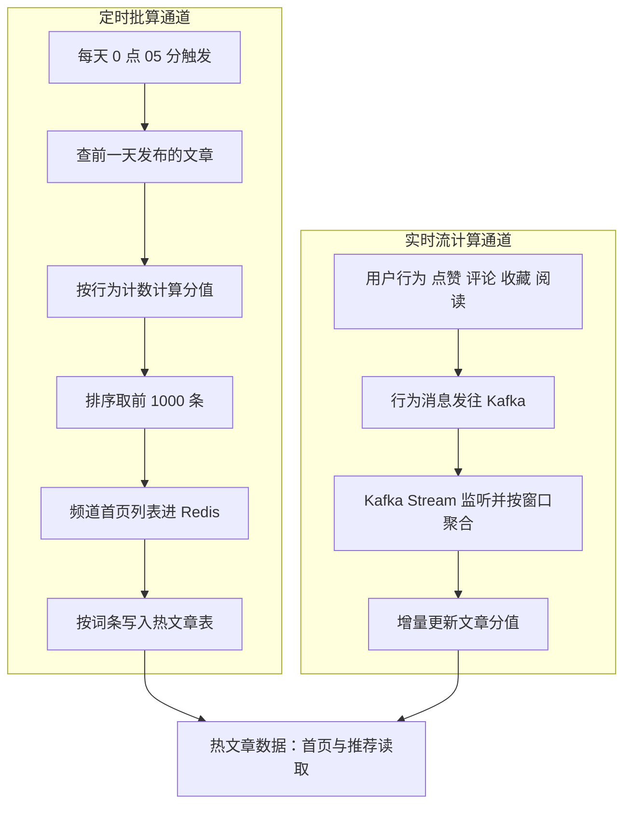

# 热文章计算开篇：这一天的目标与两条计算链路

> 🔒 安全提示：文中示例的口令/密钥均为课程教学环境演示口径，生产环境的安全要求见《安全与合规须知》。

资讯 App 的首页凭什么总能把「大家都在看」的内容顶到最前面？背后需要一档按热度记账的机制。到 day11 为止，文章的点赞、评论、收藏、阅读计数已经落在 `ap_article` 的行为列里，Kafka 的消息通道也早就架好，但「哪篇文章现在最热」这件事还没有一个正式的计算入口。day12 补的就是这一环：热文章计算。

学习目标这一课只有一分多钟，信息密度却决定了这一天的学法：它是把定时批算与实时流计算两条链路一起摆上桌的合成课。先把地图看清再动手写代码，比一头扎进 Service 里省力得多。

## 先给结论

- day12 的目标有三条：看懂热文章计算的流程图、实现定时计算热文章功能、实现文章行为数据的实时计算，前一条是重点也是难点。
- 热度不是单一指标：阅读、点赞、评论、收藏这些行为计数共同折算出分值，分值越高的文章越靠前，排最前面的就是热点文章。
- 两条通道分工明确：定时任务每天凌晨 0 点 05 分批算前一天发布的文章；Kafka Stream 实时接收行为消息，支持分组与时间窗口汇总，增量更新文章分值。
- 计算结果有两个去向：`ap_hot_articles` 表留存热点记录供查询，频道首页列表进 Redis 供 App 直接读取。
- 实时通道的接收端不用手写底层：day12 资料包带有 Kafka Stream 封装，业务只要实现监听接口。

## 三条目标各挂什么技术点

目标课不列口号，每一句目标都对应着当天的产出物，对着下表预习能把「听懂」和「写出来」分开：

| 目标 | 挂靠的技术点 | 当天的产出 |
|---|---|---|
| 清晰计算热文章数据的流程 | 流程图、`ap_hot_articles` 表设计 | 一张能向别人复述的计算链路图 |
| 能编写定时计算热文章的功能 | 定时任务、MyBatis 映射、Redis 缓存 | 从查文章到落库缓存的一条完整链路 |
| 能实时计算文章的行为数据 | Kafka Stream、行为消息封装 | 行为消息发送与流式聚合的增量更新 |

目标一被老师标成重点，原因很直接：当天的每一行代码都挂在那张流程图上，图没看懂，写出来的 Service 就只是抄。目标三的关键词是增量，定时批算给每篇文章一个初始分，实时流把用户后来的每一次点赞、评论、收藏、阅读折算进分值，两条通道合力才构成完整的热度账本。

热文章表在当天代码里反复出现，先把它的关键字段过一眼（完整建表语句在 mapper 那一课展开）：

```sql
-- 热文章表关键字段预览，按画面线整理
CREATE TABLE `ap_hot_articles` (
  `entry_id`     int(11) unsigned NOT NULL DEFAULT '0' COMMENT '词条ID，可能是用户也可能是设备',
  `tag_id`       int(11) unsigned NOT NULL DEFAULT '0' COMMENT '频道ID',
  `article_id`   int(11) unsigned NOT NULL DEFAULT '0' COMMENT '文章ID',
  `score`        int(11) NOT NULL DEFAULT '0' COMMENT '热度分值',
  `is_read`      tinyint(1) NOT NULL DEFAULT '0' COMMENT '该词条是否已读',
  `release_date` datetime DEFAULT NULL COMMENT '文章发布时间'
) ENGINE=InnoDB DEFAULT CHARSET=utf8mb4 COMMENT='热文章表';
```

`entry_id` 这一列值得停下来想一想：词条是行为实体表里的概念，一个注册用户是一个词条，一台没登录的设备也是一个词条。热文章按词条各存一份，为的是后面每个人都能有自己的已读标记与个性化空间。

## 两条计算通道怎么分工

流程图把两条通道画在一起，定时通道负责「开工打底」，实时通道负责「随来随记」：



入口在左上：定时通道一天跑一次，产出当天的热点榜单；右下的实时通道随行为消息持续运转，把新的行为折进分值。两条通道最后汇到同一份热文章数据上，首页与推荐只管读结果。

实时通道的接收端在 day09 已经把 Kafka 收发封装进 common 工程了，当天资料包里再补上 Kafka Stream 这一块，业务侧只需要实现一个三方法的监听接口（包名按工程口径改写）：

```java
/**
 * 流数据监听接口：实现类由工厂自动扫描并注册为流消费端
 * 泛型可以是 KStream 或 KTable
 */
public interface KafkaStreamListener<T> {

    String listenerTopic();   // 监听的 topic

    String sendTopic();       // 处理结果发送的 topic

    T getService(T stream);   // 流处理逻辑
}
```

容器启动后，工厂类扫出所有 `KafkaStreamListener` 实现并逐个注册成流处理器，业务代码不碰 `StreamsBuilder` 的装配细节。这正是当天实时计算能「直接写逻辑」的原因：地基在资料包里已经打好了。

## 常见误区

- **把两条通道当成二选一。** 错例是认为「有了定时批算就不需要实时流」或反过来。正解是定时批算负责每日基线，实时流负责行为增量，少了哪条，热度账都会失真。
- **以为热度就是阅读量排序。** 错例是只按 views 倒序取文章。正解是阅读、点赞、评论、收藏一起进分值公式，互动行为比纯曝光更能说明内容质量。
- **跳过流程图直接抄代码。** 错例是照着 Service 一行行抄完却讲不清「为什么先缓存频道页再逐词条落库」。正解是先把两条通道的图讲通，再回头看代码的位置感。
- **把 Kafka Stream 当成普通消费者。** 错例是用 @KafkaListener 的思路理解当天的接收端。正解是 Stream 侧有分组与时间窗口聚合能力，消费粒度是「流上的运算」，不是单条消息的回调。

## 面试可能被问到的问题

1. 面试官追问：「热文章为什么要有定时计算和实时计算两条链路？」
   答：定时批算每天 0 点 05 分对前一天发布的文章算一次基线分值，产出稳定的每日热点榜；实时链路通过 Kafka Stream 接收点赞、评论、收藏、阅读等行为消息，按时间窗口聚合后增量更新分值。批算保证榜单每天有完整的起点，实时保证爆款文章在几秒到几分钟内就能上浮，两条链路缺一不可。
2. 面试官追问：「热度分值用哪些行为指标？」
   答：课程口径是阅读、点赞、评论、收藏这些行为计数一起参与计算，分值高的文章排前面。设计思路上互动行为权重应当高于纯曝光，具体权重可以按业务调，关键是所有行为都从 `ap_article` 的计数列与行为消息里来，口径统一。
3. 面试官追问：「计算结果放在哪里，谁来读？」
   答：两个去向。`ap_hot_articles` 表按词条留存热点记录，带已读标记，供个人维度的查询；频道首页列表按频道 key 写进 Redis，App 首页直接读缓存，不打数据库。
4. 面试官追问：「实时计算为什么选 Kafka Stream 而不是再起一个 Flink？」
   答：行为消息本来就走 Kafka，用同生态的 Kafka Stream 可以免掉额外集群与数据搬运，依赖只是 spring-kafka 的 streams 模块；需求是按窗口聚合更新分值，吞吐与延迟都够用。需要复杂事件时间语义或大状态管理时再考虑更重的框架，是成本与能力的匹配问题。

## 配套资料

- 代码：`materials/code/05/头条day12/`，资料目录里的 Kafka Stream 封装（配置类、监听接口、注册工厂、流处理器与 JSON 序列化器）是真实随包文件，文中接口示例出自它，包名按工程口径改写为 `com.study.headline`；定时计算链路的 Service、Mapper 代码未随资料包提供，文中示例为按画面线与课程写法补全（引用路径截至 `头条dayNN/` 层级，内层目录名含项目原名，不进入正文）。
- 环境：课程集群 node01~node03，MySQL root/123456，Redis 与 Kafka 均部署在集群上。
