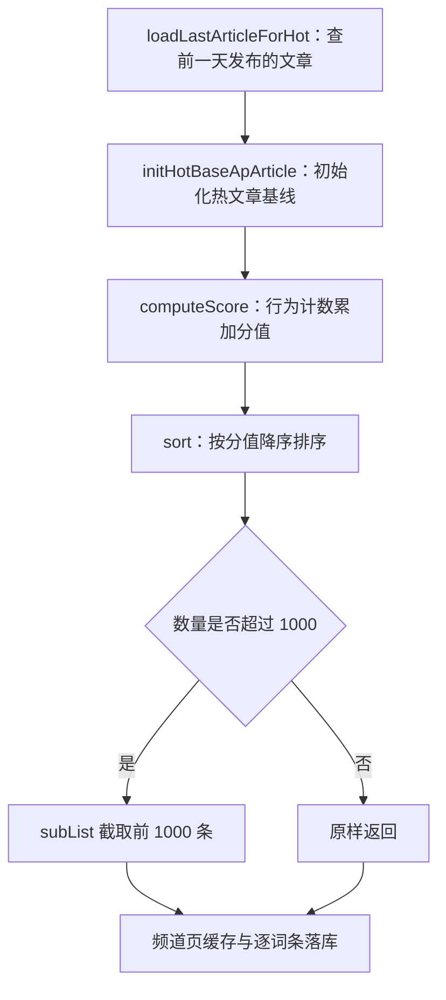
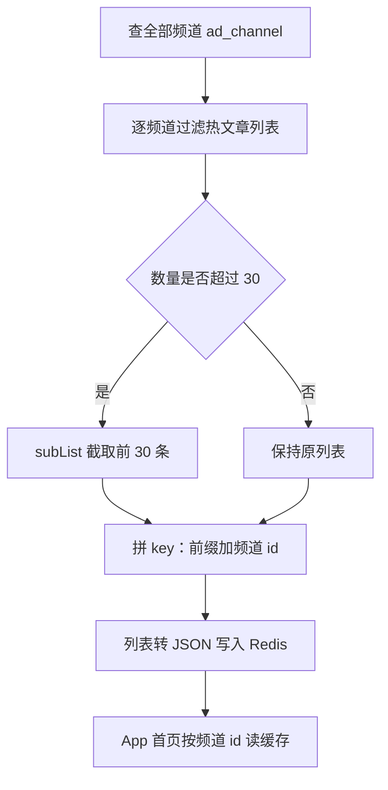
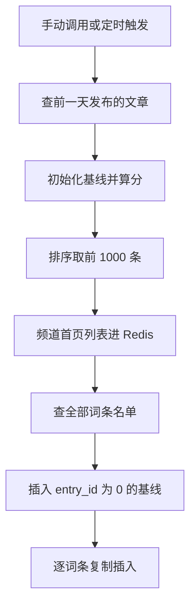
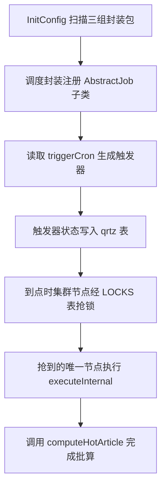
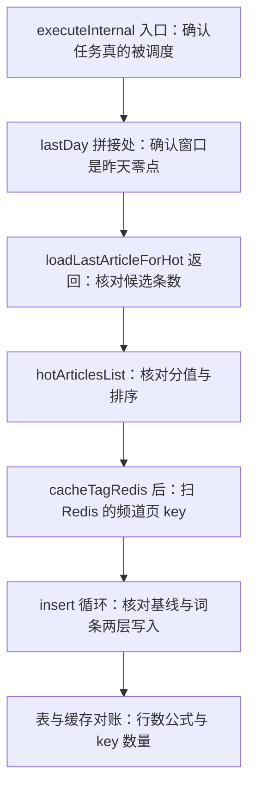

# 热文章计算_定时计算全流程：Mapper 定义、频道缓存、热点落库与 Quartz 定时任务

> 🔒 安全提示：文中示例的口令/密钥均为课程教学环境演示口径，生产环境的安全要求见《安全与合规须知》。

## 先给结论

热文章的定时计算是一条批处理链路：定时器触发后按热度分值算出热文章，按频道缓存进 Redis 供首页读取，同时给每个词条落一份热点记录。全系列五个部分从 Mapper 定义一直讲到全链路测试与对账。
主线分四段：算，Mapper 与 Service 主流程、热度分值、Top 1000 截取；存，频道页 Redis 缓存与词条热点落库、写入幂等；调，Quartz 定时任务接入与 11 张 qrtz 表；验，断点逐段与表缓存对账。两处取舍值得先记住：频道缓存用全量覆盖换一致性；热点落库因数据量乘法效应走暂时性设计，幂等三选一里选了先删后插。
五个部分依次是：
- Mapper 定义与热度分值：三张表角色、computeHotArticle 主流程与 Top 1000。
- 频道首页数据缓存到 Redis：一个 key 一个频道、cacheTagRedis 四步实现。
- 保存热点文章：ap_behavior_entry 词条名单、基线与词条各一份、幂等三选一。
- 定时任务接入 Quartz：三个重载撑起 job、qrtz 表与 MyCat 登记。
- 全链路测试：断点逐段、表与缓存对账、非幂等的现场实验与实时计算补位。

## 第1部分：热文章定时计算落地：Mapper 定义、热度分值与 Top 1000

前一天的几万篇文章散在 `ap_article` 里，行为计数躺在各自的列上，「热度」还只是一个概念。要把概念变成榜单，得先把持久层的路铺好：热文章表没有对应的实体与 Mapper，查前一天文章的方法也还不存在。这一课把三讲合成一条完整的动手线：先建 `ApHotArticles` 实体与三个 Mapper 接口，再写 Service 主流程，逐篇初始化热文章对象、累加行为分值，最后排序截取前 1000 条。

课程用的拼接手法也值得留意：`ApHotArticlesMapper` 的方法当天用不满，老师把整份 Mapper 拷进来先用着，用到哪讲到哪。跟着代码动线走，比逐个方法背签名有效得多。

### 五步思路与代码动线

思路五步在动手前先钉在墙上：每天 0 点 05 分查前一天发布的新文章，定时入口由后面的定时任务课接入；计算文章热度，维度是阅读、评论、点赞、收藏；缓存文章的频道，把频道首页数据放进 Redis；给每个词条保存一份热点文章；缓存文章图片，当天明确不做，留到最后一天做图片服务改造。

当天这一讲覆盖其中第一、二步的代码化，链路如下：



入口在左上：一条查询 SQL 把候选文章拉进内存，之后全部是对象运算，直到截取完成才交棒给缓存与落库环节。看懂这张图的关键是分界线：库里的账（行为计数）在 S3 一步折算成热度分，此后榜单的顺序只由 score 决定。

### 三张表在这条链路里的角色

动手写 Mapper 之前，先把三张表的分工捋顺，后面每个接口都能对号入座。**`ap_article` 是候选与原料。** 前一天发布的文章从这张表来，点赞、收藏、评论、阅读四个行为计数也挂在它的列上，算分的原料全部在这张表里，不需要批算时再去行为明细表汇总。**`ap_behavior_entry` 是词条名单。** 行为实体表里一行就是一个词条，注册用户与匿名设备都算，「给每个词条保存一份」这句话的名单就从这里全量查出。**`ap_hot_articles` 是结果台账。** 批算的产出按行写进来，score 与 is_read 让它既是榜单数据源又是个人已读账本。

三张表的关系决定了 Mapper 的改法：`ap_article` 与 `ap_behavior_entry` 都已有 Mapper，各补一个查询方法即可；只有 `ap_hot_articles` 是全新的，接口与 XML 都要从零建。把改动范围控制在「一新建两增量」，代码评审时也容易看清楚。

### 热文章表与实体类

动手先认表。画面里 Workbench 打开的 `ap_hot_articles` 是一张按词条存热点记录的表，建表语句按实体与映射文件的口径整理如下（画面截到的旧版建表语句里还没有 score、tag_name、is_read 三列，且带着 is_comment、is_forward 等配置列，以映射文件为准补齐）：

```sql
CREATE TABLE `ap_hot_articles` (
  `id`           int(11) unsigned NOT NULL AUTO_INCREMENT,
  `entry_id`     int(11) unsigned NOT NULL DEFAULT '0' COMMENT '词条ID，0 表示全局基线记录',
  `tag_id`       int(11) unsigned NOT NULL DEFAULT '0' COMMENT '标签ID，定时链路里存频道ID',
  `tag_name`     varchar(50) DEFAULT NULL COMMENT '冗余频道名',
  `score`        int(11) NOT NULL DEFAULT '0' COMMENT '热度分值',
  `article_id`   int(11) unsigned NOT NULL DEFAULT '0' COMMENT '文章ID',
  `province_id`  int(11) unsigned NOT NULL DEFAULT '0' COMMENT '省ID',
  `city_id`      int(11) unsigned NOT NULL DEFAULT '0' COMMENT '市ID',
  `county_id`    int(11) unsigned NOT NULL DEFAULT '0' COMMENT '县ID',
  `is_read`      tinyint(1) NOT NULL DEFAULT '0' COMMENT '该词条是否已读',
  `release_date` datetime DEFAULT NULL COMMENT '文章发布时间',
  `created_time` datetime DEFAULT NULL COMMENT '入库时间',
  PRIMARY KEY (`id`) USING BTREE
) ENGINE=InnoDB DEFAULT CHARSET=utf8mb4 COMMENT='热文章表';
```

实体类与表一一对应，`@Data` 免去 getter 与 setter 的样板代码：

```java
@Data
public class ApHotArticles {
    private Integer id;
    private Integer entryId;      // 词条ID，可能是用户也可能是设备
    private Integer tagId;        // 频道ID
    private String tagName;       // 冗余频道名
    private Integer score;        // 热度分值
    private Integer articleId;    // 文章ID
    private Date releaseDate;     // 文章发布时间
    private Integer provinceId;   // 省ID
    private Integer cityId;       // 市ID
    private Integer countyId;     // 县ID
    private Integer isRead;       // 该词条是否已读
    private Date createdTime;     // 入库时间
}
```

两个字段的语义要掰清楚。**entry_id 来自行为实体表。** 行为实体可能是注册用户，也可能是没登录的设备，热文章按词条各存一份才能各自记已读；全局基线记录用 0 占位，表示这条记录不专属任何人。**tag_id 承载的是频道。** 名字叫 tag 但存的是文章的频道 id，频道名跟着冗余进 `tag_name`，这与项目一贯的冗余设计口径一致：频道名极少修改，冗余换查询免联表。

### Mapper 层一次备齐三个接口

热文章表此前没有 Mapper，按工程惯例在 model 模块下的 article 包里新建。方法当天用不满，整份拷入先用着，后面实时计算课还会用到其中一批：

```java
public interface ApHotArticlesMapper {

    // 插入热文章数据
    int insert(@Param("record") ApHotArticles record);

    // 移除传入日期之前的热文章，控制表规模
    int removeHotArticle(@Param("removeDate") String removeDate);

    // 按条件查询热文章列表
    List<ApHotArticles> selectList(ApHotArticles apHotArticles);

    // 查询某时间点之后已产生的最大分值
    Integer selectTodayMaxScore(@Param("today") String today);

    // 更新词条对某篇文章的已读标记
    int updateReadStatus(@Param("entryId") Integer entryId,
                         @Param("articleId") Integer articleId);

    // 按地域条件加载热文章列表
    List<ApHotArticles> loadListByLocation(@Param("dto") ArticleHomeDto dto,
                                           @Param("type") short type);
}
```

对应的 XML 先写公共的 resultMap 与列清单，映射文件里实体全限定名的包名按工程口径改写：

```xml
<resultMap id="BaseResultMap" type="com.study.headline.model.article.pojos.ApHotArticles">
    <id column="id" property="id"/>
    <result column="entry_id" property="entryId"/>
    <result column="tag_id" property="tagId"/>
    <result column="tag_name" property="tagName"/>
    <result column="score" property="score"/>
    <result column="article_id" property="articleId"/>
    <result column="province_id" property="provinceId"/>
    <result column="city_id" property="cityId"/>
    <result column="county_id" property="countyId"/>
    <result column="is_read" property="isRead"/>
    <result column="release_date" property="releaseDate"/>
    <result column="created_time" property="createdTime"/>
</resultMap>

<sql id="Base_Column_List">
    id, entry_id, tag_id, tag_name, score, article_id,
    province_id, city_id, county_id, is_read, release_date, created_time
</sql>

<select id="selectTodayMaxScore" resultType="java.lang.Integer">
    select max(score) from ap_hot_articles where created_time > #{today}
</select>

<update id="updateReadStatus">
    update ap_hot_articles set is_read = 1
    where entry_id = #{entryId} and article_id = #{articleId}
</update>
```

`selectTodayMaxScore` 与 `updateReadStatus` 当天不执行，但它们透露了这张表的两个用法：分值增量更新时要拿「今天已产生的最大分值」做参照，已读标记按词条加文章的二元组精确到行。命名上也有个小插曲：方法名叫 `selectTodayMaxScore`，查询条件却是 created_time 大于传入时间，读代码时以条件为准，别被名字里的 today 带偏。

候选文章从 `ap_article` 来，往它的 Mapper 里补一个按发布时间查文章的方法：

```xml
<select id="loadLastArticleForHot" resultMap="resultMap">
    select
    <include refid="Base_Column_List"/>
    from ap_article
    where publish_time > #{lastDate}
</select>
```

一条 where 条件就完成了「前一天发布的文章」的筛选，时间点由 Service 侧拼好传进来。按词条复制还需要把词条全查出来，`ApBehaviorEntryMapper` 补一个全量查询：

```xml
<select id="selectAllEntry" resultMap="BaseResultMap">
    select * from ap_behavior_entry
</select>
```

三个接口备齐，持久层的路就通了：文章侧给候选，词条侧给「每个用户一份」的名单，热文章侧承接结果。把 `ApHotArticlesMapper` 的六个方法按读写分组看，结构更清楚：写侧只有 insert 与 removeHotArticle，一个进新账一个清旧账，removeHotArticle 按传入日期清理此前的热文章，表规模靠它滚动收敛；读侧的 selectList 与 loadListByLocation 服务查询场景，selectTodayMaxScore 与 updateReadStatus 是给实时链路预留的分值参照与已读标记。当天真正执行到的只有 loadLastArticleForHot 一条 SQL，其余方法在后面的课程里逐个上岗，这种「先备齐再点兵」的写法让后续每讲都不用再回头改持久层。

### Service 主流程：computeHotArticle 骨架

Service 定义在 article 模块，接口只有一个方法，实现类按工程惯例叫 `ApHotArticleServiceImpl`。主流程把五步思路注释在方法体里，定时入口的接入留给后面的定时任务课：

```java
public interface ApHotArticleService {

    // 计算热文章数据
    void computeHotArticle();
}
```

```java
@Service
public class ApHotArticleServiceImpl implements ApHotArticleService {

    @Autowired
    private ApArticleMapper apArticleMapper;

    @Override
    public void computeHotArticle() {
        // 1. 查询前一天发布的新文章
        String lastDay = DateTime.now().minusDays(1).toString("yyyy-MM-dd 00:00:00");
        List<ApArticle> articleList = apArticleMapper.loadLastArticleForHot(lastDay);
        // 2. 计算文章热度：阅读、评论、点赞、收藏
        List<ApHotArticles> hotArticlesList = computeHotArticle(articleList);
        // 3. 缓存文章的频道：频道首页数据进 Redis（下一讲实现）
        // cacheTagRedis(hotArticlesList);
        // 4. 给每一个词条保存一份热点文章（保存热点文章一讲实现）
        // saveHotArticleForEntryList(hotArticlesList);
        // 5. 缓存文章中的图片：暂时不做，最后一天改造
    }
}
```

时间条件这一行值得单独解释。joda-time 的 `DateTime.now().minusDays(1)` 拿到昨天此刻，再按 `yyyy-MM-dd 00:00:00` 格式化，日期取昨天的、时分秒钉成零点，落到 SQL 里就是 `publish_time > 昨天 0 点`。跑批定在 0 点 05 分，此刻当天几乎没有新文，窗口等价于「前一天全天」。若换成 `yyyy-MM-dd HH:mm:ss` 格式化，窗口就成了滚动 24 小时，两种口径都能跑，选定一种就别再改，否则跨天的分值会飘。工程选择 joda-time 而不是裸 `SimpleDateFormat`，图的是它线程安全且链式调用清晰，`minusDays` 一个词就把「前一天」写明白，JDK 8 之后的 `LocalDateTime` 同样能做到，替换成本很低。

方法体里五步注释直接照搬思路课的五句话，这不是随手一写，而是把流程图当检查清单用：每补齐一步就解开一处注释，图片那步永远挂着「暂时不做」的标注。注释与流程图一一对应，后来者对着图就能知道哪步在哪个方法里，这是合成课把多条视频串成一个类的常用手法。

私有方法 `computeHotArticle(List<ApArticle>)` 与入口方法同名重载，入参出参不同，职责边界恰好也在这对重载上：无参方法管流程编排，带参方法管纯计算。

### 初始化热文章基线：initHotBaseApArticle

每篇文章要变成一条热文章记录，第一件事是把两边的字段对上。初始化方法只搬字段不碰分值，score 先占位：

```java
// 初始化热文章基线信息，分值由 computeScore 填充
private ApHotArticles initHotBaseApArticle(ApArticle apArticle) {
    ApHotArticles hot = new ApHotArticles();
    hot.setEntryId(0);                              // 基线记录不绑定词条
    hot.setTagId(apArticle.getChannelId());         // 频道ID
    hot.setTagName(apArticle.getChannelName());     // 冗余频道名
    hot.setScore(0);                                // 分值先置 0
    hot.setArticleId(apArticle.getId());            // 关联文章
    hot.setProvinceId(apArticle.getProvinceId());   // 省ID
    hot.setCityId(apArticle.getCityId());           // 市ID
    hot.setCountyId(apArticle.getCountyId());       // 县ID
    hot.setReleaseDate(apArticle.getPublishTime()); // 文章发布时间
    hot.setCreatedTime(new Date());                 // 入库时间
    return hot;
}
```

字段搬运里有三处设计意图。**省市区三列原样复制。** 热文章表把地域信息从文章表带过来，是因为后面有按地域加载热文章的查询（`loadListByLocation`），冗余一层的代价远小于每次联表。**releaseDate 存文章的发布时间而不是入库时间。** 榜单展示与按时间衰减都要用发布时间，入库时间另存 `createdTime`，两个时间各管各的。**entryId 先给 0。** 基线记录代表「该文章在这次批算里的原始分」，词条维度的那份在保存环节复制生成。

把初始化与算分拆成两个私有方法，还有一层可维护性的考量。字段搬运的变更源是表结构，加一列才需要动 `initHotBaseApArticle`；分值公式的变更源是产品策略，调权重只动 `computeScore`。两件事的变更频率与变更主体完全不同，拆开之后各自的改动都不牵连对方，主流程循环里的三行调用顺序也不会乱：先有基线对象，再算分，最后才进列表。

### 热度分值：computeScore 与行为计数

分值公式当天讲得很克制：把文章上的四个行为计数等权相加。每一项都要判空，新发布的文章可能还没被点过赞，计数列是 null，直接相加就是 NPE：

```java
// 计算热度分值：行为计数等权累加，判空是硬要求
private Integer computeScore(ApArticle apArticle) {
    Integer score = 0;
    if (apArticle.getLikes() != null) {
        score += apArticle.getLikes();
    }
    if (apArticle.getCollection() != null) {
        score += apArticle.getCollection();
    }
    if (apArticle.getComment() != null) {
        score += apArticle.getComment();
    }
    if (apArticle.getViews() != null) {
        score += apArticle.getViews();
    }
    return score;
}
```

等权求和先把「计数变分值」的链路跑通，参数空间留在产品语义里。**第一，权重。** 互动行为的质量高于曝光，评论理应比阅读值钱，正式环境常见的一版权重是评论 3、点赞 2、收藏 2、阅读 1，把 `+=` 换成 `+= 数量 × 权重` 即可，公式结构不变。**第二，时间衰减。** 同样的分值，昨天的爆款与上个月的爆款含金量不同，批算侧可以用发布时间做衰减因子，实时侧的窗口聚合天然偏向近期行为。这两项都是后续可调的参数，当天实现的价值在于把四个行为来源统一收口到一个方法里，调权重只改一处。

行为计数能直接从文章表读到，靠的是此前用户行为功能埋下的冗余机制：点赞、收藏发生时，行为表记录明细，同时把 likes、collection 这类计数列冗余回 `ap_article`，评论与阅读同理。批算因此不必联行为明细表，一次单表查询把原料全带回来，这是当时多做一步冗余、今天少做一次汇总的回报。

拿三篇文章把账算一遍，公式的行为立刻直观起来：

| 文章 | likes | collection | comment | views | score |
|---|---|---|---|---|---|
| 甲 | 50 | 20 | 10 | 800 | 880 |
| 乙 | 3 | 1 | 0 | 90 | 94 |
| 丙 | null | null | null | 0 | 0 |

甲的互动密度高，分值把乙甩开一个量级；丙是刚发布的冷启动文章，所有行为列都是 null，判空逻辑兜住后得分 0，它依然进入候选列表参与排序，只是排在队尾。榜单的顺序从此只由 score 说了算，这就是下一节排序截取的输入。

### 排序与截取：前 1000 条怎么取

算完分值的列表是无序的，按分值降序排完，超过 1000 条就截前 1000：

```java
// 逐篇初始化并算分，再按分值降序取前 1000 条
public List<ApHotArticles> computeHotArticle(List<ApArticle> articles) {
    List<ApHotArticles> hotArticlesList = new ArrayList<>();
    ApHotArticles hot = null;
    for (ApArticle apArticle : articles) {
        hot = initHotBaseApArticle(apArticle);
        Integer score = computeScore(apArticle);
        hot.setScore(score);
        hotArticlesList.add(hot);
    }
    // 按分值降序排序，分值高的排前面
    hotArticlesList.sort(new Comparator<ApHotArticles>() {
        @Override
        public int compare(ApHotArticles o1, ApHotArticles o2) {
            return o1.getScore() < o2.getScore() ? 1 : -1;
        }
    });
    if (hotArticlesList.size() > 1000) {
        return hotArticlesList.subList(0, 1000);
    }
    return hotArticlesList;
}
```

这段代码有两处经典的面试考点。**比较器只回答了「小于」的分支。** `o1.getScore() < o2.getScore() ? 1 : -1` 在两个分值相等时返回 -1，等值情况下换个方向比较结果不同，违反了比较器的对称契约。数据量大、等值多时，TimSort 可能直接抛出 Comparison method violates its general contract。更稳的写法是 `Integer.compare(o2.getScore(), o1.getScore())`，降序语义由参数顺序表达，等值返回 0。课程写法在当天的数据规模下能跑，但契约意识要有。**subList 是视图不是副本。** `subList(0, 1000)` 返回的列表背后是原列表，原列表结构性修改会让视图抛 ConcurrentModificationException，把视图序列化或长期持有也拖着整个父列表。拿到截取结果后 `new ArrayList<>(subList)` 包一层，才是真正独立的 Top 1000。

排序放在 Service 内存里做而不是 SQL `order by` 也有说道：公式还在演进，压进 SQL 意味着每次调权重都要改查询；内存排序让计算逻辑留在可单测的 Java 侧。前一天的文章量级在几万，内存排序毫秒级完成，代价可以忽略。等候选量上到百万级，这条路就得换成 SQL 预排序或预聚合表。

到这里，`computeHotArticle` 的纯计算部分就闭环了：候选文章进来，带分值、按序排好的热文章对象出去。它与入口方法同名重载，一个管编排一个管计算，等频道缓存与逐词条落库两讲补齐后，整条定时链路才算真正合龙。
## 第2部分：频道首页缓存进 Redis：按频道切分热文章列表

算出的前 1000 条热文章还只是内存里的一个 List，App 首页是按频道一页页刷的，用户点开推荐、Java、Python 各个标签页，读的是各自频道的列表。每次请求都去 `ap_hot_articles` 里查一遍再排序，热点榜单这种典型读多写少的数据，正好是缓存的教科书场景。这一课把频道首页数据按频道切分后写进 Redis，key 是频道，value 是该频道的首页文章列表。

思路课的注释里写的是「缓存文章的频道」，老师当场纠正为「缓存频道首页」，一字之差方向完全不同：缓存的对象是每个频道首页的文章列表，频道本身只是 key 的组成部分。

### 频道页为什么是一个 key 一个频道

打开 App 首页是一排标签：推荐、Java、Python、Vue，点哪个标签刷哪个频道的文章列表。把标签页翻译成缓存结构，value 自然是「这个频道下的热文章列表」，key 得能唯一定位到频道，于是定成固定前缀加频道 id 的形式，前缀常量放在通用的文章常量类里：

```java
// 文章常量类中的首页缓存 key 前缀，按画面线整理
public class ArticleConstans {
    public static final String HOT_ARTICLE_FIRST_PAGE = "hot_article_first_page_";
}
```

拼出来的 key 形如 `hot_article_first_page_1`、`hot_article_first_page_2`，前缀把业务空间隔开，避免与登录态、搜索记录等其他业务的 key 撞名。频道 id 做后缀保证一频道一 key，用户点开哪个标签，就按哪个 id 读哪份缓存，key 的设计从页面结构倒推出来。



从左到右是一条频道一个循环：先拿到频道全集，再为每个频道切出它的文章列表，截断后拼 key 写缓存。右端是读路径，首页请求带着频道 id 命中 key，返回 JSON 反序列化成列表直接渲染。

### article 微服务接入 Redis

Redis 的公共封装 day09 就进 common 工程了，article 微服务这边只需一个壳配置类把封装扫描进来：

```java
// article 微服务的 Redis 配置：扫描 common 里的 Redis 封装
@Configuration
@ComponentScan("com.study.headline.common.redis")
public class RedisConfig {
}
```

连接参数补进 article 的配置文件，课程环境给出的是 properties 形态：

```properties
spring.redis.host=127.0.0.1
spring.redis.port=6379
spring.redis.password=123456
spring.redis.timeout=90000
```

密码这一行有个当场踩过的坑：课程环境的 Redis 默认密码是 123456，本地搭的测试环境若没设密码，带着这行去连接就会认证失败报错，处理办法是把密码行注释掉。真实生产环境必须有密码，这行到时候再补回来，这是「测试环境从简、生产环境从严」的典型小差异。

配好后注入 `RedisTemplate` 与频道 Mapper，缓存的写手就齐了：

```java
@Autowired
private AdChannelMapper adChannelMapper;

@Autowired
private RedisTemplate redisTemplate;
```

### cacheTagRedis 的四步实现

方法挂在 `ApHotArticleServiceImpl` 里，私有方法，入参是上一讲算好的热文章列表：

```java
// 缓存频道首页数据到 Redis：一频道一 key，value 为列表 JSON
private void cacheTagRedis(List<ApHotArticles> hotArticlesList) {
    List<AdChannel> channels = adChannelMapper.selectAll();
    for (AdChannel channel : channels) {
        // 逐频道过滤：热文章的 tagId 与频道 id 同源
        List<ApHotArticles> temp = hotArticlesList.stream()
                .filter(p -> p.getTagId().equals(channel.getId()))
                .collect(Collectors.toList());
        if (temp.size() > 30) {
            temp = temp.subList(0, 30);
        }
        String key = ArticleConstans.HOT_ARTICLE_FIRST_PAGE + channel.getId();
        if (temp.size() == 0) {
            redisTemplate.opsForValue().set(key, JSON.toJSONString(""));
        } else {
            redisTemplate.opsForValue().set(key, JSON.toJSONString(temp));
        }
    }
}
```

四步各有各的用意。**第一步查频道全集**，频道是运营维护的维度表，只有它知道自己有哪些栏目，热文章再热也不能自造频道。**第二步流式过滤**，热文章对象上的 tagId 在初始化时就复制自文章的频道 id，与频道表的主键同源，等值过滤把 1000 条按频道切干净，一个频道一个临时列表。**第三步截断**，单频道页面展示 30 条足够，超过就取前 30，缓存里存的是「页面上要展示的」而不是「算出来的全部」，这也是 value 体积可控的关键。**第四步写入**，列表转 JSON 字符串存 String 结构，空频道也写一个空字符串占位，读端拿到空值就知道该频道今天没有热文，不会穿透到数据库。

上一讲提过的 `subList` 视图问题在这里同样成立：截断后的 temp 若直接序列化问题不大，但要养成意识，需要长期持有或修改时先包一层 `new ArrayList<>`。

### 过期与一致性：全量覆盖的取舍

这套缓存的刷新策略是整套设计里最值得琢磨的决策。**写策略：全量覆盖。** 定时任务每天 0 点 05 分重算榜单，`cacheTagRedis` 把所有频道的 key 重写一遍，昨天的榜单被今天的整体顶掉，不存在「新榜单写一半旧榜单还在」的中间态。**过期策略：不设 TTL。** value 永久有效，新鲜度完全靠下一轮覆盖维持，课程现场连 JSON 序列化的时机都是写缓存时一次性完成，读端只做反序列化。

这套取舍放到生产语境里要对答案分点说。**榜单场景天然容忍误差。** 首页热点榜单不是库存数字，分钟级延迟用户无感，每天一次全量纠偏足够兜底。**实时增量的对接方式。** 后面实时计算课更新的是 `ap_hot_articles` 的分值，缓存的频道页列表若要保持实时，可在增量更新处顺手重写对应频道的 key，或接受榜单每日一更、分值详情实时查的分层读法。**TTL 的价值与风险。** 给 key 设一个略长于跑批周期的 TTL 是常见的保险丝：跑批失败时旧榜单到期消失，读端回源重建，不至于永远端着过期数据；代价是 TTL 到期瞬间可能击穿到库，需要配合空值缓存或加锁重建。课程版不做这层，是先把主链路跑通，保险丝作为改进点记住即可。
## 第3部分：热文章落库：给每个词条保存一份与写入幂等

频道页缓存落定后，算好的 1000 条热文章还差最后一步：写进 `ap_hot_articles` 表。这一课的标题里藏着两个关键词，老师特意拆开强调，一是「每一个用户」，二是「保存」；所以代码动作就是两段，先把词条名单全量查出来，再把榜单按词条逐份写入。写完这一课，热文章定时计算的 Service 类就整个闭环了。

### 词条名单：ap_behavior_entry 是谁

行为实体这个概念从用户行为功能那几课延续下来：用户登录后以用户身份互动，游客则用设备身份互动，两份身份在 `ap_behavior_entry` 表里各占一行，行内自带类型标记区分人与设备。热文章要「给每一个用户保存一份」，这里的用户实际是词条的泛称，登录用户与游客设备都该有一份自己的已读账本，所以名单必须是全量词条：

```xml
<select id="selectAllEntry" resultMap="BaseResultMap">
    select * from ap_behavior_entry
</select>
```

一条不带 where 的全量查询，名单有多大就复制多少份。查询无过滤条件，意味着词条表的增长直接放大热文章表的写入量，这个耦合在数据量一节单独算账。

### 写入代码：基线一份，词条各一份

Service 里注入词条与热文章两个 Mapper，主流程把名单查出来后，进入榜单循环：

```java
@Autowired
private ApBehaviorEntryMapper apBehaviorEntryMapper;

@Autowired
private ApHotArticlesMapper apHotArticlesMapper;

@Override
public void computeHotArticle() {
    // 1. 查询前一天发布的新文章
    String lastDay = DateTime.now().minusDays(1).toString("yyyy-MM-dd 00:00:00");
    List<ApArticle> articleList = apArticleMapper.loadLastArticleForHot(lastDay);
    // 2. 计算文章热度：阅读、评论、点赞、收藏
    List<ApHotArticles> hotArticlesList = computeHotArticle(articleList);
    // 3. 缓存文章的频道：频道首页数据进 Redis
    cacheTagRedis(hotArticlesList);
    // 4. 给每一个词条保存一份热点文章
    List<ApBehaviorEntry> entryList = apBehaviorEntryMapper.selectAllEntry();
    for (ApHotArticles hot : hotArticlesList) {
        // 先插全局基线记录，entry_id 保持 0
        apHotArticlesMapper.insert(hot);
        // 再按词条逐份复制
        fillHotArticleForEntryList(hot, entryList);
    }
    // 5. 缓存文章中的图片：暂时不做，最后一天抽图片微服务
}
```

复制方法体量很小，逻辑全在顺序里：

```java
// 每个词条保存一份热点文章：换词条再插一行
private void fillHotArticleForEntryList(ApHotArticles hot,
                                        List<ApBehaviorEntry> entryList) {
    for (ApBehaviorEntry entry : entryList) {
        hot.setEntryId(entry.getId());
        apHotArticlesMapper.insert(hot);
    }
}
```

三行代码里有两个必须咬住的细节。**基线插入必须在复制之前。** `fillHotArticleForEntryList` 是直接改传入对象再插入，循环结束后这个 hot 对象的 entryId 已经变成最后一个词条的 id；基线若放在复制之后插，0 号基线就再也不是 0 号，按 entry_id 为 0 查全局榜单的路径就断了。**同一个对象复用贯穿全循环。** 分值、频道、发布时间在词条间不变，变的只有 entryId，所以不需要每词条 new 一个对象；但代价是方法退出后 hot 的状态被污染，主流程里别再把它当基线用。

每个词条那行的 is_read 保持默认 0，榜单刚发布时谁都没读过，已读标记由后续阅读行为按 entry_id 加 article_id 的二元组更新，这正是词条维度数据存在的意义。

### 数据量的账：乘法效应与暂时性设计

写入量要按乘法算：榜单 1000 条是基数，词条数是倍数。课程举例十个词条，一天写入一万零一千行，毫无压力；放到真实产品语境，百万词条乘 1000 条就是一天十亿行，任何单表都接不住。课程对此并不讳言：给每个词条存一份是没集成大数据、没做用户画像之前的暂时性做法，所有词条拿到的榜单内容暂时相同，等后面大数据能力接进来，这份按词条冗余的数据结构正好成为个性化推荐的落点。

工程上的启示是把「设计为过渡」明确写进注释与文档：这份冗余数据的生命周期、被替代方案（推荐服务按词条实时召回）的触发条件，都要能回答。过渡设计不可怕，可怕的是没人记得它是过渡。

### 幂等三选一：直接插入、先删后插、upsert

定时任务有重跑的天然需求：失败重试、手动补偿、上游修数后补批，都会把同一批文章再执行一遍。当天的实现是直接插入，不拦重跑，重复执行一次就会让每个词条的热文章翻倍。防重有三条路线，取舍点在实现复杂度与安全性之间：

**路线一，先删后插。** Mapper 里现成的 `removeHotArticle(removeDate)` 按传入日期清理此前的热文章，跑批开头先删掉昨天窗口内的旧榜单再全量插入，任务天然可重跑。代价是删除窗口内的其他写入（比如实时链路的分值增量）会被误删，删与插之间还要圈事务，窗口越大风险越敞。

**路线二，唯一约束加 upsert。** 给表加唯一键，写入用 `insert ignore` 或 `on duplicate key update`，重复执行自动收敛成一行：

```sql
-- upsert 路线的唯一键示例，按主流写法补全
ALTER TABLE ap_hot_articles
  ADD UNIQUE KEY uk_entry_article (entry_id, article_id);
```

`(entry_id, article_id)` 表达「一个词条对一篇文章只留一条」，榜单若按天留存历史，就把日期列并进唯一键。upsert 没有删除窗口，实时增量不会被误伤，是生产环境更稳的选择。

**路线三，唯一约束当最后防线。** 无论业务代码选哪条路线，表上都应该有唯一键兜底：应用层 bug、并发触发、人工误操作，最终都会被约束拦成一句 duplicate key 报错而不是脏数据。约束先行，策略后补，是批处理写入的通用原则。

### 入口与自测：把整条链路跑起来

至此 `ApHotArticleServiceImpl` 的五步全部落地，定时入口的 cron 由下一课的定时任务课接入（Quartz 统一调度），当天的验证方式是测试类或临时接口手动调一次 `computeHotArticle`，把全流程串起来看：



自测核验三件事，对着清单逐项打勾。**行数对账。** `ap_hot_articles` 的行数应等于 1000 乘以词条数加一，多了说明榜单截取没生效或重复执行，少了说明候选查询或循环有漏。**缓存对账。** Redis 里按前缀扫 key，每个有热文的频道都该有对应键，`hgetall` 类的操作换成对应频道的 get 拿 JSON 验证内容。**排序对账。** 取基线记录按 score 排序抽查，榜首分值确实最大，同时 spot check 一两篇文章的计数加总与 score 一致。三件事都过，定时计算的批算侧就算交付，实时增量那边在后面的课程接手。
## 第4部分：定时任务接入 Quartz：让热文章计算每天自己跑

算分逻辑在落库一讲合龙之后，`computeHotArticle()` 已经是一条完整的批算流程，但它自己不会动，缺的是一个到点喊它起来的闹钟。裸用 Spring 的 `@Scheduled` 在单机没有问题，放到集群里就是灾难：article 微服务起几个实例，每个实例到点各跑一遍，`ap_hot_articles` 里的榜单直接按实例数翻倍。头条类资讯项目的做法是接入 common 工程里现成的 Quartz 封装，触发状态存进数据库，让集群自己协调出唯一的执行节点。

动手量不大，牵扯面却不小：配置类扫描、任务类骨架、cron 表达式，外加 11 张 qrtz 前缀的建表与 MyCat 登记，任何一处掉了链子，任务都起不来。

### 集成：让调度框架进容器

common 里的 Quartz 封装在爬虫审核那一章已经用过一次，当时库里多出来的 `CRAWLER_QRTZ_` 前缀表就是它的痕迹，admin 服务也留有自己的一套。这次轮到 article 微服务，做法完全一致，在配置类里把封装所在的包扫进来：

```java
@Configuration
@ComponentScan({"com.study.headline.common.mysql.core",   // 数据源与 Mapper 封装
                "com.study.headline.common.init",          // 通用初始化
                "com.study.headline.common.quartz"})       // Quartz 调度封装
@EnableScheduling
public class InitConfig {
}
```

`@EnableScheduling` 打开 Spring 调度注解的总开关，真正的触发器注册由 common 封装在容器启动时完成。扫描顺序有讲究：**MySQL 封装要放在调度封装前面。** Quartz 的集群模式走 JDBC JobStore，任务与触发器的状态全部存在数据库的 qrtz 表里，多节点靠读写同一批表协调互斥；数据源没就绪，调度封装初始化时就拿不到连接。所以 `com.study.headline.common.mysql.core` 必须排第一，这个顺序要当硬规矩记下来。

任务从类到触发器再到执行，走过的路如下：



左端是启动期的一次性动作，右端是每天周期性的执行路径。看懂这张图的关键在中间那段落库：触发器不是存在内存里，而是写进数据库，集群协调与宕机恢复都依赖这份持久状态。

### 任务类：三个重载撑起一个 job

article 模块下新建 job 包，任务类继承封装提供的 `AbstractJob`：

```java
@Component
@Slf4j
public class AppHotArticleQuartz extends AbstractJob {

    @Autowired
    private ApHotArticleService apHotArticleService;

    @Override
    public String[] triggerCron() {
        // 正式口径：每天 0 点 05 分执行一次，即 "0 5 0 * * ?"
        // 测试期：每 2 分钟执行一次，方便观察
        return new String[]{"0 0/2 * * * ?"};
    }

    @Override
    protected void executeInternal(JobExecutionContext jobExecutionContext)
            throws JobExecutionException {
        long start = System.currentTimeMillis();
        log.info("开始定时计算分值");
        apHotArticleService.computeHotArticle();
        log.info("计算分值完成, 耗时: {}", System.currentTimeMillis() - start);
    }

    @Override
    public String desTrigger() {
        return "每天00:05分执行一次";
    }
}
```

三个重载的分工值得掰开讲。**`triggerCron` 是触发时间的出处，也是任务的开关。** 返回值是数组，一个类可以挂多条 cron；返回空数组（骨架刚生成时的样子）就不注册任何触发器，任务处于下线状态，比注释代码优雅得多。**`executeInternal` 是干活的地方，只做薄壳。** 注入 Service 后一行调用，前后各打一条日志，用 `System.currentTimeMillis` 的差值记录耗时；批算编排留在 Service 里，测试类与手动入口才能复用同一段流程。**`desTrigger` 是给人看的描述。** 调度信息与日志里多这一句，排查时不必反查 cron 语义。批次的时间窗口同样不由 job 决定：查哪一天的文章是 Service 里 `lastDay` 的事，调度层只负责准时喊人。

cron 六段的含义与两套取值对比如下：

| 位序 | 含义 | 正式口径 | 测试期 |
|---|---|---|---|
| 1 | 秒 | 0 | 0 |
| 2 | 分 | 5 | 0/2，从 0 分起每 2 分钟 |
| 3 | 时 | 0，即 0 点 | * 每小时 |
| 4 | 日 | * 任意日 | * |
| 5 | 月 | * | * |
| 6 | 周 | ? 不指定 | ? |

日和周同时出现时必须有一个写成 `?`，这是 Quartz cron 与 Linux crontab 最大的差异之一。画面里出现过的 `0 0/5 * * * ?` 若照抄进正式环境，语义是每 5 分钟跑一次批算，与描述文字「每天 00:05 一次」完全对不上；需求要的是每天 0 点 05 分，正确写法是 `0 5 0 * * ?`。课程现场为了等得起测试，把分位改成 `0/2`，验证完再换回正式值。

### 11 张 qrtz 表与 MyCat 登记

启动之前还有一道硬门槛：库里得有这个调度器要用的表。打开原始库检查，article 前缀的 qrtz 表并不存在，admin 与 crawler 的都在，可见前缀规则是每个微服务一套。Quartz JDBC JobStore 的标准表恰好 11 张：`JOB_DETAILS`、`TRIGGERS`、`CRON_TRIGGERS`、`SIMPLE_TRIGGERS`、`SIMPROP_TRIGGERS`、`BLOB_TRIGGERS`、`CALENDARS`、`PAUSED_TRIGGER_GRPS`、`FIRED_TRIGGERS`、`SCHEDULER_STATE`、`LOCKS`。建表脚本从资料笔记里拷出，把前缀统一替换为 `ARTICLE_QRTZ_` 后执行，刷新库就能数出 11 张新表。

表建好还没完，项目走 MyCat 分库代理，调度器实际连接的是 MyCat，schema.xml 里不登记就路由不到。11 张表逐一追加 `table` 元素：

```xml
<table name="ARTICLE_QRTZ_JOB_DETAILS" dataNode="DNSQ" type="global"/>
<table name="ARTICLE_QRTZ_TRIGGERS"    dataNode="DNSQ" type="global"/>
<!-- 其余 9 张同款，逐一登记后保存 -->
```

`type="global"` 是 global 表：每个分片节点都存一份全量数据，读不需要跨分片聚合。qrtz 表行数少、读写频繁，还要求所有调度节点看到一致状态，正落在 global 表的目标场景里。配置改完保存，MyCat 必须重启才生效，这一步直接决定下一讲的测试能不能跑起来。
## 第5部分：定时计算全链路测试：从断点到对账

调度接上了，批算代码也都齐了，这一课把 article 微服务跑起来，用 debug 断点陪着数据走完全程：三条测试文章怎么变成九行热文章记录，Redis 里的频道页 key 什么时候长出来，以及任务每 2 分钟重复触发时会发生什么。测试做完，热文章的定时计算就正式收口，留下的缺口恰好是下一阶段实时计算的起点。

### 测试环境与断点布置

环境先于代码。Redis 必须处于运行状态，`cacheTagRedis` 会往里写频道首页缓存，缓存不可写这一步就断；MyCat 必须重启，上一讲往 schema.xml 里追加了 11 张 ARTICLE_QRTZ_ 前缀的 global 表，不重启的话调度器注册触发器时按表找不到，任务都挂不上去。

准备就绪后直接以 debug 方式启动 article 微服务，不用手动调接口：测试期的 cron 是每 2 分钟一次，等得起。断点打在四个位置，每个位置各盯一件事：



从上到下正是数据的变形顺序：文章行变成热文章对象，内存列表变成 Redis 字符串，最后落成表里的行。断点跟着数据走，比对着代码空想快得多。

### 断点逐段：数据怎么一步步变形

主流程已经闭环，把四个断点标注在代码上，调试时的观察目标一目了然：

```java
@Override
public void computeHotArticle() {
    // 断点 1：lastDay 应为昨天零点，如 2025-10-30 00:00:00
    String lastDay = DateTime.now().minusDays(1).toString("yyyy-MM-dd 00:00:00");
    // 断点 2：候选列表，测试库里是前一天发布的 3 篇文章
    List<ApArticle> articleList = apArticleMapper.loadLastArticleForHot(lastDay);
    // 断点 3：算分排序后的热文章列表，检查 score 与顺序
    List<ApHotArticles> hotArticlesList = computeHotArticle(articleList);
    // 缓存频道首页数据到 Redis，无异常即通过
    cacheTagRedis(hotArticlesList);
    // 断点 4：全量词条名单，测试环境 4 个词条
    List<ApBehaviorEntry> entryList = apBehaviorEntryMapper.selectAllEntry();
    for (ApHotArticles hot : hotArticlesList) {
        // 全局基线一行，entry_id 为 0
        apHotArticlesMapper.insert(hot);
        // 逐词条复制，一行一个词条
        fillHotArticleForEntryList(hot, entryList);
    }
    // 缓存文章中的图片：暂时不做
}
```

断点 1 与 2 验证的是时间窗口与候选集：`lastDay` 是昨天零点，SQL 侧就是 `publish_time > 昨天 0 点`，测试数据是前一天发布的三篇文章，列表里恰好三条。断点 3 是全场的核心观察：三条候选里阅读、评论、收藏的计数完全相同，只有点赞数分别是 3、2、1，等权累加后基线分 6，加上点赞得到 9、8、7；调试窗口里 `hotArticlesList` 第一条的 score 正是 9，第二条 8，第三条 7，点赞最高的排第一，公式与排序一起验证完毕。`cacheTagRedis` 执行完没有报错，频道页缓存这一步就算过了，更细的对账放到下一节用 Redis 命令做。

断点 4 之后是落库循环，这里藏着测试时最容易被问住的问题：**为什么同一篇文章保存了两遍？** 第一遍插入的是 entry_id 为 0 的全局基线，代表该文章本次批算的原始分，谁都不专属；第二遍在词条循环里逐个复制，把 entry_id 换成具体词条再插，为的是让每个词条有自己的已读账本与后续个性化的落点。一个用户第一次登录也该看到通用榜单，这就是基线存在的意义；词条那份则是将来千人千面的地基。

### 表与缓存对账

断点放完，数据落定，轮到库与缓存说话。行数按乘法公式核对：

```sql
-- 总行数应等于 文章数 ×（词条数 + 1），3 篇 4 词条即 15 行
select count(*) from ap_hot_articles;

-- 基线与词条行的分布：0 号 3 行，词条 1~4 各 3 行
select entry_id, count(*) from ap_hot_articles
group by entry_id order by entry_id;
```

刷新表看到的多出来的行正是这两类：entry_id 为 0 的是默认基线，1 到 4 的是逐词条复制的关联行。Redis 侧用命令扫一遍频道页的 key：

```bash
redis-cli -a 123456 keys "hot_article_first_page_*"
redis-cli -a 123456 get hot_article_first_page_1
```

有热文的频道都应该有对应 key，get 出来的 JSON 反序列化后就是该频道的首页列表，抽查一两条与表里的数据对得上，缓存对账完成。三本账对齐（候选条数、表行数、Redis key），定时计算的主链路就算交付。

### 重复执行：非幂等的现场实验

测试期 cron 是每 2 分钟一次，这个设置顺手提供了一个实验：任务不停，等第二轮触发再来一次，`ap_hot_articles` 的行数从 15 变 30，第三轮 45，重复执行一次数据翻一倍。落库一讲讨论过的幂等问题在这里从理论变成眼见为实：直接插入不拦重跑，重试与补偿都会把榜单写重。收口方案有三条，先删后插、唯一约束加 upsert、唯一键兜底，正式上线前至少落一条；测试阶段最省事的做法是测完清表，把 cron 换回每天 0 点 05 分再停服务。

### 收口与不足：为什么还需要实时计算

到这里，热文章定时计算的五步全部走完：查前一天文章、行为计数算分、频道页进 Redis、逐词条落库，外加 Quartz 调度把这一切挂上每天 0 点 05 分的闹钟。链路闭环了，短板也摆在明面上：它是天级批算，一篇文章早上八点发布、中午爆了，最迟也要等到第二天 0 点 05 分才出现在榜单上，窗口期内行为再多榜单纹丝不动。热点榜单要的是新鲜度，天级窗口明显不够用，补齐这块的正是下一阶段的实时计算：行为发生即发消息，流式聚合后增量更新分值，定时批算退居基线与兜底。
## 常见误区

- **算分不判空直接相加。** 错例是 `score += apArticle.getLikes()` 一路写到底，新文章的行为列是 null，第一篇就抛 NPE。正解是每个计数判空后再累加，或统一把 null 归零再算。
- **比较器写成分支不完整的三目。** 错例是 `< ? 1 : -1`，等值时违反对称契约，等值数据一多 TimSort 抛契约异常。正解是 `Integer.compare(o2.getScore(), o1.getScore())`，降序由参数顺序表达。
- **把 subList 的返回当独立列表。** 错例是截取后继续改父列表或把视图存进缓存，运行期出现 ConcurrentModificationException 或内存滞留。正解是 `new ArrayList<>` 复制成独立副本。
- **时间窗口口径混用。** 错例是这次用 `yyyy-MM-dd 00:00:00` 钉零点，下次用 `HH:mm:ss` 滚 24 小时，两次跑批的候选集口径不一致，分值横向不可比。正解是选定一种并在配置或常量里固定。
- **把 tag_id 当成文章标签。** 错例是按标签体系去查 `ap_label` 关联。正解是热文章表里 tag_id 承载频道 id，tag_name 是冗余频道名，语义以当天链路为准。
- **把「缓存文章的频道」做成缓存频道表本身。** 错例是把 `ad_channel` 的频道列表整个塞进 Redis 就收工。正解是缓存的对象是每个频道首页的文章列表，频道表只是过滤与拼 key 的依据。
- **过滤时用错列。** 错例是拿热文章的 tagId 与频道的另一个业务列比较，同一频道切两次缓存两个 key。正解是过滤与拼 key 用同一列（频道主键 id），tagId 在初始化时已与之同源。
- **空频道不写缓存。** 错例是 `temp.size() == 0` 时直接跳过，读端查不到 key 就穿透到数据库，冷门频道每次都打库。正解是写空字符串占位，用空值挡住穿透。
- **value 里塞进未截断的全量列表。** 错例是把该频道 1000 条全部序列化进一个 key，单 key 过大，读端反序列化也慢。正解是按页面展示量截断到 30 条再写。
- **把「每个用户」理解成只查注册用户表。** 错例是从用户表查名单，游客设备完全没有已读账本。正解是名单来自行为实体表 `ap_behavior_entry`，用户与设备都是词条。
- **基线插入放在词条复制之后。** 错例是先循环复制再插基线，此时 hot 的 entryId 已被污染成最后一个词条，0 号基线丢失。正解是先插基线再进复制循环，或复制时用独立对象。
- **给每个词条 new 一个新对象再逐字段抄。** 错例是把复制写成一长串 setter 拷贝。正解是复用 hot 对象换 entryId 直接插入，字段在词条间不变，冗余拷贝既啰嗦又容易漏字段。
- **重跑任务不防重。** 错例是手动补跑一次批算，词条的热文章行数直接翻倍。正解是先删后插或唯一约束加 upsert，重跑幂等，约束兜底放最后。
- **cron 位序抄错或搬错方言。** 错例是把 Linux 五段式 `5 0 * * *` 直接填进 Quartz，少一位秒直接解析失败；或把 `0 0/5 * * * ?` 当成每天 0:05。正解是按秒 分 时 日 月 周六段写，日与周置 `?`，写完先用解析工具核对语义。
- **数据源封装没有先扫。** 错例是把 `common.quartz` 放在扫描列表最前，Quartz 初始化时数据源还没就绪，启动即报连接异常。正解是 MySQL 封装永远排在调度封装前面。
- **表没建、MyCat 没登记就启动。** 错例是本地 MySQL 建了表但 schema.xml 没加对应元素，触发器注册时按表查不到，报 table 不存在。正解是建表与登记同步做，改完 schema.xml 记得重启 MyCat。
- **空数组骨架直接当上线。** 错例是 `triggerCron` 返回空数组却以为任务在跑，等榜单几天不更新才查到调度头上。正解是上线前核对启动日志里的触发器注册条目与 `desTrigger` 描述。
- **改了 schema.xml 不重启 MyCat 就开测。** 错例是表建了、配置加了，任务注册时仍报 table 不存在，围着代码查半天。正解是记住 schema.xml 的修改以重启为生效条件，测试前先重启。
- **只对账表不对账缓存。** 错例是看到表里 15 行就宣布测试通过，Redis 里 key 缺失或 JSON 内容不对都没发现，首页读缓存时才暴露。正解是表行数、Redis key、JSON 内容三样都过一遍。
- **把两遍保存当成重复 bug。** 错例是看到基线加词条两层插入就去「优化」掉一层，已读标记与个性化随之失去载体。正解是理解两层各管什么：基线管通用榜单，词条行管个人关联。
- **把测试期 cron 当成正式口径。** 错例是测完忘了把 `0 0/2 * * * ?` 换回 `0 5 0 * * ?`，生产上每 2 分钟全量重算一次，数据库与缓存白白承压。正解是上线检查清单里加一条：核对 cron 与 `desTrigger` 描述一致。

## 面试可能被问到的问题

1. 面试官追问：「热度分值公式为什么先做等权求和？怎么演进？」
   答：等权求和把阅读、点赞、评论、收藏四个行为来源收口到一个方法，先验证「计数变分值、排序出榜单」的链路正确，是工程上先跑通再调参的路线。演进方向有两层：按行为质量加权重，比如评论高于点赞高于阅读；引入发布时间衰减因子，让近期内容占优。公式收在一个私有方法里，调参不改结构。

2. 面试官追问：「为什么在 Java 内存里排序截取，而不是 SQL order by limit？」
   答：候选集是前一天发布的文章，几万量级，内存排序毫秒级完成；热度公式还在演进，放在 Java 侧可单测、可扩展，压进 SQL 每次调权重都要改查询，还难以用上索引。量级上到百万再考虑 SQL 预排序、预聚合表或离线批算引擎。

3. 面试官追问：「entry_id 是 0 的记录是什么？为什么还要给每个词条复制一份？」
   答：entry_id 为 0 是全局基线记录，代表该文章在本次批算里的原始分，不专属任何用户或设备。复制给每个词条是为了词条维度的已读标记与后续个性化：is_read 按 entry_id 加 article_id 精确到行，将来接了用户画像，同一份基线就能长出千人千面的榜单。

4. 面试官追问：「Comparator 的契约问题出在哪？」
   答：compare 要满足自反、对称、传递。`o1 < o2 ? 1 : -1` 在等值时两个方向都返回 -1，对称性被破坏，JDK 的 TimSort 在等值较多的场景可能抛 Comparison method violates its general contract。标准写法是 Integer.compare 并把降序表达在参数顺序里。

5. 面试官追问：「subList 直接返回有什么风险？」
   答：subList 返回的是原列表的视图，原列表结构性修改会导致视图读写出 ConcurrentModificationException，视图被序列化或长期持有还会拖着整个父列表占内存。需要独立结果时用 new ArrayList 包装一份副本。

6. 面试官追问：「查前一天文章的时间条件怎么定的？」
   答：joda-time 的 DateTime.now().minusDays(1) 配 `yyyy-MM-dd 00:00:00` 格式化，把窗口钉在前一天零点，配合 0 点 05 分跑批等价于前一天全天；SQL 侧就是 publish_time 大于传入时间点。口径一旦选定要固定下来，否则跨天批算的分值不可比。

7. 面试官追问：「频道首页的 Redis key 怎么设计的？」
   答：固定业务前缀加频道 id，形如 hot_article_first_page_1，前缀隔离业务空间防止撞名，频道 id 后缀保证一频道一 key。value 是该频道首页热文章列表的 JSON 字符串，单频道超过 30 条截断到 30，与页面展示量对齐。

8. 面试官追问：「为什么不设过期时间，缓存不一致怎么办？」
   答：刷新靠定时任务每天全量覆盖，key 永久有效但内容每日被顶掉，属于以天为周期的最终一致；热点榜单容忍分钟级误差，用户无感。生产上可以加一层略长于跑批周期的 TTL 当保险丝，跑批失败旧数据到期回源，但要配合空值缓存或互斥重建防击穿。

9. 面试官追问：「某频道一条热文都没有，读缓存会发生什么？」
   答：写缓存时空频道也写入空字符串占位，读端命中 key 拿到空值直接返回空列表，不会穿透到数据库。若跳过空频道不写，冷门频道的每次请求都会查库，正好把缓存想挡的流量又放回去了。

10. 面试官追问：「为什么存 JSON 字符串而不是用 Redis 的 List 或 Hash 结构？」
   答：首页读的是整页列表，一次取一整个 value，String 加 JSON 序列化一次往返就够，读写路径最简单；用 List 结构要 lrange 分页再逐条反序列化，复杂度上去了收益没有。需要按文章粒度增删或做已读过滤时，再考虑换结构，结构跟随访问模式走。

11. 面试官追问：「为什么要给每个词条都存一份热文章，直接一张榜单不行吗？」
   答：词条维度的数据承载个性化能力：is_read 按词条加文章记录已读，后续按词条过滤已读、按用户画像调整排序都基于这份冗余。当前阶段各词条榜单内容相同，是无大数据能力下的过渡设计，结构先到位，能力后接入。

12. 面试官追问：「每天插入词条数乘 1000 行，量大了怎么办？」
   答：三条路：收缩冗余，榜单只存基线，词条维度的已读单独建轻量表；按需生成，词条首次访问首页时懒加载生成个人列表；彻底交给推荐服务实时召回，去掉逐词条物化。课程选物化是为教学链路直观，生产上百万词条必须换前两条之一。

13. 面试官追问：「定时任务重跑怎么保证不产生重复数据？」
   答：先删后插或 upsert 二选一。先删后插靠 Mapper 按日期清理旧账再全量写入，实现简单但删除窗口内会误伤并发写入，需要圈事务；upsert 靠唯一约束加 insert ignore 或 on duplicate key update，无删除窗口更稳。无论哪条路线，表上唯一键都是最后防线。

14. 面试官追问：「is_read 字段为什么设计在热文章表而不是单独的已读表？」
   答：已读是词条对榜单文章的属性，跟着热文章记录走，查询首页时一条 SQL 就能带上已读标记，避免再联一张已读表；代价是热文章表按词条冗余放大。若榜单改为按需生成，已读也应随之拆出独立表，存储结构跟随访问模式。

15. 面试官追问：「批算侧交付前你怎么自测这条链路？」
   答：手动触发一次 computeHotArticle，做三项核验：表行数等于 1000 乘词条数加一，对账写入量；Redis 按前缀扫 key，有热文的频道都有键且 JSON 内容正确；基线记录按 score 排序，抽查榜首与个别文章的分值等于计数加总。三项通过再接定时调度。

16. 面试官追问：「Quartz 集群模式为什么能保证任务不被重复执行？」
   答：集群模式用 JDBC JobStore，任务与触发器状态存在数据库，触发时间到了之后节点要先在 LOCKS 表上抢行锁，抢到的那个节点才执行，其余节点看到锁被占直接跳过。起多少个实例都不会重复触发，代价是所有状态读写都要过数据库。

17. 面试官追问：「为什么不直接用 Spring 的 @Scheduled？」
   答：@Scheduled 是进程内调度，每个实例各自到点执行，集群下必然重复；它也没有持久化，服务重启期间错过的触发点直接丢失。Quartz 集群模式把状态放数据库天然互斥，还有 misfire 策略补偿错过的触发，代价是要维护 11 张表。单机或容忍重复的场景用 @Scheduled 更轻。

18. 面试官追问：「任务类里为什么只调一行 Service，不直接写业务？」
   答：job 类做薄壳，编排留在 Service，同一套计算流程才能被测试类、手动接口、其他调度入口复用；job 的执行上下文与事务边界和普通调用不同，业务放进 job 会把调度细节渗进领域代码。日志与计时这类横切动作留在壳里，业务类保持纯净。

19. 面试官追问：「11 张 qrtz 表各管什么？」
   答：JOB_DETAILS 与 TRIGGERS 存任务与触发器定义，CRON_TRIGGERS 等子表存不同类型的触发细节，FIRED_TRIGGERS 存正在执行的记录，SCHEDULER_STATE 存节点心跳，LOCKS 是集群互斥锁，CALENDARS 与 PAUSED_TRIGGER_GRPS 管例外日历与暂停组。SCHED_NAME 列区分不同微服务的调度器身份，所以表按服务加前缀隔离。

20. 面试官追问：「qrtz 表为什么在 MyCat 里配成 global 表？」
   答：global 表在每个分片节点存全量数据，读不需要跨分片聚合。qrtz 表行数少、更新频繁、要求集群内一致视图，正适合 global；若按分片规则拆开，调度器的心跳与抢锁读写会被路由到不同节点，互斥语义就失效了。

21. 面试官追问：「定时计算的测试你怎么设计对账？」
   答：三本账：候选条数等于前一天发布的文章数；表行数等于文章数乘词条数加一，其中基线行等于文章数；Redis 里每个有热文的频道都有频道页 key 且内容正确。再加排序抽查，榜首分值最大、个别文章分值等于计数加总。账本对齐才算通过。

22. 面试官追问：「同一篇文章为什么插两遍？」
   答：一层是 entry_id 为 0 的全局基线，存本次批算的原始分，服务匿名访客与首次登录用户的通用榜单；另一层按词条复制，承载 is_read 这类词条维度属性。两层职责不同，去掉任何一层都会砍掉一种能力。

23. 面试官追问：「任务重复执行会发生什么，怎么防？」
   答：直接插入的实现下每跑一轮就多一批行，榜单行数线性膨胀。防重三条路：批前按日期清理旧账再全量插入；表加唯一键用 upsert 收敛重复；无论选哪条，唯一键都是最后防线，把应用层失误拦成 duplicate key 报错而不是脏数据。

24. 面试官追问：「天级批算的不足怎么补？」
   答：批算给基线与兜底，实时链路给新鲜度：行为发生即发消息，流式聚合窗口内的增量，直接更新文章分值与缓存，批算每天全量纠偏一次。两层互补，实时保证分钟级反映，批算保证最终一致与数据修正。

25. 面试官追问：「测试环境为什么要临时改快 cron？」
   答：天级任务验证一次要等一天，开发节奏等不起。把 cron 调成每 2 分钟，同样的代码路径几分钟内可以反复观察，副作用是重复执行的数据膨胀要靠清表收尾，正式上线前必须换回生产口径并核对。

## 配套资料

- 代码：`materials/code/05/头条day12/`，资料目录里真实随包的是 Kafka Stream 封装（配置类、监听接口、注册工厂、流处理器、JSON 序列化器），供后面的实时计算课使用；本讲的 `ApHotArticles` 实体、三个 Mapper 接口与 XML、`ApHotArticleServiceImpl` 未随资料包提供，文中示例为按画面线（实体类、建表语句、Mapper 方法签名、XML 片段均出自课件与 IDE 截图）整理补全（引用路径截至 `头条dayNN/` 层级，内层目录名含项目原名，不进入正文）。
- 环境：课程集群 node01~node03，MySQL root/123456，`ap_article`、`ap_behavior_entry`、`ap_hot_articles` 表在导入脚本生成的库里查验。
- 代码：`materials/code/05/头条day12/`，资料目录里真实随包的是 Kafka Stream 封装（配置类、监听接口、注册工厂、流处理器、JSON 序列化器），供实时计算课复用；本讲的 `RedisConfig`、`cacheTagRedis`、key 前缀常量与连接参数未随资料包提供，文中示例为按画面线（配置类、注入、过滤与写入截图出自课件与 IDE 画面）整理补全，JSON 工具按课程写法补全（引用路径截至 `头条dayNN/` 层级，内层目录名含项目原名，不进入正文）。
- 环境：课程集群 node01~node03，Redis 部署在集群节点上，默认密码 123456；MySQL root/123456；频道数据在 `ad_channel` 表中查验。
- 代码：`materials/code/05/头条day12/`，资料目录里真实随包的是 Kafka Stream 封装（配置类、监听接口、注册工厂、流处理器、JSON 序列化器），供实时计算课复用；本讲的 `fillHotArticleForEntryList`、词条查询与插入代码未随资料包提供，文中示例为按画面线（注入、循环与插入的 IDE 截图出自课件画面）整理补全，唯一约束 SQL 按主流写法补全（引用路径截至 `头条dayNN/` 层级，内层目录名含项目原名，不进入正文）。
- 环境：课程集群 node01~node03，MySQL root/123456，`ap_behavior_entry` 与 `ap_hot_articles` 表在导入脚本生成的库里查验。
- 代码：`materials/code/05/头条day12/`，资料目录里真实随包的是 Kafka Stream 封装（配置类、监听接口、注册工厂、流处理器、JSON 序列化器），供实时计算课使用；本讲的 `InitConfig`、`AppHotArticleQuartz` 与 MyCat 登记片段未随资料包提供，文中示例为按画面线（配置类扫描、任务类三个重载、建表脚本与 table 元素截图出自课件与 IDE 画面）整理补全（引用路径截至 `头条dayNN/` 层级，内层目录名含项目原名，不进入正文）。
- 环境：课程集群 node01~node03，MySQL root/123456，qrtz 表在导入脚本生成的库里查验；MyCat 的 schema.xml 修改后需重启服务。
- 代码：`materials/code/05/头条day12/`，资料目录里真实随包的是 Kafka Stream 封装（配置类、监听接口、注册工厂、流处理器、JSON 序列化器），供实时计算课使用；本讲涉及的主流程、词条复制与对账 SQL 未随资料包提供，文中示例为按画面线（debug 断点、调试窗口数据、表数据与执行日志截图出自课件画面）整理补全（引用路径截至 `头条dayNN/` 层级，内层目录名含项目原名，不进入正文）。
- 环境：课程集群 node01~node03，MySQL root/123456，`ap_hot_articles` 行数与分布可直接在库里查；Redis 密码 123456，频道页 key 按前缀扫描核对。
