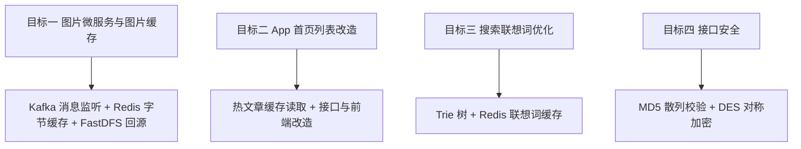

# 项目优化开篇：四个目标与对应的技术地图

> 🔒 安全提示：文中示例的口令/密钥均为课程教学环境演示口径，生产环境的安全要求见《安全与合规须知》。

功能做全之后，系统暴露出来的不再是「缺功能」，而是「不够快、不够稳」：热文章榜单算出来了，App 首页却还在按老逻辑读库；榜单文章被高频打开，正文配图与封面全部指向文件服务器，越刷越喘；搜索框的联想词还在对数据库做模糊查询；登录接口的密码至今没有做任何加密校验。项目优化这一天就对着这四个短板各下一刀，开课先把目标与技术的对应关系摆清楚，后面每一课才知道自己在补哪块砖。

## 先给结论

- 当天四个目标：图片微服务与图片缓存、App 端文章查询列表改造、搜索联想词优化、接口安全（登录密码校验）。
- 图片缓存是当天主线：新建一个专门处理图片的微服务，监听热文章消息，把热文章相关图片缓存到 Redis，并对外提供图片访问接口供 App 调用。
- 列表改造解决「算了没用上」：热文章数据已经躺在 Redis 与热文章表里，App 首页接口与前端要改成优先展示热点文章。
- 联想词优化把数据源从直查 MySQL 换成 Trie 树加 Redis 的组合，前缀匹配在内存里完成，效率明显提升。
- 接口安全补上密码校验：MD5 这类不可逆散列算法管密码摘要，另讲 DES 这种对称加密算法的适用场景。

## 四个目标各挂什么技术点

目标课不喊口号，每一句目标都对应着当天的产出物。对着这张表预习，能把「听懂了」和「写出来了」分开：

| 目标 | 挂靠的技术点 | 当天的产出 |
|---|---|---|
| 图片微服务开发及应用 | 新建 images 微服务、Kafka 消息监听、Redis 缓存图片字节、FastDFS 回源 | 图片缓存链路加图片访问接口 |
| App 文章查询列表改造 | 热文章缓存读取、列表接口与前端改造 | 首页优先展示热点文章 |
| 搜索联想词优化 | Trie 树结构、Redis 缓存联想词 | 联想接口换数据源，响应提速 |
| 接口安全 | MD5 散列、DES 对称加密、密码校验逻辑 | 登录密码加密校验落地 |



四条目标里，目标一的施工期最长，消息定义、发送、微服务导入、缓存逻辑、访问接口占了当天的大部分篇幅；目标二到目标四各自收成一个独立纵切。学的时候按主线推进，支线各自成块，不会乱。

## 图片缓存是前一天留的活

目标一不是凭空冒出来的需求，前一天的热文章计算落地时，代码尾部留了一个明确的口子：

```java
// ApHotArticleServiceImpl.computeHotArticle 的尾部，前一天落地时的写法
for (ApHotArticles hot : hotArticlesList) {
    apHotArticlesMapper.insert(hot);            // 保存热点文章
    fillHotArticleForEntryList(hot, entryList); // 按词条复制一份
}
// 缓存文章中的图片（暂时不做）
```

这行注释就是今天第一件事的施工位。功能需求的表述也很直白：随着热文章的访问越来越频繁，文章内的图片频繁访问图片服务器，对图片服务器造成很大压力，因此决定把热文章相关图片缓存到 Redis；开发功能包括监听热文章消息缓存图片。做法上不是在原有服务里塞几行缓存代码，而是搭一个专门处理图片的微服务，接收热文章消息后拉图入缓存，再提供访问接口让 App 取图。整条链路的形状：


关键路径在「消息到字节」这一段：消息里流动的只是热点文章数据，真正的图片下载与缓存发生在图片微服务内部，重 IO 与核心文章链路就此分开。当天要落地的缓存接口先给个签名预告：

```java
public interface CacheImageService {

    /**
     * 缓存图片到 redis
     * @param imgUrl  图片地址
     * @param isCache 是否走缓存
     * @return 图片字节
     */
    byte[] cacheRedis(String imgUrl, boolean isCache);
}
```

返回值是 `byte[]`，一句话点破缓存对象是图片二进制本身，命中后连文件服务器都不用碰；`isCache` 参数给「强制回源」留了口子。这两个设计的取舍在需求分析与代码思路的课里展开。

## 列表改造、联想词与接口安全的看点

**列表改造解决「计算结果送达最后一公里」。** 热文章数据已经进了 Redis 与热文章表，App 首页接口却还按老路径读库，算出来的榜单没有真正触达用户。改造把接口的读取顺序换成优先取热点文章，前端列表渲染跟着调整，计算与展示两条线就此接通。

**联想词优化换的是数据结构与数据载体。** 此前的联想词直接查 MySQL，模糊匹配在数据量上来之后既慢又费库；改造引入 Trie 树（前缀树，把公共前缀收敛到一条路径上的树形结构）做前缀匹配，再配合 Redis 缓存联想结果，两次击穿都发生在内存里，效率自然比直查数据库高。

**接口安全补的是登录环节最基本的一道防线。** 之前做登录时密码没有做任何校验处理，明文进出库；当天引入 MD5 做密码摘要，MD5 属于散列算法，单向不可逆，验证时比对摘要而不是原文；另讲一种 DES 对称加密算法，加密解密共用一把密钥，适合需要还原明文的场景。这里有个术语要纠偏：MD5 不是加密算法，更谈不上非对称，散列与加密是两个家族，口误在转写里常见，概念上必须分清。

## 常见误区

- **把图片缓存理解成把图片 URL 存进 Redis。** 错例是缓存里只存 key 到 URL 的映射，命中后仍要去文件服务器拉图，回源压力一点没少。正解是缓存图片字节流本身，命中即返回字节。
- **把 MD5 称为加密算法或非对称加密。** 错例是「用 MD5 加密后可以解密回来」。正解是 MD5 是单向散列，摘要不可逆；DES 才是对称加密，可逆但密钥要保密。
- **把联想词优化当成加个索引就完事。** 错例是在 MySQL 里给搜索词建索引后宣称优化完成。正解是前缀匹配换了数据结构（Trie），数据载体换了位置（Redis），两层一起动才有量级提升。
- **四个目标平均用力。** 错例是以为当天四件事体量相当。正解是图片缓存贯穿当天主线，消息、微服务、缓存、接口环环相扣，先把主线走通再收支线。

## 面试可能被问到的问题

1. 面试官追问：「图片缓存为什么要单独建一个微服务，在文章服务里加段缓存代码不行吗？」
   答：图片下载与字节处理是重 IO 操作，混进文章服务的核心链路会在高峰期互相拖累；独立图片微服务让故障隔离、独立扩容成为可能，后续图片相关的其他能力也有归处。消息解耦之后，文章服务只负责广播热点数据，图片侧的节奏自己掌控。
2. 面试官追问：「图片缓存的对象是 URL 还是图片本身，为什么？」
   答：缓存图片二进制本身。URL 映射只能省掉重复查库，命中后仍要回源文件服务器，带宽与磁盘压力原封不动；字节缓存让命中请求完全不触达文件系统，用内存换彻底卸载回源，代价由 Redis 内存护栏与淘汰策略兜住。
3. 面试官追问：「Trie 树为什么适合搜索联想？和直接查库比优势在哪？」
   答：联想的本质是前缀匹配，Trie 把公共前缀收敛到共享路径，一次树上游走就能圈出所有同前缀词，复杂度与词库总量解耦；配合 Redis 缓存高频前缀的结果，热点查询连树都不用遍历。直查数据库的 like 前缀匹配要扫描数据且走网络，量级完全不同。
4. 面试官追问：「密码存储为什么用 MD5 这类散列，而不是 DES 这类可逆加密？」
   答：验证密码只需要比对，不需要还原原文，可逆能力本身就是风险面，库被拖走后密钥一旦泄露全部明文裸奔。散列单向不可逆，验证时对输入重算摘要比对即可。生产上还会在 MD5 基础上加盐并换用更慢的散列来对抗彩虹表。
5. 面试官追问：「热文章数据都算出来了，App 端为什么还看不到热点优先？」
   答：计算链路和展示链路是两段，热文章落在 Redis 与热文章表里，App 首页接口仍按旧路径读库，缺的是接口读取顺序与前端渲染的改造。这正是「计算结果送达最后一公里」的问题，数据 ready 不等于用户可见。

## 配套资料

- 代码：`materials/code/05/头条day13/`。该日资料包解压结果为空（未含源码文件），文中 `computeHotArticle` 尾部片段与 `CacheImageService` 接口按画面线抄录并按本课写法补全；引用路径截至 `头条dayNN/` 层级，内层目录名含项目原名，不进入正文。
- 代码：`materials/code/05/头条day07/`，资料目录里真实随包提供 Kafka 收发封装九个工具类，图片缓存的消息链路直接复用这套封装。
- 环境：课程集群 node01~node03，MySQL root/123456，Redis、Kafka 与 FastDFS 均部署在集群上。
