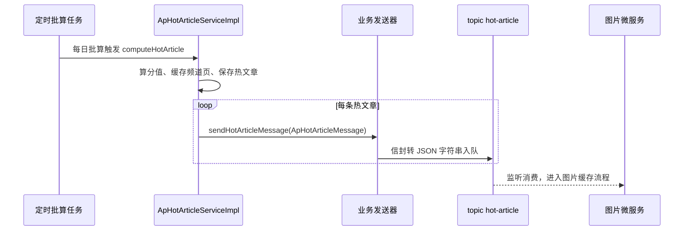

# article 端发送图片预热消息：topic 三层配置与热点文章信封

> 🔒 安全提示：文中示例的口令/密钥均为课程教学环境演示口径，生产环境的安全要求见《安全与合规须知》。

需求定了要把热文章图片缓存进 Redis，第一刀切在哪里：得先让图片微服务知道「哪些文章值得缓存图片」。文章侧的 `ApHotArticleServiceImpl` 在热文章批算收尾时留了一句「缓存文章中的图片（暂时不做）」，这一课就把这个口子补上。Kafka 的收发封装早在公共工程里架好，业务侧照既有套路三步走：登记消息名称、封装消息类、在计算热文章的方法里发消息。三步做完，图片侧的监听课才有东西可收。

## 先给结论

- 发送三步走：topic 三层配置登记消息名称、定义热点文章消息封套类、在 `computeHotArticle` 保存热文章的循环里逐条发送。
- topic 配置键 `kafka.topic.hot-article`，完整名 `headline.topic.hot.article.single.test`，按单消息通道约定以 single 标记结尾段，环境后缀随 profile 变化。
- 消息体是 `ApHotArticles` 热点文章对象，里面带 `articleId`；不发图片 URL 列表，解析图片的活留给消费端。
- 发送时机锚定在热文章批算的循环里，每保存一条热文章就发一条预热消息，榜单一天一千条对应一千条消息，量级很轻。
- 幂等不靠消息去重靠覆盖写：图片缓存是 set 覆盖，重复消费只是重复下载一次再覆盖，结果不变；消息 key 用 UUID 随机串，也不追求分区保序。

## 第一步：消息名称的三层登记

新消息进门先起名字，名字落在三层配置里，这是工程里 topic 管理的既定规矩。环境层给真实取值，公共层的 `kafka.properties` 用占位符透传，代码层的 `KafkaTopicConfig` 绑定读取。两处 properties 先后登记（示例合并展示，两段分别位于各自文件）：

```properties
# 环境层 maven-test.properties：热文章消息名称，图片缓存预热用
kafka.topic.hot-article=headline.topic.hot.article.single.test

# 公共层 kafka.properties：占位符透传，真实值由构建 profile 注入
kafka.topic.hot-article=${kafka.topic.hot-article}
```

代码层在 `KafkaTopicConfig` 里加一个字段，启动时由 Spring 的松散绑定把连字符配置键映射成驼峰字段：

```java
@Data
@Configuration
@ConfigurationProperties(prefix = "kafka.topic")
@PropertySource("classpath:kafka.properties")
public class KafkaTopicConfig {
    private String submitArticleAuth;    // 文章提交审核
    private String articleAuditSuccess;  // 审核通过
    private String articleUpdateBus;     // 行为增量消息
    private String hotArticle;           // 热文章消息，本讲新增
}
```

配置键尾段与字段名对得上，`kafka.topic.hot-article` 自动落进 `hotArticle` 字段，业务代码从此只认 `kafkaTopicConfig.getHotArticle()`，换环境零代码改动。三层各管一段的价值在多环境部署时兑现：test 与 prod 的取值差异留在 properties 里，代码里的引用永远是一个驼峰字段。

## 第二步：热点文章消息的封套

消息不裸发，要套公共工程里的 `KafkaMessage` 信封。热点文章的消息封套定义在公共消息包的 app 子包下：

```java
package com.study.headline.common.kafka.messages.app;

import com.study.headline.common.kafka.KafkaMessage;
import com.study.headline.model.article.pojos.ApHotArticles;

/**
 * 热点文章消息：载荷是热文章对象，图片缓存预热用
 */
public class ApHotArticleMessage extends KafkaMessage<ApHotArticles> {

    public ApHotArticleMessage() {}

    public ApHotArticleMessage(ApHotArticles data) {
        super(data);
    }

    @Override
    public String getType() {
        return "hot-article";
    }
}
```

无参构造给框架反射用，有参构造给业务组装用，`getType()` 返回的 `hot-article` 是消费端路由的钥匙：公共封装在容器启动时扫出全部信封子类，把类型字符串到类的映射收进注册表，消费端拿到 JSON 后凭 type 反查该反序列化成哪个类。类型字符串定义后不可改名，改名等于把消费端的路由表撕掉一页。

**消息体装对象而不是图片 URL 列表，是这一步最值得琢磨的决策。** 热文章对象里没有图片地址，只有 `articleId`；图片地址藏在文章内容的富文本与封面字段里，要查了文章才知道。把解析逻辑放在消费端，文章服务发消息时零额外查询，职责边界也干净：文章侧声明「这篇内容热了」，图片侧自己决定怎么取图怎么缓存。反过来在发送端解析出 URL 列表再发，文章服务要多查一次文章内容做字符串处理，消息体也跟着膨胀，而解析结果消费端未必原样可用。

## 第三步：在计算热文章的方法里发出去

文章端有一个业务发送器，审核成功、行为增量这些既有业务消息都挂在上面，本次照同样的样子再加一个方法：

```java
/**
 * 发送热文章消息：触发图片微服务缓存文章图片
 */
public void sendHotArticleMessage(ApHotArticleMessage message) {
    // topic 取配置类常量，key 用随机串，信封对象交底层转 JSON 入队
    this.sendMesssage(kafkaTopicConfig.getHotArticle(),
            UUID.randomUUID().toString(), message);
}
```

底层调用的 `sendMesssage` 是公共封装的基础方法，方法名三个 s 是资料原样拼写，业务方法名两个 s，两个拼写并存不是笔误，拷代码时不要顺手「纠正」。发送点在热文章批算的主流程里，把那句「暂时不做」的注释删掉，换成真正的发送：

```java
@Override
public void computeHotArticle() {
    // 查前一天新发布的文章，计算热度，缓存频道首页（前面课程已落地）
    List<ApHotArticles> hotArticlesList = computeHotArticle(articleList);
    cacheTagRedis(hotArticlesList);
    List<ApBehaviorEntry> entryList = apBehaviorEntryMapper.selectAllEntry();
    for (ApHotArticles hot : hotArticlesList) {
        apHotArticlesMapper.insert(hot);             // 保存热点文章
        fillHotArticleForEntryList(hot, entryList);  // 按词条复制
        // 每条热文章发一条图片预热消息
        kafkaSender.sendHotArticleMessage(new ApHotArticleMessage(hot));
    }
}
```

发消息之前先注入业务发送器，`@Autowired` 一个字段的事。整条链路的时序如下：



关键路径在循环里那一次调用：数据准备与落库完成后顺手把消息递出去，发送动作夹在批算流程内，不引入额外调度，也不需要图片侧轮询。

## 发送时机与幂等

**时机锚定批算节奏。** 榜单每天凌晨批算一轮，一千条热文章对应一千条预热消息，Kafka 处理这个量级毫无感觉。实时链路那边行为消息频次高得多，行为每动一次就把图片预热跑一遍纯属灾难，所以发送点只放批算循环里，实时增量不触发预热。这个取舍的依据是图片缓存的有效期与榜单刷新周期天然一致：榜单换血才需要换图，分值的分钟级抖动不改变「哪些图值得缓存」。

**幂等靠覆盖写，不靠消息只到一次。** 消息 key 用 `UUID.randomUUID()` 随机串，同一篇文章的消息会散进不同分区，不保序也不去重；但消费端的图片缓存是 set 覆盖语义，同一条消息重复消费，无非是图片多下载一次、Redis 多覆盖一次，最终状态与消费一次完全一致，天然幂等。失败侧由公共封装的重试闭环兜底：业务异常先在容器内重试，耗尽后消息带着累加的 retry 回滚到原 topic 重新排队，超过次数或时长上限才抛弃。想要更精细的控制也有路线：key 换成 `articleId`，同一文章进同一分区保序，还能借分区粒度做消费端去重，代价是可能让分区数据倾斜，课程版选 UUID 图的是简单直接。

## 常见误区

- **在发送端解析图片 URL 列表塞进消息。** 错例是文章服务查完文章内容、抠出图片地址再发消息，多一次内容查询，消息体膨胀，解析逻辑还可能与消费端的需求错位。正解是消息只带热点文章对象，图片解析是图片微服务的职责。
- **三处配置对不上。** 错例是 properties 里写 `hot-article`，配置类字段叫 `hotArticless`，松散绑定失败，字段注入 null，发消息时 topic 为空直接报错。正解是配置键尾段与驼峰字段严格对应，启动后打印一次配置值自检。
- **把消息 key 当去重手段。** 错例是以为 key 用 `articleId` 就能挡住重复消息。正解是 key 只影响分区与局部保序，幂等必须由消费端状态或覆盖写语义保证，两端职责别混。
- **把预热挂在实时行为链路上。** 错例是点赞阅读每动一次就触发一轮图片预热，消息风暴拖垮图片下载。正解是预热跟随每日批算，实时链路的分值更新与图片缓存无关。

## 面试可能被问到的问题

1. 面试官追问：「为什么通过发消息触发图片缓存，文章服务直接拉图存 Redis 不行吗？」
   答：直接拉图会把重 IO 的图片下载塞进文章服务，批算高峰与图片下载叠加，核心链路被拖慢；发消息把两件事解耦，文章服务只广播热点数据，图片微服务按自己的节奏消费，故障互不传染，图片侧还能独立扩容。
2. 面试官追问：「消息体为什么装热点文章对象而不是图片地址列表？」
   答：热文章对象里现成的只有 articleId，图片地址要查文章内容才能解析，把解析留在消费端，发送端零额外查询、消息体最小；职责也清晰，文章侧声明热度，图片侧决定取图与缓存方式。URL 列表方案把本属图片域的解析压给了文章域，边界被打破。
3. 面试官追问：「消息 key 用 UUID 随机串，重复消费怎么办？」
   答：重复消费的结果是图片多下载一次并覆盖写入，缓存是 set 覆盖语义，最终状态一致，天然幂等，不需要消息层去重。若要进一步控制，key 可换 articleId 使同文章消息进同分区，配合消费端按文章去重，但会引入分区倾斜的权衡。
4. 面试官追问：「topic 配置为什么要三层，环境层透传层配置类各起什么作用？」
   答：环境层给真实取值，多环境差异收敛在 properties 切换；透传层用占位符让公共模块与具体环境解耦；配置类靠松散绑定把配置键落成驼峰字段，业务代码只认 getter。三层合起来做到换环境零代码改动，也避免 topic 字符串散落在业务代码里。
5. 面试官追问：「每天一千条消息，用 Kafka 是不是杀鸡用牛刀？」
   答：量级确实不大，但 Kafka 在这里买的是三样东西：与既有审核、行为增量消息同一套通道与封装，零额外运维；失败重试闭环由封装的错误处理器统一兜底；消费端是独立微服务，削峰与隔离都靠消息边界。消息中间件的价值不只在吞吐，还在解耦与可靠性基建的复用。

## 配套资料

- 代码：`materials/code/05/头条day07/`。资料目录里真实随包提供 Kafka 封装九件：`KafkaMessage`（消息信封基类）、`KafkaSender`（`sendMesssage` 基础发送方法，三个 s 为资料原样）、`KafkaTopicConfig`（topic 绑定）、`MessagesRegister`（类型路由注册）、`RetryErrorHandler`（失败回滚重试）及生产者、消费者配置与监听工厂，文中信封与发送链路即建立在这批真实文件之上；源码包名为机构前缀，正文统一改写为 `com.study.headline`。
- 代码：`materials/code/05/头条day13/`。该日资料包解压结果为空（未含源码文件），文中 `ApHotArticleMessage`、业务发送方法与 `computeHotArticle` 改造片段按画面线抄录并按本课写法补全；引用路径截至 `头条dayNN/` 层级，内层目录名含项目原名，不进入正文。
- 环境：课程集群 node01~node03，MySQL root/123456；Kafka 地址配置在 `kafka.properties` 的 `kafka.hosts`，按所在环境指向真实 broker。
