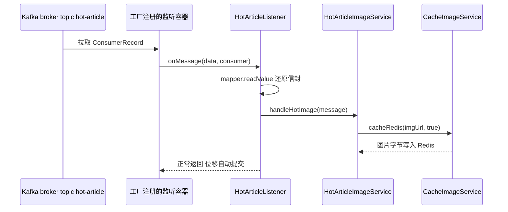

# 消息接收监听类编写：图片微服务的 Kafka 消费入口

> 🔒 安全提示：文中示例的口令/密钥均为课程教学环境演示口径，生产环境的安全要求见《安全与合规须知》。

发送端会发消息了，处理与缓存逻辑也备好了，中间还缺一个「接」字。这一课的代码量是图片缓存这条链路里最少的，一个类几十行，但它把公共 Kafka 封装的消费侧机制完整走了一遍：为什么不用注解声明监听、容器是谁建的、消息怎么从一串 JSON 还原成对象、失败为什么不上翻。看懂这个类，公共封装的消费侧就通了一半。

## 先给结论

- 监听类 `HotArticleListener` 放在 images 模块的 `kafka.listener` 包，实现公共封装的 `KafkaListener<String, String>` 接口，挂 `@Component` 与 `@Log4j2`。
- 两个必答方法：`topic()` 返回 `kafkaTopicConfig.getHotArticle()`，与发送端同一个配置键；`onMessage` 拿 `data.value()` 用 `ObjectMapper` 反序列化成 `ApHotArticleMessage`，转手交给 `handleHotImage`。
- 不用 `@KafkaListener` 注解：封装里的 `KafkaListenerFactory` 在容器启动后扫描全部 `KafkaListener` 类型的 bean，逐个建监听容器注册进 Spring，业务类只管声明 topic。
- 反序列化与业务调用包在 try-catch 里，失败 `log.error` 记录，不让单条坏消息打爆重试闭环。
- 注入三件：`KafkaTopicConfig`、`ObjectMapper`、`HotArticleImageService`，监听器自己不写一行业务。

## 为什么不用 @KafkaListener 注解

Spring Kafka 自带 `@KafkaListener` 注解，方法上一挂就能消费。公共封装另起炉灶，用的是「接口加工厂」的组合，先看业务类要实现的接口（真实封装，包名按工程口径改写）：

```java
package com.study.headline.common.kafka;

import org.springframework.kafka.listener.ConsumerAwareMessageListener;

/**
 * 消息监听实现接口：业务监听类实现它，工厂负责注册
 */
public interface KafkaListener<K, V> extends ConsumerAwareMessageListener<K, V> {

    // 监听的主题，必答
    String topic();

    // 使用的监听容器工厂，默认走公共配置
    default String factory() {
        return "defaultKafkaListenerContainerFactory";
    }

    // 消费组，默认共用
    default String group() {
        return "default";
    }
}
```

`onMessage` 方法不用声明，它来自父接口 `ConsumerAwareMessageListener`。真正干活的是工厂，容器启动时把 Spring 容器里所有 `KafkaListener` 类型的 bean 收割一遍，逐个建容器、挂监听、注册单例：

```java
@Component
public class KafkaListenerFactory implements InitializingBean {

    @Autowired
    DefaultListableBeanFactory defaultListableBeanFactory;

    @Override
    public void afterPropertiesSet() {
        // 扫出容器里全部 KafkaListener 类型的 bean
        Map<String, KafkaListener> map =
                defaultListableBeanFactory.getBeansOfType(KafkaListener.class);
        for (String key : map.keySet()) {
            KafkaListener k = map.get(key);
            // 按监听类声明的工厂与 topic 建容器，挂上监听对象
            AbstractKafkaListenerContainerFactory factory =
                    (AbstractKafkaListenerContainerFactory)
                            defaultListableBeanFactory.getBean(k.factory());
            AbstractMessageListenerContainer container =
                    factory.createContainer(k.topic());
            container.setupMessageListener(k);
            // 容器以类名加 AutoListener 命名注册成单例
            String beanName = k.getClass().getSimpleName() + "AutoListener";
            defaultListableBeanFactory.registerSingleton(beanName, container);
            logger.info("add auto listener [{}]", beanName);
        }
    }
}
```

这套机制的价值在于配置收敛。`topic()` 返回的是配置类的字段，topic 字符串只存在于 properties 一处，换环境零代码改动；注解方案里 topic 写死在方法参数上（占位符能缓解但终究散落）。新业务要接消息，实现接口、挂 `@Component`，剩下的注册、线程、重试全部由工厂与容器配置代劳。日志里那行 `add auto listener` 是排查「消息没人消费」的第一个检查点，没出现就意味着监听类没被 Spring 收编。

## 监听类完整代码

```java
package com.study.headline.images.kafka.listener;

import com.fasterxml.jackson.databind.ObjectMapper;
import com.study.headline.common.kafka.KafkaListener;
import com.study.headline.common.kafka.KafkaTopicConfig;
import com.study.headline.common.kafka.messages.app.ApHotArticleMessage;
import com.study.headline.images.service.HotArticleImageService;
import lombok.extern.log4j.Log4j2;
import org.apache.kafka.clients.consumer.Consumer;
import org.apache.kafka.clients.consumer.ConsumerRecord;
import org.springframework.beans.factory.annotation.Autowired;
import org.springframework.stereotype.Component;

@Log4j2
@Component
public class HotArticleListener implements KafkaListener<String, String> {

    @Autowired
    private KafkaTopicConfig kafkaTopicConfig;

    @Autowired
    private ObjectMapper mapper;

    @Autowired
    private HotArticleImageService hotArticleImageService;

    @Override
    public String topic() {
        // 与 article 端发送的 topic 同源，取自同一个配置键
        return kafkaTopicConfig.getHotArticle();
    }

    @Override
    public void onMessage(ConsumerRecord<String, String> data, Consumer<?, ?> consumer) {
        log.info("接收到热文章消息, value: {}", data.value());
        try {
            String value = data.value();
            // 信封 JSON 还原成消息对象，热点文章载荷在 getData 里
            ApHotArticleMessage message = mapper.readValue(value, ApHotArticleMessage.class);
            // 交给热文章图片处理服务
            hotArticleImageService.handleHotImage(message);
        } catch (Exception e) {
            // 消费失败不外抛：坏消息重试无意义，记日志人工排查
            log.error("接收消息失败", e);
        }
    }
}
```

泛型参数 `<String, String>` 对应消息的 key 与 value 类型：发送端 `sendMesssage` 走的就是字符串键值，value 是 `writeValueAsString` 产出的信封 JSON。`ObjectMapper` 是 Spring Boot 自动装配的 bean，反序列化按目标类的字段名映射，`KafkaMessage` 基类的 `retry`、`time`、`type`、`data` 四个字段与载荷一起还原，业务代码 `getData()` 拿热点文章对象。信封里还有一个 `type` 字段（值为 `hot-article`），封装的类型注册表维护着它与消息类的映射，供错误处理器在重试回滚时重建消息；本 topic 只承载热点文章一种消息，直接指定目标类反序列化即可，两条路殊途同归。`onMessage` 的第二个参数 `consumer` 是父接口签名带来的消费者引用，可用于手动位移提交等高级操作，本场景位移自动管理，参数闲置。

从消息进来到图片落 Redis 的完整接力：



监听类在整条链路里的角色是「收、转、派」：收 ConsumerRecord，转成业务对象，派给处理服务。业务逻辑一行不沾，这是监听类的本分。

## 异常处理与重试的边界

try-catch 的位置包住了反序列化与业务调用两步，这个细节对应着封装容器的一个重要配置。`defaultKafkaListenerContainerFactory` 上挂着 `RetryTemplate`（五次指数退避）与 `RetryErrorHandler`（重试耗尽回滚原 topic 重新排队），它们的触发条件是监听器抛异常。这里把异常吞掉，等于对这条链路做出明确声明：图片预热不参与消息级重试。

判断的依据是失败的性质。反序列化失败说明消息体损坏，重试多少次结果都一样，这类失败重试无意义；业务处理失败（比如 Redis 抖动）理论上可重试，但图片处理内部已经对每张图单独 try-catch，单图失败不会外抛，能走到外层 catch 的消息本来就不该重放。如果反过来把异常上抛，五次重试会让同一条消息反复触发图片下载，重试闭环在这里只会放大故障。消费侧的这套「收与不收」的边界，与发送端的重试语义配对存在，两端一起看才完整。

## 常见误区

- **在 topic() 里手写 topic 字符串。** 错例是 `return "headline.topic.hot.article.single.test"`，环境一换全错，与三层配置的管理机制背道而驰。正解是返回 `kafkaTopicConfig` 的字段，字符串只活在 properties 里。
- **监听类忘挂 @Component。** 错例是类写了、接口实现了，工厂扫不到 bean，启动后一条消息也不消费且没有报错。正解是补上注解，启动日志核对 `add auto listener` 那行输出。
- **catch 里只 printStackTrace。** 错例是 `e.printStackTrace()`，输出落到标准错误流，日志系统里查不到。正解是 `log.error("接收消息失败", e)`，异常对象作为最后一个参数交给日志框架，堆栈完整入库。
- **把业务逻辑写进监听器。** 错例是在 onMessage 里直接查库、解析、写缓存，监听类膨胀成第二个 service。正解是监听器只做收转派，业务能力沉淀在 service 层，监听器换个 topic 复制改两行就能用。

## 面试可能被问到的问题

1. 面试官追问：「自研 KafkaListener 接口相比 @KafkaListener 注解有什么好处？」
   答：topic 收敛到配置类，多环境零代码改动；工厂统一建容器，注册、线程、重试逻辑集中管理；业务类面向接口，收转派职责清晰，统一加日志或监控改一处即可。代价是多一层封装的认知成本，团队规模小、topic 少的项目用注解反而直接。
2. 面试官追问：「onMessage 的 Consumer 参数是干什么用的？」
   答：`ConsumerAwareMessageListener` 签名带来的消费者引用，可以拿它做手动位移提交、暂停恢复分区、按需拉取等精细控制。本场景位移自动管理，参数闲置，但签名保留为将来留了口子。
3. 面试官追问：「消息反序列化失败会触发重试吗？」
   答：不会。监听器内部 catch 住记日志，异常不上抛，容器的 RetryTemplate 只在监听器抛异常时介入。JSON 损坏属于不可恢复失败，重试只是浪费；设计上把可重试与不可重试的失败分开，前者交给重试闭环，后者记日志人工排查。
4. 面试官追问：「消费组与并发是怎么定的？」
   答：消费组默认 `default`，由公共消费者配置统一给出；容器并发在 `KafkaConsumerConfig` 里定为 8，要结合分区数权衡：并发超过分区数时多出的线程空转，图片下载是重 IO，高并发有利吞吐但要防把 FastDFS 打满。
5. 面试官追问：「收到消息后怎么路由到具体的处理逻辑？」
   答：两层路由。topic 决定监听类，工厂按每个监听类声明的 topic 建容器，一对一固定；消息信封里的 type 字段决定载荷类型，封装的类型注册表维护映射，错误处理器靠它重建消息。本场景同 topic 单一消息类型，反序列化直接指定目标类。

## 配套资料

- 代码：`materials/code/05/头条day07/`。资料目录里真实随包提供 Kafka 封装九件：`KafkaListener`、`KafkaListenerFactory`、`KafkaConsumerConfig`（含 `defaultKafkaListenerContainerFactory`、重试模板与并发配置）、`KafkaMessage`、`MessagesRegister`、`RetryErrorHandler` 等，监听类直接建立在这批真实文件上；源码包名为机构前缀，正文统一改写为 `com.study.headline`。
- 代码：`materials/code/05/头条day13/`。该日资料包解压结果为空（未含源码文件），文中 `HotArticleListener` 与接口、工厂的改写展示按画面线抄录并按本课写法补全；引用路径截至 `头条dayNN/` 层级，内层目录名含项目原名，不进入正文。
- 代码：`materials/code/05/头条day12/`，Kafka Stream 封装的监听工厂可对照上文监听注册的思路。
- 环境：课程集群 node01~node03，MySQL root/123456；Kafka 地址配置在 `kafka.properties` 的 `kafka.hosts`，按所在环境指向真实 broker。
