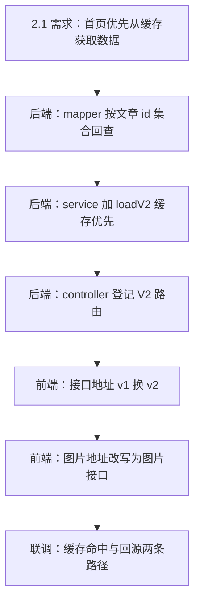
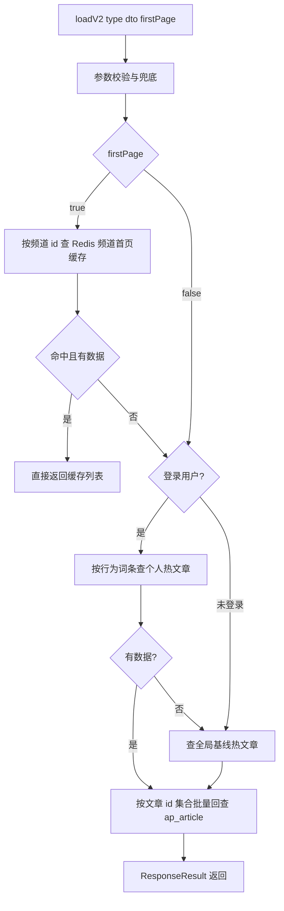

# App 首页接口改造：热文章列表先走 Redis 缓存的三条请求路径

> 🔒 安全提示：文中示例的口令/密钥均为课程教学环境演示口径，生产环境的安全要求见《安全与合规须知》。

热文章算出来了，频道首页缓存写进 Redis 了，图片也成批缓存了，可 App 首页那条列表接口还在每次请求都打数据库。算完不应用等于白算，改造就在眼前。这一课跨三段内容：先定改造思路，再把 service 层的缓存优先逻辑与两条回源路径写透，控制器的路由登记与前端切换随后两课展开。首页是整个 App 压力最大的读入口，把它的取数路径从「每次查库」改成「缓存优先、未命中回源」，是 day13 项目优化的主菜。

## 先给结论

- 接口版本升到 V2：`/api/v2/article/load`、`/load_more`、`/load_new` 三个路径，入参与响应结构与 V1 完全一致，前端只需换地址，解析代码零改动。
- service 层收口为一个 `loadV2(Short type, ArticleHomeDto dto, boolean firstPage)`，参数校验与 V1 同款；`firstPage` 只有首次加载为 true，它是缓存与数据库的分水岭。
- 首屏先查频道首页缓存，key 沿用热文章计算课的口径 `hot_article_first_page_` 加频道 id，命中直接返回；channelId 为空的「推荐」流不查缓存直接走库。
- 未命中回源两条路：登录用户按行为词条查 `ap_hot_articles` 再回查 `ap_article`；未登录或词条缺失查 `entry_id` 为 0 的全局基线榜单。
- 上拉与下拉不碰缓存：频道首页缓存只有首页那批数据且每日一更，翻页与刷新必须回源拿真实结果。
- 课程版未命中不回填缓存，新鲜度交给每日全量覆盖；回填是生产演进点，要配互斥与空值策略才敢上。

## 改造蓝图：为什么先立一个 V2 接口

老接口直接改有两个风险：一是首页是核心入口，改动期间出问题没有退路；二是老的前端版本还在线上跑，接口语义一变就是事故。工程在搭骨架时就在 URL 与包名里埋了版本号，controller 按 `v1`、`v2` 分包，URL 按 `/api/v1`、`/api/v2` 分层，此刻正是它兑现价值的时候：新逻辑全装进 V2，V1 原样留着，前端切换地址就是灰度开关，出了问题改回地址即回滚。

改造的动线是先粗后细，画成一张蓝图：



需求里两条主线，第一条是首页列表：添加 V2 接口，首页列表先加载热点文章，已登录给推荐的热文章，未登录给默认的热文章，按频道访问时从缓存里取频道首页数据。第二条是图片：FastDFS 里的图片已经缓存进 Redis，App 端图片优先从缓存读，主要改前端，把图片地址换成图片访问接口，后端只需保证那个 GET 图片接口可用。两条主线一后一前，后端先行、前端跟上，联调验证收尾。

把三个加载场景与缓存的数据维度对齐看，需求为什么这么定就清楚了。热文章表按行为词条逐份存榜、频道首页缓存按频道存展示列表，两者覆盖的用户视角不同：词条维度服务于「给这个人推什么」，频道维度服务于「这个频道页展示什么」，推荐流与频道页由此各走各的取数线。双版本并存也有代价：同一套业务要维护两份 service 代码，V1 冻结、V2 演进，窗口期内修 bug 可能要改两处；所以并存期越短越好，前端完成切换、数据验证稳定后，V1 的历史使命就结束了，版本化的意义在于切换过程可控，而不是永远养着两套。

## Mapper 先行：按文章 id 集合回查

V2 的取数源头从推荐表换成了热文章表，`ap_hot_articles` 里只有 articleId，要把列表渲染出来还得回文章表取完整内容。文章列表第一版的 Mapper 里有一个按 id 集合回查的方法，但它收的是推荐记录对象列表；V2 手里是纯 id 集合，于是新增一个 V2 版本：

```java
// ApArticleMapper 新增：依据文章 id 集合获取文章列表（V2）
List<ApArticle> loadArticleListByIdListV2(@Param("list") List<Integer> list);
```

对应的 XML 用 foreach 拼 IN 查询，结构与第一版的回查同构：

```xml
<!-- 依据文章 id 集合获取文章数据 V2 -->
<select id="loadArticleListByIdListV2" resultMap="resultMap">
    select * from ap_article where id in
    <foreach item="item" collection="list" separator=",">
        #{item}
    </foreach>
</select>
```

两个版本摆在一起看差异：第一版收 `List<ApUserArticleList>`，foreach 里取 `item.articleId`，因为推荐链路手里是推荐记录；V2 收 `List<Integer>`，foreach 直接取元素，因为热文章链路手里就是 id。数据源换了，回查的骨架不变，这正是当初把「查推荐记录」与「按 id 回查」拆成两段查询的回报：拆开之后，任何一条新链路只要能产出 id 集合，就能复用第二段。同场还要给 `ApHotArticlesMapper` 补一个按行为词条查热文章的方法 `loadArticleIdByEntryId(entryId, dto, type)`，词条维度的查询条件是 `entry_id` 等值加频道与时间方向，留给回源小节使用。

IN 查询有个先记下的伏笔：`where id in (...)` 不保证返回顺序与传入顺序一致，数据库按自己的代价模型返回行序。热文章榜单是有名次的，回查之后顺序若被打乱，页面上的排名就乱了。这个问题在回源代码里展开。

## Service 的 V2 入口：参数校验复用，多一个首页开关

service 层不另起炉灶，在 `ApArticleService` 上加一个 V2 方法。签名比 V1 多两个东西：返回仍是 `ResponseResult`，参数多一个 `boolean firstPage`，方向与入参沿用既有口径：

```java
/**
 * 加载文章列表 V2
 * @param type      加载类型 1 加载更多 2 加载最新
 * @param dto       查询参数
 * @param firstPage 是否首页：true 先查缓存，false 直接走库
 */
ResponseResult loadV2(Short type, ArticleHomeDto dto, boolean firstPage);
```

`firstPage` 这个开关是整个 V2 的题眼。首页首屏要的是「这个频道下当前最热的文章」，缓存里的频道首页数据正是为它准备的；上拉翻页要的是「缓存那批之后的旧内容」，下拉刷新要的是「比缓存更新的内容」，两者都不在缓存的能力范围内。所以只有首屏有资格查缓存，实现里第一段先做与 V1 完全同款的参数兜底，然后进入缓存判断：

```java
@Override
public ResponseResult loadV2(Short type, ArticleHomeDto dto, boolean firstPage) {
    // 1. 参数校验：与第一版列表同款兜底，dto 空对象、锚点缺省当前时间、
    //    size 默认 20 且上限 50、type 非 1 非 2 归一为加载更多
    if (dto == null) {
        dto = new ArticleHomeDto();
    }
    if (dto.getMaxTime() == null) {
        dto.setMaxTime(new Date());
    }
    if (dto.getMinTime() == null) {
        dto.setMinTime(new Date());
    }
    Integer size = dto.getSize();
    if (size == null || size <= 0) {
        size = 20;
    }
    dto.setSize(Math.min(size, MAX_PAGE_SIZE));
    if (!ArticleConstants.LOADTYPE_LOAD_MORE.equals(type)
            && !ArticleConstants.LOADTYPE_LOAD_NEW.equals(type)) {
        type = ArticleConstants.LOADTYPE_LOAD_MORE;
    }
    // 2. 首页首屏先查缓存：命中直接返回
    if (firstPage) {
        List<ApArticle> cacheList = getCacheArticleV2(dto);
        if (cacheList.size() > 0) {
            log.info("使用缓存加载首页数据 channelId: {}", dto.getChannelId());
            return ResponseResult.okResult(cacheList);
        }
    }
    // 3. 缓存未命中或非首页：按登录态分流回源
    AppUser user = AppThreadLocalUtils.getUser();
    if (user != null) {
        return ResponseResult.okResult(getUserArticleV2(user, dto, type));
    }
    return ResponseResult.okResult(getDefaultArticleV2(dto, type));
}
```

参数校验这段代码与文章列表第一版逐行同源：dto 兜底成空对象、两个锚点缺省取当前时间、size 默认 20 用 Math.min 收口到上限 50、方向常量归一。复用的理由也直白：V2 与 V1 面对的是同一批前端参数，兜底规则没有理由分叉，分叉了反而要在排查时对两套口径。

## 缓存读路径：一个频道一个 key

缓存的写侧在热文章计算课已经就位：按频道逐个切分热文章列表，超过 30 条截断到 30，key 是固定前缀 `hot_article_first_page_` 加频道 id，value 是列表序列化成的 JSON 字符串，空频道也写一个空字符串占位。读侧的职责就是用一模一样的拼法把 key 拼出来：

```java
// 查询频道首页缓存：一个频道一个 key，与热文章计算课的写入口径严格对齐
private List<ApArticle> getCacheArticleV2(ArticleHomeDto dto) {
    if (dto.getChannelId() == null) {
        // channelId 为空代表「推荐」流：缓存只覆盖具体频道页，推荐流直接走库
        return Lists.newArrayList();
    }
    String key = ArticleConstants.HOT_ARTICLE_FIRST_PAGE + dto.getChannelId();
    log.info("查询频道首页缓存 channelId: {}", dto.getChannelId());
    String ret = redisTemplate.opsForValue().get(key);
    if (StringUtils.isEmpty(ret)) {
        return Lists.newArrayList();
    }
    // 反序列化目标类型必须与写入侧对齐，配错了读出来的就是空壳对象
    List<ApArticle> list = JSON.parseArray(ret, ApArticle.class);
    log.info("频道首页缓存规模 channelId: {}, size: {}", dto.getChannelId(), list.size());
    return list;
}
```

这段代码里藏着两个值得停下来的对齐问题。**读写模板要同一套序列化。** 写侧用 Redis 模板写 JSON 字符串，读侧换了 `StringRedisTemplate` 来读，键值全程是字符串时两者兼容，但前提是写侧存的确实是明文字符串而不是某套 JDK 序列化的二进制；换模板之后若读到乱码，先查两边序列化器配置，再怀疑业务代码。**反序列化的目标类型要与写侧内容对齐。** 写侧存的是热文章对象列表，读侧课程现场按 `ApArticle.class` 解析，两个实体的字段并不完全同构：热文章对象上没有 title、images 这类展示字段，解析出来的文章对象就是一只空壳，id 还是热文章行自己的主键而不是文章主键。生产口径应该在写侧先转换成展示用的文章对象再序列化，或者读侧按热文章实体解析后回源补全，两头用同一份实体，类型配对才无懈可击。联调时若首页出现「卡片有框无字」，第一个要查的就是这里。

空频道占位也有个没兑现的细节。写侧给空频道写空字符串，本意是防穿透；但读侧把「key 不存在」与「空字符串」都归为未命中，占位挡穿透的意图并没有生效，空频道的请求照样落到数据库。严格的做法是读侧先 `hasKey` 区分两种状态，命中空串直接返回空列表并结束，或干脆约定空频道不写缓存、由回源路径兜底，取舍要写进设计说明而不是留在代码注释里。

## 回源两条路：全局基线与用户榜单

回源方法的查询条件值得先交代一句：`loadListByLocation` 与 `loadArticleIdByEntryId` 的过滤维度是同一套，词条或基线定行集，频道 id 等值定栏目，时间方向由 type 决定（加载更多取锚点之前的发布时间，加载最新取锚点之后的），条数由 dto 的 size 收口。锚点在这里落在热文章表的发布时间列上，测试时要意识到榜单数据的发布时间分布决定了两个方向能不能查出东西，这在联调一课会被现场验证。

缓存未命中或非首页时走数据库，登录态是分流条件，两条路都从热文章表出发：

```java
// 默认榜单：entry_id 为 0 的全局基线回查文章表
private List<ApArticle> getDefaultArticleV2(ArticleHomeDto dto, Short type) {
    List<ApHotArticles> hotList = apHotArticlesMapper.loadListByLocation(dto, type);
    if (hotList == null || hotList.isEmpty()) {
        return Lists.newArrayList();
    }
    List<Integer> articleIds = hotList.stream()
            .map(ApHotArticles::getArticleId)
            .collect(Collectors.toList());
    return apArticleMapper.loadArticleListByIdListV2(articleIds);
}
```

默认榜单查的是热文章表的全局基线：保存热点文章那一步给每篇文章插过一条 `entry_id` 为 0 的基线记录，它不属于任何用户，就是「这次的榜单本身」。`loadListByLocation` 是热文章计算课时备好的方法，按条件定位热文章列表，时间方向与 size 由 dto 和 type 带进去。课程现场这里写的是循环逐条 `selectById` 回查，功能正确但每篇文章一发 SQL，30 条榜单就是 30 次主键查询，典型 N+1；文中直接复用本讲新增的批量回查，一次 IN 拉回全部，效果等价、往返少一个数量级。榜单名次也在这里补回来：IN 回查不保序，严谨的实现要在内存里按热文章分值或文章发布时间重排一次，或让回查 SQL 按 `field` 类函数与传入顺序对齐，不能默认数据库还你一个有序结果。

登录用户的榜单多一步定位：

```java
// 用户榜单：按行为词条查个人热文章，查不到退回全局基线
private List<ApArticle> getUserArticleV2(AppUser user, ArticleHomeDto dto, Short type) {
    // 定位当前用户的行为主体，与行为功能课同一套查询
    ApBehaviorEntry entry = apBehaviorEntryMapper.selectByUserIdOrEquipment(user.getId(), null);
    // 行为主体缺失或没有词条时退回 0：热文章表里 entry_id 为 0 就是全局基线
    Integer entryId = (entry == null || entry.getId() == null) ? 0 : entry.getId();
    List<ApHotArticles> hotList = apHotArticlesMapper.loadArticleIdByEntryId(entryId, dto, type);
    if (hotList == null || hotList.isEmpty()) {
        // 该词条名下没有热文章，回落默认榜单
        return getDefaultArticleV2(dto, type);
    }
    List<Integer> articleIds = hotList.stream()
            .map(ApHotArticles::getArticleId)
            .collect(Collectors.toList());
    return apArticleMapper.loadArticleListByIdListV2(articleIds);
}
```

保存热点文章时按行为词条逐份复制过榜单，每个词条一份、已读标记各自独立，所以登录用户能按自己的词条 id 取到专属榜单；词条不存在或名下无数据时退回 `entry_id` 为 0 的基线，与未登录用户同款。退 0 而不是返回空列表，是这条链路的容错底线：新注册用户、长期未活跃用户在词条维度可能什么都没有，首页不能白屏。整条 V2 的判定流合起来如下：



无论从哪条支路走过来，出口都是同一个 `ResponseResult` 包着的文章列表，前端解析只有一份。V1 与 V2 在这一层的差别只剩数据源与缓存前置，契约层面的稳定性恰恰是这次改造能「无感切换」的根基。

## 三条请求路径的缓存策略差异

三个接口共用 `loadV2`，差异全在参数组合里，也正是缓存策略的分界：

| 入口 | type | firstPage | 取数路径 |
|---|---|---|---|
| `/api/v2/article/load` | 加载更多 | true | 缓存优先，未命中回源 |
| `/api/v2/article/load_more` | 加载更多 | false | 直接回源 |
| `/api/v2/article/load_new` | 加载最新 | false | 直接回源 |

分界的逻辑值得逐条说透。**load 是首屏，缓存为它而生。** 频道首页缓存里存的就是每个频道展示用的前 30 条，首屏一次命中，数据库一个字节都不用碰，这是整个改造的收益主体。**load_more 翻的是缓存之外的历史。** 缓存里只有首页那批，第二屏往后的内容缓存里根本没有，必须回源；而且时间锚点落在热文章表的发布时间列上，词条与基线两种维度都按同一套锚点语义过滤。**load_new 要的是缓存给不了的新鲜度。** 频道首页缓存每天零点后全量覆盖一次，白天新发布的文章要等第二天才进榜单，下拉刷新若也读缓存，用户刷到的永远是昨天的世界；刷新路径必须回源，用「晚于 minTime」的方向去数据库找增量。

从收益结构看，这次改造把最重的流量挪走了。信息流产品的请求分布高度偏斜，首屏 load 的调用量通常远大于翻页与刷新之和，而它恰好是唯一能整页命中缓存的路径；命中一次的成本是一次 Redis GET 加一次 JSON 反序列化，毫秒级完成，替代的是热文章表与文章表的多次查询。命中率随频道运营质量浮动，冷门频道缓存为空时请求会穿透回源，这正是写侧坚持给空频道也写占位、读侧要区分空串与不存在的动机，穿透治理与缓存收益是同一件事的两面。

回源未命中要不要顺手回填缓存，是个明码标价的取舍。课程版选择不回填：缓存的主导权在每日批算那边，全量覆盖一次到位，读侧回填会造成「白天的缓存是读出来的旧榜单、零点又被打算任务重写」的两套来源，一致性的账难算。生产上要回填也成立，前提是把回填对象限定为「批算产物 + 读侧补充」的分层结构，并配互斥重建防击穿、空值缓存防穿透，TTL 略短于批算周期当保险丝。还有一层与内容治理相关：热文章榜单与文章配置表是解耦的，下架状态不在缓存读路径过滤，若要求下架即刻消失，得让下架动作联动清缓存或回源时联表，本课版先把主链路跑通，这层联动列为改进点。

图片这条支线在蓝图里排在后端之后：App 端图片地址改写成图片访问接口地址，图片请求于是全部流经先查缓存再回源 FastDFS 的 GET 接口，具体改写在控制器与前端两课落地。

## 常见误区

- **三个入口都传 firstPage 为 true。** 错例是把缓存开关当加速开关全局打开，结果上拉翻页永远翻回缓存里那 30 条，下拉刷新刷不出新文章。正解是只有 load 传 true，翻页与刷新诚实回源。
- **缓存 key 与写入侧拼法不一致。** 错例是读侧少拼频道 id、或用频道名当后缀，key 永远查不中，缓存形同虚设还多一次 Redis 往返。正解是前缀加频道 id 与写侧逐字符对齐，联调时先手动 get 一次确认。
- **反序列化目标类型与写侧错配。** 错例是写侧存热文章对象列表、读侧按文章实体解析，读出满屏空壳对象。正解是两端用同一份展示实体，或读侧按热文章实体解析后再回源补全。
- **把 IN 回查的结果当有序列表用。** 错例是回查结果直接渲染，榜单名次被数据库的返回顺序打乱。正解是回查后按分值或发布时间显式重排，或让 SQL 与传入顺序对齐。

## 面试可能被问到的问题

1. 面试官追问：「首页接口为什么要出 V2 版本，而不是直接改 V1？」
   答：V2 让新老逻辑并存，URL 版本号就是灰度与回滚开关，前端切地址即切换，出问题改回去就行；直接改 V1 则新老前端都被绑定在同一份风险上。契约不变、实现升级，是接口演进的常规做法。
2. 面试官追问：「缓存命中与回源的判定条件为什么挂在 firstPage 上？」
   答：缓存里只有每个频道展示用的首页那批数据，且每天才更新一次；首屏正好要这批数据，翻页要的是缓存之外的历史，刷新要的是比缓存更新的内容。firstPage 语义上是「这是不是首屏」，与缓存的数据覆盖范围天然对齐。
3. 面试官追问：「缓存未命中为什么不回填？」
   答：课程版的缓存由每日批算全量覆盖，主导权在写入侧，读侧回填会引入第二个数据来源，白天与零点两份榜单混存，一致性难维护。生产上要回填需分层设计并配互斥重建与空值缓存，TTL 短于批算周期兜底，这是一笔可以做的账，但要连着防护一起做。
4. 面试官追问：「用户榜单和默认榜单是什么关系？」
   答：热文章表按行为词条逐份复制榜单，每份独立记已读；entry_id 为 0 的基线记录是全局榜单本身。登录用户按自己的词条取个人榜单，词条缺失或名下无数据就退回基线，保证任何用户都能拿到一份列表，首页绝不白屏。
5. 面试官追问：「IN 回查文章表有什么隐患？」
   答：一是不保序，榜单名次会被数据库返回顺序打乱，要在内存或 SQL 里显式重排；二是集合过大时 SQL 文本膨胀、解析变慢，本课的量级有 30 条收口，可控；三是循环逐条回查是 N+1，应合并成一次批量 IN，本课的 V2 Mapper 就是为这个准备的。
6. 面试官追问：「缓存读侧用什么类型接住 JSON，有什么讲究？」
   答：反序列化目标类型必须与写入侧序列化的对象对齐，字段名不一致时解析出的是字段全空的壳对象，编译期与运行期都不报错，只有页面渲染异常才能暴露。工程做法是两端共用同一份 DTO 或实体，序列化与反序列化对称，联调时用日志打印解析后的条数与关键字段确认。

## 配套资料

- 代码：`materials/code/05/头条day13/`。该日资料包解压结果为空（未含源码文件），文中 loadV2、getCacheArticleV2、两条回源方法与 Mapper 定义为按画面线（IDE 截图出自课件与调试画面）抄录并按本课写法补全的可运行版本，包名统一改写为 `com.study.headline`；引用路径截至 `头条dayNN/` 层级，内层目录名含项目原名，不进入正文。
- 关联：`materials/code/05/头条day12/`，资料目录里真实随包的是 Kafka Stream 封装（配置类、监听接口、注册工厂、流处理器与序列化器），热文章实时计算与频道首页缓存的写入侧与它同链路，可对照缓存数据的生产方；`materials/code/05/头条day01/` 内层数据库规范设计说明书的索引规约是回查 SQL 的设计依据。
- 环境：课程集群 node01~node03，Redis 部署在集群节点，默认密码 123456；MySQL root/123456；频道数据在 `ad_channel`、榜单数据在 `ap_hot_articles` 中查验。
