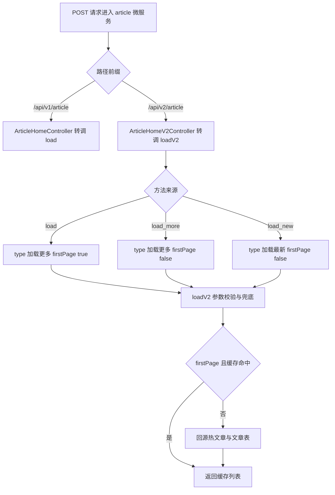

# 文章首页接口改造：V2 路由挂上 Controller，请求与响应一个字段都不动

> 🔒 安全提示：文中示例的口令/密钥均为课程教学环境演示口径，生产环境的安全要求见《安全与合规须知》。

service 层的 `loadV2` 已经写完：缓存优先、未命中回源、登录态分流，三条取数路径都收在一个方法里。可这条链路现在还够不着前端，HTTP 请求进门的地方还是空的。这一课把 V2 的控制器补上：新建 `ArticleHomeV2Controller`，实现与 V1 同一份 API 契约，三条 POST 路由原样复制，方法体全部转调新 service。写完之后整套接口就能跑起来了，联调时最典型的一个坑（DTO 全是 null）也会在这里现形。

## 先给结论

- 新建 `ArticleHomeV2Controller` 放在 `controller.v2` 包，类级 `@RequestMapping("/api/v2/article")`，三条 POST 路由 `/load`、`/load_more`、`/load_new` 与 V1 完全同构，只差版本位。
- 控制器与 V1 实现同一个 `ArticleHomeControllerApi` 接口，Spring 靠 URL 前缀区分两个实现，互不冲突。
- 方法体只做参数装配：方向常量 type、请求体 dto、首页开关 firstPage 三件套转调 `apArticleService.loadV2`，业务一行不写。
- `firstPage` 只有 load 传 true，上拉与下拉都传 false，缓存与回源的分界在控制器层就定格了。
- 每个方法的 dto 参数必须带 `@RequestBody`，漏掉它请求体反序列化不发生，dto 全字段为 null，这是现场真实踩过的一跤。

## v2 包里的新控制器

控制器沿用工程的分包惯例：`v1`、`v2` 各占一个包，URL 版本位与包名双重标注。在 article 微服务的 controller 目录下新建 `v2` 包，类名定为 `ArticleHomeV2Controller`，实现 `ArticleHomeControllerApi`。这个 API 接口正是 V1 控制器实现的那份契约，三个方法签名 load、loadMore、loadNew 一字不差，IDE 生成重写骨架后先把方法体留空：

```java
package com.study.headline.article.controller.v2;

import com.study.headline.article.api.ArticleHomeControllerApi;
import com.study.headline.model.article.dtos.ArticleHomeDto;
import com.study.headline.model.common.dtos.ResponseResult;

public class ArticleHomeV2Controller implements ArticleHomeControllerApi {

    @Override
    public ResponseResult load(ArticleHomeDto dto) {
        return null;
    }

    @Override
    public ResponseResult loadMore(ArticleHomeDto dto) {
        return null;
    }

    @Override
    public ResponseResult loadNew(ArticleHomeDto dto) {
        return null;
    }
}
```

骨架立起来之后补两个类级注解：`@RestController` 声明返回值直接写进响应体，`@RequestMapping("/api/v2/article")` 定基路径，再注入 service。一个接口契约、两个实现类，这种结构在 Spring MVC 里完全合法：两个实现类的请求映射路径分别是 `/api/v1/article` 与 `/api/v2/article`，请求进来看 URL 前缀就知道找谁，不会出现映射冲突。契约接口在这里的价值是约束：V2 想漏实现哪个方法都编译不过，V1 与 V2 的方法签名被同一份契约钉死，前端换地址才敢称之为无感。

```java
@RestController
@RequestMapping("/api/v2/article")
public class ArticleHomeV2Controller implements ArticleHomeControllerApi {

    @Autowired
    private ApArticleService apArticleService;
    // 三个重写方法见下文
}
```

## 三个路由与 loadV2 的转调

三个方法逐一补齐注解与方法体。注解是 `@PostMapping` 加路径，路径拼写沿用 V1 的口径：全小写、单词下划线分隔，`/load`、`/load_more`、`/load_new`，一个字符都不能差，否则前端按旧地址习惯拼请求就是 404。方法体统一是转调：

```java
/** 首次加载：首屏走缓存优先 */
@PostMapping("/load")
@Override
public ResponseResult load(@RequestBody ArticleHomeDto dto) {
    return apArticleService.loadV2(ArticleConstants.LOADTYPE_LOAD_MORE, dto, true);
}

/** 上拉加载更多：翻缓存之外的历史，直接回源 */
@PostMapping("/load_more")
@Override
public ResponseResult loadMore(@RequestBody ArticleHomeDto dto) {
    return apArticleService.loadV2(ArticleConstants.LOADTYPE_LOAD_MORE, dto, false);
}

/** 下拉刷新：要缓存给不了的新鲜度，直接回源 */
@PostMapping("/load_new")
@Override
public ResponseResult loadNew(@RequestBody ArticleHomeDto dto) {
    return apArticleService.loadV2(ArticleConstants.LOADTYPE_LOAD_NEW, dto, false);
}
```

三个方法体各一行，参数装配的规则值得单独背下来。方向常量 type 与 V1 同口径：load 默认按加载更多处理，load_more 显式传加载更多，load_new 传加载最新，两版接口对方向常量的语义没有任何分叉，排查问题时才不会对两套表。首页开关 firstPage 只有 load 传 true：打开 App 首屏第一次加载走的必然是 load，它才是缓存服务的对象；首屏之后用户上拉、下拉，走的是 load_more 与 load_new，缓存里既没有翻页要的历史也没有刷新要的增量，控制器直接把 false 交出去，回源的决策就交给 service。三条路由与参数的对应关系收成一张表：

| 路由 | type | firstPage | 取数预期 |
|---|---|---|---|
| `POST /api/v2/article/load` | 加载更多 | true | 缓存优先，未命中回源 |
| `POST /api/v2/article/load_more` | 加载更多 | false | 直接回源 |
| `POST /api/v2/article/load_new` | 加载最新 | false | 直接回源 |

一次请求从进门到取数的分发路径如下图：



图里能看到控制器的定位：它只挑路径、配参数，所有判断都发生在 service。`@RequestBody` 把请求体 JSON 反序列化成 `ArticleHomeDto`，channelId、maxTime、minTime、size 这批字段的兜底与校验沿用 service 层 `loadV2` 里那段同款逻辑，控制器不重复做。这样做的好处是校验口径只有一份：V1 与 V2 面对同一批前端参数，兜底规则分了叉，联调时同样的请求两个版本返回不同结果，排查成本翻倍。

## 契约不变的边界

「前端无感」这四个字要落到实处，得划清哪些东西变了、哪些没变。变了的是 URL 版本位与 service 内部实现；没变的是请求方法 POST、请求体 `ArticleHomeDto` 的字段集合、响应壳 `ResponseResult` 的 code 与 data 结构、data 里 `ApArticle` 列表的字段集合。前端解析响应的代码一行不用动，切换动作只剩改配置里的接口地址，这正是思路分析一课蓝图里「V1 冻结、V2 演进」的兑现时刻。

边界之外还有一条隐性约束：控制器保持薄。业务逻辑一旦写进 controller，两版控制器就要各养一份，改 bug 改两处，版本并存的意义直接归零。三个方法体各一行转调，看起来单薄，实际上是把「逻辑只有一份」这条纪律用代码结构固定了下来。

## 联调验证：一次请求穿过三层

重启 article 微服务，直接用接口工具打一发 V2 首屏请求：

```bash
# article 微服务课程环境端口 9001，channelId 传具体频道才有缓存可查
curl -X POST "http://localhost:9001/api/v2/article/load" \
  -H "Content-Type: application/json" \
  -d '{"channelId":1,"size":10}'
```

在 `loadV2` 的缓存查询一行打断点，请求进来后能看到两件事。命中路径：`getCacheArticleV2` 按 `hot_article_first_page_1` 拿到频道首页数据，日志打出缓存规模，方法直接返回，数据库一次都没有访问。回源路径：把缓存 key 改错或删掉再请求，断点走过缓存判空进入登录态分流，回源方法里有现场加的计时打印，用 `System.currentTimeMillis` 记录查询前后的毫秒差，控制台直接给出回源耗时。两相对比，缓存路径省掉的是热文章表查询加文章表回查的整个往返，这正是控制器把 firstPage 传对才能收到的收益。

第一轮联调现场卡住的点也在这里留个底：请求进来，断点里的 dto 每个字段都是 null，缓存 key 拼不出频道 id，回源也没了锚点。代码逻辑逐行看都没问题，最后发现是方法的 dto 参数漏了 `@RequestBody`，Spring 把请求体原样丢掉了，参数对象是 new 出来的空壳。把三个方法的参数补上注解，重启，字段立刻有值。

## 常见误区

- **dto 参数漏 @RequestBody。** 错例是照着重写骨架直接填方法体，注解只有 @PostMapping，请求体反序列化不发生，dto 全字段 null，表现是「接口通了但永远查空」。正解是每个方法的 dto 参数都显式加 `@RequestBody`，与 V1 逐字符对齐。
- **V2 路由写成 v1。** 错例是类级注解抄 V1 忘改版本位，两个控制器的映射路径完全相同，Spring 启动直接报 ambiguous mapping 起不来。正解是 `/api/v2/article` 与 `controller.v2` 包双重核对，启动日志里确认两个前缀都注册成功。
- **三个方法 firstPage 全传 true。** 错例是把缓存开关当加速开关，上拉翻页永远翻回缓存里那 30 条。正解是只有 load 传 true，对照上面的路由参数表逐条检查。
- **在 controller 里做参数校验或拼业务。** 错例是觉得「顺手校验一下」，校验口径与 service 分叉，V1 与 V2 行为不一致。正解是控制器只装配参数，校验与兜底全部留在 `loadV2`。

## 面试可能被问到的问题

1. 面试官追问：「同一份 API 接口被 V1 和 V2 两个控制器实现，Spring 怎么知道请求给谁？」
   答：请求映射按 URL 前缀区分，两个实现类的类级路径分别是 /api/v1/article 与 /api/v2/article，方法级路径相同也不冲突。Spring 启动时把每条 mapping 注册成唯一键，匹配哪条就走哪个实现。前提是版本位必须不同，路径完全相同会在启动期报 ambiguous mapping。
2. 面试官追问：「为什么控制器里几乎不写逻辑，连校验都放 service？」
   答：控制器是 HTTP 层的适配器，职责是把请求装配成 service 的入参、把返回包成响应壳。校验与业务下沉到 service 后，同一份逻辑可以被 V1、V2 甚至未来的 V3 复用，修改只动一处。校验放 controller 会造成多版本口径分叉，排查时对不上账。
3. 面试官追问：「firstPage 为什么由控制器传，而不是 service 自己判断？」
   答：service 拿不到「这次请求是不是首屏」的语义，type 只能区分方向，load 与 load_more 在方向上都是加载更多，首屏与翻页的差别恰恰体现在入口上。控制器最清楚请求来自哪个端点，由它把语义开关显式传下去，service 保持纯粹。
4. 面试官追问：「V2 上线后发现缓存逻辑有 bug，怎么快速止损？」
   答：前端把配置里的接口地址切回 V1 即可，V1 一直在线且行为未动，这就是版本并存买的保险。后端也可以在网关层把 /api/v2 的流量切走。切换回 V1 后再修复 V2、重新验证，整个过程对用户不可见。
5. 面试官追问：「漏了 @RequestBody 会有什么现象，为什么不是报错？」
   答：方法参数没有注解时，Spring MVC 默认尝试按模型属性或省略处理，dto 被实例化成空对象而不是绑定请求体，请求照样 200，只是所有字段是 null。这类「正常返回但数据为空」的问题比直接报错更难查，断点看参数对象是最快的定位手段。

## 配套资料

- 代码：`materials/code/05/头条day13/`。该日资料包解压结果为空（未含源码文件），文中 ArticleHomeV2Controller 与联调请求示例为按画面线（IDE 截图出自课件与调试画面）抄录并按本课写法补全的可运行版本，包名统一改写为 `com.study.headline`；引用路径截至 `头条dayNN/` 层级，内层目录名含项目原名，不进入正文。
- 关联：`materials/code/05/头条day12/`，真实随包的 Kafka Stream 封装（配置类、监听接口、注册工厂、流处理器与序列化器）是频道首页缓存的写入侧链路，可与本课读侧对照；V1 控制器与 `ArticleHomeControllerApi` 契约的原始口径见文章列表接口定义与编码两课的正文代码。
- 环境：课程集群 node01~node03，MySQL root/123456，article 微服务课程环境端口 9001；缓存 key 前缀 `hot_article_first_page_`，频道 id 从 `ad_channel` 表查验。
