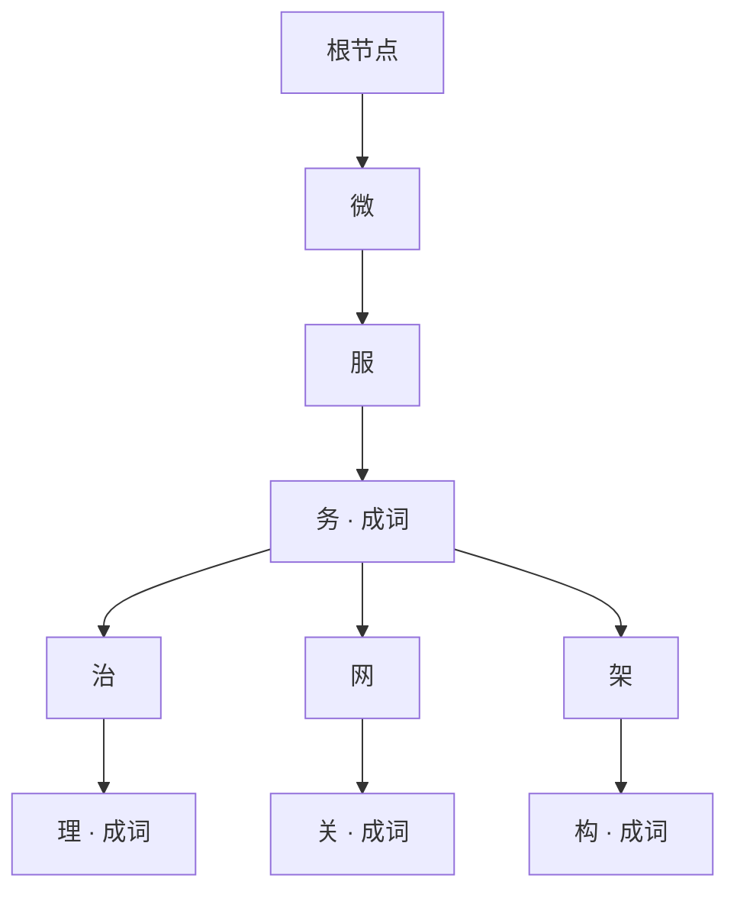

# 联想词优化需求分析：词库进 Redis，前缀树换掉模糊查询

> 🔒 安全提示：文中示例的口令/密钥均为课程教学环境演示口径，生产环境的安全要求见《安全与合规须知》。

搜索框是全站交互最密集的入口：用户每敲一个字符就发一次联想请求，一次输入五个字就是五次查询。搜索联想的首版方案把词库放在 `ap_associate_words` 表里，服务层把关键字两端拼上 `%` 走 like 中缀模糊查询，小词库小流量时体感尚可。现在性能需求摆上了台面：联想词搜索越来越频繁，每次都从数据库查，占用数据库资源且查询效率低。这一课定改造方案与接口契约，代码实现留给下一课。

## 先给结论

- 旧方案的瓶颈在 like 本身：两端 `%` 让索引彻底失效，词库全表扫描，键击频率又把这张小表查成热点。
- 改造分两层：词库全量放进 Redis，查询不落库；检索结构换成 Trie 前缀树，内存里按前缀快速定位。
- Trie 又称单词查找树或字典树，是哈希树的变种，靠复用字符串的公共前缀来减少查询时间，最大限度地减少无谓的字符串比较，查询效率比哈希树高。
- 接口契约不变：V2 沿用 POST 请求与 `UserSearchDto` 入参，出参仍是 `ResponseResult` 包 `ApAssociateWords` 列表，只升版本位，前端改一个地址。
- 命中语义从「中缀包含」收窄为「前缀匹配」：输入「微服务」带出「微服务治理」，输入「服务治理」不再命中，这与键盘输入的顺序天然一致。

## 旧方案的账：like 撑不住在哪里

把首版的取数路径摆出来，瓶颈才看得具体。用户在搜索框每敲一个字，前端发一次联想请求，服务层拼出 `%关键字%` 交给 MySQL：

```sql
-- 首版联想词查询：两端通配符的中缀匹配
select id, associate_words, created_time
from ap_associate_words
where associate_words like concat('%', #{searchWords}, '%')
limit #{limit}
```

这条 SQL 的问题不在写法，在结构。**第一，通配符开头让索引失效。** B+ 树索引按列值的最左前缀组织，`%` 打头意味着任何索引都帮不上忙，MySQL 只能逐行取出 associate_words 做字符串匹配，词库多大就扫多大。**第二，键击频率放大访问量。** 联想请求的特点是又碎又密，一个用户一次搜索贡献五次查询，日活一涨，这张本来不起眼的小表成了数据库上最忙的读源。**第三，缓存没地方挂。** 一次请求一个关键字，关键字组合近乎无限，按关键字做缓存几乎全部未命中，Redis 帮不上忙。三条加在一起，性能需求里「占用数据库资源、查询效率低」的结论就成立了。

改动的目标也就清晰：让联想查询不再碰数据库，同时在内存里找到一种比逐条字符串比较更快的组织方式。这两个问题一个管「数据放哪」，一个管「怎么找」，方案分层解决。

## Trie：把词库按前缀叠起来的树

Trie 的样子先画出来，原理自明。把「微服务」「微服务治理」「微服务网关」「微服务架构实践」四个词放进同一棵树：



每个节点只存一个字符，从根到某节点的路径拼出一个前缀；带「成词」标记的节点代表词库里的完整词条。输入「微服务」做联想时，检索从根出发沿「微」「服」「务」三步下行，停在「务」节点，收集它子树里所有成词标记，「微服务治理」「微服务网关」「微服务架构实践」一并拿到。四个词共享的「微服务」三个字符在树里只存了一份，这就是名词解释里「利用字符串的公共前缀减少查询时间」的含义。

对比着看它为什么快。哈希表也能把全量词库装进内存，但前缀查询没有直达路径：要命中所有以「微服务」开头的词，只能遍历整张表的 key 逐个做字符串前缀比较，词库 N 条就是 N 次比较，每次比较还要逐字符检查。Trie 把比较次数从「与词库规模相关」压到「与前缀长度相关」，查到「微服务」永远只走三步，词库从四千条涨到四万条，前缀检索的步数一步都不变；收集子树的开销只与命中结果的数量有关。名词解释里「查询效率比哈希树高」说的就是这组对比：哈希树赢在等值查找，Trie 赢在前缀查找，联想词恰好是后者的主场。

Trie 典型用于统计、排序和保存大量字符串，用途并不限于字符串，但字符串场景收益最大。词库这种「一次全量加载、只读检索、按前缀命中」的资产，正落在它的舒适区里。

## 方案分层：缓存管存放，树管检索

改造后的读路径分三层，各管一件事：


**数据层，全量词库进 Redis。** 词库是运营维护的静态资产，量级可控、读多写少，正好整份序列化成一个字符串挂在固定 key 下。联想请求只碰 Redis，`ap_associate_words` 表退到回源兜底的位置，性能需求里「不占用数据库资源」由此兑现。

**检索层，Trie 管前缀命中。** 拿到词库列表后构建 Trie，用输入串做前缀检索拿回候选。树是纯内存结构，构建与检索的开销都在服务进程内，不产生任何网络往返。

**契约层，接口只升版本位。** V2 接口与首版同族，方法挂在 `ApArticleSearchService` 上，新增第二个版本的联想方法：

```java
/**
 * 搜索联想词 V2：词库走 Redis 缓存，检索走 Trie 前缀树
 * @param userSearchDto 入参沿用首版，pageSize 上限 50
 */
ResponseResult searchAssociationV2(UserSearchDto userSearchDto);
```

入参 `UserSearchDto` 不变，出参仍是 `ResponseResult` 包 `ApAssociateWords` 列表，返回的字段名与首版一字不差，前端解析代码不用动；变的只有访问地址的版本位与后台实现。CODE 定义沿用工程的异常码枚举，参数问题返回 `PARAM_INVALID`，没有新增错误码的必要。类定义层面的新增清单也在此交底：Trie 与 TrieNode 两个工具类、词库 Mapper 的全量查询方法、service 的 V2 方法，加上控制器上对应的 V2 端点，一共四处，下一课逐一落地。

有一处行为变化要挑明：首版两端 `%` 是中缀匹配，输入「服务治理」也能带出「微服务治理」；V2 的前缀检索只认从左往右的开头命中。语义收窄不是缺陷而是取舍，键盘输入天然从左到右，用户敲到「微」字时联想就该出现，前缀语义与输入过程对齐，还顺带砍掉了中缀命中带来的大量噪音候选。

## 常见误区

- **把 Trie 当成模糊搜索的万能解。** Trie 擅长前缀，做不了中缀与后缀命中，「包含某片段」的需求要用别的结构或全文检索引擎。正解是先确认业务语义：联想词场景要的就是前缀，V2 收窄语义是设计决定，不是实现遗漏。
- **只上缓存不上结构。** 错例是把全量词库放进 Redis，检索时取出来逐条 `contains`，数据库是不查了，内存里照样线性扫全表，词库一大延迟照样超标。正解是缓存与检索结构各解决一个问题，配合使用。
- **契约不变理解成路径也不变。** 错例是 V2 直接复用 V1 的 URL，两版实现抢同一个映射路径，启动期就冲突。正解是请求方法、入参、出参保持不变，URL 版本位必须升级，给灰度与回滚留出开关。
- **词库量级不清就上 Trie。** Trie 的构建开销与词条总量成正比，词库膨胀到十万级时每次请求重建树就不划算了。正解是先确认词库规模与变更频率，量级大到一定程度要把树缓存起来复用，这个决策留给实现课展开。

## 面试可能被问到的问题

1. 面试官追问：「联想词为什么要同时用 Redis 和 Trie，只用其中一个行不行？」
   答：两者解决的问题不同。Redis 解决「数据放哪」，让查询不落库，挡住数据库压力；Trie 解决「怎么找」，把前缀检索从线性比较降到按前缀长度下行。只用 Redis 也得在内存里挑一种检索方式，线性遍历在词库大时不行；只用 Trie 不加缓存，每次请求都要回数据库拉全量词库建树，网络往返成了新瓶颈。
2. 面试官追问：「Trie 的查询复杂度是多少，比哈希表好在哪？」
   答：前缀检索的下行复杂度是 O(L)，L 是前缀长度，与词库规模无关；收集子树的开销与命中条数成正比。哈希表等值查找 O(1) 更快，但前缀查询只能全表遍历逐个比较，O(N×L)。联想词是前缀场景，Trie 是正确工具。
3. 面试官追问：「V2 从中缀匹配收窄为前缀匹配，会不会算接口破坏性变更？」
   答：结构层面入参出参完全一致，不算契约破坏；行为层面命中集合变小，属于语义调整。收窄的依据是输入过程天然从左到右，前缀命中与用户输入节奏对齐。若确有中缀需求，应另立接口或引入检索引擎，而不是悄悄改语义。
4. 面试官追问：「词库被运营改了，缓存怎么同步？」
   答：全量缓存最大的风险是缓存成了旧数据。可选策略有三种：词库增删改时删除缓存 key，让下一次查询回源重建；给 key 设一个可容忍的 TTL，接受分钟级延迟；量大时用消息通知服务增量更新。取舍取决于词库变更频率与业务对新鲜度的要求，实现课会给出课程版的处理。
5. 面试官追问：「为什么词库要做一张独立的表，而不是直接 like 文章表？」
   答：文章表百万级行数，like 全表扫的代价完全不可接受；词库表量级可控，是运营提前维护好的静态资产。把候选词做成独立资产还有维护上的好处：词库增删即时生效、可以加权重控制展示次序，接口对词库怎么来的完全不感知。

## 配套资料

- 代码：`materials/code/05/头条day13/`。该日资料包解压结果为空（未含源码文件），文中 V2 接口定义与分层方案图为按画面线（课件文档的需求、名词解释与接口定义章节）抄录并按本课写法补全，包名统一改写为 `com.study.headline`；引用路径截至 `头条dayNN/` 层级，内层目录名含项目原名，不进入正文。
- 关联：`materials/code/05/头条day01/`，内层数据库规范设计说明书是 `ap_associate_words` 表与字段命名的依据；首版 like 查询的完整实现（Mapper、XML、Service、端点）见搜索联想词接口开发课的正文代码。
- 环境：课程集群 node01~node03，Redis 部署在集群节点，默认密码 123456；MySQL root/123456；词库数据在 `ap_associate_words` 表中查验，测试词库可手工插入若干词条。
