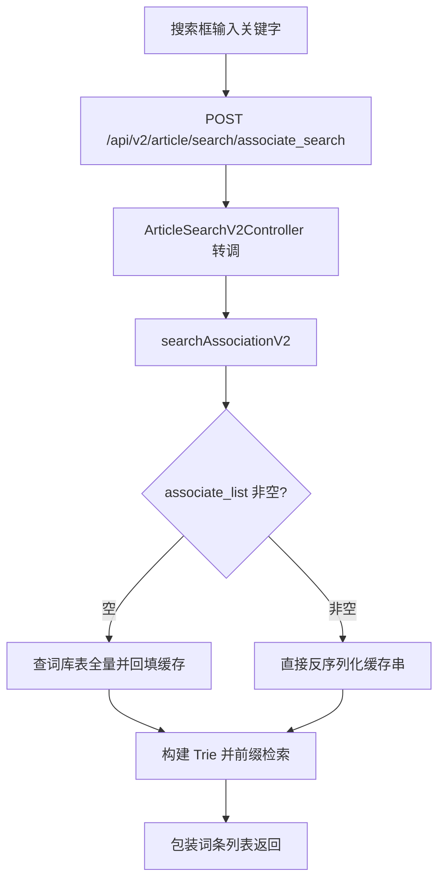

# 联想词 V2 收口：控制器转调、回源分支验证与综合测试

> 🔒 安全提示：文中示例的口令/密钥均为课程教学环境演示口径，生产环境的安全要求见《安全与合规须知》。

Service 的 V2 方法已经就位，剩下最后一层：把控制器挂上去，让前端真正打到新链路上。这一课的动作不大，拷一个 V2 控制器、改一个前端配置项，但验证环节值得放慢速度：缓存未命中回源与命中直读两条分支各走一遍断点，再把新旧两版的取数路径放在同一张表里对照，联想词优化才算真正收官。现场还送了一段插曲，服务启动时 Kafka 连不上，测试被迫中断重启，这个坑同样值得记一笔。

## 先给结论

- V2 控制器仍是「实现同一份契约接口」的套路：四个方法全部转调 service，只有联想词一项改指 `searchAssociationV2`，其余三个方法行为与 V1 完全一致。
- 前端只改 `config.js` 里联想词一项的版本位，请求路径从 v1 换到 v2，页面代码零改动。
- 综合测试的验收点有两个：断点证明请求走进了 V2 方法；再证明第二次检索不再触碰词库 Mapper，读的是 Redis 里的 `associate_list`。
- like 版与 Trie 版的差距不在代码多少，而在取数路径：前者每次请求全表扫描加逐条比较，后者一次缓存读加一次前缀下行，与词库规模无关。
- 启动报 `Connection to node -1 could not be established` 时先查消息中间件与网络，article 服务挂着 Kafka 监听，中间件不就绪服务起不来。

## V2 控制器：同一份契约，只换一个出口

控制器层沿用项目一贯的惯例：契约接口 `ArticleSearchControllerApi` 不动，新建 `controller.v2` 包，V2 控制器实现同一份接口。四个映射路径与 V1 一字不差，方法体全部是一行转调，唯一的差别在联想词这一项：

```java
package com.study.headline.article.controller.v2;

import com.study.headline.article.apis.ArticleSearchControllerApi;
import com.study.headline.article.service.ApArticleSearchService;
import com.study.headline.model.common.dtos.ResponseResult;
import com.study.headline.model.common.dtos.UserSearchDto;
import org.springframework.beans.factory.annotation.Autowired;
import org.springframework.web.bind.annotation.PostMapping;
import org.springframework.web.bind.annotation.RequestBody;
import org.springframework.web.bind.annotation.RequestMapping;
import org.springframework.web.bind.annotation.RestController;

@RestController
@RequestMapping("/api/v2/article/search")
public class ArticleSearchV2Controller implements ArticleSearchControllerApi {

    @Autowired
    private ApArticleSearchService apArticleSearchService;

    @PostMapping("load_search_history")
    @Override
    public ResponseResult findUserSearch(@RequestBody UserSearchDto dto) {
        // 搜索历史读取：行为与 V1 一致，直接转调原方法
        return apArticleSearchService.findUserSearch(dto);
    }

    @PostMapping("del_search")
    @Override
    public ResponseResult delUserSearch(@RequestBody UserSearchDto dto) {
        return apArticleSearchService.delUserSearch(dto);
    }

    @PostMapping("clear_search")
    @Override
    public ResponseResult clearUserSearch(@RequestBody UserSearchDto dto) {
        return apArticleSearchService.clearUserSearch(dto);
    }

    @PostMapping("associate_search")
    @Override
    public ResponseResult searchAssociate(@RequestBody UserSearchDto dto) {
        // 唯一的变化：联想词改走 V2，缓存加 Trie
        return apArticleSearchService.searchAssociationV2(dto);
    }
}
```

这样写的意图在方案课就交过底：搜索历史、删除历史、清空历史三个方法与本次优化无关，V2 控制器原样转调旧 service 方法，行为不变；联想词一项切到 V2 方法，缓存与检索的新逻辑只在它身上生效。两版控制器并存，前端把流量切过来，一旦 V2 出问题，把配置里的版本位改回去就是回滚，旧代码一行没动。

## 前端切换与启动插曲

前端要做的只有一件事：`common/config.js` 里联想词接口的版本位升到 v2。搜索域的接口清单里只动这一项（片段为按画面线整理的示意）：

```javascript
// config.js 搜索域接口清单：只有联想词一项动版本位
associate_search: { url: '/api/v2/article/search/associate_search', sv: 'article' },
```

改完前端会自动重启，后端的 article 服务也要重启一次。插曲出现在这里：服务启动中途刷出一串连接失败日志，Spring 应用直接起不来：

```text
Connection to node -1 could not be established. Broker may not be available.
```

这是 article 服务的 Kafka 监听容器在反复重连 broker 失败，KafkaListener 的启动被阻塞，应用上下文装配不完。这一课现场的原因是网络松动，恢复后重启即过；换成部署环境，排查顺序是先确认 broker 进程与监听端口、再核对服务里配置的 broker 地址、最后查防火墙与网络分区。要点是别把它误判成联想词改造引入的代码问题：报错来自中间件连接层，业务代码还没被执行到，启动失败发生在监听容器初始化阶段。

## 综合测试：两条分支各走一遍

测试的目标不是「好不好使」，而是「走没走对路」。整条链路的分支画出来是这样：



第一个请求是未命中回源路径。缓存里还没有 `associate_list`，在 service 的查库回填那一行打断点，请求进来必然停在这里；放行后到 Redis 里确认回填结果：

```bash
redis-cli -a 123456 get associate_list
```

能看到整份词库的 JSON 串，说明回源与回填都落了地。第二个请求是命中直读路径：把断点继续留在查库那一行再搜一次，请求应当不停在查库、直接走反序列化分支，Mapper 的断点一次都不会被触发，这就是「查询不落库」的直接证据。断点期间前端搜索框会一直转圈等待，演示前记得把断点摘掉，否则每个请求都会被线程挂起卡住。

两条分支之外再补一个功能验收：输入一个有词库词条作为前缀的关键字，联想框应带出以它开头的全部候选；换成词库里不存在的开头，返回空列表且无异常。至此接口行为、缓存行为、检索行为三点全部对上。

## like 版与 Trie 版放在同一张表里

改造收尾把两版的账并排算一遍，压测或计时验证时各盯各的指标：

| 对比项 | V1：like 中缀查询 | V2：缓存加 Trie |
|---|---|---|
| 取数路径 | 每次请求查词库表全表 | 命中后一次 Redis GET |
| 匹配开销 | 逐条字符串包含比较，与词条数成正比 | 前缀下行加子树收集，与词条数无关 |
| 数据库压力 | 键击频率放大成热点读 | 退到回源兜底，常态为零 |
| 索引利用 | 两端 `%` 让索引失效 | 不再依赖这条 SQL |
| 缓存可行性 | 关键字近乎无限，几乎全未命中 | 全量词库挂固定 key，命中即收益 |

验证手段不必复杂：用接口工具对同一关键字各打几十次请求计时对比，同时盯着数据库的会话与慢查询，V1 下词库表的查询频次与请求次数同步上涨，V2 下词库表纹丝不动，Redis 的命中计数上涨。数字之外，这两条路径的形状差异本身就是改造价值的证据。

## 常见误区

- **只改控制器不改前端配置。** 错例是 V2 代码全部就绪、`config.js` 还指着 v1，测试时看到的一切都是旧链路，误以为改造没生效。正解是切换后在前端网络面板确认请求地址带上了 v2。
- **断点留在代码里就交付演示。** 错例是验证完忘记摘断点，演示时请求全部挂起，表象是「接口卡死」。正解是断点只属于调试过程，走完立即清理。
- **把启动失败当成代码问题。** 错例是看到 Kafka 连接失败就去改联想词相关代码。正解是先分层定位：连接层报错查中间件与网络，业务代码的问题才会出现在业务方法的堆栈里。
- **验证只看结果不看路径。** 错例是联想框能出词就认为切换成功，实际可能请求还走在旧版本上。正解是配合断点或日志确认请求进入了 V2 方法，缓存分支各验证一次。

## 面试可能被问到的问题

1. 面试官追问：「V2 控制器为什么要实现和 V1 同一个契约接口？」
   答：契约不变是这次优化的前提，入参出参完全一致，前端解析代码不用动。实现同一接口能强制两版的签名保持对齐，编译器兜底防漂移；新控制器只负责把联想词一项路由到 V2 实现，其余方法保持旧行为，灰度与回退都只动版本位。
2. 面试官追问：「怎么证明第二次查询没有走数据库？」
   答：两个证据配合。Mapper 查询方法上打断点，第二次请求不触发即证明未查库；Redis 客户端里能看到 `associate_list` 的完整值，且缓存命中分支被走到。日志里也可以在回源分支打印一条标记，第二次请求 absence 即为旁证。
3. 面试官追问：「缓存为空的第一批请求会是什么现象？」
   答：未命中的请求都会去查词库表并回填缓存，存在短暂的并发回源，属于缓存击穿的轻量形态。词库全量查询本身开销小，通常可容忍；要严格防护就加分布式锁或只放单实例回填，回填完成后其余请求全部走缓存。
4. 面试官追问：「压测这两个版本时分别该盯哪些指标？」
   答：V1 盯词库表的查询频次、慢查询与数据库连接池占用，请求量上去了这几项先恶化；V2 盯 Redis 的命中与响应耗时、服务进程的 CPU 与 GC，数据库侧应当接近零查询。两版的对比点在「数据库压力是否随请求量线性上涨」。
5. 面试官追问：「前端切换版本位时要注意什么？」
   答：只改目标接口的版本位，不能顺手把没改动的接口一起切，避免无谓的回归面；切换后确认请求真实打到 v2，并保留一键切回 v1 的能力。回退的价值在故障处置速度，这也是两版代码并存、旧方法不删的原因。

## 配套资料

- 代码：`materials/code/05/头条day13/`。该日资料包解压结果为空（未含源码文件），文中 V2 控制器、前端配置片段与测试方案按画面线（IDE 编码与调试画面）抄录并按本课写法补全，包名统一改写为 `com.study.headline`；引用路径截至 `头条dayNN/` 层级，内层目录名含项目原名，不进入正文。
- 关联：`materials/code/05/头条day01/`，内层数据库规范设计说明书是词库表结构与字段命名的依据；V2 service 与 Trie 工具类的完整实现见联想词业务代码编写课正文。
- 环境：课程集群 node01~node03，Redis 部署在集群节点，默认密码 123456；MySQL root/123456；综合测试的观察点是 `associate_list` 的回填值与词库 Mapper 断点的触发情况。
