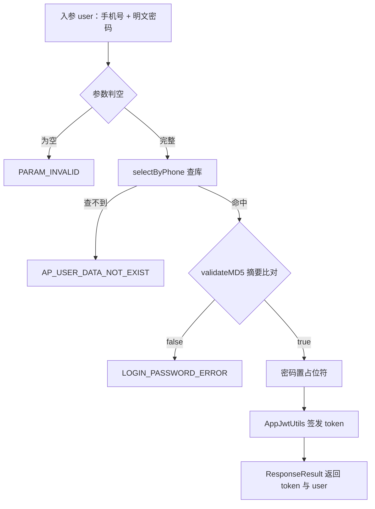

# 密码验证与登录验证 Service：把明文 equals 改造成摘要比对

> 🔒 安全提示：文中示例的口令/密钥均为课程教学环境演示口径，生产环境的安全要求见《安全与合规须知》。

登录链路落成那天的画面线里，密码比对是一行明文 `equals`：前端传什么，就跟库里比什么。教学期为了聚焦链路可以接受，接口安全的需求摆上来之后，这一行必须换掉，连带要动的还有库里存的内容。改造收敛成两个新角色：一个专门做密码验证的 `ValidateService`，把 DES、MD5、MD5 加盐三种校验收拢成一个契约；一个登录 Service 的 V2 方法，在原有五步链路里把第三步换成摘要比对。这一课把 service 层这两个角色写完，数据侧的密码列同步换成摘要串，控制层与全链路测试留给下一课收口。

## 先给结论

- 新增 `ValidateService` 接口立三种验证：`validateDES`、`validateMD5`、`validateWithSalt`，入参统一是前台 `user` 与库中 `dbUser` 两个实体，返回 boolean，登录时按需只选一种。
- 验证逻辑本质是一句话：把前台输入的明文密码用与入库时相同的算法再算一遍，与库中密文做相等比较，方向上让库中密文调用 `equals`，规避空指针。
- 登录 Service 的 V2 方法五步走：参数校验、查用户、密码验证、脱敏、签 token；三个错误码 `PARAM_INVALID`、`AP_USER_DATA_NOT_EXIST`、`LOGIN_PASSWORD_ERROR` 与 V1 一脉相承。
- 数据侧配套动作：password 列改为存摘要，salt 列补值；课程演示把盐手工 UPDATE 成固定值，工程上应注册时逐用户随机生成。
- 旧登录方法一行不动，V2 方法并存；明文 equals 是 0070 如实呈现的教学简化，V2 就是那节课预留的工程化出口。

## 验证服务：三种算法一个契约

查询用户的 Mapper 是存量资产，`selectByPhone` 按手机号查用户在登录模块第一天就在用，本课直接复用，不重复造轮子。新的工作从验证服务开始。它被设计成一个独立接口而不是塞进登录 Service，理由是验证算法是一个可选项集合：对称加密有 DES、AES，摘要算法有 MD5，MD5 还有加盐变体，实际项目通常只落地其中一种，但接口把三种的形状一起立出来，选择权留给调用方，将来换算法只换调用点不换契约：

```java
package com.study.headline.login.service;

import com.study.headline.model.user.pojos.ApUser;

/**
 * 密码验证服务：对称加密 DES、AES，摘要 MD5，MD5 扩展盐 salt
 * 三种方式对应三种入库口径，调用方按入库算法选择其一
 */
public interface ValidateService {

    /**
     * DES 验证：库中密文由 DES 加密而来
     * @param user 前台传入的登录参数
     * @param db   数据库中查出的用户实体
     * @return 摘要一致返回 true
     */
    boolean validateDES(ApUser user, ApUser db);

    /**
     * MD5 验证：库中密文由 MD5 摘要而来
     */
    boolean validateMD5(ApUser user, ApUser db);

    /**
     * MD5 加盐验证：库中密文由密码拼接该用户 salt 后摘要而来
     */
    boolean validateWithSalt(ApUser user, ApUser db);
}
```

两个 `ApUser` 入参不是笔误，它们的来源完全不同：`user` 是前台请求体反序列化出来的对象，密码字段装的是用户输入的明文；`db` 是按手机号从库里查出的实体，密码字段装的是入库时生成的密文，加盐版本还要从它身上取 salt。实现类把三种验证各写成一行核心逻辑，全部依赖上一课拷进 utils 包的 `MD5Utils` 与 `DESUtils`：

```java
package com.study.headline.login.service.impl;

import com.study.headline.login.service.ValidateService;
import com.study.headline.model.user.pojos.ApUser;
import com.study.headline.utils.common.DESUtils;
import com.study.headline.utils.common.MD5Utils;
import org.springframework.stereotype.Service;

@Service
public class ValidateServiceImpl implements ValidateService {

    @Override
    public boolean validateDES(ApUser user, ApUser db) {
        // 输入明文先加密成密文，再与库中密文比对
        return db.getPassword().equals(DESUtils.encode(user.getPassword()));
    }

    @Override
    public boolean validateMD5(ApUser user, ApUser db) {
        return db.getPassword().equals(MD5Utils.encode(user.getPassword()));
    }

    @Override
    public boolean validateWithSalt(ApUser user, ApUser db) {
        // 盐取库中该用户自己的 salt，注册侧怎么拼的这里就怎么拼
        return db.getPassword().equals(
                MD5Utils.encodeWithSalt(user.getPassword(), db.getSalt()));
    }
}
```

三个方法共享同一个骨架，差异只在摘要函数：DES 版调 `DESUtils.encode`，MD5 版调 `MD5Utils.encode`，加盐版调 `MD5Utils.encodeWithSalt` 并把 `db.getSalt()` 拼进去。写法上有两处细节值得圈出来。**比较方向让库中密文在前。** `db.getPassword()` 调用 `equals`，入参才是可能为空的计算结果：工具类异常时返回空串，若让空串在前面调 `equals` 不会出错，反过来让可能为 null 的库字段或计算结果先调用就会抛空指针。库中实体刚从 `selectByPhone` 查出来且非空校验已过，以它为调用方最稳。**加盐版本的两个取值都来自库侧。** 盐不从前台传，前台只交明文密码，盐永远是服务端从用户记录里取，这个约束保证了攻击者无法指定盐绕过校验。DES 与 AES 同属对称家族，课程只实现 DES 版，AES 的替换思路一致：换工具类、换 transformation、保证密钥长度，验证方法的骨架不变。

工具类与验证方法之间还有一层必须锁死的一致性：摘要函数在「入库侧」与「校验侧」必须产出同样的串，两边各写各的算法或编码细节，登录就会永远失败。最快的锁定方式是给工具类留一个自测入口，把两串摆在一起肉眼对齐：

```java
public static void main(String[] args) {
    // 入库口径：注册侧生成并存进 password 列的摘要
    String stored = MD5Utils.encodeWithSalt("test", "123");
    System.out.println("库中存：" + stored);
    // 校验口径：登录侧按同样规则重算再比对
    boolean pass = MD5Utils.encodeWithSalt("test", "123").equals(stored);
    System.out.println("比对结果：" + pass);
}
```

比对结果为 true，口径才算对上；哪天有人改了编码方式、拼串顺序或补零逻辑，这个入口第一时间暴露。课程里验证摘要性质用的就是这招，成本低但兜底价值高。

## 登录 Service V2：五步主链路

登录 Service 沿用项目处理版本升级的惯例：旧接口 `ApUserLoginService` 与它的 `loginAuth` 一行不动，新增 V2 方法 `loginAuthV2`，两版并存，回退与灰度都只是切换调用点的动作。实现类里注入两个依赖，Mapper 管查用户，`ValidateService` 管密码比对：

```java
@Autowired
private ApUserMapper apUserMapper;
@Autowired
private ValidateService validateService;

@Override
public ResponseResult loginAuthV2(ApUser user) {
    // 1. 参数校验：手机号与密码任一为空直接打回
    if (StringUtils.isEmpty(user.getPhone()) || StringUtils.isEmpty(user.getPassword())) {
        return ResponseResult.errorResult(AppHttpCodeEnum.PARAM_INVALID);
    }
    // 2. 按手机号查用户，查不到视为账号不存在
    ApUser dbUser = apUserMapper.selectByPhone(user.getPhone());
    if (dbUser == null) {
        return ResponseResult.errorResult(AppHttpCodeEnum.AP_USER_DATA_NOT_EXIST);
    }
    // 3. 密码验证：算法与入库口径一致，课程版选定 MD5
    boolean isValid = validateService.validateMD5(user, dbUser);
    if (!isValid) {
        return ResponseResult.errorResult(AppHttpCodeEnum.LOGIN_PASSWORD_ERROR);
    }
    // 4. 脱敏：凭据不能出服务端，密码字段用占位符替代
    dbUser.setPassword("*");
    // 5. 按库中实体（携带 id）签发 token，与用户信息一并返回
    Map<String, Object> map = new HashMap<>();
    map.put("token", AppJwtUtils.getToken(dbUser));
    map.put("user", dbUser);
    return ResponseResult.okResult(map);
}
```

整条链路的形状画出来是一条带四个出口的直线：



前三步与 V1 的 loginAuth 完全同构：参数残缺、账号不存在、密码错误三类问题各归各的错误码，前端与排查沿用旧口径。真正的变化集中在第三步内部：V1 拿明文直接 `equals` 库里存的明文，V2 先把输入摘要成串再与库中密文比对，库里的东西从明文变成了摘要串。**选哪一种验证是这一步的唯一自由度。** `ValidateService` 提供三种方法，运行时只调一个，课程选定 `validateMD5`，对应数据侧把密码列统一换成 MD5 摘要的配套动作；如果库里存的是 DES 密文或加盐摘要，这里就换成对应方法，登录 Service 的其余代码一个字不用改，这正是验证服务独立成契约的回报。

后两步也有讲究。**脱敏对象换成了库中实体。** 返回体里放的是 `dbUser` 而不是入参 `user`：入参只有手机号与密码两个字段，页面需要的昵称、头像等信息在库中实体上，token 也必须按携带 id 的实体签发。验证通过后 `setPassword("*")` 把凭据位置占住，占位符或 `null` 都行，判断标准只有一个：库里无论存明文还是密文，都不能原样出服务端。**签发沿用既有工具。** `AppJwtUtils.getToken` 按用户 id 出三段式 JWT，与 0070 的 V1 共用同一把签发逻辑，前端拿到的 token 结构在两版之间没有任何差异。

还有一个输入形态的边界要交代清楚：课程版前端送的是明文密码，摘要动作发生在服务端，明文只在 HTTPS 信道里走一趟。更进一步的口径是前端先做一轮摘要再传，服务端对「摘要串」再加工入库，传输链路上从不出现原始密码。两种取法各有账要算：前端先摘要多挡一层中间人以外的地方（代理日志、网关排错记录），但把摘要逻辑暴露给前端，库中实际存的是「摘要的摘要」，算法迁移时前后端要一起动。课程选服务端摘要，链路简单、职责集中在服务端，往前演进时再评估前端摘要的收益。

## 数据侧配套：password 列从明文换成摘要

代码选了 MD5，库里的存量数据就要跟上。测试账号先换成摘要口径，盐一并补上：

```sql
-- 课程演示：测试账号密码换成 MD5 摘要，盐先手工写死
UPDATE `ap_user` SET `password` = MD5('test'), `salt` = '123' WHERE `id` = '1';
```

这条 UPDATE 之后，库里 `password` 列的值是 32 位十六进制摘要，肉眼与工具都还原不出 `test`，登录时 `validateMD5` 用同样的摘要函数重算比对。盐这一列在纯 MD5 版本里暂时闲置，在加盐版本里是主角。课程演示把盐 UPDATE 成固定值 `123` 是为了先把链路跑通，生产化的演进方向在上一课已经交底，这里把它落成可执行的清单：**注册与改密入口生成随机盐**，比如取随机数补齐成定长字符串，与密码拼接后摘要，两列一次写入；**校验侧永远从库取盐**，`validateWithSalt` 的取法已经是这个形状；**算法入库存证**，盐与摘要算法如果将来可能变更，给用户记录加一列标记算法版本，避免历史用户无法登录。真实工程里还有更彻底的做法，把盐直接揉进密文串里，存取都不需要单独的 salt 列，校验时先拆出盐再重算比对，支付域工程的 `PasswordUtil` 就是这个思路，`generate` 负责加盐生成、`verify` 负责拆盐校验，成对出现。本课不引入它，但改造完成后迁移的方向与成本要心里有数。

配套里还有一个容易被漏掉的闭环：**写入口径必须同步改造。** 登录校验换成 MD5 之后，注册、修改密码、管理员重置密码这些入口如果还在写明文，新注册的用户将永远登录失败，因为库里是明文而校验算的是摘要。凡是往 password 列写数据的路径，全部换成与 `ValidateService` 一致的摘要口径，这个闭环在课程里由手工 UPDATE 代替，工程上是审计清单上的必查项。

存量用户的迁移也有一条平滑路径可走：不必一次性把全库密码重置成摘要，可以借「下一次登录」逐个升级。用户登录时先用旧口径校验，通过后当场按新口径重算入库，校验侧对两种存量形态做兼容判断，跑一段时间后库里的明文自然清零。这条渐进路线的代价是校验方法要同时认得两种形态，收益是零打扰、零重置，0070 的面试题里预埋的「登录时重算升级」说的就是它。课程环境数据量小，直接 UPDATE 一条搞定，工程环境则要按迁移方案分批走。

## 与 0070 的衔接：明文口径如何兑现成 V2

把两版登录摆在一起看，改造的边界一目了然：

| 环节 | V1（0070 落地版） | V2（本课改造版） |
|---|---|---|
| 库中密码 | 明文 | MD5 摘要（可选加盐） |
| 密码比对 | 明文 `equals` | `ValidateService` 摘要后比对 |
| 错误码 | 三码拆分 | 三码拆分，完全一致 |
| token 签发 | `AppJwtUtils` | 同一工具，行为不变 |
| 返回脱敏 | `setPassword(null)` | `setPassword("*")`，同义 |
| 存量方法 | 保持原样 | 保持原样，两版并存 |

0070 当时把明文 equals 如实呈现，并把「工程上应改为 MD5 加盐或 BCrypt 校验、salt 字段就是给这条路用的」留成了伏笔；这一课兑现的正是那个伏笔，salt 字段从闲置变成加盐版本的数据支柱。V2 不直接改 V1 有两层原因：一是行为兼容，数据库切换口径的窗口期里，两版方法对应两套数据形态，并存才能平滑迁移；二是回退成本，V2 出问题切回调用点即可，不需要版本回滚代码。等摘要口径在库里铺满、前端稳定走 V2，V1 的明文方法再进入清理窗口，顺序不能反。

## 请求头拼图：t 与 md 在登录链路的位置

密码验证是接口安全的一环而不是全部。day01 的接口规范里已经立过两个安全请求头：`t` 携带请求时间，服务端判断请求时效，超出窗口视为过期重放直接拒绝；`md` 携带参数签名，查询串排序后做 MD5，服务端用同样规则重算比对，防参数在途中被篡改。这两项校验属于网关或过滤器层的通用逻辑，落在 utils 工程的 `UrlSignUtils` 一类工具上，对每个接口一视同仁，登录接口也不例外。本课改造的是另一层：凭据本身的形态，两者互补而不重叠。拼在一起，登录接口对外要过四道关：请求头时效与签名挡住重放与篡改，参数校验挡住残缺请求，摘要比对挡住凭据错误，token 挡住后续请求的身份冒用。课程把重放与签名的过滤器实现留作工程化演进点，但每一道关卡在总体设计里的位置，从这一课起要能说清楚。

## 常见误区

- **注册与校验算法不一致。** 错例是登录侧换成 `validateMD5`，注册入口仍存明文，新用户全部登录失败。正解是所有写 password 列的路径与校验侧使用同一套摘要口径，改造时按写入路径逐个核对。
- **比较方向写反。** 错例是让 `MD5Utils.encode(...)` 的结果先调用 `equals`，工具异常返回 null 时直接空指针；或者拿可能为 null 的字段先调用。正解是让已判空的库中密文调用 `equals`，计算结果作为入参。
- **盐写死或从查询串里收。** 错例是全库统一一个盐值，同密码同摘要依旧成立；或允许前端传盐，攻击者可指定盐绕过。正解是逐用户随机盐，校验时只从库中取。
- **脱敏只挡明文不挡密文。** 错例是认为库里已是密文就可以原样返回，摘要串虽不能逆向，但等于把可离线碰撞的凭据交给前端。正解是验证完成后一律置占位符，返回体过一遍「字段能不能给」的审查。

## 面试可能被问到的问题

1. 面试官追问：「密码存储为什么用不可逆摘要，而不是 DES 加密后存？」
   答：登录校验只需要判断相同与否，不需要还原原文，摘要正好满足；可逆加密意味着密钥泄露时全库密码可还原成明文，风险面大得多。摘要把「存明文」的隐患压缩成「泄库也只能离线碰撞」，再靠加盐让碰撞失效。
2. 面试官追问：「ValidateService 为什么同时立三个验证方法，运行时不是只用一个吗？」
   答：接口把候选算法的形状一起固定下来，调用方按入库口径选一种，换来的是换算法只改调用点。多版本并存期也可能真的用到多个：存量用户 MD5、新用户加盐，按用户记录的算法标记路由到不同方法，这正是契约先行的好处。
3. 面试官追问：「加盐版本的盐应该怎么生成和保管？」
   答：注册或改密时用安全随机数生成定长随机串，随用户记录入库，不需要保密；校验时从库中取该用户自己的盐与密码拼接重算。要避免全库统一盐与前端传盐两种做法，前者让对照表按统一盐重算即可碰撞，后者把校验的输入权交给了攻击方。
4. 面试官追问：「登录校验为什么按参数、用户、密码的顺序把关？」
   答：按成本与依赖排序。参数判空是纯内存判断，最先挡掉残缺请求；查用户决定后续比对的依据是否存在，账号不存在时继续比对没有意义；密码验证依赖查出的实体，必须在其后。顺序颠倒会让空指针出现在校验层，或者把不存在的账号也拖进比对逻辑。
5. 面试官追问：「V2 登录方法与 V1 并存而不是直接改掉，图什么？」
   答：灰度与回退。数据库口径切换有窗口期，两版方法对应两套数据形态，并存让迁移平滑；V2 异常时把调用点切回 V1 即可恢复，不需要回滚代码版本。这也要求两版共用契约接口，签名对齐由编译器保证。
6. 面试官追问：「t 与 md 两个请求头在登录接口上防什么，跟密码加密是什么关系？」
   答：t 判断请求时效防重放，md 对排序后的参数做摘要比对防篡改，都属于传输层防线，由通用过滤器统一执行；密码加密防的是存储层泄库见明文。一个管路上，一个管库里，互补不重叠，登录接口四道关：时效签名、参数校验、摘要比对、token 鉴权。

## 配套资料

- 代码：`materials/code/05/头条day13/`。该日资料包解压结果为空（未含源码文件），文中 `ValidateService` 接口与实现、`loginAuthV2` 方法按画面线（IDE 编码与调试画面）抄录并按本课写法补全为可运行版本：画面线上返回体回传入参 `user`（仅手机号与密码），此处按 0070 口径对齐为返回脱敏后的库中实体并按其 id 签发 token。包名统一改写为 `com.study.headline`；引用路径截至 `头条dayNN/` 层级，内层目录名含项目原名，不进入正文。
- 关联：`materials/code/05/头条day01/`，内层数据库规范设计说明书是 `ap_user` 表 phone、password、salt 字段口径的依据；`materials/code/04/shanjupay/shanjupay/shanjupay-common/src/main/java/com/shanjupay/common/util/MD5Util.java` 是其他课程工程里 MD5 摘要的真实源码，可对照摘要函数的实现风格。
- 环境：课程集群 node01~node03，MySQL root/123456；测试账号的 password 与 salt 用 UPDATE 语句按文中口径调整，验证方式见下一课控制层与综合测试。
