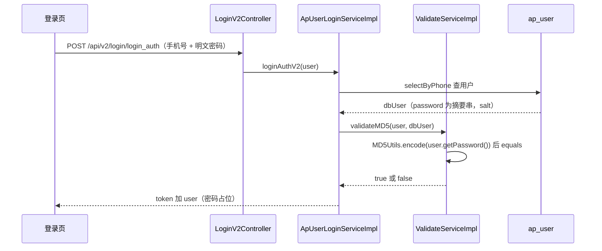

# 登录接口 V2 收口：控制层转调、正反用例与优化日验收

> 🔒 安全提示：文中示例的口令/密钥均为课程教学环境演示口径，生产环境的安全要求见《安全与合规须知》。

Service 层的摘要比对链路已经齐了，控制层只剩转调一件事。这一课把 `/api/v2/login/login_auth` 挂上网，前端 `config.js` 切到 v2，用一条真实测试账号把「明文进、摘要比、token 出」的全程走一遍断点，再用 MockMvc 把正反用例钉进回归清单。做完这些，项目优化日的四块改造全部落地，可以做一个完整的收尾盘点。

## 先给结论

- `LoginV2Controller` 复制 V1 骨架：类级路径升到 `/api/v2/login`，实现同一份契约接口，方法体一行转调 `loginAuthV2`。
- 前端只动 `config.js` 的 `user_login` 一项，url 版本位升 v2，页面与请求代码零改动。
- 断点验收的三个观察点：入参是明文、库中实体是摘要串、验证方法内先加密再 `equals` 返回 true。
- MockMvc 用例覆盖四类出口：正确凭据拿 token，密码错报 `LOGIN_PASSWORD_ERROR`，账号不存在报 `AP_USER_DATA_NOT_EXIST`，缺参报 `PARAM_INVALID`。
- 优化日四块改造（图片缓存、首页接口、联想词、接口安全）在控制层全部收口，数据库与缓存两头的账都能对上。

## 控制器：v2 版本位的最后一块

登录域的控制器与搜索域同款套路：契约接口不动，`controller.v2` 包里新建 V2 控制器，路径前缀升一位：

```java
package com.study.headline.login.controller.v2;

import com.study.headline.login.apis.LoginControllerApi;
import com.study.headline.login.service.ApUserLoginService;
import com.study.headline.model.common.dtos.ResponseResult;
import com.study.headline.model.user.pojos.ApUser;
import org.springframework.beans.factory.annotation.Autowired;
import org.springframework.web.bind.annotation.PostMapping;
import org.springframework.web.bind.annotation.RequestBody;
import org.springframework.web.bind.annotation.RequestMapping;
import org.springframework.web.bind.annotation.RestController;

@RestController
@RequestMapping("/api/v2/login")
public class LoginV2Controller implements LoginControllerApi {

    @Autowired
    private ApUserLoginService apUserLoginService;

    @PostMapping("/login_auth")
    public ResponseResult login(@RequestBody ApUser user) {
        // 唯一变化：转调 V2 方法，密码走摘要比对
        return apUserLoginService.loginAuthV2(user);
    }
}
```

控制器里没有任何业务逻辑，这是分层刻意的留白：参数校验、查库、摘要比对、脱敏、签发全部在 service 完成，控制器只负责把 HTTP 请求翻译成方法调用。`@RequestBody` 是老坑，POST 收 JSON 体必加，漏了它 Spring 不会解析请求体，入参全空，第一道参数校验就会把请求打回，表象与「接口坏了」一模一样。

## 前端切换与一次全链路断点验证

前端 `config.js` 的用户域清单里，登录一项升版本位（片段为按画面线整理的示意）：

```javascript
// config.js 用户域接口清单：登录一项版本位升到 v2
user_login: { url: '/api/v2/login/login_auth', sv: 'login' },
```

前后端各自重启后开始走链路。准备一条测试账号：库里 `password` 列已是 MD5 摘要，前端登录框输入的却是明文密码，两者之间的关系正是这次改造的核心。断点从控制层一路布到验证方法内部，整条链路画成时序图：



断点依次印证三件事。第一站在 service 入口：入参 `user` 的 password 字段是明文 `test`，手机号与库里测试账号一致。第二站在查库之后：`dbUser` 的 password 字段是 32 位十六进制的摘要串，与入参在字面上毫无相似之处，这一眼就是改造前后的分水岭，V1 时代这两串必须完全相同才能通过，V2 时代库里再也不存明文。第三站在验证方法内部：单步进去看到输入先被 `MD5Utils.encode` 算成摘要，再与库中密文 `equals`，返回 true；放行到最后，返回体里 token 与 user 并肩出现，user 的密码字段已是占位符。换一个错误密码再发一次，验证方法返回 false，链路在 `LOGIN_PASSWORD_ERROR` 这个出口提前终止，正反两个方向的出口都亲眼确认过，控制层的工作就算交付。

## 用 MockMvc 把正反用例钉住

断点验证是人工验收，跑一遍就散了；把同样的场景固化成测试类，回归时机器替人守门。day13 资料包为空，下面的测试类按本课写法补全，接口行为以画面线为准：

```java
package com.study.headline.login;

import com.study.headline.model.common.enums.AppHttpCodeEnum;
import org.junit.Before;
import org.junit.Test;
import org.junit.runner.RunWith;
import org.springframework.beans.factory.annotation.Autowired;
import org.springframework.boot.test.context.SpringBootTest;
import org.springframework.http.MediaType;
import org.springframework.test.context.junit4.SpringRunner;
import org.springframework.test.web.servlet.MockMvc;
import org.springframework.test.web.servlet.setup.MockMvcBuilders;
import org.springframework.web.context.WebApplicationContext;

import static org.springframework.test.web.servlet.request.MockMvcRequestBuilders.post;
import static org.springframework.test.web.servlet.result.MockMvcResultMatchers.jsonPath;
import static org.springframework.test.web.servlet.result.MockMvcResultMatchers.status;

@RunWith(SpringRunner.class)
@SpringBootTest
public class LoginV2ControllerTest {

    @Autowired
    private WebApplicationContext wac;

    private MockMvc mockMvc;

    @Before
    public void setup() {
        mockMvc = MockMvcBuilders.webAppContextSetup(wac).build();
    }

    /** 正例：正确手机号与明文密码，返回 200 且携带 token */
    @Test
    public void loginOk() throws Exception {
        String body = "{\"phone\":\"13800000000\",\"password\":\"test\"}";
        mockMvc.perform(post("/api/v2/login/login_auth")
                        .contentType(MediaType.APPLICATION_JSON).content(body))
                .andExpect(status().isOk())
                .andExpect(jsonPath("$.code").value(AppHttpCodeEnum.SUCCESS.getCode()))
                .andExpect(jsonPath("$.data.token").isNotEmpty())
                // 密码字段必须脱敏，绝不能把摘要串给前端
                .andExpect(jsonPath("$.data.user.password").value("*"));
    }

    /** 反例一：密码错误，返回 LOGIN_PASSWORD_ERROR */
    @Test
    public void loginWrongPassword() throws Exception {
        String body = "{\"phone\":\"13800000000\",\"password\":\"wrong\"}";
        mockMvc.perform(post("/api/v2/login/login_auth")
                        .contentType(MediaType.APPLICATION_JSON).content(body))
                .andExpect(jsonPath("$.code")
                        .value(AppHttpCodeEnum.LOGIN_PASSWORD_ERROR.getCode()));
    }

    /** 反例二：缺少密码，返回 PARAM_INVALID */
    @Test
    public void loginMissingParam() throws Exception {
        String body = "{\"phone\":\"13800000000\"}";
        mockMvc.perform(post("/api/v2/login/login_auth")
                        .contentType(MediaType.APPLICATION_JSON).content(body))
                .andExpect(jsonPath("$.code")
                        .value(AppHttpCodeEnum.PARAM_INVALID.getCode()));
    }
}
```

用例的取材有讲究。断言一律引用 `AppHttpCodeEnum` 而不是硬编码数字，错误码调整时测试不用跟着改；正例里除了断言 token 存在，还补了一条密码占位符的断言，脱敏这条安全底线值得一个专门的检查；反例挑了「凭据错」与「参数缺」两类，加上「账号不存在」用例（换一个库里没有的手机号即可）凑齐四个出口，每个错误码至少被一个用例踩过。测试账号用库里预置的演示数据，手机号、密码都以实际库中记录为准，不要拿真实用户数据跑测试。四条用例与断点验证构成互补：断点证明链路内部形态正确，用例证明对外契约稳定，两条腿都站稳才敢说收口。

## 优化日收官清单

这一天的四块改造到此全部落地，收尾盘点把各自的入口与收益对一遍：

| 改造块 | 关键动作 | 收益 |
|---|---|---|
| 图片缓存 | 热文章图片经图片微服务入缓存，article 端发消息维护 | 图片访问不穿透回源 |
| 首页接口改造 | 文章列表 service 与 controller 换成缓存读取 | 首屏数据走缓存，不再直连库 |
| 联想词优化 | 词库进 Redis，检索换 Trie，V2 控制器与前端版本位切换 | 检索不落库，前缀命中与词库规模无关 |
| 接口安全 | MD5 与 DES 工具类、验证与登录 V2、控制层收口 | 密码不再明文存取，凭据不出服务端 |

四个改造块共享同一条方法论：先立契约再动实现，新旧版本并存，流量切换只动版本位，回退成本压到最低。缓存类改造（图片、首页、联想词）解决性能问题，安全类改造（接口安全）解决形态问题，一天的优化同时覆盖了「快」与「稳」两个维度。后续演进点也都留了标记：缓存过期与主动失效、每请求重建 Trie 的复用方案、MD5 加盐向 BCrypt 的迁移，都是这批代码走向生产的下一站。

## 常见误区

- **版本位只改一半。** 错例是控制器升到 v2、前端还指着 v1，测试时看到的仍是明文比对，误判改造无效。正解是切换后在网络面板确认请求路径，再在 service 入口打断点确认进的是 V2 方法。
- **断言里比对明文密码。** 错例是测试里断言返回体的 password 等于输入的明文，V2 下返回的是占位符，用例永远红。正解是断言占位符或字段缺席，凭据相关字段只断言「不该出现什么」。
- **用真实用户数据做测试。** 错例是拿生产库的真实手机号与密码跑接口，测试日志里留下敏感信息，还可能触发账号锁定类风控。正解是预置专用测试账号，用例数据自包含。
- **只测正例不测反例。** 错例是正确凭据能拿到 token 就算通过，错误码路径从未验证，前端按错误码分支的提示逻辑全靠线上碰运气。正解是每个业务错误码至少一条用例。

## 面试可能被问到的问题

1. 面试官追问：「前端传的是明文密码，摘要存储还有意义吗？」
   答：有意义，传输与存储是两件事。传输明文靠 HTTPS 的信道加密保护；存储摘要保护的是落库之后的世界，库被拖走、备份泄露、运维直查都拿不到明文。两层各管一段，互不替代。
2. 面试官追问：「MockMvc 测登录接口要覆盖哪些用例？」
   答：正例断言 code、token 存在与密码脱敏；反例覆盖全部业务错误码，缺参、账号不存在、密码错误各一条；再加边界如空请求体。断言引用错误码枚举避免硬编码，数据用自包含的测试账号。
3. 面试官追问：「断点验证和自动化用例各自适合什么阶段？」
   答：断点适合首次落地与排障，能看到内部形态与执行路径，代价是不可重复、依赖人工；用例适合回归与持续集成，机器重复执行并固化对外契约。新链路先断点走通，再沉淀成用例，两者是先后关系不是二选一。
4. 面试官追问：「登录错误提示要不要区分账号不存在与密码错误？」
   答：两套口径各有场景。拆开利于前端精准提示与运维按码统计，本课沿用三码拆分；面向公网的生产系统常合并成一个「账号或密码错误」，避免攻击者借差异枚举有效手机号，再用失败次数限制与验证码补防线。取舍取决于系统暴露面。
5. 面试官追问：「这一天四块改造有什么共同点？」
   答：都以缓存或形态改造替代原直连实现，契约保持不变，实现分层落地：需求分析定方案、service 与工具层换内核、控制层与前端只动版本位。好处是每块都能独立灰度与回退，互不牵连。

## 配套资料

- 代码：`materials/code/05/头条day13/`。该日资料包解压结果为空（未含源码文件），文中 V2 控制器、前端配置片段按画面线（IDE 编码与 WebStorm 调试画面）抄录，MockMvc 测试类为按本课写法补全的可运行示例（day13 无测试源码可对照），包名统一改写为 `com.study.headline`；引用路径截至 `头条dayNN/` 层级，内层目录名含项目原名，不进入正文。
- 关联：`materials/code/05/头条day01/`，内层数据库规范设计说明书是 `ap_user` 表字段口径的依据；V1 登录控制器与三道校验的完整实现见 app 登录模块开发课正文，两版对照可看出改造边界。
- 环境：课程集群 node01~node03，MySQL root/123456；测试账号数据按密码验证课的 UPDATE 口径预置，MockMvc 用例依赖登录微服务与数据库同时可用。
