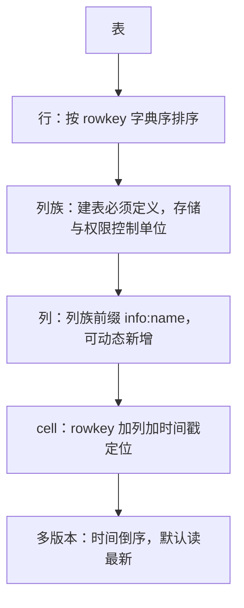
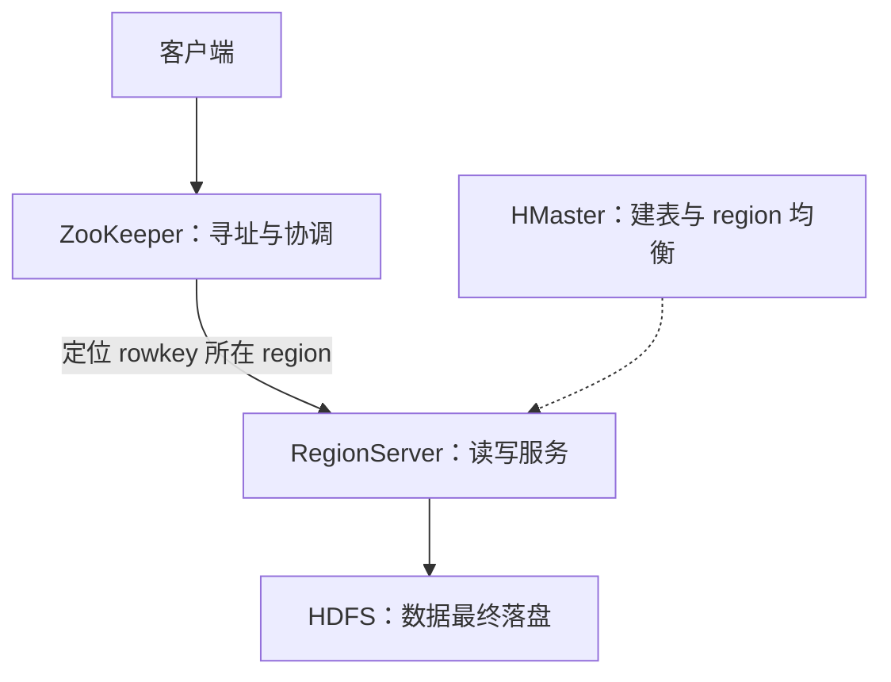

# 认识 HBase：冷数据的宽表仓库长什么样

迁移方案把冷数据的目的地定在 HBase，动手集成之前得先认识这位新成员。这一课读资料里的 HBase 讲义：它是什么、数据模型长什么样、集群怎么搭、命令行怎么玩，再对照项目里已经备好的封装代码，看这些概念落到工程里是什么样子。

## 先给结论

- HBase 是 BigTable 的开源实现，架在 HDFS 之上，高可靠、高性能、列存储、可伸缩、实时读写的 NoSQL 数据库，定位介于 NoSQL 与 RDBMS 之间。
- 取数只有两种姿势：按 rowkey 精确 get、按 rowkey 范围 scan；不支持 join 等复杂查询，事务只到行级。
- 数据类型只有一种：字节数组；列族建表时必须定死，列可以动态加，空列不占存储（稀疏）。
- 集群依赖 ZooKeeper 与 Hadoop 环境，三个核心角色：HMaster 管调度，RegionServer 扛读写，ZooKeeper 做协调寻址。
- 项目里做迁移只建一张 HBase 表，所有数据的存取都在这一张表上进行，靠列族与 rowkey 承载全部文章相关数据。

## 定位：它不是另一个 MySQL

讲义给 HBase 的一串定语值得逐个掂量：高可靠（数据落在 HDFS 上多副本存放）、高性能（LSM 写入路径，后面展开）、列存储（以列族组织数据）、可伸缩（加机器加容量）、实时读写（写入即可读）。它有表、有行、有列，却没有 SQL；事务只支持行级，想要多表 join 这类复杂查询，要借助 Hive 等大数据组件，那属于后续阶段的内容。

它的特点可以归成三条：**大**，一张表可以有上十亿行、上百万列；**面向列**，存储与权限控制以列族为单位，列族独立检索；**稀疏**，为空的列不占存储空间，表可以设计得非常稀疏。与 MySQL 摆在一起看分工：

| 维度 | MySQL | HBase |
|---|---|---|
| 数据模型 | 关系表，schema 固定 | 宽表，列族固定、列动态 |
| 查询能力 | SQL 全家桶：join、聚合、二级索引 | 仅 rowkey 精确查与范围扫描 |
| 事务 | 多行事务 | 单行事务 |
| 数据类型 | 整型、字符串、时间等丰富类型 | 只有一种：字节数组 |
| 扩展方式 | 纵向升级为主 | 横向加节点 |
| 适合 | 在线业务主存储 | 海量写入、按键读取的冷数据 |

这张表也解释了迁移方案里「Rowkey 用 MySQL 主键 id」的约定为什么成立：两边都按主键点查，查询语义无缝对齐。

## 数据模型：从表到 cell

逻辑视图自顶向下是表、行、列族、列、cell。行键 rowkey 是检索的主键，数据按 rowkey 字典序存放；建表时必须声明列族，列名以列族为前缀（如 `info:name`）；cell 由 rowkey、列、时间戳共同定位，同一格保存同一份数据的多个版本，按时间倒序排列，最新的排最前。



图上最关键的一层是列族：它是建表时唯一必须预先声明的东西，后挂的列都归属某个列族。稀疏是宽表的灵魂，某一行的列在另一行里可以完全不存在，空列不付存储代价。这与迁移方案里「多表对象组装」直接呼应：文章、内容、配置、作者合并成一行后，不少列在特定行上就是空的，稀疏模型让宽表设计不付额外成本。

命令行先摸一遍手感，建表写入读取一套走完：

```bash
# 进入 HBase 命令行
./hbase shell
# 建 user 表，info 与 data 两个列族
create 'user', 'info', 'data'
# 写入：rowkey 为 r0001，列族 info 下的 name 列
put 'user', 'r0001', 'info:name', 'zhangsan'
put 'user', 'r0001', 'info:age', '20'
# 精确取一行
get 'user', 'r0001'
# 范围扫描：指定列族与 rowkey 区间
scan 'user', {COLUMNS => 'info', STARTROW => 'r0001', ENDROW => 'r0003'}
```

列族在建表语句里就位（`info`、`data`），写入时才出现具体的列（`info:name`），这组命令就是「列族预定义、列动态」的直观版本。

## 集群角色与安装

安装 HBase 前要先备好两个环境：ZooKeeper 与 Hadoop（HDFS），装法是解压加改配置，讲义给出两个关键文件：

```bash
# hbase-env.sh：JDK 路径与外部 ZooKeeper
export JAVA_HOME=/usr/java/jdk1.7.0_55
export HBASE_MANAGES_ZK=false
```

```xml
<!-- hbase-site.xml 核心三项 -->
<configuration>
    <!-- 指定 hbase 在 HDFS 上的存储路径 -->
    <property>
        <name>hbase.rootdir</name>
        <value>hdfs://hbase</value>
    </property>
    <!-- 分布式模式 -->
    <property>
        <name>hbase.cluster.distributed</name>
        <value>true</value>
    </property>
    <!-- ZooKeeper 地址，多个用逗号分隔 -->
    <property>
        <name>hbase.zookeeper.quorum</name>
        <value>master01,master02,slave01</value>
    </property>
</configuration>
```

讲义里的主机名按各自集群对应替换，课程集群即 node01~node03。三个角色各司其职，协作关系如下：



读写路径的关键一段：客户端经 ZooKeeper 定位到 rowkey 所在的 RegionServer，之后数据读写直连 RegionServer，不再经过 HMaster；HMaster 只管建表删表、region 分配与负载均衡，掉线不影响已有 region 的读写。`HBASE_MANAGES_ZK=false` 的意思正是用外部 ZooKeeper 实例，不让 HBase 自管。

## 为什么冷数据放 HBase

**写入路径是 LSM 树。** MySQL 的 B+ 树写入是随机页写，数据量大时页分裂与索引维护成本高；HBase 写入先记日志再进内存写缓存，攒够一批顺序刷成磁盘文件，把随机写变成顺序写，对磁盘友好，吞吐量级完全不同。冷数据恰恰是写多读少、批量流入的典型。

**横向扩展堆容量。** MySQL 扩容靠换更强的机器，HBase 加节点即加容量，region 在节点间自动均衡。上亿行级别的表，横向扩展是唯一现实的路径。

**稀疏宽表接得住对象组装。** 迁移方案把多表对象聚成一行，列多且不少为空，稀疏模型让宽表不付空列的存储代价；一张表装下全项目迁移数据，正是「大」这个特点的用武之地。

**点查与主键对齐。** 冷数据召回的路径是按主键 id 取一篇，正是一次 rowkey get，封装里连预分区都备好了：

```java
// 预分区建表（节选自资料包的 HBase 封装，包名按规范改写）
public boolean createTableBySplitKeys(String tableName, List<String> columnFamily, byte[][] splitKeys) {
    // ...省略参数校验与表描述构建...
    // 指定 splitkeys
    admin.createTable(tableDescriptor, splitKeys);
    return true;
}

// 默认按 1~9 划出分区边界，配合 rowkey 前缀把写入摊到多个 region
public byte[][] getSplitKeys(String[] keys) {
    if (keys == null) {
        keys = new String[]{"1|", "2|", "3|", "4|",
                "5|", "6|", "7|", "8|", "9|"};
    }
    // ...排序后转为二维字节数组返回...
}
```

项目侧的装配类把配置与连接收拢在一处：

```java
// HBase 接入配置（节选自资料包的 HBase 封装，包名按规范改写）
@Setter
@Getter
@Configuration
@PropertySource("classpath:hbase.properties")
public class HBaseConfig {

    @Value("${hbase.zookeeper.quorum}")
    private String zookip_quorum;
    @Value("${hbase.client.keyvalue.maxsize}")
    private String maxsize;

    @Bean
    public HBaseClent getHBaseClient() {
        org.apache.hadoop.conf.Configuration conf = getHbaseConfiguration();
        return new HBaseClent(conf); // 内部经 ConnectionFactory 建立连接
    }
}
```

连接经 ZooKeeper 地址建立，读写工具类 HBaseClent 提供 `creatTable`、`putData`、`getRowData`、按起止 rowkey 的 `getResultScanner` 等方法，`PrefixFilter`、`RowFilter`、`QualifierFilter` 等查询过滤器也已备齐，迁移链路直接调用即可。

## 常见误区

- **拿关系库思维用 HBase。** 错例是想在 HBase 上做 join、聚合与多表事务。正解是取数只有 rowkey get 与 scan，事务只到行级，复杂统计交给离线组件。
- **把列族当列随手加。** 错例是运行时给表补列族。正解是列族必须建表时定义，改动是重运维操作；列（qualifier）可以动态新增，设计时把易变部分放列、稳定部分放列族。
- **以为重复 put 覆盖旧值无痕。** 正解是同一 cell 的多次写入形成多版本，按时间倒序共存，读默认最新；不理解版本机制会把历史版本当脏数据，或反过来丢掉想要的新值。
- **Rowkey 随手设计。** 错例是拿单调递增时间戳当 rowkey，新数据全部挤进最后一个 region。正解是让 rowkey 在 key 空间里摊开，项目用主键 id 加预分区建表把写入打散。

## 面试可能被问到的问题

1. 面试官追问：「HBase 和 MySQL 的定位差异是什么，什么时候选 HBase？」
   答：MySQL 是关系库，SQL 与事务能力全，适合在线业务主存储；HBase 是架在 HDFS 上的 NoSQL 宽表，只有 rowkey 精确查与范围扫，事务到行级，数据都是字节数组。数据量到上亿行、写入吞吐高、查询按主键点查的场景选 HBase，本项目的冷数据正是这个画像。
2. 面试官追问：「Rowkey 设计有哪些原则，项目里为什么用主键 id？」
   答：原则是长度尽量短、取值散列分布避免热点、把高频查询条件融进 rowkey。项目用 MySQL 主键 id 是为了与在线侧按 id 取文章的路径对齐，冷数据召回一次 get 命中；写入热点靠预分区与 key 空间设计缓解。
3. 面试官追问：「LSM 树为什么写入快，代价是什么？」
   答：写入先落日志再进内存写缓存，攒批后顺序刷成磁盘文件，把随机写变成顺序写，吞吐高。代价是读可能要合并内存与多层文件（读放大），以及后台合并 compaction 带来的资源消耗。
4. 面试官追问：「HBase 集群里 HMaster、RegionServer、ZooKeeper 各干什么？」
   答：HMaster 管建表删表、region 分配与负载均衡；RegionServer 承载 region、直接服务数据读写；ZooKeeper 负责协调与寻址入口。客户端读写不经过 HMaster，它掉线不影响已有 region 服务。
5. 面试官追问：「列族、列、cell、多版本是什么关系？」
   答：列族是建表时定义的存储与权限单位，列挂在列族下以列族名为前缀、可动态新增；rowkey 加列加时间戳定位一个 cell，同一 cell 的多次写入形成多版本，按时间倒序存放，默认读最新，可指定 VERSIONS 取历史版本。

## 配套资料

- 代码：`materials/code/05/头条day14/`，hbase 封装（HBaseConfig、HBaseClent、HBaseStorageClient、HBaseStorage、HBaseInvok、HBaseConstants）与 mongo 封装（MongoDBconfigure、MongoConstant、MongoStorageEntity），文中代码节选自其中，包名按规范改写为 `com.study.headline`。
- 说明：shell 命令与集群配置按课件画面线整理，HBase 讲义 PDF 随原资料包提供、未随源码落库；HMaster/RegionServer 职责、LSM 原理与 rowkey 设计原则按主流资料补写。
