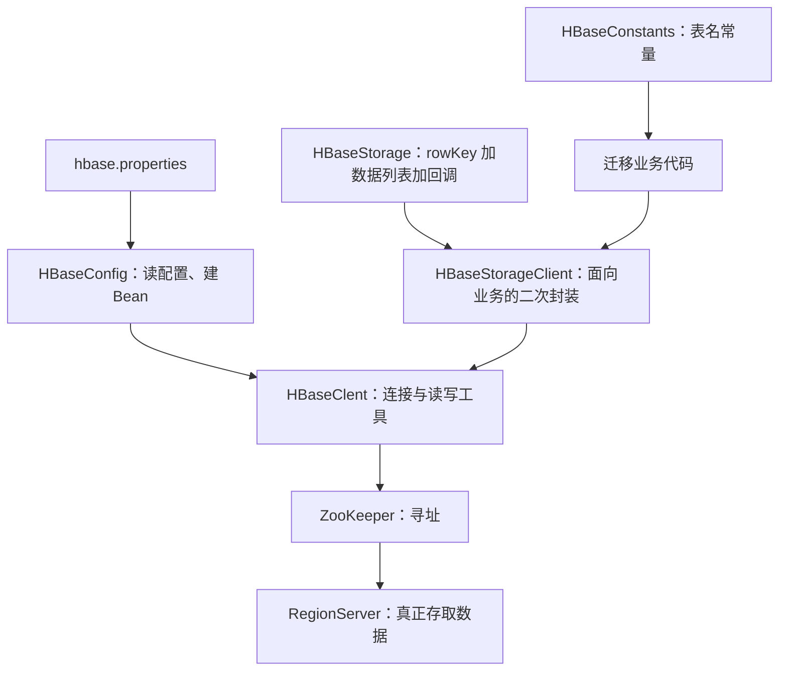

# 把 HBase 接进 common 模块：配置装配、建表封装与预分区

迁移方案把冷数据的目的地定在 HBase，真正动手写迁移代码之前，得先让工程具备跟 HBase 打交道的能力。这一课做的事情很集中：在公共模块里放好配置文件与封装类，把连接的建立、建表、读写的底层动作收拢成几个能直接注入使用的 Bean，迁移微服务后续拿来就用。

## 先给结论

- 集成位置选公共模块而不是迁移微服务：封装是公共能力，谁要迁移谁注入，测试代码也能直接复用。
- 配置只有两项：`hbase.zookeeper.quorum` 给 ZooKeeper 集群地址，`hbase.client.keyvalue.maxsize` 给单个单元格设大小上限，按自己的集群环境填写。
- HBaseConfig 装配类用 `@PropertySource` 读配置文件，`@Bean` 造出工具类 HBaseClent，连接在构造器里经 `ConnectionFactory` 一次建立，之后全项目共用。
- 建表有两个入口：`creatTable` 普通建表，先判存在再建；`createTableBySplitKeys` 预分区建表，配合 `getSplitKeys` 把 rowkey 空间预先切开，防写入热点。
- 依赖无需再引，公共 pom 已经备好 HBase 相关 jar，拷封装类、加配置文件即可。

## 为什么放公共模块

要写 HBase 的业务目前只有迁移微服务一个，但封装没有放进迁移服务里。原因很直接：连接管理、建表、byte 数组与字符串的互转这些动作与迁移业务无关，任何服务都可能用到；放进公共模块，迁移服务、后续的测试类都靠注入拿现成的工具。集成动作本身也因此变得很轻，拷贝资料包里的 hbase 包到公共模块，再补一个配置文件，集成就算完成了。

配置文件 `hbase.properties` 一共两行，键名与 HBase 官方配置项同名：

```properties
# HBase 接入配置，主机按课程集群 node01~node03 对应替换
hbase.zookeeper.quorum=node01,node02,node03
hbase.client.keyvalue.maxsize=500000
```

`quorum` 填 ZooKeeper 节点列表，多个用逗号分隔，客户端连上 ZooKeeper 之后才能定位到真正的 RegionServer。`keyvalue.maxsize` 限制单个 cell 的大小，这里给到约 50 万字节，文章正文这类大字段写入时若超限会在客户端直接抛错，把异常数据挡在入口，而不是带进存储。

## HBaseConfig：把连接做成一个 Bean

装配类是整个封装的入口，代码不长，完整贴出来：

```java
// HBase 装配类（节选自资料包封装，包名按规范改写为 com.study.headline）
@Setter
@Getter
@Configuration
@PropertySource("classpath:hbase.properties")
public class HBaseConfig {

    // HBase 注册地址，即 ZooKeeper 集群
    @Value("${hbase.zookeeper.quorum}")
    private String zookip_quorum;
    // 单个单元格大小上限
    @Value("${hbase.client.keyvalue.maxsize}")
    private String maxsize;

    @Bean
    public HBaseClent getHBaseClient() {
        org.apache.hadoop.conf.Configuration hBaseConfiguration = getHbaseConfiguration();
        return new HBaseClent(hBaseConfiguration);
    }

    private org.apache.hadoop.conf.Configuration getHbaseConfiguration() {
        org.apache.hadoop.conf.Configuration hBaseConfiguration = new org.apache.hadoop.conf.Configuration();
        hBaseConfiguration.set("hbase.zookeeper.quorum", zookip_quorum);
        hBaseConfiguration.set("hbase.client.keyvalue.maxsize", maxsize);
        return hBaseConfiguration;
    }
}
```

执行顺序值得走一遍：Spring 启动时读到 `@PropertySource` 加载 properties 文件，两个 `@Value` 把配置值注入字段；容器创建 HBaseClent 这个 Bean 时，`getHbaseConfiguration` 把两个键塞进 Hadoop 风格的 Configuration 对象；HBaseClent 的构造器里调用 `ConnectionFactory.createConnection(conf)` 建立连接。之后任何服务注入 HBaseClent，拿到的都是同一个共享连接，不必每个方法各自开关连接。



这张图的关键路径是：业务代码只认 HBaseStorageClient 与 HBaseStorage，不直接碰原生 API；连接的建立细节全部压在 HBaseConfig 与 HBaseClent 两层里。

## HBaseClent：近八百行的能力地图

工具类 HBaseClent 将近八百行，看着吓人，按功能分组其实就五类：

| 分组 | 代表方法 | 说明 |
|---|---|---|
| 表管理 | `tableExists`、`creatTable`、`createTableBySplitKeys`、`deleteTable`、`getAllTableNames` | 建删查表，列族查询 `getAllFamilyNames` 也在这一组 |
| 写入 | `putData`、`setColumnValue` | 按列族批量写列，或单格赋值 |
| 精确读 | `getRowData`、`getColumnValue`、`getColumnValuesByVersion` | 按 rowkey get 一行、一列，或取多版本 |
| 扫描 | `getResultScanner`（全表与起止 rowkey 两个重载）、`getResultScannerPrefixFilter` 等过滤器版本 | Scan 全家桶，`PrefixFilter`、`RowFilter`、`QualifierFilter` 都已备齐 |
| 收尾 | 私有 `close(Admin, ResultScanner, Table)` | 每个方法 finally 里统一关闭资源 |

以普通建表为例，先判存在再建，方法被重复调用也不会报错：

```java
// 建表（节选自资料包封装，包名按规范改写）
public boolean creatTable(String tableName, List<String> columnFamily) {
    Admin admin = null;
    try {
        admin = connection.getAdmin();
        // 列族描述符逐个构建
        List<ColumnFamilyDescriptor> familyDescriptors = new ArrayList<>(columnFamily.size());
        columnFamily.forEach(cf -> {
            familyDescriptors.add(ColumnFamilyDescriptorBuilder.newBuilder(Bytes.toBytes(cf)).build());
        });
        TableDescriptor tableDescriptor = TableDescriptorBuilder.newBuilder(TableName.valueOf(tableName))
                .setColumnFamilies(familyDescriptors)
                .build();
        if (admin.tableExists(TableName.valueOf(tableName))) {
            log.debug("table Exists!");
        } else {
            admin.createTable(tableDescriptor);
            log.debug("create table Success!");
        }
    } catch (IOException e) {
        log.error(MessageFormat.format("创建表{0}失败", tableName), e);
        return false;
    } finally {
        close(admin, null, null);
    }
    return true;
}
```

两个细节在阅读封装时容易划过去：一是所有字符串与 rowkey、列名之间都经 `Bytes.toBytes` 与 `Bytes.toString` 互转，因为 HBase 底层只认字节数组；二是每个方法都在 finally 里关掉自己开出的 Admin、ResultScanner、Table，只有构造器里建的 Connection 一直活着。

## 预分区建表：createTableBySplitKeys

普通建表只有一张表一个 region，rowkey 又接近单调递增时，所有写入都会挤进同一个 region，单节点忙死、其他节点围观。预分区在建表时就按边界把 rowkey 空间切成多份，数据落表瞬间就摊到多个 region 上：

```java
// 预分区建表（节选自资料包封装，包名按规范改写）
public boolean createTableBySplitKeys(String tableName, List<String> columnFamily, byte[][] splitKeys) {
    Admin admin = null;
    try {
        if (StringUtils.isBlank(tableName) || columnFamily == null || columnFamily.size() == 0) {
            log.error("===Parameters tableName|columnFamily should not be null,Please check!===");
            return false;
        }
        admin = connection.getAdmin();
        if (admin.tableExists(TableName.valueOf(tableName))) {
            return true;
        } else {
            // ...列族与表描述符构建同 creatTable...
            // 指定 splitkeys 建表
            admin.createTable(tableDescriptor, splitKeys);
        }
    } catch (IOException e) {
        log.error("", e);
        return false;
    } finally {
        close(admin, null, null);
    }
    return true;
}

// 默认按 1~9 划出分区边界
public byte[][] getSplitKeys(String[] keys) {
    if (keys == null) {
        keys = new String[]{"1|", "2|", "3|", "4|",
                "5|", "6|", "7|", "8|", "9|"};
    }
    byte[][] splitKeys = new byte[keys.length][];
    // 用 HBase 自带的字节比较器升序排序
    TreeSet<byte[]> rows = new TreeSet<byte[]>(Bytes.BYTES_COMPARATOR);
    for (String key : keys) {
        rows.add(Bytes.toBytes(key));
    }
    // ...按序填入 splitKeys 数组返回...
    return splitKeys;
}
```

默认边界是 `1|` 到 `9|` 九个字符串，配合迁移方案里 rowkey 以数字 id 开头的约定，主键 1 开头的行进第一个 region，2 开头的进第二个，以此类推。边界值带竖线后缀是为了避免与真实 rowkey 恰好相等。表不存在时按切分点建，已存在直接返回成功，迁移链路重复触发也不会建出第二张表。

## 二次封装预告：HBaseStorageClient

工具类面向原生 API，业务真用起来还有点绕。封装包里另有面向业务的一层 HBaseStorageClient，注入 HBaseClent 后提供两类方法：写入侧 `addHBaseStorage`，传表名与一个 HBaseStorage 对象，内部自动判表存在性、逐列写入、成功后触发回调钩子；查询侧 `getStorageDataEntity` 与 `getStorageDataEntityList`，传 rowkey 与实体类，直接吐回组装好的对象。数据载体 HBaseStorage 继承 StorageEntity，装 rowKey、列数据列表与回调 HBaseInvok，列族名从数据列表里自动提取，不用手工指定。这层的用法与测试留到下一课展开，这里先把角色摆清楚：HBaseClent 是工具，HBaseStorageClient 是业务接口。

## 常见误区

- **把集成理解成引 jar 包。** 错例是只往 pom 里加依赖就以为完事。正解是依赖公共 pom 已备好，真正要做的是配置文件加封装类入位，再确认装配类被组件扫描扫到。
- **quorum 只填一个节点。** 错例是写死单台 ZooKeeper 地址，那台机器抖动客户端就失联。正解是填写完整节点列表用逗号分隔，客户端自动故障转移。
- **每读写一次就新建一次连接。** 错例是业务代码里到处 `ConnectionFactory.createConnection`。正解是连接是重量级对象，封装里只在装配时建一次，方法内部只开关轻量的 Table 与 Admin。
- **拿 creatTable 当唯一建表入口。** 错例是数据量上来后写入全压进一个 region。正解是 rowkey 单调递增的表必须走 `createTableBySplitKeys` 预分区，普通建表只适合测试场景。

## 面试可能被问到的问题

1. 面试官追问：「HBase 的 Java 客户端为什么通过 ZooKeeper 连接，而不是直连 RegionServer？」
   答：region 会分裂、迁移，RegionServer 也可能增减，客户端无法预知某条 rowkey 此刻在哪台机器上。ZooKeeper 是集群的寻址入口，客户端先问它拿到目标 RegionServer 地址，之后读写直连不再经过中间层。
2. 面试官追问：「预分区解决什么问题，splitkeys 怎么定？」
   答：不分区时新表只有一个 region，rowkey 单调递增会让写入集中在最后一个 region 形成热点。splitkeys 按预期 rowkey 分布划边界，本项目 rowkey 以数字 id 开头，用 1 到 9 开头的边界串切出十个区间，让写入均匀摊开。
3. 面试官追问：「Connection、Table、Admin 三个对象的线程安全与生命周期怎么管理？」
   答：Connection 线程安全且创建昂贵，进程级单例长存；Table 与 Admin 轻量但非线程安全，按方法作用域即用即关；封装里统一在 finally 中关闭，防止句柄泄漏。
4. 面试官追问：「hbase.client.keyvalue.maxsize 这类配置为什么要在客户端设？」
   答：它是写入侧的保护阀。文章正文这类大字段如果不设上限，一条异常数据就可能拖垮一次 put 甚至一个 region 的内存，客户端在写入前校验并把超限数据挡在迁移入口，成本最低。
5. 面试官追问：「封装层为什么设计 HBaseInvok 回调接口？」
   答：写入成功后业务往往还有后续动作，比如回写文章表的同步标识。把回调挂在 HBaseStorage 对象上，由写入方法在数据真正落库后触发，同步顺序的决策权留给调用方，封装层不必知道业务细节。

## 配套资料

- 代码：`materials/code/05/头条day14/`，hbase 封装 6 文件（HBaseConfig、HBaseClent、HBaseStorageClient、HBaseStorage、HBaseInvok、HBaseConstants），文中 HBaseConfig、creatTable、createTableBySplitKeys、getSplitKeys 均节选自其中，包名按规范改写为 `com.study.headline`；引用路径截至该层，内层目录不再展开。
- 说明：properties 文件与 pom 依赖按课件画面线整理，集群主机名按 node01~node03 替换；分区边界与热点问题的原理阐述按主流资料补写。
