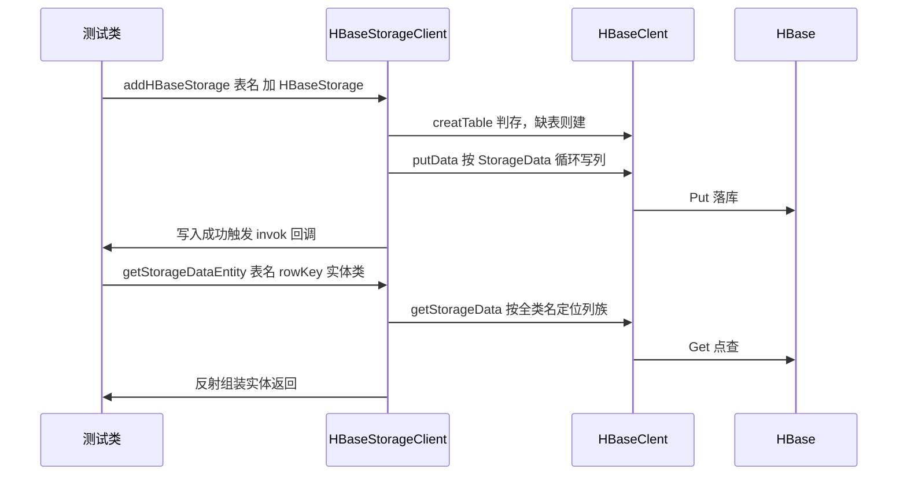

# 用封装层读写 HBase：一行写入一个对象，传个类名取回一个对象

原生 client 的四个测试跑通后，能力验证完毕，但业务代码不该直接碰五个参数的 putData 与字节数组解析。这一课换封装层 HBaseStorageClient 做同样的写入与查询，重点看三件事：数据怎么组装、封装内部做了什么、为什么传一个实体类就能取回组装好的对象。

## 先给结论

- 写入的数据载体是 HBaseStorage：装 rowKey、一个 StorageData 列表；每个 StorageData 对应一个实体类，`targetClassName` 必须填实体全类名，它同时决定列族名与查询时的映射类型。
- 键值对 StorageEntry 就是列：key 是列名，value 是列值，key 必须与实体类字段名对应，否则查回来封装不上。
- `addHBaseStorage` 内部自动判表存在并建表，列族名从数据里自动提取，写入成功后触发回调钩子，迁移链路的同步标识回写就挂在这个钩子上。
- 查询用 `getStorageDataEntity`，传表名、rowKey、实体类三样，封装按全类名定位列族取回数据，再反射 new 出实体逐字段赋值，吐回现成对象。
- 增与查是封装层的高频动作，改与删在 HBase 存储口径里基本不用，数据以只增为主。

## 写入测试：把对象拆成列装进 HBaseStorage

测试方法先构造数据载体，再交给封装：

```java
// 封装层写入测试（示例为按本课画面与写法补全，包名按规范改写）
@Test
public void testStorageSaveData() {
    HBaseStorage storage = new HBaseStorage();
    storage.setRowKey("storage_row_key_00001");

    // 一个 StorageData 对应一个实体类
    StorageData storageData = new StorageData();
    // 关键：填实体全类名，它就是列族名，也是查询映射的类型
    storageData.setTargetClassName(ApArticle.class.getName());

    // 每个键值对就是一列：key 是列名，value 是列值
    List<StorageEntry> entryList = new ArrayList<>();
    StorageEntry entry = new StorageEntry();
    entry.setKey("title");
    entry.setValue("数据迁移");
    StorageEntry entry2 = new StorageEntry();
    entry2.setKey("id");
    entry2.setValue("123456");
    entryList.add(entry);
    entryList.add(entry2);
    storageData.setEntryList(entryList);

    List<StorageData> dataList = new ArrayList<>();
    dataList.add(storageData);
    storage.setDataList(dataList);

    storageClient.addHBaseStorage("hbase_storage_test_table_name", storage);
}
```

组装时有一个字段不能随手填：`targetClassName` 用 `ApArticle.class.getName()` 拿全类名，而不是自己编个字符串。原因在封装的实现里：列族名直接取这个值，查询时也按它去定位列族并反射出对应类型，填错了写入照常成功，查询却再也对不上。entry 的 key 一头连着 HBase 的列名，一头连着实体字段名，示例里 title 与 id 正好都是 ApArticle 的真实字段。断点里看这个 storage 对象，rowKey、列族、两个键值对一目了然；测试跑完回命令行 `list`，新表已经在。

## 封装内部：判表、写列、回调，三步连发

`addHBaseStorage` 的实现不到十行，三件事按序发生：

```java
// 封装实现（节选自资料包 HBaseStorageClient，包名按规范改写）
public void addHBaseStorage(String tableName, HBaseStorage hBaseStorage) {
    if (null != hBaseStorage && StringUtils.isNotEmpty(tableName)) {
        // 表不存在则建，列族名从数据列表自动提取
        hBaseClent.creatTable(tableName, hBaseStorage.getColumnFamily());
        String rowKey = hBaseStorage.getRowKey();
        boolean result = addStorageData(tableName, rowKey, hBaseStorage.getDataList());
        if (result) {
            hBaseStorage.invok(); // 写入成功后的回调钩子
        }
    }
}

// 列族自动提取（节选自资料包 HBaseStorage）
public List<String> getColumnFamily() {
    return getDataList().stream().map(StorageData::getTargetClassName).collect(Collectors.toList());
}
```

调用方可以完全不建表，第一次写入时表就自动出来了；表已存在时 `creatTable` 判存后静默跳过，重复触发不报错。批量版本 `addHBaseStorage(tableName, list)` 对列表逐条调单条方法，多条 rowKey 一次提交。回调钩子 `invok` 在写入结果为真后才执行，HBaseStorage 上的 hBaseInvok 字段由调用方按需设置，不设就跳过，这一层把「写成功之后还要干什么」的决策权留给了业务。



时序图的下半段是查询链路，写入与读回共用同一套类型约定，全类名是两边对齐的锚点。

## 查询测试：传个类名，取回组装好的对象

查询侧的代码短得近乎奢侈：

```java
// 封装层查询测试（示例为按本课画面与写法补全，包名按规范改写）
@Test
public void testStorageGetData() {
    ApArticle article = storageClient.getStorageDataEntity(
            "hbase_storage_test_table_name", "storage_row_key_00001", ApArticle.class);
    System.out.println(article);
}
```

打印结果里 id 为 123456、title 为数据迁移，一个 ApArticle 对象原样取回。实现里真正的翻译动作有两段，先是按全类名取列族：

```java
// 查询实现（节选自资料包 HBaseStorageClient 与 HBaseClent，包名按规范改写）
public <T> T getStorageDataEntity(String tableName, String rowKey, Class<T> tClass) {
    T tValue = null;
    if (StringUtils.isNotEmpty(tableName)) {
        StorageData hBaseData = hBaseClent.getStorageData(tableName, rowKey, tClass.getName());
        if (null != hBaseData) {
            tValue = (T) hBaseData.getObjectValue();
        }
    }
    return tValue;
}

// HBaseClent 侧：Result 按列族拍平成 StorageData
public StorageData getStorageDataForfamilyName(Result hTableResult, String familyName) {
    StorageData storageData = null;
    if (hTableResult != null && !hTableResult.isEmpty()) {
        Map<byte[], byte[]> familyMap = hTableResult.getFamilyMap(Bytes.toBytes(familyName));
        if (null != familyMap && !familyMap.isEmpty()) {
            storageData = new StorageData();
            for (Map.Entry<byte[], byte[]> entry : familyMap.entrySet()) {
                storageData.setTargetClassName(familyName);
                storageData.addStorageEntry(Bytes.toString(entry.getKey()), Bytes.toString(entry.getValue()));
            }
        }
    }
    return storageData;
}
```

后半段的 `getObjectValue` 属于公共存储模块的 StorageData，源码未随资料落库，其行为按课件讲解还原：反射把传入的 Class new 出实例，再用工具类逐个把键值对往同名字段里 set，key 从 HBase 查出来，值跟着落进属性。只有测试里写的那两个字段有值，实体其余属性保持 null，这正是按列存储的形态，存了几列就回来几列。批量版本 `getStorageDataEntityList` 接受类型列表，一次返回多个对象，单条与批量在读写两侧都有对应方法。

## 与原生 API 对比，封装买到了什么

同一件事两种写法摆在一起，差异不在行数，在心智负担：

| 维度 | 原生 HBaseClent | 封装 HBaseStorageClient |
|---|---|---|
| 写入参数 | 表名、rowKey、列族、columns 数组、values 数组 | 表名、一个 HBaseStorage 对象 |
| 建表 | 调用方自己安排 | 内部判存自动建 |
| 列值对齐 | 两个数组按下标，错位无感 | 键值对自带名字，无对齐问题 |
| 查询返回 | Result，手动遍历 Cell 转字节 | 直接返回实体对象 |
| 业务衔接 | 无 | 回调钩子承接同步标识回写 |

原生那课的 columns 与 values 必须人肉对齐，封装这里每个值都带着名字；原生查询拿到 Result 还要一轮 `Bytes.toString` 解析，封装把反射组装藏在了 `getObjectValue` 里。代价是多一层抽象，字段名与列名的对应关系成了隐式契约，这正是下一节误区的来源。

## 常见误区

- **targetClassName 随手编字符串。** 错例是写个自造的名字图省事，写入成功、查询永远取不回。正解是固定用实体全类名，写入与查询两端都由它对齐列族与类型。
- **entry 的 key 与实体字段名对不上。** 错例是列名写 articleTitle，实体字段叫 title。正解是 key 必须与实体属性名一致，反射赋值按名字匹配，对不上的列查回来就丢。
- **以为封装会替你建列族。** 错例是运行时想给已有数据补一个实体类型。正解是列族在首次建表时由 targetClassName 集合决定，新增实体类型要慎重，改列族是重运维操作。
- **指望查回来的对象字段齐全。** 错例是写入只存了 id 与 title，查询却断言所有属性有值。正解是宽表按列存，写入几列查回几列，其余属性为 null，需要就先补写。

## 面试可能被问到的问题

1. 面试官追问：「封装层为什么用实体全类名当列族名？」
   答：一举两得，写入时列族名天然唯一且语义清晰，查询时拿实体类的 getName 就能定位列族，再用同一个 Class 反射组装对象，写入与读回不需要任何额外映射配置。
2. 面试官追问：「addHBaseStorage 里表不存在就自动建，生产上这么做妥当吗？」
   答：开发与迁移场景方便，判存让方法幂等；生产要更谨慎，建表是重操作，通常由初始化脚本或预分区建表统一管理，应用内自动建表适合小表与测试，核心大表建议显式管控。
3. 面试官追问：「回调钩子解决了什么问题？」
   答：迁移链路要求写入 HBase 成功后才回写同步标识，回调让业务在数据真正落库后介入，封装层不必知道业务细节，调用方按需设置钩子，不设则自动跳过。
4. 面试官追问：「从 HBase 取回的实体对象其他属性是 null，怎么理解？」
   答：HBase 按列存储，一行里只落了写入过的列，查询按列族拍平返回，没写的列不占空间也不返回。需要完整对象时补齐写入，或在读取侧对 null 做兜底。
5. 面试官追问：「这套封装与直接用原生 client 相比，风险在哪里？」
   答：隐式契约变多，字段名与列名、全类名与列族的对应关系都靠约定维护，约定破坏时错误往往延迟到查询才暴露。对策是常量收敛表名与类型名、写入侧校验 key 与字段匹配、关键链路配集成测试。

## 配套资料

- 代码：`materials/code/05/头条day14/`，hbase 封装 6 文件，文中 HBaseStorageClient、HBaseStorage、getStorageDataForfamilyName 节选自其中（包名按规范改写为 `com.study.headline`）；引用路径截至该层，内层目录不再展开。
- 说明：测试类未随资料落库，testStorageSaveData 与 testStorageGetData 示例为按本课画面与写法补全；StorageData 与 StorageEntry 属公共存储模块、源码未随资料落库，其结构与反射组装行为按课件讲解还原。
