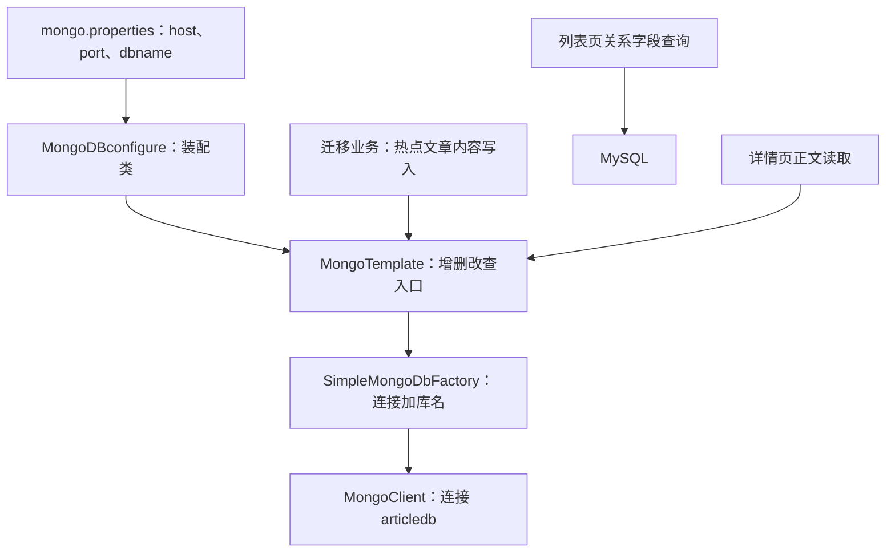

# MongoDB 进场：装配 MongoTemplate，把热点文章内容存进文档库

HBase 这条线测通之后，迁移的另一个目的地 MongoDB 用同样的套路接入：公共模块里放配置文件与三个类，迁移服务加依赖，写一个测试类跑插入与查询。这一课顺带把选型问题说清楚：热点文章的内容数据为什么要落在文档库里。

## 先给结论

- 集成套路与 HBase 完全同构：公共模块建 mongo 包，配置文件加装配类，Spring 容器里多出一个可直接注入的 MongoTemplate。
- 连接配置三项：`mongo.host`、`mongo.port`、`mongo.dbname`，数据库名按自己环境起，课程环境库名为 articledb。
- MongoDBconfigure 用 `SimpleMongoDbFactory` 包住 `MongoClient`，再包成 MongoTemplate Bean，课程环境未开认证，连接只有地址与端口。
- 实体侧 MongoStorageEntity 继承存储基类，`@Document` 指明集合名，`@Id` 标明主键字段 rowKey。
- 选型口径：MongoDB 是文档型 NoSQL，读写性能定位介于 Redis 与 MySQL 之间，热点文章正文这类大字段整读整取，落 Mongo，关系字段仍归 MySQL。

## 三个类一个配置文件，集成即完成

在公共模块下新建 mongo 包，把资料里的 MongoDBconfigure、MongoConstant、MongoStorageEntity 拷进去，配好 `mongo.properties`，集成动作就做完了。配置文件按课程环境填写：

```properties
# Mongo 接入配置，主机按课程集群 node01~node03 对应替换
mongo.host=node01
mongo.port=27017
mongo.dbname=articledb
```

装配类是唯一的 Java 动作，代码完整贴出：

```java
// Mongo 装配类（节选自资料包封装，包名按规范改写为 com.study.headline）
@Configuration
@PropertySource("classpath:mongo.properties")
public class MongoDBconfigure {

    @Value("${mongo.host}")
    private String host;
    @Value("${mongo.port}")
    private int port;
    @Value("${mongo.dbname}")
    private String dbName;

    @Bean
    public MongoTemplate getMongoTemplate() {
        return new MongoTemplate(getSimpleMongoDbFactory());
    }

    public SimpleMongoDbFactory getSimpleMongoDbFactory() {
        return new SimpleMongoDbFactory(new MongoClient(host, port), dbName);
    }
}
```

结构是一个双层包装：`MongoClient(host, port)` 建立与 Mongo 服务的连接，课程环境连接不带用户名密码；`SimpleMongoDbFactory` 把连接与库名绑定成工厂；最外层 MongoTemplate 才是业务拿到的对象，增删改查方法都在它身上。三者都随容器创建一次、全程复用，业务代码不需要碰任何连接细节。



图里两条业务箭头对应迁移方案的双目的地分工：MySQL 存关系字段服务列表查询，Mongo 存内容大字段服务详情读取，MongoTemplate 只承接后者。

## 实体与常量：两个小类的角色

存储实体继承公共存储基类，注解决定它在 Mongo 里的落位：

```java
// Mongo 存储实体（节选自资料包封装，包名按规范改写）
@Document(collection = "mongo_storage_data")
@Setter
@Getter
public class MongoStorageEntity extends StorageEntity {
    // 主键的 Key，@Id 标明该字段是主键
    @Id
    private String rowKey;
}
```

`@Document` 指明写入哪个集合，相当于关系库里的表名；`@Id` 把 rowKey 标成文档主键，按 id 查询、判重都靠它。基类 StorageEntity 承载的数据结构与 HBase 侧一致：目标类名加键值对列表，同一套存储对象既能组装进 HBase，也能落进 Mongo，这正是公共模块抽象的意义。MongoConstant 里放着迁移集合名的常量 `APARTICLE_MIGRATION_TABLE`，集合名集中收敛，避免散落各处的字符串字面量对不上号。

## 迁移服务接入与两个测试

迁移服务在依赖里补上公共 mongo 模块，并把包加入扫描：

```java
// InitConfig 扫描包补充 mongo（示例为按本课写法补全，包名按规范改写）
@ComponentScan({"com.study.headline.common.init",
        "com.study.headline.common.mongo",
        "com.study.headline.common.mysql"})
```

测试类注入 MongoTemplate，一插一查两个方法：

```java
// Mongo 集成测试（示例为按本课画面与写法补全，包名按规范改写）
@RunWith(SpringRunner.class)
@SpringBootTest
public class MongoTest {

    @Autowired
    private MongoTemplate mongoTemplate;

    @Test
    public void testSave() {
        ApArticle article = new ApArticle();
        article.setId(22222);
        article.setTitle("迁移测试说明书");
        mongoTemplate.insert(article);
    }

    @Test
    public void testGetOne() {
        ApArticle article = mongoTemplate.findById(22222, ApArticle.class);
        System.out.println(article);
    }
}
```

insert 不指定集合名时按类名映射默认集合，传入实体即插入；跑完测试连上图形客户端打开 articledb 刷新，新文档已经在，id 22222、标题迁移测试说明书。查询用 `findById`，第一个参数是主键值，第二个参数指明映射类型，返回组装好的实体，控制台打印出的对象与写入一致，查询闭环。MongoTemplate 的方法面远不止这两个：`findAll` 查全量、`count` 计数、`remove` 删除、`update` 更新，用法同源，用到时按需取用即可。

## 为什么热点正文放 Mongo

迁移方案给热点文章安排了两个去处，Mongo 承接的是内容数据，理由可以拆成三层。

**数据形态合拍。** 一篇文章的正文是长度不可控的大文本，配上标题、作者、图片等若干字段，天然是一份完整文档。文档模型一次整读整取，详情页一次查询拿到全文，不需要像关系库那样跨表 join 或拆列取回。

**性能定位居中。** 按课件口径，MongoDB 的读写性能介于 Redis 与 MySQL 之间：不如内存 KV 极致，但文档读写加索引足以支撑按 id 取正文的点查路径；相比 MySQL，大字段宽行的读放大更小。热点正文属于读多、按 id 点查、单条较大的画像，落在这个中间档位正合适。

**与 HBase 的分工。** 全量冷数据在 HBase，按 rowkey 取回是回调补链路用的；热点是另一个更热的访问层，正文独立成文档放 Mongo，列表页的 MySQL 关系查询与详情页的 Mongo 正文读取互不干扰，大字段也不会拖慢列表查询。

## 常见误区

- **以为要为 Mongo 写一套 DAO。** 错例是按 MyBatis 习惯先建 mapper 层。正解是 MongoTemplate 直接注入即用，方法覆盖增删改查，简单场景无需再包一层。
- **数据库名写死在代码里。** 错例是连接串里硬编码库名，换个环境就报库不存在。正解是库名进 `mongo.properties`，环境差异交给配置。
- **漏掉组件扫描导致注入失败。** 错例是加了依赖却没把 mongo 包加进 `@ComponentScan`，启动报找不到 MongoTemplate Bean。正解是依赖与扫描包成对出现。
- **把 Mongo 当缓存层用。** 错例是拿它做热点缓存、过期淘汰。正解是 Mongo 是持久化的文档库，热点正文是「存」的决策；缓存语义另有专门的内存组件承担，两者不要混。

## 面试可能被问到的问题

1. 面试官追问：「MongoTemplate 与 MongoClient 什么关系，为什么要包一层工厂？」
   答：MongoClient 只负责连接服务端，不带库与操作的语义；SimpleMongoDbFactory 把连接与具体数据库绑定；MongoTemplate 再基于工厂提供实体映射、集合路由与增删改查 API。层层包装让业务只面对面向对象的模板方法。
2. 面试官追问：「热点文章正文为什么放 MongoDB 而不是 MySQL 或 Redis？」
   答：正文是大文本整读，文档模型一次取回免 join；按 id 点查的场景 Mongo 索引足够，性能定位在 Redis 与 MySQL 之间；Redis 是缓存语义不适合做持久主存储，MySQL 承接列表页关系查询，大字段入库会拖慢列表，职责就这样分开。
3. 面试官追问：「@Document 与 @Id 注解各起什么作用？」
   答：@Document 声明实体映射的集合名，相当于表名；@Id 标记文档主键字段，findById、判重、主键路由都以它为准。本项目把 rowKey 标成主键，与 HBase 侧的 rowkey 约定保持一致。
4. 面试官追问：「insert 与 save 有什么区别？」
   答：insert 是纯新增，主键已存在的文档会报错；save 按主键判断，存在则整体更新、不存在则插入。迁移场景只追加不覆盖，用 insert 语义更严格，写错主键能立刻暴露。
5. 面试官追问：「这套存储基类同时服务 HBase 与 Mongo，好处是什么？」
   答：同一份业务数据组装一次，键值对结构两边通用，迁移到哪个目的地都复用同一套组装与拆解逻辑；新增存储介质时业务代码改动收敛在装配层，不动数据组装。

## 配套资料

- 代码：`materials/code/05/头条day14/`，mongo 封装 3 文件（MongoDBconfigure、MongoConstant、MongoStorageEntity），文中装配类与实体类节选自其中（包名按规范改写为 `com.study.headline`）；引用路径截至该层，内层目录不再展开。
- 说明：迁移服务接入与测试类未随资料落库，InitConfig 与 MongoTest 示例为按本课画面与写法补全；配置文件、客户端验证按课件画面线整理，主机名按 node01~node03 替换；三层选型对比按课件口径与主流资料补写。
