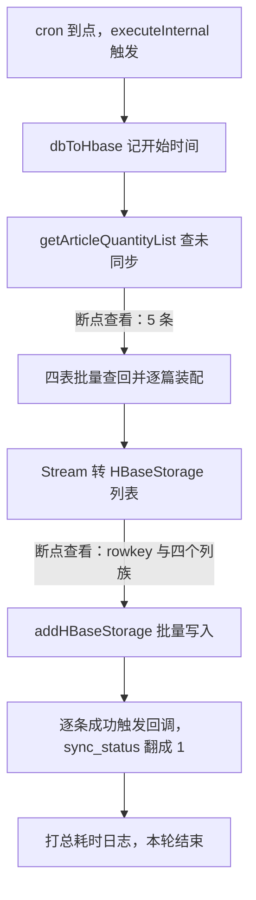

# 定时全量迁移：Quartz 任务把未同步数据周期性搬进 HBase

迁移的门面方法全部就绪，可总得有个东西周期性去调它，不然未同步的文章永远躺在库里。这一课补上这条自动化的腿：一个 Quartz 定时任务，每两分钟醒一次，调门面的全量同步方法，把未同步数据搬进 HBase。任务本身只有十几行，真正的看点在测试前的数据准备、断点调试时链路逐层展开的样子，以及重复执行为什么不产生脏数据。

## 先给结论

- 任务类继承项目封装的 `AbstractJob`，重写 `triggerCron` 给出 cron 表达式、重写 `executeInternal` 写业务体，`@Component` 交给 Spring 管理即可，注册与调度由封装层处理。
- 测试口径用 `0 0/2 * * * ?` 每两分钟一次；正式环境切到低峰期，比如每天凌晨两点，表达式一改即可，任务代码不动。
- `executeInternal` 只做三件事：打开始日志、调 `articleQuantityService.dbToHbase()`、打完成日志，编排逻辑全部留在门面里。
- 任务执行前要备好现场：清掉 HBase 迁移表的旧测试数据，把文章的 `sync_status` 重置为 0，中间件 Mycat 先启动。
- 重复执行天然幂等：写入成功回调翻牌，下一轮扫描自然跳过；失败批次状态不动，下一轮自动重做，断点续迁不靠额外代码。

## 任务类：两个重写方法定下全部行为

Quartz 任务的接入方式与之前的消息监听一个思路，框架定骨架、业务填空：

```java
package com.study.headline.migration.quartz;

@Component
@Log4j2
public class MigrationDbToHbaseQuartz extends AbstractJob {

    @Autowired
    private ArticleQuantityService articleQuantityService;

    @Override
    public String[] triggerCron() {
        // 测试：每两分钟一次；正式环境改为凌晨低峰期，如 0 0 2 * * ?
        return new String[]{"0 0/2 * * * ?"};
    }

    @Override
    protected void executeInternal(JobExecutionContext jobExecutionContext)
            throws JobExecutionException {
        log.info("开始同步文章数据到 HBase");
        articleQuantityService.dbToHbase();
        log.info("同步文章数据到 HBase 完成");
    }
}
```

`AbstractJob` 是项目对 Quartz 的封装基类，子类只暴露两个方法：`triggerCron` 声明触发节奏，`executeInternal` 承载业务。任务类被 `@Component` 标记后由 Spring 托管，job 与 trigger 的注册、持久化、调度都由封装层代劳，执行信息会落在 Quartz 的 `QRTZ_JOB_DETAILS` 系列表里，出问题时直接查表就能确认任务有没有注册上、表达式是什么。

任务体里没有一行组装或写入的代码，这与门面设计的初衷一致：定时任务是触发方，不是执行方。将来调整扫描范围、批次大小或者补统计，动的都是门面实现，任务类纹丝不动。

## 跑之前：把现场清理干净

验证一轮全量迁移，现场的三个准备动作缺一不可。HBase 迁移表里上一轮的测试数据先清掉，不然新写入与旧数据混在一起分不清来源；MySQL 里文章的同步状态要重置为未同步，没有未同步数据，任务跑完只能是「没有找到数据」的空转：

```sql
-- 把测试文章重置为未同步，等定时任务来捞
UPDATE ap_article SET sync_status = 0 WHERE id IN (
    1383857487211950081, 1383857487211950082, 1383857487211950083
);
```

环境侧还有一条容易被忘的：库前面挂着 Mycat 中间件，迁移微服务连的是它，Mycat 不启动任务一跑就报连接错误。三项就绪后以 debug 方式启动迁移微服务，等 cron 到点，断点就会停进 `executeInternal`。

## 断点之下：一轮同步的五步展开

单步跟踪一轮任务，链路分五步，每步都能看到可核验的中间值：



前两步是查询与组装，断点停在组装结果上能看到五条 `ArticleQuantity`，每条都挂着回调对象。第三步转换，`getHbaseStorage` 把综合对象变存储对象，展开 `HBaseStorage` 能看到 rowkey 是文章 id，`dataList` 里依次是文章、配置、正文、作者四个 `StorageData`，列名与列值数组一一对应。第四步批量写入，存储客户端逐条打印开始与完成日志。第五步回调翻牌，五篇文章的 `sync_status` 全部从 0 变 1，刷新数据库立见分晓。

下一轮 cron 再到点时，同样的扫描只会得到空列表，日志走到「没有找到数据」分支即结束。这一轮空转不是浪费，它恰恰证明了闭环成立：已同步的数据不再被捞，任务在稳态下的开销只剩一次未同步查询。

## 幂等与续迁：重复执行为什么安全

定时任务的两大工程问题在这一课的设计里都有了答案。重复执行方面，HBase 的写入按 rowkey 覆盖，同一篇文章迁两遍，第二遍原位盖掉第一遍，不会出现重复行；状态翻牌又把已同步的行挡在扫描之外，重跑的入口本来就窄。中断续迁方面，翻牌动作严格排在写入成功之后，进程中途挂掉，没写进去的文章状态仍是 0，重启后的下一轮扫描把它们原样捞回，断点续迁不需要额外的检查点文件。

这两条性质合起来还有一层含义：任务执行顺序、执行次数都不需要严格保证。任务多跑一遍是无害覆盖，少跑一遍由下一轮补上，运维上不必为这个任务做精细的调度管控，这正是把状态收敛进数据本身的好处。

## 常见误区

- **测试与生产共用一套 cron。** 错例是验证完忘了改，每两分钟一次的全量扫描直接上了正式环境，主库与 HBase 都被无意义的空扫骚扰。正解是测试口径用 `0 0/2 * * * ?`，上线前切成凌晨低峰期的每天一次，表达式与发布流程绑定检查。
- **失败后手动把状态改成已同步。** 错例是排查异常时图省事，把没迁完的文章 `sync_status` 批量置 1，这批数据从此无人认领，HBase 里永久缺失。正解是失败保持 0，交给下一轮自动重做；确认数据已在 HBase 才允许人工置位。
- **任务体里写业务编排。** 错例是在 `executeInternal` 里注入四个 Service 自己组装、自己写入，定时任务与消息消费两套流程并存。正解是任务只调门面的 `dbToHbase()`，触发与执行分层，逻辑改动永远只有一处。
- **不看 QRTZ 表排查任务。** 错例是任务没触发就反复重启服务。正解是先查 Quartz 持久化表确认 job 与 trigger 是否注册、cron 是否正确，再查任务日志，把「没触发」与「触发了但报错」两类问题分开定位。

## 面试可能被问到的问题

1. 面试官追问：「定时迁移为什么用 Quartz，Spring 的 @Scheduled 不行吗？」
   答：Quartz 的 job 与 trigger 持久化在数据库里，服务重启任务不丢，多实例部署时可以基于数据库锁避免重复触发，cron 调整只动数据不动代码。`@Scheduled` 是进程内调度，重启即重置，集群场景还要自己防并发。迁移这种要长期稳定跑的批处理任务，持久化与集群友好是刚需，所以选 Quartz。
2. 面试官追问：「每两分钟执行一次，上一轮还没跑完下一轮又触发，会出问题吗？」
   答：功能上不会出脏数据，写入按 rowkey 覆盖，两次执行互不冲突；性能上可能出现两轮并发扫库与写 HBase，白白加倍负载。工程上给任务类加 `@DisallowConcurrentExecution` 之类的并发禁止声明，或者把 cron 间隔拉长到远超单轮耗时，两头都保险。
3. 面试官追问：「断点续迁在这个设计里是怎么实现的？」
   答：续迁的状态载体就是文章表的 `sync_status` 字段。翻牌动作严格排在 HBase 写入成功之后，中途宕机时已写入的翻了牌、没写入的仍是 0，重启后下一轮扫描自然从断点继续。没有独立的进度文件要维护，进度就藏在数据里。
4. 面试官追问：「怎么判断一轮全量迁移跑没跑成功？」
   答：三层观测。任务日志给出开始与完成的时间点；门面日志给出筛选出的未同步数据量与总耗时；存储客户端逐条打印 rowkey 级的开始与完成。数据量加耗时能看出这轮的规模，rowkey 日志能定位卡住的单条，最后用数据库里同步状态的翻牌数量做对账。
5. 面试官追问：「正式环境的 cron 你会怎么定？」
   答：迁移动作只写不读线上业务数据，压力集中在主库的未同步查询与 HBase 写入，放在业务低峰期最合适，比如每天凌晨两点整 `0 0 2 * * ?`。数据量大到单轮跑不完时，再考虑按天分片或加大批间隔，原则是避开高峰、单轮有界、失败可续。

## 配套资料

- 代码：`materials/code/05/头条day14/`，hbase 封装六个 Java 文件，文中批量写入、逐条回调、建表防重的机制依据其中的 `HBaseStorageClient` 与 `HBaseStorage`；引用路径截至 `头条day14/` 层级，内层目录冠以项目原名，正文统一以「头条类资讯项目」指代。
- 说明：迁移微服务业务主体未随资料包落库，`AbstractJob` 封装基类与任务类按画面线与口播整理、按本课写法补全为可编译示例，类名按画面整理、方法名与门面口径对齐，包名统一改写为 `com.study.headline`；cron 测试口径、断点调试过程按画面线整理，QRTZ 持久化行为按 Quartz 通用机制补写。
