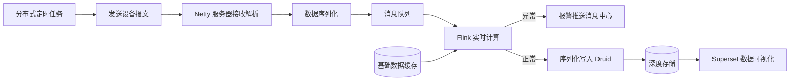

# 任务流程图：一条设备报文从发送到报表的完整旅程

用例图回答了系统给谁用，但组件之间的数据怎么流动、每个环节的职责边界在哪，还要靠任务流程图。架构图是静态的，只说有哪些组件；任务流程图是动态的，把系统里每个环节要做的事情标出来，并标出先后关系。day1 用一张任务流程图把后面几天要写的代码串成一条线，看懂它，每天开工前就知道自己写的那块代码站在链路的哪一站。

## 先给结论

- 主链路一句话：定时任务模拟设备发送报文，Netty 服务器接收并解析，序列化后送进消息队列，Flink 消费队列并结合缓存里的基础数据做实时计算，异常走报警推送消息中心，数据流向序列化后写入 Druid 实时分析，最终落到深度存储，分析结果由 Superset 在页面可视化展示。
- 报文的接收、解析、序列化三件事都压在 Netty 这一站，它对多线程 NIO 编程的支撑是扛住大量设备连接的关键，课程后面有专门章节讲这块代码。
- Flink 是第四代实时计算引擎，判定异常靠两路输入合流：消息队列里的实时数据，加缓存中的基础数据。
- 消息中心在流程图里标灰色，说明它不是系统核心，属于可替换的通知通道。
- 五个环节对应五个核心技术点：分布式定时任务、Netty、Flink、Apache Druid、Apache Superset，day1 记住这张对应表，后面几天按站认领代码。

## 一、全景图：两条流向，一个闭环

任务流程图把设备到报表的旅程画成一条链，中间在实时计算处分出两条流向：



关键路径有两条。**报警流**：实时计算发现设备异常，把报警发到消息中心，由它通知人。**分析流**：实时计算的数据序列化后写入 Druid 做联机实时分析，分析结果进深度存储，可视化层从存储里取数出报表。两条流共享前半段（采集与队列），在计算节点分道，各自服务「当下告警」与「事后分析」两个目的。基础数据缓存不在这条主链上，它站在实时计算旁边供数据，角色的分量却不小，下一节会讲到。

## 二、逐站拆解：每一站做什么、用什么做

**第一站，报文发送，用分布式定时任务模拟。** 教学环境里没有真实的温湿度设备，课程用分布式定时任务按 cron 表达式定时构造报文发往服务端，模拟设备上报。定时任务在工程里是可管理的档案，任务实体长这样：

```java
package com.study.coldchain.common.job.entity;

@Data
@TableName("schedule_job")
public class ScheduleJobEntity implements Serializable {
    @TableId
    private Long jobId;
    @NotBlank(message = "bean名称不能为空")
    private String beanName;       // 要执行的 spring bean 名称
    private String params;         // 任务参数
    @NotBlank(message = "cron表达式不能为空")
    private String cronExpression; // 调度周期
    private Integer status;        // 任务状态
    private String remark;         // 备注
}
```

任务指向一个 Spring bean，配上 cron 与参数，调度引擎按 `cronExpression` 周期触发。分布式的意义在于任务可多实例分摊、可暂停可恢复。生产环境把这一站换成真实设备，报文照发，链路其余部分原样复用。

**第二站，接收与解析，由 Netty 承担。** 设备侧的报文是自定义文本格式，构造逻辑在报文实体里：

```java
// 设备报文：竖线分隔的定长结构，SHT 开头，版本串结尾
public String deviceMessage() {
    StringBuffer sb = new StringBuffer();
    sb.append("SHT");
    sb.append("|").append(this.getMetercode()); // 设备编码
    sb.append("|").append(this.getTem());       // 温度
    sb.append("|").append(this.getHum());       // 湿度
    sb.append("|").append(this.getState());     // 设备状态
    sb.append("|").append(this.getLon());       // 经度
    sb.append("|").append(this.getLat());       // 纬度
    sb.append("|").append(this.getCurtime());   // 上报时间
    sb.append("|").append("SH5lb1.2.1R");
    return sb.toString();
}
```

服务端要面对的是成百上千台设备的长连接，这正是 Netty 的主场：多线程加 NIO 的编程模型让它能用少量线程管理大量并发连接，编解码器把字节流按报文格式还原成结构化数据。报文接收、解析、序列化三步都在这一站完成，day3 的数据采集服务会专门展开这里的代码。

**第三站，序列化入队，采集与计算解耦。** 解析出的数据做序列化后发送到消息队列，工程里序列化用 Java 原生机制封装成工具：

```java
package com.study.coldchain.common.utils;

public class SerializeUtil {
    public static byte[] serialize(Object object) {
        ByteArrayOutputStream baos = new ByteArrayOutputStream();
        ObjectOutputStream oos = new ObjectOutputStream(baos);
        oos.writeObject(object);
        return baos.toByteArray();
    }

    public static Object unserialize(byte[] bytes) {
        ByteArrayInputStream bais = new ByteArrayInputStream(bytes);
        ObjectInputStream ois = new ObjectInputStream(bais);
        return ois.readObject();
    }
}
```

对象变字节数组，进队列、出队列、落存储都能统一搬运。消息队列在这一站的价值是削峰与解耦：设备上报的节奏不可控，计算的消费能力有限，队列在中间吸收波动，两端按自己的节奏工作。

**第四站，实时计算，Flink 两路输入合流。** Flink 一方面从消息队列接收实时数据，另一方面从缓存取基础数据，两者结合做实时计算：拿设备的当前采集值与缓存里的阈值档案比对，判断哪台设备状态异常。基础数据缓存就是全景图里那根旁路，工程里由 Redis 工具类支撑，设备档案与阈值常驻缓存，计算节点不必为每条数据回查数据库。异常即报警，报警发到消息中心；正常数据走另一条流向，序列化后写入实时分析系统。

**第五站，实时分析与可视化，Druid 加 Superset。** Druid 面向大数据的 OLAP 联机实时分析，按时间与维度组织数据，任意时间范围的温湿度统计都能快速聚合，最终数据存到深度存储做长期归档。实时统计分析的结果通过 Apache Superset 以数据可视化的方式在页面展示，工作台、曲线、报表都从这里取数。

## 三、异常分支与设计边界

流程图上的异常分支只有一条：判定异常，推送消息中心。三点设计边界值得记牢。**判定在计算层，不在存储层**，异常是拿实时数据与缓存阈值比对的瞬时结论，等数据落库再扫表就慢了。**消息中心刻意标灰**，课件明确它不是系统核心：通知通道是短信、邮件还是第三方推送，随业务环境替换，核心链路只负责把「某设备异常」这个事件投递出去，通道与链路解耦。**报文发送是模拟件**，这一站是教学脚手架，考核的是链路其余四站的真实实现，面试或评审时要把这层窗户纸说破。

## 常见误区

- **把任务流程图与数据流程图混为一谈。** 错例是以为同一张图换个名字。正解是任务流程图讲节点职责与先后关系，数据流程图讲数据形态如何变化，课件里两图相邻正好对照着读。
- **以为设备真的在线发报文。** 错例是把模拟发送当成真实设备接入，讨论起设备固件。正解是报文发送由分布式定时任务按 cron 模拟，生产上替换为真实设备，链路不变。
- **把消息中心当核心组件自研。** 错例是给消息中心设计复杂的存储与流程。正解是它就是灰色标识的通知通道，核心链路投递事件，通道可整体替换。
- **以为 Netty 只负责收字节。** 错例是把解析、序列化扔给后续环节，导致采集服务边界模糊。正解是接收、解析、序列化三步都压在 Netty 这一站完成，产出结构化数据再入队。
- **忽略基础数据缓存这根旁路。** 错例是以为 Flink 只消费消息队列就能判定异常。正解是阈值与设备档案从缓存来，两路输入合流才有判定，缓存缺失时判定要么失准要么回查数据库拖慢链路。

## 面试可能被问到的问题

1. 面试官追问：「任务流程图和数据流程图的区别是什么？」
   答：任务流程图以系统环节为单位，标出每个环节做什么、先做什么后做什么，强调职责与顺序；数据流程图以数据为单位，描述数据从什么形态变成什么形态、流经哪里。前者用来划分代码模块，后者用来设计存储与序列化。
2. 面试官追问：「报文为什么用 Netty 接收，特点是什么？」
   答：设备走 TCP 长连接自定义文本协议上报，Netty 的多线程加 NIO 模型能用少量线程管理大量并发连接，编解码器正好承接自定义报文的拆包解析。接收、解析、序列化在这一站完成后入队，采集服务的边界清晰。
3. 面试官追问：「为什么用分布式定时任务模拟报文发送？」
   答：教学环境没有真实设备，需要可控、可调度、可多实例的发送源。定时任务档案里有 bean 名称、cron 表达式与参数，按周期构造报文发出，还能暂停恢复。生产环境换成真实设备上报，链路其余环节不受影响。
4. 面试官追问：「Flink 做异常判定需要哪些输入？」
   答：两路合流：一路是消息队列里的实时采集数据，含设备编码、温湿度值、位置；另一路是缓存中的基础数据，含设备档案与温湿度阈值。拿实时值与阈值比对得出高温、正常、低温等状况，异常即产生报警事件推送消息中心。
5. 面试官追问：「消息中心在流程图里为什么标灰色？」
   答：灰色表示它不是系统核心，属于可替换的通知通道。核心链路的职责是把异常事件投递出去，具体走短信、邮件还是第三方推送由消息中心决定，替换通道不影响采集、计算与存储，这是把易变部分与稳定部分解耦的常见手法。
6. 面试官追问：「Druid 和深度存储在链路里怎么分工？」
   答：Druid 承接实时分析的读写，面向 OLAP 做按时间与维度的快速聚合，服务报表的即时查询；深度存储做长期归档，容量大成本低，供历史回溯与批处理。实时结果先进 Druid，沉淀数据归深度存储，时效与成本各取所长。

## 配套资料

- 代码：`materials/code/06/day1 背景介绍与系统介绍/`，公共组件工程 `cold-common` 为真实随包代码：`job` 包的 `ScheduleJobEntity` 对应定时任务模拟发送，`netty` 包 `MessageEntity` 的 `deviceMessage` 对应报文构造，`utils` 包的 `SerializeUtil` 与 `JedisUtil` 对应序列化与基础数据缓存，文中代码按该工程整理，包名统一改写为 `com.study.coldchain`。
- 说明：引用路径截至 `materials/code/06/` 的 day 目录层级，工程内层目录含项目原名，不写入博客；任务流程图的节点与流向按本讲课件画面整理，消息中心的灰色标识、Flink 两路输入与 Druid 深度存储的描述按课件讲解整理。
