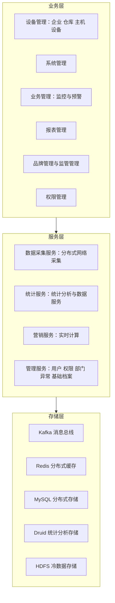

# 系统架构图：从业务视角拆解冷链监控平台的三层骨架

拿到一个陌生系统，多数人的第一反应是问「用了什么技术」，这个顺序其实是反的。技术选型是答案，不是问题；真正要先弄清的是这个系统有哪些功能、功能之间怎么分组、每组功能由谁来承载。系统架构图回答的就是这一层，它还有个别名叫业务架构图，day1 用它把整个平台拆成了业务层、服务层、存储层三层骨架。

## 先给结论

- 系统架构图即业务架构图，从业务角度描述功能组成，与具体实现无关；换一套技术栈，这张图一个字都不用改。
- 业务层六组功能：设备管理、系统管理、业务管理、监管管理、报表管理、权限管理。
- 服务层四个微服务：数据采集服务做分布式网络采集，统计服务做统计分析与数据服务，营销服务承载实时计算，管理服务兜住用户、权限、部门、异常与基础档案。
- 存储层五个角色各管一类数据：Kafka 消息总线、Redis 分布式缓存、MySQL 分布式存储、Druid 统计分析存储、HDFS 冷数据存储。
- 冷热温数据的访问频率决定数据落在哪一层：极热进 JVM 内存，热数据进 Redis，常用数据进 MySQL，冷数据进 HDFS。

## 一、业务架构图为什么与实现无关

课程里用了汽车的类比。一辆车拆开是轮胎、发动机、方向盘、车门、底盘、空调，这是功能视角的系统架构；至于轮胎用哪个品牌、发动机用哪家厂商，属于具体实现，业务架构图不关心。检验一张系统架构图画得对不对，就看换掉某个具体实现之后，图是否原封不动：把 Redis 换成别的缓存、把 MySQL 换成别的数据库，功能分组与层间关系不该有任何变化。

这个视角对拆分功能清单是强约束。业务层画「报表管理」就够了，写「Echarts 报表」就越界了；服务层画「数据采集服务」就够了，写「Netty 采集服务」同样越界。技术与功能的分界线，正好是系统架构图与技术架构图的分界线。

## 二、三层骨架：业务层、服务层、存储层

把平台的业务功能按三层排开：



业务层的功能按使用对象分组：面向设备的硬件设备管理，面向运营的企业、仓库、主机、设备档案管理，面向监控的监控管理、报表统计与预警管理，再加上系统管理与权限管理这类平台自身的能力。这些功能不在业务层单独建系统，而是落到服务层的微服务里实现。

服务层是整张图的核心，四个服务按负载特征分工。数据采集服务是分布式网络服务，扛的是海量设备长连接；统计服务是统计分析的 OLAP 微服务，做的是多维聚合；营销服务是实时计算微服务，对外体现为预警能力，超温超湿的判断在这发生；管理服务覆盖用户管理、权限管理、部门管理、菜单管理与基础资料管理，是平台的地基功能。

存储层五个组件不是并列的五个数据库，而是五类角色：Kafka 是消息总线，承接系统间数据传递；Redis 是分布式缓存，扛高频读写；MySQL 存业务档案与系统数据；Druid 是统计分析存储，面向时序聚合；HDFS 存冷数据，收留历史归档。

## 三、服务层落点：公共组件工程里的真实锚点

架构图上的每个服务，在 day1 的公共组件工程 `cold-common` 里都能找到对应的代码雏形。管理服务里的用户管理，实体已经定义好了：

```java
package com.study.coldchain.common.user.entity;

@Data
@TableName("sys_user")
public class SysUserEntity implements Serializable {
    @TableId
    private Long userId;        // 用户 ID
    @NotBlank(message = "用户名不能为空")
    private String username;    // 用户名
    @NotBlank(message = "密码不能为空")
    private String password;    // 密码
    private String salt;        // 盐，配合密码加密
    private Integer status;     // 状态 0：禁用 1：正常
    private Long createUserId;  // 创建者 ID
}
```

异常管理同样有落点，管理服务各接口的报错统一走自定义异常，错误码与消息由它承载：

```java
package com.study.coldchain.common.exception;

@Data
public class MyException extends RuntimeException {
    private String msg;          // 异常消息
    private int code = 500;      // 错误码，默认 500

    public MyException(String msg, int code) {
        super(msg);
        this.msg = msg;
        this.code = code;
    }
}
```

配合 `utils` 包里统一返回体 `Result`（正常返回 `code 0`，异常时带错误码与消息），管理服务的接口规范就齐了。基础档案这边，公司、仓库、主机、设备四张实体的归属链在开篇那篇已经见过：设备挂在主机下、主机挂在仓库下、仓库挂在公司下，管理服务的基础档案管理维护的正是这条链，业务层的监控与预警都要顺着它路由。

## 四、冷热温数据：存储层的分配逻辑

存储层为什么非要五种组件？课程给了一个生活化的类比：家里不常用的东西放储物箱，常用的放在顺手的地方，每天都要碰的干脆放在枕边。数据同理，区别只在访问频率。

极热的数据，也就是程序每时每刻都在读的，直接放 JVM 内存里，Java 程序随取随用，成本最低、速度最快；非常热的数据放 Redis，跨进程共享，毫秒级访问；常用数据放 MySQL，撑得住点查与事务；三年前、五年前、十年前的冷数据，查询频率和概率都很低，放进大数据平台的深度存储 HDFS，只需要提供一条查询途径，好处是存储成本极低。

这个分层反过来也解释了存储层的标注：Kafka 与 Redis 服务于「正在发生」的数据，MySQL 服务于「经常要查」的数据，Druid 服务于「要按时间与维度聚合」的数据，HDFS 服务于「很少再碰但不能丢」的数据。冷热温不是三种数据，是同一条数据生命周期的三个阶段：一条温湿度记录刚产生时在队列与缓存里是热数据，聚合沉淀后进 Druid 是温数据，过了保留期归档进 HDFS 就成了冷数据。

## 常见误区

- **把系统架构图画成技术架构图。** 错例是在业务架构里写 Spring Boot、Netty 这类具体技术。正解是业务层写功能、服务层写服务职责、存储层写数据角色，技术名词留到下一张图。
- **服务层只看见采集服务。** 错例是以为物联网平台只有接入这一件事。正解是四个服务同等重要，统计、实时计算、管理各有独立负载特征，拆开才能各自扩容。
- **所有数据一股脑进 MySQL。** 错例是拿一个库扛热数据、档案、历史归档。正解是按访问频率与查询形态分层，冷数据下放 HDFS，在线库只留活跃数据。
- **认为业务层功能与服务层服务一一对应。** 错例是数着业务层有六组功能就要求服务层有六个服务。正解是业务层是功能视角的分组，服务层是部署视角的拆分，两组是多对多映射，报表管理落在统计服务，监控与预警落在营销服务。

## 面试可能被问到的问题

1. 面试官追问：「系统架构图和业务架构图是什么关系？」
   答：是同一张图的两种叫法。它从业务角度描述系统包含哪些功能、功能之间什么关系，与具体技术实现无关；判断标准是替换任何具体组件后图形不变。技术选型的内容属于技术架构图的范畴。
2. 面试官追问：「这个平台服务层为什么拆成四个服务？」
   答：按负载特征拆。数据采集服务扛海量设备长连接，统计服务扛多维聚合分析，营销服务扛实时计算与预警，管理服务扛事务型管理功能。负载不同，扩容节奏与故障隔离要求不同，拆开部署互不拖累。
3. 面试官追问：「冷数据、温数据、热数据怎么划分，分别存哪？」
   答：按访问频率划。极热数据放 JVM 内存随时取，热数据放 Redis 支撑毫秒级高频读，常用数据放 MySQL 支撑事务与点查，长期不访问的历史数据放 HDFS 深度存储压低成本，只保留查询途径。核心思想是让数据的存放位置匹配它的访问成本。
4. 面试官追问：「Kafka 为什么叫消息总线而不是消息队列？」
   答：队列是点对点的传递视角，总线是系统级的基础设施视角。采集、计算、存储、统计多个系统都挂在这根总线上收发数据，发送方不关心谁在消费，消费方不关心谁在投递，系统间通信统一经由它，所以叫总线。
5. 面试官追问：「统计服务为什么选 OLAP 型存储而不是 MySQL？」
   答：统计分析的查询模式是时间范围加维度聚合，数据量随采样点线性增长。Druid 这类 OLAP 存储面向高吞吐写入与聚合查询设计，按时间分区、任意维度组合毫秒级返回；MySQL 在亿级明细上做这类聚合，索引与 IO 都会失控。档案事务留 MySQL，时序分析进 OLAP，各司其职。

## 配套资料

- 代码：`materials/code/06/day1 背景介绍与系统介绍/`，公共组件工程 `cold-common` 为真实随包代码（30 余个 Java 文件）：`user` 包的 `SysUserEntity` 与令牌实体，`exception` 包的 `MyException`，`utils` 包的统一返回体 `Result`，`admin` 包的公司、仓库、主机、设备档案实体；文中两段 Java 代码按该工程整理。
- 说明：引用路径截至 `materials/code/06/` 的 day 目录层级；工程内包名含机构前缀，正文统一改写为 `com.study.coldchain`；三层骨架与服务职责按本课系统架构图的画面与讲解整理，冷热温数据概念按本课讲解归纳。
