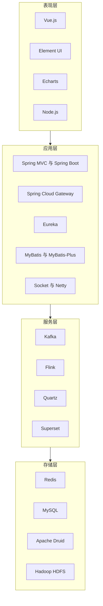

# 技术架构图：每一层用什么技术，以及为什么是它

系统架构图定下了功能清单，落地前还差一张图：同样的功能，可以用不同的技术组合实现，为什么偏偏是这一套？技术架构图把选型按层排开，每一项都给得出理由。看懂这张图的标准不是背组件名，而是能回答「换成别的行不行、为什么不用别的」。

## 先给结论

- 表现层用 Vue.js 加 Element UI、Echarts，Node.js 提供工程化构建；框架的价值是把组件与中间过程封装好，用卡车运沙子，而不是用手搬。
- 应用层是 Spring Boot 体系：Spring MVC 承接接口，Spring Cloud Gateway 做网关，Eureka 做注册发现；ORM 层用 MyBatis 与 MyBatis-Plus 做表到实体的映射；设备接入靠 Socket 与 Netty 建 TCP 长连接。
- 服务层四个中间件四个岗位：Kafka 管解耦与高并发数据传输，Flink 管实时计算，Quartz 管分布式定时任务，Superset 管报表可视化。
- 存储层四类存储四种性格：Redis 存缓存与实时数据，MySQL 存档案数据，Apache Druid 既是存储又是 OLAP 分析服务，HDFS 是最终深度存储。
- 选型原则：流行且经过验证的技术优先；衡量架构是否合理，看系统间关系是否融洽、技术与负载是否匹配。

## 一、从业务架构到技术架构：换一张视角

系统架构图回答「有哪些功能」，技术架构图回答「用什么技术实现这些功能」，实现同样要分层，每层的技术点连起来就是技术架构图。功能从上到下逐层被翻译：页面功能翻译成前端框架，接口与管理功能翻译成应用框架与 ORM，计算能力翻译成流处理引擎，数据翻译成四种存储。两图对照着看，业务层每个功能块都能在技术架构里找到承接者。



## 二、表现层：框架换来的开发效率

前端选了 Element UI 做组件库，Echarts 画报表图表，Vue.js 加 Node.js 撑起整个前端开发框架。这套组合不是唯一解：直接写 HTML 加 Ajax 调后端接口，一样能把页面做出来。选框架的理由是效率，课程里的类比很直白：把一堆沙子从甲地运到乙地，开车能到，用手搬也能到，差别在时间与力气。Element UI 把表格、表单、弹窗这些通用组件封装好了，Echarts 把坐标系、图例、交互封装好了，Node.js 把依赖管理与打包流程工程化了，中间过程不用重造，开发速度自然快。

这个逻辑反过来也是选型的检验法：任何一个新组件进架构图之前，先问它替你封装了什么、省了多少事。答不上来的，就是多余的依赖。

## 三、应用层：Spring Boot 体系与 ORM 的位置

应用层的选型最容易引发「能不能不用」的追问。不用 Eureka、换个注册中心行不行？不用 Spring Boot、退回 SSM 行不行？都行。选 Spring Cloud 体系的关键理由是流行本身：流行意味着经过大量项目验证，选型思路有据可查，常见的坑早已被前人踩过并修复，代码出问题的概率更低。

ORM 这一层的概念要先说清。ORM 即对象关系映射，一边是 MySQL 里的表结构，一边是 Java 实体对象，ORM 在两者之间做映射，让开发者以对象的方式操作表，这就是数据访问层的开发。项目里用的是 MyBatis 加 MyBatis-Plus，前者提供灵活的 SQL 映射，后者在它之上补齐通用增删改查。Socket 与 Netty 是应用层里专门做网络开发的两个组件，设备侧不走 HTTP，靠它们建立 TCP 长连接、收发自定义报文。

这些选型不是 PPT 上的口号，公共组件工程的 `pom.xml` 里逐一可见（按工程整理，包名已改写）：

```xml
<groupId>com.study.coldchain</groupId>
<artifactId>cold-common</artifactId>
<parent>
    <groupId>org.springframework.boot</groupId>
    <artifactId>spring-boot-starter-parent</artifactId>
    <version>2.1.8.RELEASE</version>
</parent>
<dependencies>
    <!-- 应用层：Web 接口能力 -->
    <dependency>
        <groupId>org.springframework.boot</groupId>
        <artifactId>spring-boot-starter-web</artifactId>
    </dependency>
    <!-- ORM：MyBatis-Plus 做对象关系映射 -->
    <dependency>
        <groupId>com.baomidou</groupId>
        <artifactId>mybatis-plus</artifactId>
        <version>3.0.7.1</version>
    </dependency>
    <!-- 服务层：Kafka 客户端，对接消息总线 -->
    <dependency>
        <groupId>org.springframework.kafka</groupId>
        <artifactId>spring-kafka</artifactId>
        <version>2.1.0.RELEASE</version>
    </dependency>
    <!-- 存储层：Redis 缓存客户端 -->
    <dependency>
        <groupId>org.springframework.boot</groupId>
        <artifactId>spring-boot-starter-data-redis</artifactId>
    </dependency>
</dependencies>
```

选型落到工程里的下一步是连接配置，服务启动时按约定指向各中间件（按本课写法补全的示例）：

```yaml
spring:
  kafka:
    bootstrap-servers: kafka1.example.com:9092
    consumer:
      group-id: coldchain-compute
  redis:
    host: redis1.example.com
    port: 6379
mybatis-plus:
  mapper-locations: classpath:mapper/*.xml
```

## 四、服务层与存储层：每个组件的岗位说明

服务层四个组件，Kafka 的职责有两个：一是系统之间做解耦，二是支撑高并发的数据传输，设备上报的洪峰先由它顶住。Flink 是实时计算模块的核心，告警判断与实时统计都压在它身上。Superset 是数据可视化的报表平台，报表页面的底层由它出数。Quartz 承担分布式定时任务，在这个平台里有个特殊的用途：模拟硬件设备定时发送报文数据，让开发环境也能持续产生数据、观测异常场景，不用真接一台冷库设备。

存储层四类存储的性格差异，决定了数据各归各位。Redis 是缓存层，存监控指标和系统管理里的公司、设备这类高频读取数据，实时数据也在这里；MySQL 存公司、设备等档案类业务数据；Apache Druid 有双重身份，既是数据存储，又是提供 OLAP 实时统一分析的服务；HDFS 是深度存储，全系统的数据最终归宿。

## 五、选型的分寸：合理比先进更重要

整张技术架构图传递的方法论，比组件清单更有价值。同一层永远存在替代方案，前端可以不用 Vue 体系，后端可以不用 Spring Cloud，选与不选的判据是两条：系统与系统之间的关系是否融洽，也就是组件间的耦合是否清晰、边界是否干净；系统使用的技术是否合理，也就是技术的强项是否正对这条链路的负载特征。设备接入选 Netty 是因为它扛长连接，实时计算选 Flink 是因为它对延迟敏感，时序分析选 Druid 是因为它聚合快，每一项都是负载与技术的一一对位，而不是追逐版本号上的新。

## 常见误区

- **把技术架构图当组件堆砌清单。** 错例是只罗列组件名，说不出每个组件替系统解决什么。正解是每个技术点配一句选型理由，说不出的先移出架构图。
- **把 ORM 等同于 MyBatis-Plus。** 错例是以为 ORM 是某个具体框架的名字。正解是 ORM 是对象关系映射的思想，MyBatis 与 MyBatis-Plus 是这一思想的具体实现，后者提供更强的通用能力。
- **混淆两个都叫 Druid 的东西。** 错例是看到工程里引入 `druid-spring-boot-starter` 就以为接入了分析引擎。正解是那个依赖是数据库连接池，架构图里的 Apache Druid 是时序 OLAP 存储引擎，重名而已，角色完全不同。
- **Quartz 当成普通的后台定时器。** 错例是以为它只做每天凌晨跑批。正解在项目里它是分布式定时任务，还承担模拟设备发报文的数据源职责，开发环境的整条链路靠它喂料。

## 面试可能被问到的问题

1. 面试官追问：「技术架构图和系统架构图分别解决什么问题？」
   答：系统架构图从业务视角列出功能与服务划分，回答「做什么」；技术架构图把每层功能翻译成具体技术，回答「用什么做」。两图上下对齐，业务层的每个功能块都能在技术层找到承接组件，这才算架构闭环。
2. 面试官追问：「前端直接用 HTML 加 Ajax 也能实现，为什么还要上 Vue 加 Element UI？」
   答：功能上确实都能实现，差别在效率与质量。框架把通用组件、图表库与工程化流程封装好，开发不必重造轮子，页面一致性与可维护性也更有保障。这本质是用工具换时间的选择，与项目规模和迭代节奏匹配即可。
3. 面试官追问：「为什么选 Spring Cloud 体系而不是更轻的 SSM？」
   答：SSM 也能实现功能，但 Spring Cloud 经过大量项目验证，生态成熟，常见问题都有现成方案，出问题的概率更低。注册中心、网关、服务拆分在体系内有对应的成熟组件，微服务治理不用从零搭，试错成本低。
4. 面试官追问：「ORM 解决什么问题？MyBatis 和 MyBatis-Plus 是什么关系？」
   答：ORM 做数据库表结构与 Java 实体对象之间的映射，让开发者面向对象操作数据而不是手拼 SQL 结果集。MyBatis 提供灵活的 SQL 映射能力，MyBatis-Plus 在其之上封装通用增删改查与分页等能力，项目里两者配合使用。
5. 面试官追问：「Quartz 在这个项目里起什么作用？」
   答：它是分布式定时任务组件，在本平台里主要用来模拟硬件设备按周期发送报文，让没有真实冷库设备的开发与测试环境也能持续产生数据，验证从接入、计算到告警的整条链路。
6. 面试官追问：「怎么判断一个系统的技术架构合不合理？」
   答：看两条，一是系统与系统之间的关系是否融洽，组件边界清晰、耦合可控；二是各层技术与负载是否匹配，接入、计算、存储各自用了对口的技术强项。满足这两条，选型新一点旧一点都是合理的。

## 配套资料

- 代码：`materials/code/06/day1 背景介绍与系统介绍/`，公共组件工程 `cold-common` 的 `pom.xml` 为真实随包配置，含 `spring-boot-starter-web`、`spring-kafka`、`mybatis-plus`、`spring-boot-starter-data-redis`、`jedis`、`druid-spring-boot-starter`、`fastjson` 等依赖，与四层技术架构一一对应；`job` 包的 `ScheduleJobEntity` 是 Quartz 定时任务实体；文中 `pom.xml` 片段按该工程整理，`application.yml` 为按本课写法补全的连接配置示例。
- 说明：引用路径截至 `materials/code/06/` 的 day 目录层级；工程内包名与 groupId 含机构前缀，正文统一改写为 `com.study.coldchain`；四层技术清单与选型理由按本课技术架构图的画面与讲解整理。
