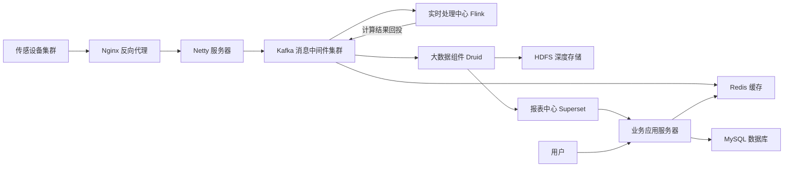

# 物理部署图：从传感器到报表中心，系统落在哪些机器上

只写得出业务代码，不等于了解系统。初中级开发把功能做出来确实够用，可一旦要排查线上问题、评估扩容、定位某台机器的故障影响面，就必须回答另一个维度的问题：这套系统部署在哪些服务器上、每台机器跑什么、机器之间按什么关系连接。物理部署图回答的就是这最后一问，它也是 day1 架构四图的收官。

## 先给结论

- 部署链路十站接力：传感设备经 Nginx 反向代理进入 Netty 服务器，Netty 开数据端口收报文并转成 JSON 推进 Kafka；Flink 消费队列做阈值判断，结果回投 Kafka 由 Druid 监听入库，最终深度存储到 HDFS；Superset 监听 Druid 出报表，业务应用系统查 MySQL 与 Redis 完成展示。
- Nginx 在设备接入里的职责是反向代理与转发，Netty 服务器专注报文处理，两者分开让接入层可以独立扩容。
- 每一层都是集群：消息中间件、实时处理中心、数据分析中心、报表中心、应用服务器全部支持水平扩展。
- 开发环境用分布式定时任务模拟设备发报文，拓扑与生产同构，端口与网络约定要在开工前定死。

## 一、部署视角回答开发视角答不了的问题

代码写得再好，也回答不了「Kafka 挂一台节点，数据会不会丢」「报表变慢，瓶颈在报表中心还是数据库」这类问题。要深挖系统，得把五个维度凑齐：业务是什么结构、用了哪些技术、数据从哪流到哪、核心任务是什么、系统怎么部署。前四个维度分别由业务图、技术架构图、数据流程图、任务流程图覆盖，部署图补上第五块：服务器有几台、每台跑什么、彼此什么关系。掌握到这个程度，整个系统才算装进脑子。

## 二、部署拓扑：一张图看机器落位

按物理部署图把链路画出来：



顺着一条报文走一遍。前端的大量传感设备提交温湿度报文，先到 Nginx，由它反向代理转发给 Netty 服务器；Netty 服务器开通了专门的数据端口接收报文，并做数据转换，把设备侧的文本报文转成 JSON 格式，推送到 Kafka 队列。实时处理中心里的 Flink 监听队列，拿到数据先做逻辑判断：这是哪类数据、温度有没有超过上限或跌破下限，超了就是高温或低温。判断完的结果同样扔回 Kafka，由大数据组件 Druid 监听队列，把实时计算后的数据存储下来，数据最终深度存储进 HDFS。报表中心 Superset 监听 Druid 的数据生成报表，在业务应用系统里展示；应用系统自身的读请求，落在 MySQL 与 Redis 上。

这条链上有两个容易被略过的设计。其一，Flink 的计算结果不直接写 Druid，而是回投队列再由 Druid 消费，实时处理中心与数据分析中心之间没有直连，各自扩容互不影响。其二，Superset 与应用系统都不碰原始队列，前者只读 Druid，后者只读 MySQL 与 Redis，读路径与写路径彻底分开。

## 三、端口与网络约定：开工前定死的细账

部署图落到工程上，第一笔细账是端口与网络。约定的原则是公网只暴露 Nginx 入口，设备侧与浏览器都从这里进来；Netty 的数据端口、Kafka、Redis、MySQL 等组件端口全部留在内网，组件之间走内网互联。端口数值按工程惯例取主流默认值（按本课部署图整理的示例约定）：

| 节点 | 端口 | 用途 |
|---|---|---|
| Nginx | 80 / 443 | 管理端 HTTP 对外入口 |
| Netty 服务器 | 7777 | 设备报文 TCP 接入，与 Nginx 转发目标一致 |
| Kafka | 9092 | 消息总线 |
| Redis | 6379 | 分布式缓存 |
| MySQL | 3306 | 档案与业务数据 |
| Superset | 8088 | 报表中心 Web 界面 |
| HDFS | 9000 | 深度存储 RPC |

采集服务一侧的连接配置把这些约定固化下来（按本课写法补全的示例）：

```yaml
server:
  port: 8081          # 采集服务管理接口端口
netty:
  server:
    port: 7777        # 设备报文接入端口，接收经 Nginx 转发的长连接
spring:
  kafka:
    bootstrap-servers: kafka1.example.com:9092
  redis:
    host: redis1.example.com
    port: 6379
```

设备侧的报文是 TCP 长连接，所以 Nginx 这层做的是传输层的代理转发，把设备的连接请求转给后端 Netty 服务器；管理端的 HTTP 请求则走应用层代理。一条入口两种转发，Nginx 挡在最前面，Netty 不用直接面对公网。

## 四、每一层都是集群：水平扩展写在图上

物理部署图与单机教程图最大的区别，是它默认每个环节都是集群。消息中间件、实时处理中心、数据分析中心、报表中心、应用服务器，任何一层都可以水平扩展：加机器、加实例，吞吐就往上抬。支撑这件事的前提是各层都没有单点依赖，Kafka 靠多节点分摊分区，Flink 靠增加并行实例提高并行度，应用服务器无状态、加挂负载均衡即可扩容。反过来理解部署图也成立：图上每个框都是一个可替换的集群角色，排障时先定位层，再定位层内节点。

## 五、没有真设备的环境，数据从哪来

部署链路要转起来，得有报文进来。开发与测试环境没有冷库设备，平台用分布式定时任务模拟硬件设备定时发送报文，公共组件工程里的调度实体就是它的落点：

```java
package com.study.coldchain.common.job.entity;

@Data
@TableName("schedule_job")
public class ScheduleJobEntity implements Serializable {
    @TableId
    private Long jobId;              // 任务 id
    @NotBlank(message = "bean名称不能为空")
    private String beanName;         // 要执行的 Spring bean 名称
    private String params;           // 任务参数
    @NotBlank(message = "cron表达式不能为空")
    private String cronExpression;   // cron 表达式，控制发送周期
    private Integer status;          // 任务状态
}
```

任务的执行体指向一个 Spring bean，cron 表达式控制发送节奏，跑起来之后整条链路就有持续的数据流，从 Nginx 进来到 Superset 出报表的每个环节都能被观测，异常数据场景也能按需制造。这也是验证部署拓扑是否打通的常规手段：不用等真设备到位，拓扑先跑通。

## 六、day1 收官：四张图合成一张地图

到这里，day1 的架构全景线闭环了。用例图站在用户视角回答系统能做什么，任务流程图把动作串成时间线，数据流程图盯住数据的来路与去处，系统架构图给出功能与服务的三层分组，技术架构图把每层落到具体技术，物理部署图最后落笔：一切落到机器、进程与端口上。六张图从抽象到具体逐层收窄，合起来就是这张系统的完整地图。day1 之后，day2 起进入微服务框架搭建，图上的每一个框，接下来都要变成真实的工程。

## 常见误区

- **部署图与架构图混为一谈。** 错例是画了系统架构就当部署图用，或者部署图里写满职责描述。正解是架构图讲职责分层，部署图讲机器、进程、端口与连接关系，两图各答一问。
- **设备直连 Netty，省掉代理层。** 错例是让传感器的连接直接打到 Netty 端口。正解是 Nginx 挡在前面做反向代理与转发，Netty 隐藏在内网，只管报文处理，接入层也因此能平滑扩容。
- **把所有组件画成单点。** 错例是每个组件只画一个框，任何一处故障全场停摆。正解是按部署图把各层画成集群并标注可水平扩展，扩容与容灾设计才有落点。
- **端口与网络约定临场发挥。** 错例是开发、测试、生产各定一套端口，联调时对不上账。正解是开工前把端口表与网络边界定死并写进配置，环境之间只换地址不换约定。

## 面试可能被问到的问题

1. 面试官追问：「一条设备报文从物理链路上要经过哪些节点？」
   答：设备先连到 Nginx，由它反向代理转发给 Netty 服务器；Netty 在专用端口收报文并转成 JSON 推进 Kafka；Flink 消费队列做阈值判断，结果回投队列；Druid 监听队列入库并最终深度存储到 HDFS；Superset 监听 Druid 出报表，业务应用系统查 MySQL 与 Redis 做展示。
2. 面试官追问：「为什么设备接入要经过 Nginx，不让它直连 Netty？」
   答：Nginx 做反向代理与转发，把公网入口收敛到一处，Netty 隐藏在内网专注报文处理；接入侧要扩容时由 Nginx 分流到多台 Netty 实例，还可以做连接数控制与健康检查。没有这层，接入能力被单台 Netty 锁死。
3. 面试官追问：「哪些层可以水平扩展，依据是什么？」
   答：消息中间件、实时处理中心、数据分析中心、报表中心、应用服务器都可以水平扩展。依据是各层都解除了单点依赖：队列靠多节点分摊分区，流处理靠并行实例，无状态应用加节点加负载均衡即可，层与层之间都经队列或明确接口解耦，扩容不牵连相邻层。
4. 面试官追问：「开发环境没有真实冷库设备，怎么验证整条链路？」
   答：用分布式定时任务模拟设备按周期发送报文，任务的执行体与 cron 表达式都配置在调度实体里，跑起来后链路持续有数据，从接入到报表每个环节都能观测，还能定向制造超温数据验证告警。
5. 面试官追问：「Netty 服务器为什么单独开一个数据端口？」
   答：设备报文走的是自定义 TCP 协议，与管理端 HTTP 流量协议不同、负载特征也不同。单独开端口让报文通道与业务接口在传输层就分开，互不挤占，防火墙与 Nginx 转发规则也能按端口精确放行。

## 配套资料

- 代码：`materials/code/06/day1 背景介绍与系统介绍/`，公共组件工程 `cold-common` 为真实随包代码：`job` 包的 `ScheduleJobEntity` 与 `ScheduleJobLogEntity` 是分布式定时任务及其日志实体，`netty` 包的 `MessageEntity` 定义设备报文与接入字段；文中 Java 代码按该工程整理，端口表与 `yaml` 配置为按主流默认值与本课部署图整理的示例约定。
- 说明：引用路径截至 `materials/code/06/` 的 day 目录层级；工程内包名含机构前缀，正文统一改写为 `com.study.coldchain`；部署拓扑与数据流向按本课物理部署图的画面与讲解整理，端口数值为示例约定。
