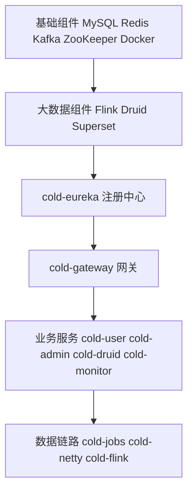

# 系统环境和服务：程序工作在哪里，要装些什么

「在我本地明明是好的」，这类争论的根子多半是环境没有制度化。环境就是程序工作的地方，代码从写完到见到真实用户，中间要换好几个工作场地，每个场地的使用者、目的、验收标准都不一样。场地没定好就开写，联调、测试、上线每一环都会出对不上账的事故。场地之外还有一份装机清单：平台的服务分三类，先装谁后装谁，心里要有数。

## 先给结论

- 五个环境是一条流水线：本地环境供开发日常使用，开发环境做联调，测试环境做功能与性能验证，UAT 环境给业务做上线前确认，生产环境面向真实用户。
- 环境数量取决于企业实力，可以裁剪，但每砍掉一级，风险就往生产多挪一步。
- 平台的服务分三类装机：基础组件、大数据组件、业务应用，装机的顺序就是这三类。
- 八个微服务的端口在工程配置里约定好，环境之间只换地址不换端口。

## 一、五个环境：程序工作的地方

**本地环境** 是开发人员自己的笔记本或台式机，代码变化最快，随时改随时跑，只保证自己那一段逻辑成立。

**开发环境** 是团队联调的场地。本地自测通过只代表单人成立，一个小组甚至多个小组的代码合在一起，接口对不对得上，要把程序部署到开发环境才知道。它面向开发人员，部署频率极高。

**测试环境** 由测试人员掌控。功能测试、性能测试、安全测试都在这里做，所有功能达到预期目标后，代码才能往下一级走。

**UAT 环境** 也叫准生产环境，用户是最终的业务人员或客户。他们按真实业务场景做功能验证，确认符合要求，程序才被部署到生产环境。

**生产环境** 面向真实用户，这一级的每一次变更都要走发布规范，出问题的代价直接体现在业务上。


每一级换一次负责人，验证目标也从「我写的逻辑成立」逐级放大到「业务要求达成」。现实里不少企业没有这么齐全：有的只有本地加测试环境，测完直接上生产；更简陋的连测试环境都没有，本地联调通过就上线。这不是对错问题，是实力问题，但裁剪掉的每一级验证，等于把对应的风险挪给了生产。

## 二、三类服务：装机清单

**基础组件** 是所有程序的地基：MySQL 存档案数据，Redis 存缓存与实时指标，Kafka 做消息总线，ZooKeeper 做协调，Docker 承载容器化组件，JDK 是 Java 程序的运行底座。这层的特征是稳定压倒一切，装好之后很少动，程序要用它们才有功能。

**大数据组件** 是 Apache Flink、Apache Druid、Superset 这一类，同样要提前装好，程序才能在上面跑、才能用相应功能。它们和 MySQL 的差别不在「是不是数据库」，而在资源消耗与运维复杂度：普遍吃内存、按集群方式部署、各自有一套专业体系，复杂度明显更高。实力强一点的公司会配专门的大数据运维团队来管这一层。

**业务应用** 是自己开发的系统，冷链监控平台的八个微服务全部属于这一类。它们的部署依赖前两类的就位：中间件不在线，服务起不来；大数据组件不在线，实时计算与报表就是空谈。

## 三、服务清单与端口表

端口是全局约定，写在每个服务的配置里。以 cold-user 工程的真实配置为例：

```yaml
server:
  port: 8185            # 服务端口，八个服务互不重复

spring:
  application:
    name: cold-user     # 注册到注册中心的服务名
  profiles:
    active: dev         # 环境开关，环境之间只换地址类配置
```

八个业务服务的端口约定整理如下（数值取自工程真实配置）：

| 服务 | 端口 | 职责 |
|---|---|---|
| cold-eureka | 8001 | 服务注册中心 |
| cold-gateway | 8080 | 网关统一入口 |
| cold-admin | 8181 | 业务管理与系统管理 |
| cold-druid | 8182 | 历史数据查询 |
| cold-monitor | 8183 | 实时数据查询 |
| cold-jobs | 8184 | 任务调度与设备模拟 |
| cold-user | 8185 | 用户服务 |
| cold-netty | 8186 | 设备报文接收 |

地址类配置按环境分文件。cold-netty 的 dev 配置里，注册中心与 Kafka 的地址一目了然（域名按约定脱敏）：

```yaml
# cold-netty 的 dev 环境配置（按工程真实配置整理，域名已脱敏）
eureka:
  client:
    service-url:
      defaultZone: http://eureka.example.com:8001/eureka

spring:
  kafka:
    bootstrap-servers: kafka1.example.com:9092
    listener:
      concurrency: 5        # 监听容器线程数，提高消费并发
    producer:
      retries: 3
    consumer:
      group-id: coldflink
```

端口固定、地址随环境换，是联调对得上账的前提。联调时连不上的根因，多数是两边的端口或地址约定不一致，而不是代码有问题。

## 四、启动顺序：按依赖排队

依赖关系决定顺序，把三类服务串成一条启动线：



关键路径是注册中心先于一切业务服务启动，因为服务起来第一件事就是注册；网关随后，它的路由发现依赖注册中心；业务服务就位后，数据链路服务最后拉起，报文一进来就能被完整消费。顺序错了不一定会失败，多数客户端带重试机制能自愈，但启动日志里会先刷一大片连接失败，排障时先核对启动顺序能省很多时间。

## 常见误区

- **环境之别只在于机器不同。** 错例是五个环境共用一份配置，靠口头记忆改地址。正解是用 profile 分文件管理，端口等约定保持一致，只替换地址类配置。
- **把 UAT 当测试环境二遍用。** 错例是测试没测完的逻辑放进 UAT 继续找缺陷。正解是 UAT 的使用者是业务人员，验证的是业务要求是否达成，不是继续暴露 bug。
- **端口临场起意。** 错例是新服务随手占一个没登记的端口，撞车后逐个排查。正解是端口属于全局约定，新增服务先查表再分配，登记成本远低于冲突排查成本。
- **大数据组件按普通软件对待。** 错例是装完 Flink 不规划内存与节点数就直接压测。正解是这类组件按集群思维规划资源与部署，必要时交给专门的运维团队。

## 面试可能被问到的问题

1. 面试官追问：「为什么要分这么多环境，本地测完直接上生产行不行？」
   答：功能上行得通，风险上不可控。本地验证只覆盖单人单机视角，联调、回归、性能、业务确认各有专门的场地与负责人，环境就是把验证过程制度化。环境少的企业不是不懂，是资源所限，砍掉的每一级都是往生产转移的风险。
2. 面试官追问：「UAT 环境和测试环境的区别是什么？」
   答：使用者与目的不同。测试环境由测试人员做功能、性能、安全验证，找的是缺陷；UAT 环境由业务人员或客户按真实业务场景确认功能是否符合要求，做的是上线前的业务验收。
3. 面试官追问：「你们的服务端口是怎么管理的？」
   答：全局约定写在各服务配置文件里，注册中心 8001、网关 8080，业务服务从 8181 排到 8186，环境之间只换中间件地址不换端口。新增服务先查约定再分配，避免冲突。
4. 面试官追问：「多环境配置在 Spring Boot 里怎么落地？」
   答：application.yml 放公共配置，spring.profiles.active 指定激活的环境，差异写进 application-dev.yml、application-prod.yml 这类文件，启动参数或配置中心都能切换激活的 profile。
5. 面试官追问：「服务启动顺序怎么排，乱了会怎样？」
   答：按依赖排，基础组件与大数据组件先就位，注册中心先于业务服务，网关随后，业务服务就位后数据链路服务最后拉起。顺序乱了多数靠客户端重试能自愈，但日志会大量报连接失败，拉长排障时间。

## 配套资料

- 代码：`materials/code/06/day2 微服务框架与基础服务/`，cold-eureka、cold-user 工程的 `application.yml` 与 cold-gateway 的 `application.yaml` 为真实配置，文中端口与服务名取自这些文件。
- 代码：`materials/code/06/day3 数据采集服务/`，cold-netty 的 `application-dev.yml` 是 dev 环境地址配置的真实样例，文中 Kafka 连接片段按它整理（域名按约定脱敏）。
- 代码：`materials/code/06/项目代码/`，全部微服务模块的完整配置，端口表可逐项核对。
- 说明：引用路径截至 day 目录层级；环境划分与三类服务清单按本课画面与讲解整理；示例域名统一用 example.com 占位。
