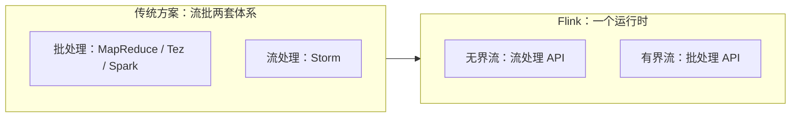
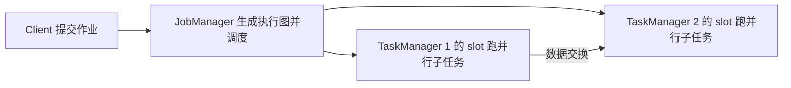
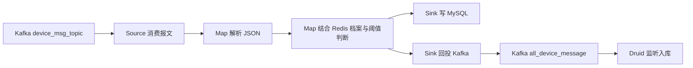

# Apache Flink 简介：流批一体的计算引擎，和它在冷链平台的岗位

冷库温度超标，告警晚十分钟就没有意义。定时跑批的计算方案最快也要等下一个调度周期，数据一进系统就开始算的流处理引擎，用武之地正在这里。平台选的是 Apache Flink，一个开源的分布式流处理框架，也是这套系统里实时温控计算的核心。

## 先给结论

- Flink 是第四代流处理计算引擎，用 Java 实现，基于同一个运行时（Flink Runtime）同时支持流处理与批处理，对外提供 DataStream 与 DataSet 两套 API。
- 统一的视角是关键：批处理被看作有界流，是流处理的特例。
- 核心能力：高吞吐低延迟高性能、事件时间窗口、有状态计算的 exactly-once 语义、背压、基于轻量级分布式快照的容错。
- 在冷链监控平台里，cold-flink 工程监听 Kafka 的设备报文、结合 Redis 档案做温湿度阈值判断，结果写 MySQL 供实时查询，回投 Kafka 供 Druid 入库。

## 一、流处理与批处理：从两套方案到一个运行时

传统的开源计算方案把流与批当成两种不同的应用类型。流处理关注低延迟和 exactly-once，即每条数据只生效一次的保证；批处理关注高吞吐、高效率。两类需求特征不同，实现上通常分别给出两套方案，或者各用一个独立框架：批处理一脉有 MapReduce、Tez、Spark，流处理一脉有 Storm。

Flink 的视角完全不同：它认为批处理是流处理的子集。作为流处理看待输入时，数据是无界的，永远算不完；批处理只是输入数据被定义成有界的特殊情况。一套运行时，两个 API，上层面向流与批的应用框架都建立在这两套 API 之上。



与 Spark Streaming 的对比可以放进同一个坐标系（按主流资料补充）：Spark Streaming 把流切成一个个小批次，本质是批的循环调度，延迟在秒级；Flink 是逐条处理的真流，延迟在毫秒级，窗口与状态语义也是为流而原生设计。课程画面里给的对标对象是 Storm，结论是 Flink 的速度比 Storm 更快，周边能力也更完整。

## 二、核心特性：为流而生的那几件武器

**吞吐与延迟** 两个指标在 Flink 里是同时要的：高吞吐、低延迟、高性能的流处理。

**窗口（Window）** 高度灵活，支持按 time、按 count、按 session 以及 data-driven 的窗口，还带事件时间语义，乱序数据也能按发生时间归窗。

**exactly-once** 建立在有状态计算之上：算子的中间状态对每条数据恰好生效一次，不多不少，故障恢复后结果仍然正确。

**背压（backpressure）** 让系统优雅降速：下游消费不过来时，流速的压力从下游往上游传导，上游自动放慢，而不是无声积压到崩溃。

**容错** 靠轻量级分布式快照实现，也就是 checkpoint。失败后从最近一次快照恢复，继续算。

**运行时自管理**：Flink 是跑在 JVM 里的 Java 程序，却在 JVM 内部实现了自己的内存管理，减轻 GC 压力；支持迭代计算；支持程序自动优化，避免特定情况下 Shuffle、排序这类昂贵操作，中间结果按需缓存。

容错并不是 PPT 上的口号，工程代码里一行就能对上号：平台 cold-flink 工程的主任务里有 `env.enableCheckpointing(5000)`，即每 5 秒做一次快照，配合固定延迟重启策略构成完整的容错方案。

## 三、运行时架构与算子（按 Flink 主流架构补充）

课程画面聚焦在特性清单上，运行时的角色分工按 Flink 主流架构补在这里。JobManager 是作业的大脑：作业提交后生成执行图、把算子拆成并行子任务去调度，并协调所有 checkpoint。TaskManager 是干活的工人：以 slot 划分资源，每个 slot 跑一个子任务，节点之间互相交换数据。



算子是组装逻辑的积木：source 取数、map 转换、keyBy 分区、window 开窗、sink 输出。用 day4 示例工程的一个真实小程序看算子怎么串（按 flink-demo 工程的 SocketWordCount 整理，包名已改写）：

```java
// 监听 socket 文本流，5 秒窗口统计单词数（按 SocketWordCount 整理）
DataStream<String> text = env.socketTextStream("localhost", 9000);

DataStream<WordWithCount> counts = text
        .flatMap(new FlatMapFunction<String, WordWithCount>() {   // 算子：分词
            public void flatMap(String s, Collector<WordWithCount> out) {
                for (String word : s.split("\\s")) {
                    out.collect(new WordWithCount(word, 1L));
                }
            }
        })
        .keyBy("word")                     // 算子：同一单词进同一并行子任务
        .timeWindow(Time.seconds(5))       // 算子：5 秒滚动窗口
        .reduce(new ReduceFunction<WordWithCount>() {   // 算子：窗口内聚合
            public WordWithCount reduce(WordWithCount a, WordWithCount b) {
                return new WordWithCount(a.word, a.count + b.count);
            }
        });

counts.print();
env.execute();
```

source、flatMap、keyBy、timeWindow、reduce、print，一条链从取数到输出，每个算子各司其职，这就是 Flink 编程的基本形态。

## 四、在冷链监控平台里的角色

cold-flink 工程的 `pom.xml` 里，生态结合的组件一目了然：`flink-connector-kafka_2.11` 连 Kafka，`flink-connector-redis` 连 Redis，`mysql-connector-java` 连 MySQL，Flink 版本为 1.8.0。这正是 Flink 生态支持的一个缩影：可跑在 YARN 集群上，也可以独立集群部署，对接 HDFS、Kafka、HBase、Elasticsearch、RabbitMQ、S3 等外部系统。

主任务的完整骨架（按 cold-flink 工程的 StreamingJob 真实代码整理，包名与地址已按约定改写）：

```java
public class StreamingJob {
    public static void main(String[] args) throws Exception {
        final StreamExecutionEnvironment env = StreamExecutionEnvironment.getExecutionEnvironment();

        // 容错：5 秒一次 checkpoint，失败按固定延迟重启 4 次
        env.enableCheckpointing(5000);
        env.getConfig().setRestartStrategy(RestartStrategies.fixedDelayRestart(4, 1000));

        // 数据源：Kafka 队列 device_msg_topic，cold-netty 写入的设备报文
        Properties props = new Properties();
        props.setProperty("bootstrap.servers", "kafka1.example.com:9092");
        props.setProperty("group.id", "coldflink");
        FlinkKafkaConsumer<String> consumer =
                new FlinkKafkaConsumer<>("device_msg_topic", new SimpleStringSchema(), props);

        // 解析报文，结合 Redis 档案做温湿度阈值判断
        DataStream<MessageEntity> stream = env.addSource(consumer)
                .setParallelism(1)
                .map(s -> JSON.parseObject(s, MessageEntity.class));
        DataStream<MessageEntity> out = stream.map(new MessageAggregate());

        // 结果两条出路：写 MySQL 供实时查询；回投 Kafka 供 Druid 监听入库
        out.addSink(new SinkToMySQL());
        out.map((MessageEntity m) -> JSON.toJSONString(m))
           .addSink(new FlinkKafkaProducer<>("all_device_message",
                   new SimpleStringSchema(), props));

        env.execute("冷链设备实时监控任务");
    }
}
```

报文从 Kafka 进来只是一条光秃秃的读数，设备名称、所属公司与仓库归属、温湿度上下限都存在 Redis 的设备档案里。MessageAggregate 这个算子先取档案再判断，核心逻辑（按真实代码整理）：

```java
// 温度阈值判断：报文温度与档案里的上下限比较，结论写回 temalert 字段
if (value.getTem() > value.getMaxtem()) {
    value.setTemalert(1);      // 高温
} else if (value.getTem() < value.getMintem()) {
    value.setTemalert(-1);     // 低温
} else {
    value.setTemalert(0);      // 正常
}
```

一条报文的完整旅程：



算完的结果分两路走：写进 MySQL 的实时指标表 `cz_message_realtime`，实时查询服务从这里读数给前台；回投 `all_device_message` 队列，Druid 监听入库后供历史分析。计算与存储之间依然靠队列解耦，与部署图的约定一致。

## 常见误区

- **Flink 只能做流处理。** 错例是以为批处理要另找框架。正解是批处理是有界流，同一运行时提供 DataSet API，流批共用一套容错与调度体系。
- **exactly-once 等于系统绝对不丢不重。** 正解是它保证的是 Flink 内部状态的语义；端到端不重取决于输出端。工程里 SinkToMySQL 用 replace into 按主键覆盖写库，重复写入结果一致，是朴素有效的幂等手段。
- **阈值判断字段不会出错。** 真实工程里出现过把温度上限写成湿度上限的笔误（tem 与 maxhum 串行），流计算上线前逐字段核对判断逻辑是必修课。
- **checkpoint 越频繁越安全。** 错例是把间隔压到几百毫秒。正解是快照本身有开销，5 秒一次是吞吐与恢复速度的折中，还要配合重启策略才算完整容错。

## 面试可能被问到的问题

1. 面试官追问：「Flink 和 Spark Streaming 的区别是什么？」
   答：Spark Streaming 把流切成微批，本质是批的循环调度，延迟在秒级；Flink 逐条处理真流，延迟在毫秒级，窗口、状态与时间语义为流处理原生设计。需要毫秒级告警的场景，Flink 更对口。
2. 面试官追问：「exactly-once 怎么理解，靠什么实现？」
   答：指每条数据对算子状态恰好生效一次，故障恢复后结果仍正确。实现依赖轻量级分布式快照，即 checkpoint 周期性地把算子状态与处理位置存下来，失败后从最近快照恢复；端到端不重还需要输出端配合幂等。
3. 面试官追问：「JobManager 和 TaskManager 各自干什么？」
   答：JobManager 负责生成执行图、调度并行子任务、协调 checkpoint，是作业的大脑；TaskManager 以 slot 划分资源，执行具体子任务并在节点间交换数据，是干活的工人。作业并行度由 slot 数量决定。
4. 面试官追问：「为什么说批处理是有界流？」
   答：流处理的输入数据无限延伸，永远算不完；批处理的输入是有限的静态数据集，相当于一条有终点、有界的流。Flink 把批当成流的特例，一套运行时同时承载两类计算。
5. 面试官追问：「背压是什么，Flink 怎么处理？」
   答：下游处理速度跟不上上游发送速度时，压力从下游向上游传导，Flink 通过网络栈让上游自动降低发送速率，避免数据无声积压到内存崩溃。Web UI 里能看到背压指标，用来定位慢算子。
6. 面试官追问：「Flink 在你们项目里承担什么？」
   答：监听 Kafka 的设备报文，结合 Redis 里的设备档案做温湿度阈值判断，算出高温低温结论；结果一份写 MySQL 供实时查询，一份回投 Kafka 由 Druid 监听入库做历史分析，容错靠 5 秒 checkpoint 加固定延迟重启。

## 配套资料

- 代码：`materials/code/06/day4 Flink基础与流数据处理/`，flink-demo 工程的 `SocketWordCount`、`StreamFromKafka` 等真实示例，算子链示例按 `SocketWordCount` 整理。
- 代码：`materials/code/06/day6 实时计算 - 冷眼项目实战/`，cold-flink 工程的 `StreamingJob`、`MessageAggregate`、`SinkToMySQL` 与 `pom.xml` 为真实代码（该目录名含项目代号，正文统一称冷链监控平台）。
- 代码：`materials/code/06/day1 背景介绍与系统介绍/`，netty 包的 `MessageEntity` 实体定义报文字段与温湿度阈值字段。
- 说明：引用路径截至 day 目录层级；运行时架构（JobManager、TaskManager）与 Spark Streaming 对比为按主流资料补充，课程画面以流批统一视角与特性清单为主；包名统一改写为 `com.study.coldchain`。
