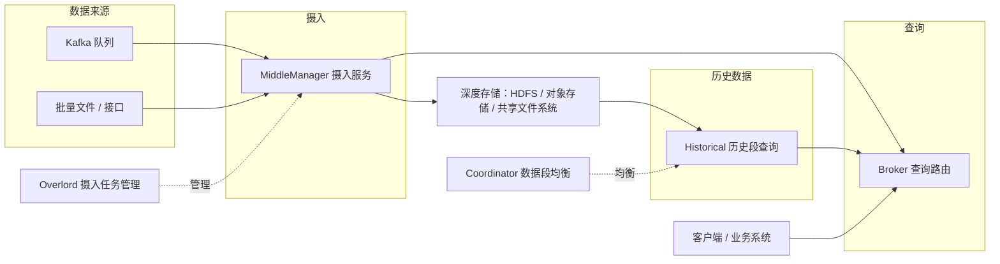

# Apache Druid 简介：海量时序数据为什么交给它

设备每十秒上报一次温湿度，一年下来就是几千万行流水；运营要的却是「过去一小时每个仓库的平均温度」「昨天超温次数最多的五十台设备」。这类查询在行式存储的 MySQL 上越跑越慢。冷链监控平台的技术架构里，这一层活由 Apache Druid 承担。还有个容易把人绕晕的细节：工程依赖清单里出现过两个都叫 Druid 的东西，一个是 Apache 基金会的分析引擎，一个是数据库连接池，名字撞车，毫无血缘。

## 先给结论

- Apache Druid 是高性能、高容错的开源分布式分析型数据存储，主打实时摄入与亚秒级聚合查询，属于 OLAP 阵营。
- 性能靠四件事撑起：列式存储、按时间分区、采集时预聚合、近似计算。
- 集群按角色分工：Broker 查询路由，MiddleManager 数据摄入，Historical 历史段查询，Coordinator 与 Overlord 负责后台均衡与任务管理。
- 它与连接池 Alibaba Druid 只是重名：`druid-spring-boot-starter` 是连接池依赖，Apache Druid 是独立部署的时序分析引擎。
- 数据特征对得上才用它：只增不改、按时间聚合的数据最合适，频繁改动的事务数据别放进来。

## 一、定位：它是什么，天生吃什么数据

Druid 的定义里有三个关键词：实时查询、统计分析、分布式存储。它的核心架构融合了三类系统的创意：数据仓库的建模方式、时间序列数据库的时间组织、日志搜索系统的索引与过滤思路，融合的结果是既能实时写入、又能快速聚合读出的一层存储。

课件列了七类典型应用：点击流分析（Web 站点与移动应用埋点日志）、网络遥测分析（海量服务器日志，盯性能与异常机器）、服务器指标存储、供应链分析（制造业各类指标）、应用程序性能度量、数字营销与广告分析、商业智能与联机分析处理（BI/OLAP）。场景不同，数据的形状一致。**第一，数据只追加、不修改。** 像流水账，写完即成事实，回头不涂改。**第二，读法以聚合统计为主。** 要的从来不是某一行某个格子，而是按时间切片算出的汇总值。识别出这两条，就知道什么数据该交给它、什么数据不该。

## 二、性能从哪来：列存、分区、预聚合、近似

**第一是列式存储。** 一张表二十个字段，查其中十个，行式存储要先定位行、再把整行读进来挑字段；列式存储直接定位这十列，其他列完全不碰。每一列按自己的数据类型做了针对性优化，扫描和聚合都更快，配合 CONCISE、Roaring 这类压缩位图索引，还能跨多列做快速过滤。

**第二是基于时间的分区。** 这一点参考了时序数据库：数据先按时间划分，再按其他字段做二级分区。查「昨天八点到九点」，只访问与时间范围匹配的分区，其余历史数据完全不参与，时间维度查询的性能因此很稳。

**第三是采集时自动汇总。** 换句话说，数据在进库之前已经完成预计算、预处理，而不是查询时现算。设备每十秒一条，按「设备 × 分钟」预聚合后，落库的就是分钟级汇总，扫描量直接降一个数量级，存储成本跟着降。

**第四是近似算法。** 近似 Count Distinct、近似排序、近似直方图与分位数，在可接受的误差范围内比精确计算快得多；精度比速度重要的场合，Druid 同样提供精确的 Count Distinct 与精确排序，按需切换。

集群层面还有三条保证。可扩展：通常部署在几十到几百台服务器的集群上，每秒数百万条记录的写入、数万亿条记录的保留，响应延迟在亚秒级别。大规模并行处理：查询在整个集群范围内并行执行。自愈自平衡加云原生容错：扩缩容只需增删服务器，集群在后台自动重新平衡、不停机；数据采集后先安全落到深度存储（云存储、HDFS 或共享文件系统），即使服务器全部故障也能从深度存储恢复，局部故障靠副本保证恢复期间仍可查询，目标是全天候运行，配置更改、软件更新都不需要停机窗口。

## 三、集群角色：一张图看懂五类进程

课件只讲到「核心架构融合三类创意」，没有展开进程级分工；这里按 Apache Druid 的通用部署形态补一张角色图，把名字先对上号，后续章节用到时不再陌生。



写入链路：Kafka 或批量文件进 MiddleManager，摄入成数据段落入深度存储，Historical 再加载这些数据段对外提供查询。查询链路：客户端请求到 Broker，Broker 按分区把请求路由到 Historical 与摄入中的数据，合并后返回。Coordinator 管数据段在集群里的均衡，Overlord 管摄入任务，两者把运维动作收敛成集群自动行为，这就是「自愈自平衡」的来源。

摄入有两条路：实时路是监听 Kafka 队列，数据一到就写入；批量路是导入文本、日志类文件，或通过接口采集远程数据。

## 四、在冷链监控平台里的位置，与两个 Druid

Flink 实时计算产生的指标与告警结果要长期保存、随时按时间切片分析，这份数据写入 Apache Druid；业务系统要查时序分析结果，走 Druid 提供的查询接口。存储层四件套各守一段：Redis 管热点实时值，MySQL 管档案数据，HDFS 管最终归档，Druid 管中间这层「算得快」的分析。

下面这段摄入配置为按主流写法补全的示例（本课没有集群配置源码），含义是从 Kafka 主题读设备数据、按小时建段、分钟粒度预聚合温度指标：

```json
{
  "type": "kafka",
  "spec": {
    "dataSchema": {
      "dataSource": "coldchain_meter",
      "parser": {
        "parseSpec": {
          "format": "json",
          "timestampSpec": { "column": "curtime", "format": "auto" },
          "dimensionsSpec": {
            "dimensions": ["metercode", "hostcode", "housename", "companyname"]
          }
        }
      },
      "metricsSpec": [
        { "type": "count", "name": "report_count" },
        { "type": "doubleSum", "name": "tem_sum", "fieldName": "tem" },
        { "type": "doubleMax", "name": "tem_max", "fieldName": "tem" }
      ],
      "granularitySpec": {
        "type": "uniform",
        "segmentGranularity": "hour",
        "queryGranularity": "minute"
      }
    },
    "ioConfig": { "topic": "coldchain-report" }
  }
}
```

查询就是普通 SQL（Druid SQL，示例按本课写法补全），预聚合的成果直接体现在聚合函数的速度上：

```sql
SELECT housename,
       SUM(tem_sum) / SUM(report_count) AS avg_tem,
       MAX(tem_max)                     AS max_tem
FROM coldchain_meter
WHERE __time >= TIME_PARSE('2026-01-01 00:00:00')
  AND __time <  TIME_PARSE('2026-01-02 00:00:00')
GROUP BY housename
```

两个 Druid 的边界在这里钉牢。公共工程 `cold-common` 的 `pom.xml` 里，连接池的坐标是 `com.alibaba` 的 druid，跟在 MyBatis-Plus 后面管理 JDBC 连接，随应用进程运行；Apache Druid 是独立集群，吃的是 Kafka 里的报文数据而不是 JDBC 连接。看依赖坐标和部署位置就能分清：一个在应用内管连接，一个在存储层管分析。

## 常见误区

- **把两个 Druid 当成一个东西。** 错例：看到工程里有 druid 依赖，就以为接入了分析引擎。正解：`com.alibaba` 的 druid 是数据库连接池，Apache Druid 是时序 OLAP 引擎，角色完全不同，技术架构篇里已澄清过一遍。
- **把 Druid 当能随机改数的事务库。** 错例：想直接 UPDATE 某条历史指标。正解：它面向只增不改的时序事实数据，纠错走重算或补录，没有行级随机更新，也别指望多行事务。
- **把近似算法当精度缺陷。** 错例：以为结果不可信、不能用。正解：近似换的是数量级的速度，且提供精确 Count Distinct 与精确排序开关，精度与速度按场景切换。
- **把预聚合当查询期缓存。** 错例：以为数据原样进库、查的时候临时算。正解：预聚合发生在采集时，落库的就是汇总结果，省的是存储与扫描，不是把结果缓存几分钟。

## 面试可能被问到的问题

1. 面试官追问：「Apache Druid 为什么聚合查询快？」
   答：四层原因叠加：列式存储让查询只读需要的列；按时间分区让时间范围查询只扫匹配分区；采集时预聚合让落库数据已是汇总结果；近似算法在允许误差时进一步降低计算量。再加上位图索引与大规模并行处理，亚秒级响应就是这样来的。
2. 面试官追问：「Broker、Historical、MiddleManager 各干什么？」
   答：MiddleManager 负责实时摄入，把 Kafka 或批量数据写成数据段；Historical 加载历史数据段，承担大部分查询；Broker 接收客户端查询，按分区路由到对应节点并合并结果。Coordinator 负责数据段均衡，Overlord 负责摄入任务管理。
3. 面试官追问：「什么数据适合放 Druid，什么不适合？」
   答：只增不改、按时间聚合分析的事实数据适合，比如设备上报指标、点击流、服务器监控指标。需要高频行级更新与强事务约束的业务数据不适合，那类数据留在 MySQL。
4. 面试官追问：「项目里两个都叫 Druid 的组件怎么区分？」
   答：一个是 Alibaba 开源的数据库连接池，随应用进程运行，解决连接复用问题；另一个是 Apache Druid，独立的分布式 OLAP 集群，解决海量时序数据的实时摄入与聚合分析。看依赖坐标与部署位置即可区分，本项目里前者在服务工程依赖里，后者在存储层架构里。
5. 面试官追问：「Druid 挂了一部分服务器，数据会丢吗？」
   答：不会。数据采集后先落深度存储，如 HDFS、对象存储或共享文件系统，Historical 节点只是加载数据段；节点故障后可从深度存储重新加载，局部故障期间靠副本保证可查。集群的目标是全天候运行，配置更改与软件更新也不需要停机。

## 配套资料

- 代码：`materials/code/06/day1 背景介绍与系统介绍/`，公共工程 `cold-common` 的 `pom.xml` 为真实随包配置，其中 `druid-spring-boot-starter` 是连接池依赖、`spring-kafka` 是 Kafka 客户端依赖，可与本节两个 Druid 的区分对照着看。
- 本课无 Apache Druid 集群配置源码，文中摄入与查询示例为按本课写法补全。
- 说明：引用路径截至 `materials/code/06/` 的 day 目录层级；工程内包名与 groupId 含机构前缀，正文统一按 `com.study.coldchain` 口径改写。
