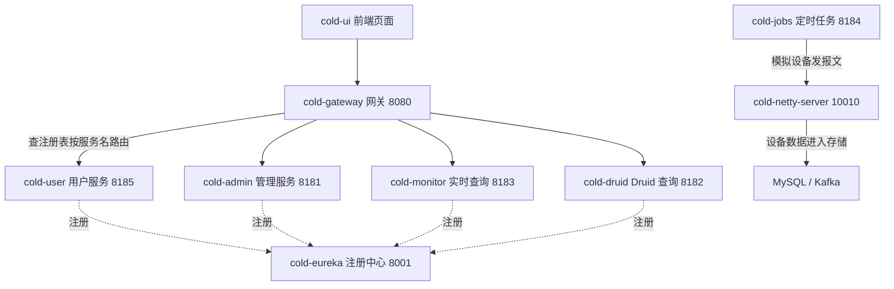

# 应用服务介绍：九个服务怎么拼成冷链监控平台后台

接手一个平台，最先要摸清的不是代码，而是「线上跑了哪些进程、各占哪个端口、谁调用谁」。冷链监控平台后台是九个服务加一套前端，看名字都是 cold 开头，分不清谁管登录、谁管数据、谁在造数据，排障时就会对着端口抓瞎。这一篇把服务清单、启动方式、公共工程与前端部署一次理清。

## 先给结论

- 后台是八个 Spring Boot 服务，全是可执行 jar，`java -jar` 加 `&` 启动；前端是 Vue 工程，打包后扔进 Tomcat。
- 入口与治理：cold-eureka（8001）是注册中心，cold-gateway（8080）是前端统一入口，按服务名从注册中心路由。
- 业务面四个：cold-user 管登录退出，cold-admin 管公司仓库主机设备档案，cold-monitor 查 MySQL 实时指标，cold-druid 查 Apache Druid 时序数据。
- 数据面两个：cold-netty-server（10010）收设备报文，cold-jobs 用定时任务模拟设备发报文喂链路。
- cold-common 公共工程沉淀实体与工具，被各服务共享，是理解数据结构的钥匙。

## 一、服务清单：一张表看全端口

| 应用 | 端口 | 说明 | 启动命令 |
|---|---|---|---|
| cold-eureka | 8001 | 服务注册中心 | `java -jar cold-eureka-0.0.1-SNAPSHOT.jar &` |
| cold-gateway | 8080 | API 网关，前端统一入口 | `java -jar cold-gateway-0.0.1-SNAPSHOT.jar &` |
| cold-user | 8185 | 用户服务 | `java -jar cold-user-1.0.0.jar &` |
| cold-admin | 8181 | 管理服务 | `java -jar cold-admin-0.0.1-SNAPSHOT.jar &` |
| cold-druid | 8182 | Druid 查询服务 | `java -jar cold-druid-1.0.0.jar &` |
| cold-monitor | 8183 | 实时查询服务 | `java -jar cold-monitor-0.0.1-SNAPSHOT.jar &` |
| cold-jobs | 8184 | 定时任务服务 | `java -jar cold-jobs-0.0.1-SNAPSHOT.jar &` |
| cold-netty-server | 10010 | Netty 服务 | `java -jar cold-netty-server-1.0-SNAPSHOT.jar &` |
| cold-ui | 8000 | Web 服务（Tomcat） | `service tomcat start \| stop \| restart` |

所有后台服务都是 Spring Boot 创建的 Java 应用，内嵌 Web 容器，打出来的可执行 jar 用 `java -jar` 直接起，不需要另配应用服务器。命令末尾的 `&` 是 Linux 的后台执行符，进程挂到后台继续跑，终端可以接着敲下一条。依次启动就是一行一个 jar：

```bash
# 先起注册中心与网关，再起业务服务，& 让进程转入 Linux 后台
java -jar cold-eureka-0.0.1-SNAPSHOT.jar &
java -jar cold-gateway-0.0.1-SNAPSHOT.jar &
java -jar cold-admin-0.0.1-SNAPSHOT.jar &
java -jar cold-netty-server-1.0-SNAPSHOT.jar &
```

前端 cold-ui 是唯一用 Tomcat 的：`service tomcat start | stop | restart` 管它的启停。补一句边界的划分：Flink 实时计算作业与 Superset 可视化平台不在上表里，它们不是 Spring Boot 服务，分别以独立计算程序与独立平台的方式部署，后续章节单独讲。

## 二、注册中心与网关：公司前台的小本本

Eureka 与 Gateway 的分工，课程里用公司前台打了个比方：公司前台放着一本目录，记着每个部门在哪个办公室。cold-eureka 就是这本目录，8001 端口，各业务服务启动后把自己的名字与端口登记上去；cold-gateway 是 8080 的统一前台接待，前端所有请求先打到它，它先查一下目录里注册了哪些服务，再按服务名路由。比如请求里访问的是用户服务，Gateway 查到 cold-user 注册在 8185，就把请求转发过去。业务服务的地址从此对前端透明，服务挪端口、横向加实例，前端一行代码不用改。



图里两条链路要分清。管理链路从左往右：前端到网关，网关按注册表转发到 user、admin、monitor、druid 四个查询与管理服务，各服务启动时向注册中心登记。数据链路在下方：cold-jobs 里的定时任务模拟硬件设备，按周期生成报文发到 cold-netty-server 的 10010 端口，Netty 服务接收真实设备与模拟设备提交的报文数据，送进存储侧。各服务的职责再各用一句话钉住：cold-user 当前版本提供用户登录与退出；cold-admin 管公司、仓库、主机、设备的设置；cold-monitor 实时查询 MySQL 里的实时指标结果；cold-druid 是查询 Druid 里时序数据的查询服务。

## 三、cold-common：被所有服务共享的公共工程

微服务各自独立，但档案实体、返回封装、分页工具这些内容每个服务都要用，它们被抽进公共工程 cold-common，随依赖进入各服务。结构上按业务域分包：user 包放系统用户实体，admin 包放公司、仓库、主机、表计、监控点实体，netty 包放设备报文实体，job 包放定时任务实体，utils 包放返回封装、分页、Jedis 工具与 Token 生成器。

以 admin 包的表计实体为例，它承载设备档案的核心字段（真实随包代码，包名按 `com.study.coldchain` 口径改写，节选）：

```java
package com.study.coldchain.common.admin.entity;

@Data
@TableName("cz_meter")
public class MeterEntity implements Serializable {
    @TableId
    private String id;             // 设备主键
    private String metercode;      // 设备编码
    private String metername;      // 设备名称
    private String hostid;         // 所属主机
    private String houseid;        // 所属仓库
    private String companyid;      // 所属公司
    private String meterstatus;    // 状态：1 在用，0 停用，2 异常
    private String maxtem;         // 温度上限
    private String mintem;         // 温度下限
    private String maxhum;         // 湿度上限
    private String minhum;         // 湿度下限
    private Integer meterinterval; // 采集间隔（秒）
}
```

netty 包的 MessageEntity 则是设备上报数据的公共载体，档案字段加当前温湿度、告警状态一字段不缺，`@TableName` 直接指向实时指标表，各服务读写的都是同一个实体（完整字段与报文拼接方法在系统数据结构一篇展开）：

```java
package com.study.coldchain.common.netty.entity;

@Data
@TableName("cz_message_realtime")
public class MessageEntity implements Serializable {
    private String metercode;  // 设备编码
    private String meterid;    // 设备主键
    private String hostid;     // 主机
    private String houseid;    // 仓库
    private String companyid;  // 公司
    private int tem;           // 当前温度
    private int hum;           // 当前湿度
    private int temalert;      // 温度状况：1 高温，0 正常，-1 低温
    private int humalert;      // 湿度状况：1 高湿，0 正常，-1 低湿
    private int state;         // 状态：1 在用，0 停用，2 异常
    private String curtime;    // 上报时间
}
```

这些实体与 MyBatis-Plus 的注解映射、Kafka 与 Redis 的客户端依赖一起，构成了各服务共用的底座，工程 `pom.xml` 的依赖清单在技术架构篇里逐项对过层。

## 四、前端应用：从 npm 到 Tomcat

前端是 Node.js 加 Vue 开发的 HTML 与 JS 页面，运行时通过网关调后台接口。它的生命周期分两段。本地开发时，`npm install` 装依赖搭好 Vue 工程，`npm run serve` 起本地 Web 服务边改边看。要部署时换一条路：`npm run build` 生成 dist 目录，里面就是纯静态的 HTML 与 JS；把目录上传到 Linux 的 Tomcat 应用目录 `/var/lib/tomcat/webapps`，解压并改名为 cold，Tomcat 配置文件在 `/etc/tomcat/`，8000 端口对外服务：

```bash
# 本地开发
npm install
npm run serve

# 部署：打包生成 dist，上传后解压改名为 cold
npm run build
cd /var/lib/tomcat/webapps/
unzip dist.zip
mv dist cold
```

serve 与 build 的区别记一句：serve 起的是带热更新的开发服务器，build 产出的是可部署的静态目录，前者给人看，后者给 Tomcat 托管。

## 常见误区

- **把 8080 当某个业务服务的端口。** 错例：前端直连 8185、8181 这些端口调服务。正解：8080 的 Gateway 才是前端统一入口，业务服务地址由网关按注册表解析，绕过网关就把服务发现的意义丢了。
- **以为每个后台服务要配一个 Tomcat。** 错例：按传统 war 包思路给每个服务准备容器。正解：服务是 Spring Boot 可执行 jar，内嵌容器，`java -jar` 即可；全平台只有前端 cold-ui 用 Tomcat 托管。
- **把 cold-jobs 当成后台清理类定时任务。** 错例：以为它是跑批删数据。正解：它是模拟硬件设备的服务，用 Quartz 定时生成并发送设备报文，是开发环境整条数据链路的数据源。
- **把 cold-druid 与 cold-monitor 混为一谈。** 正解：两者都是查询服务，cold-monitor 查 MySQL 里的实时指标结果，cold-druid 查 Apache Druid 里的时序分析数据，数据源不同，接口面向的场景也不同。

## 面试可能被问到的问题

1. 面试官追问：「前端一个请求到达后台的完整链路是什么？」
   答：页面先打网关 8080，Gateway 从 Eureka 查目标服务的注册信息，按服务名路由到具体实例，例如用户请求被转到 cold-user 的 8185。注册中心负责登记与发现，网关负责统一入口与转发，前端只认识网关地址。
2. 面试官追问：「为什么后台服务能用 java -jar 直接启动？」
   答：服务全部由 Spring Boot 创建，可执行 jar 内嵌了 Web 容器，启动时自己起服务，不需要外部应用服务器；命令尾部的 & 让进程转入 Linux 后台。全平台只有前端静态页面用 Tomcat 托管。
3. 面试官追问：「cold-jobs 有什么存在的必要？」
   答：开发与测试环境没有真实的冷库设备，cold-jobs 用定时任务模拟硬件设备按周期发送报文到 Netty 服务端口，让接入、计算、告警整条链路能持续产生数据、验证异常场景，等价于一台假设备。
4. 面试官追问：「cold-common 公共工程有什么好处，有什么要注意的？」
   答：好处是实体、返回封装、工具类、依赖版本在一处维护，各服务复用，避免同一份实体各写一份后字段漂移。要注意它是公共依赖，改公共实体会影响所有引用方，升级需要评估各服务的兼容。
5. 面试官追问：「前端项目的本地运行与部署分别怎么做？」
   答：本地先 npm install 装依赖，npm run serve 起开发服务器；部署时 npm run build 生成 dist 静态目录，上传到 Linux 的 Tomcat 应用目录并改名为 cold，由 8000 端口的 Tomcat 对外服务。

## 配套资料

- 代码：`materials/code/06/day1 背景介绍与系统介绍/`，公共工程 `cold-common` 为真实随包代码：`pom.xml`、user 包（`SysUserEntity`、`SysUserTokenEntity`）、admin 包（`CompanyEntity`、`WarehouseEntity`、`HostEntity`、`MeterEntity`、`MonitorEntity`）、netty 包（`MessageEntity`）、job 包（`ScheduleJobEntity`、`ScheduleJobLogEntity`）与 utils 工具类；服务清单、端口与启动命令按本课画面整理，各业务服务工程本体在后续 day 落地。
- 说明：引用路径截至 `materials/code/06/` 的 day 目录层级；工程内包名与 groupId 含机构前缀，正文统一按 `com.study.coldchain` 口径改写。
