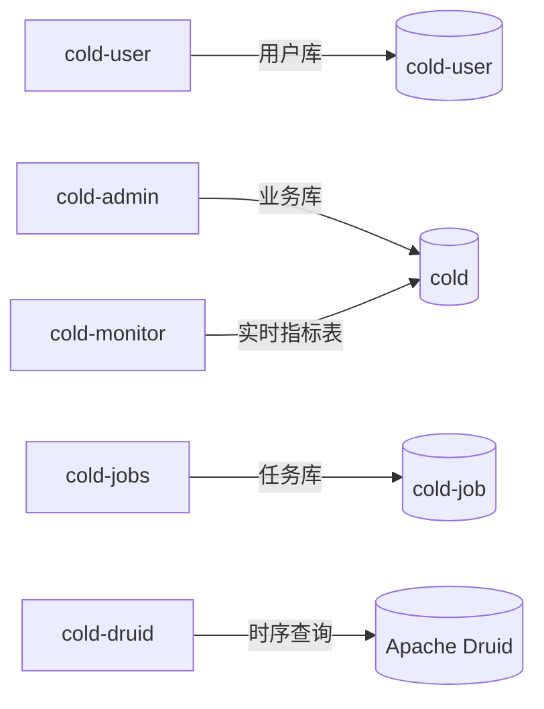
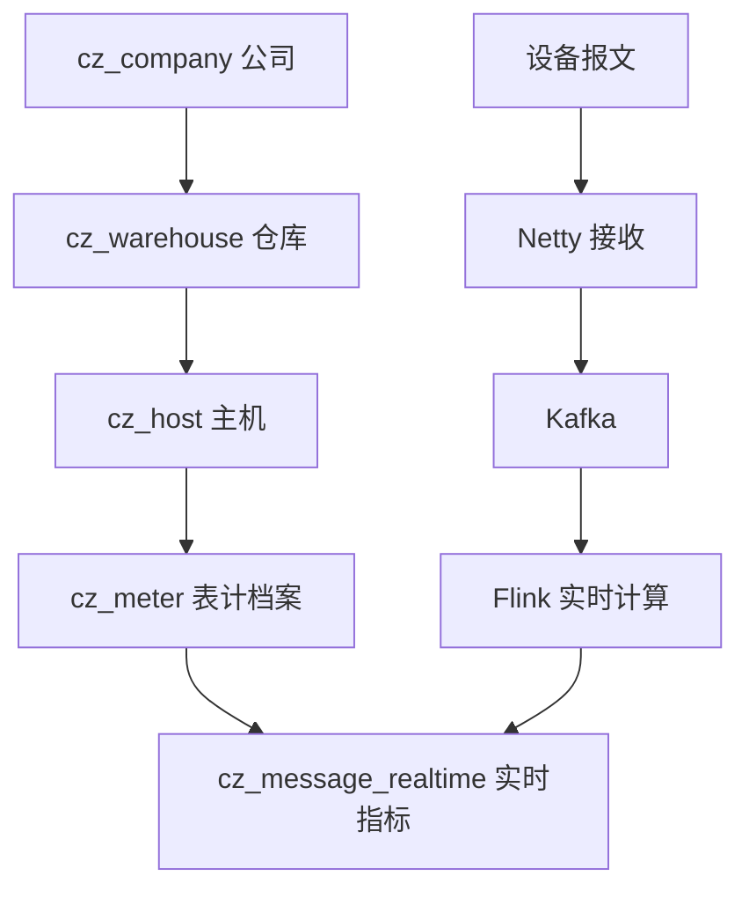

# 系统数据结构：三个库、十几张表怎么分工

想知道一台冷库设备昨天为什么告警，却不知道告警阈值存在哪张表；想手动修一条数据，第二天大数据抽取却漏掉了这条变更。这些困惑都指向同一件事：没把平台的数据结构看懂。冷链监控平台的数据落在三个数据库里，加上 Quartz 自己的一套表，看着不少，其实一条主线就能串起来。

## 先给结论

- 三个库按微服务边界分：用户库 cold-user、业务库 cold、定时任务库 cold-job，各服务各访问各的库，不是分库分表。
- 档案数据是一条链：公司、仓库、主机、表计，层层挂接；监控点配置 cz_monitor 挂在主机上。
- 实时指标表 cz_message_realtime 是全平台数据的交汇点：设备报文经 Netty 与流计算写入，档案冗余字段让它能脱离多表联查直接出数。
- createdTime 与 updateTime 交给数据库自动维护（`CURRENT_TIMESTAMP` 加 `ON UPDATE CURRENT_TIMESTAMP`），为大数据按时间增量抽取兜底。
- 定时任务库里 Quartz 自带 QRTZ_ 前缀的表管调度，工程自研的 schedule_job 与 schedule_job_log 管业务侧任务配置与执行日志。

## 一、三个数据库的分界

分库的依据不是数据量，是微服务的边界：每个服务有自己的一亩三分地，用户服务访问用户库，管理服务访问业务库，定时任务服务访问任务库，服务之间「你访问你的库，我访问我的库」，互不越界。监控服务要读实时指标，读的是业务库里那张实时指标表；查询 Druid 的服务则直接连 Apache Druid，属于跨到时序存储侧访问。



这张图把服务与库的对应关系钉住：库的数量跟着服务边界走，而不是把所有表塞进一个大库等数据量大了再拆。分库不分表是当前规模下的合理形态，表结构清楚了，日后真要做拆分也知道从哪刀切下去。

## 二、用户库：登录与令牌的两张表

用户库只有 sys_user 与 sys_user_token 两张表。用户表的字段是用户 ID、用户名、密码、盐、邮箱、手机号、状态（0 禁用，1 正常），外加创建者与创建时间（按本课数据结构画面整理的建表脚本）：

```sql
CREATE TABLE sys_user (
  user_id        bigint       NOT NULL COMMENT '主键Id',
  username       varchar(50)  NOT NULL COMMENT '用户名',
  password       varchar(100)          COMMENT '密码（加盐摘要）',
  salt           varchar(20)           COMMENT '盐值，参与密码加密',
  email          varchar(100)          COMMENT '邮箱',
  mobile         varchar(100)          COMMENT '手机号',
  status         tinyint               COMMENT '状态：0 禁用，1 正常',
  create_user_id bigint                COMMENT '创建者ID',
  create_time    datetime              COMMENT '创建时间',
  PRIMARY KEY (user_id)
);
```

盐值是密码加密时额外混入的一串随机数据，同样一个密码，盐不同算出的摘要就不同，能防彩虹表反查。状态字段控制账号禁用与否，登录入口要校验它。

令牌表对应工程的 `SysUserTokenEntity`，就四个字段：用户 ID、token 值、过期时间、更新时间。登录成功时生成 token 存进表里，前端每次请求都带着这个 token，后台校验它是否过期，过期就拒绝本次 API 调用。存 MySQL 的理由是现实权衡：这是后台管理系统，用户量不大，查表足够；用户量上来之后，这张表一般迁去 Redis 缓存，把每次请求一次的数据库开销省掉。

## 三、业务库：档案链与实时指标交汇点

业务库 cold 是数据结构的主战场。档案数据按层级挂接，实时数据从设备侧流进来，两边在实时指标表汇合。



档案链自上而下：公司表存名称、简称、企业编码、地址、电话、质量管理员与负责人、网站、企业类型；仓库表存编码、名称、地址、类型（1 冷库，2 常温）、所属公司、经纬度、面积、状态；主机表把主机挂到仓库，带主机编码、型号、SIM 卡号这些装机配置；表计实体 `MeterEntity` 对应 cz_meter，存设备编码、所属主机仓库公司、在用状态，以及温度上下限、湿度上下限、采集间隔这些告警阈值配置。另有监控点表 cz_monitor，名字像设备档案，实际是监控配置：监控人员姓名与电话、预警类型（0 温湿度，1 温度，2 湿度）、挂在哪台主机，工程里的 `MonitorEntity` 字段与此一一对应。

实时指标表 cz_message_realtime 由工程 netty 包的 `MessageEntity` 映射，它的字段分三段：档案冗余段（设备、主机、仓库、公司的编码与名称）、实时值段（当前温湿度、上下限、经纬度、状态、上报时间）、计算段（temalert 与 humalert，1 高、0 正常、-1 低，由 Flink 实时计算写入）。冗余这么多名称字段，换来的是报表查询不用联四张档案表。完整实体与报文拼接方法如下（真实随包代码，包名按 `com.study.coldchain` 口径改写）：

```java
package com.study.coldchain.common.netty.entity;

@Data
@TableName("cz_message_realtime")
public class MessageEntity implements Serializable {
    private static final long serialVersionUID = 1L;
    private String metercode;   // 设备编码
    private String metername;   // 设备名称
    private String hostid;      // 主机
    private String houseid;     // 仓库
    private String companyid;   // 公司
    private int tem;            // 当前温度
    private int maxtem;         // 温度上限
    private int mintem;         // 温度下限
    private int hum;            // 当前湿度
    private int maxhum;         // 湿度上限
    private int minhum;         // 湿度下限
    private int temalert;       // 温度状况：1 高温，0 正常，-1 低温
    private int humalert;       // 湿度状况：1 高湿，0 正常，-1 低湿
    private int state;          // 状态：1 在用，0 停用，2 异常
    private String lon;         // 经度
    private String lat;         // 纬度
    private String curtime;     // 上报时间

    /** 拼一条测试报文：帧头 SHT，帧尾 SH5lb1.2.1R，竖线分隔字段 */
    public String deviceMessage() {
        StringBuffer sb = new StringBuffer();
        sb.append("SHT");
        sb.append("|").append(this.getMetercode());
        sb.append("|").append(this.getTem());
        sb.append("|").append(this.getHum());
        sb.append("|").append(this.getState());
        sb.append("|").append(this.getLon());
        sb.append("|").append(this.getLat());
        sb.append("|").append(this.getCurtime());
        sb.append("|").append("SH5lb1.2.1R");
        return sb.toString();
    }
}
```

`deviceMessage()` 拼出来的就是设备报文的样子：帧头 SHT，后面依次是设备编码、温度、湿度、状态、经度、纬度、时间，竖线分隔，帧尾 SH5lb1.2.1R 收口。定时任务模拟设备发的报文正是这个格式，Netty 服务收到的也是这个格式，两侧拿同一实体对照，联调时对报文就不用猜。

## 四、updateTime 交给数据库：为增量抽取兜底

公司、仓库这类档案表都有 createdTime 与 updateTime 两个时间戳。维护方式有两种：应用层在每次增删改时顺手更新；或者像本课这样，把活交给数据库：

```sql
-- 业务库公司表的时间戳字段（按本课数据结构画面整理）
CREATE TABLE cz_company (
  id           varchar(50)  NOT NULL COMMENT '主键',
  company      varchar(100)          COMMENT '公司名称',
  abbreviation varchar(50)           COMMENT '公司简称',
  companytype  varchar(20)           COMMENT '企业类型',
  createdTime  timestamp    NOT NULL DEFAULT CURRENT_TIMESTAMP COMMENT '创建时间',
  updateTime   timestamp    NOT NULL DEFAULT CURRENT_TIMESTAMP
               ON UPDATE CURRENT_TIMESTAMP COMMENT '修改时间，任何字段变更自动刷新',
  PRIMARY KEY (id)
);
```

`ON UPDATE CURRENT_TIMESTAMP` 的含义是：这一行的任何字段变了，updateTime 自动刷新为当前时间，不管变更来自程序代码还是客户端手工执行 SQL。这个设计对大数据增量抽取是兜底：抽取按 updateTime 扫「昨天到今天变更的记录」，如果时间戳只靠应用更新，一条绕过应用的 SQL 修复就会漏更时间戳，这条数据就被抽取遗漏；数据库级自动更新把这种遗漏堵死了。代价是时间取自数据库服务器，要求数据库与应用服务器都和时钟服务器做过同步，服务器时间不齐，增量窗口就会错位，一般环境都会配 NTP 对时，通常不会成为问题。

## 五、定时任务库：Quartz 的表与自研的两张

定时任务库 cold-job 里，Quartz 用自己的表管调度，QRTZ_ 前缀的表按职责记四组就够。触发器族：QRTZ_TRIGGERS 存触发器基本信息（名称、所属组、绑定的任务与下次触发时间），QRTZ_CRON_TRIGGERS 存 cron 表达式与时区，QRTZ_SIMPLE_TRIGGERS 存简单触发的重复次数、间隔与已触发次数。任务：QRTZ_JOB_DETAILS 存每个任务的详细配置。运行态：QRTZ_FIRED_TRIGGERS 记录已触发的触发器，QRTZ_PAUSED_TRIGGER_GRPS 记暂停的触发器组，QRTZ_SCHEDULER_STATE 让 Quartz 判断每个调度实例的状态，QRTZ_LOCKS 存悲观锁信息，集群模式下靠它保证同一任务不被两个实例同时执行。日历类：QRTZ_CALENDARS 排除特定时间不调度。

工程在这之上加了业务侧的两张表，与 job 包实体对应：schedule_job 存任务配置（`ScheduleJobEntity` 的 beanName、params、cronExpression、status），调度器按 beanName 反射调用 Spring 容器里的任务 bean；schedule_job_log 存每次执行的日志（log_id、job_id、bean_name、params、status、error、times、create_time），任务出错时靠它回溯。Quartz 的表负责「准点触发」，这两张表负责「触发什么、触发得怎么样」，分工清楚。

## 六、day1 收官

到这里，day1 的内容连成了完整一条线：从物流与冷链的行业背景进入，经过系统架构、技术架构与物理部署确定盘子，再由组件选型、应用服务清单落到工程组织，最后用三个库的数据结构把数据安放到位。后续 day 从微服务框架与基础服务开始动代码，今天看过的端口、实体与表名会一一在工程里出现。

## 常见误区

- **把 cz_monitor 当设备档案表。** 错例：看名字以为它存设备本身。正解：设备（表计）档案在 cz_meter，存编码与温湿度阈值；cz_monitor 是监控点配置，存监控人、预警类型与所属主机。
- **以为 updateTime 由应用更新就万无一失。** 正解：绕过应用的 SQL 操作不会触发应用层更新，增量抽取会漏数据；交给数据库 `ON UPDATE CURRENT_TIMESTAMP` 才是兜底。
- **自己动手设计 Quartz 的表。** 正解：QRTZ_ 系列表由 Quartz 官方脚本建表、由框架读写，项目只管往 schedule_job 里配任务，改动 Quartz 表结构反而会破坏集群调度。
- **认为 token 表必须放 Redis。** 正解：用户量小的后台系统存 MySQL 完全够用，每次请求多一次主键查询成本可控；用户量大了再迁 Redis，是量级问题不是架构对错问题。

## 面试可能被问到的问题

1. 面试官追问：「为什么要分成三个数据库？」
   答：按微服务边界划分，用户服务、业务服务、定时任务服务各自访问自己的库，数据所有权清晰，服务之间不共享库表，改结构互不影响。这是分库不分表的形态，驱动力是服务边界而不是数据量。
2. 面试官追问：「updateTime 用数据库自动更新有什么好处和风险？」
   答：好处是任何变更路径（程序、脚本、客户端）都会刷新时间戳，大数据按 updateTime 增量抽取不会漏数据。风险是时间取自数据库服务器，依赖服务器时钟，应用与数据库都要和 NTP 时钟服务器对时，否则增量窗口会错位。
3. 面试官追问：「登录令牌为什么存表，什么时候该换 Redis？」
   答：token 在登录时生成入库，前端每次请求携带，后台校验过期时间。存表的理由是后台系统用户量小，表查询成本可控；当用户量与请求量大到每次查表成为瓶颈时，迁到 Redis，用过期时间原生能力替代手工校验。
4. 面试官追问：「实时指标表为什么冗余公司、仓库、主机的名称字段？」
   答：它是设备报文直接落地的表，写入频率高、查询以分析展示为主。冗余名称让大部分查询不联档案表，报表性能稳定；代价是档案改名时要做同步维护，属于典型的读多写少场景的空间换时间。
5. 面试官追问：「Quartz 集群怎么保证同一个任务不被重复执行？」
   答：集群实例共享同一套 QRTZ_ 表，通过 QRTZ_LOCKS 的悲观锁抢占触发权，抢到的实例把触发记录写入 QRTZ_FIRED_TRIGGERS，QRTZ_SCHEDULER_STATE 维护各实例心跳状态，实例宕机后其他实例能接手恢复。
6. 面试官追问：「设备报文的格式是怎么定下来的？」
   答：自定义帧格式，帧头 SHT、帧尾 SH5lb1.2.1R，中间用竖线分隔设备编码、温度、湿度、状态、经纬度与时间。公共工程 MessageEntity 的 deviceMessage 方法给出了标准拼法，模拟设备与解析侧共用同一实体，保证两侧对报文的理解一致。

## 配套资料

- 代码：`materials/code/06/day1 背景介绍与系统介绍/`，公共工程 `cold-common` 的实体类为真实随包代码：user 包 `SysUserEntity`、`SysUserTokenEntity`，admin 包 `CompanyEntity`、`WarehouseEntity`、`HostEntity`、`MeterEntity`、`MonitorEntity`，netty 包 `MessageEntity`（含 `deviceMessage` 报文方法），job 包 `ScheduleJobEntity`、`ScheduleJobLogEntity`。
- 本课无数据库脚本源码，文中 `sys_user`、`cz_company` 建表 SQL 为按本课数据结构画面整理；Quartz 表说明按课件与主流写法归纳。
- 说明：引用路径截至 `materials/code/06/` 的 day 目录层级；工程内包名与 groupId 含机构前缀，正文统一按 `com.study.coldchain` 口径改写。
