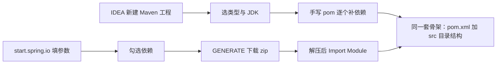

# 创建 Spring Boot 工程：脚手架生成与手工创建的取舍

day2 的第一个动作是把工程骨架立起来，平台九个服务全由 Spring Boot 创建，骨架立得快不快直接决定节奏。新手常见的卡点有三个：IDEA 直接建 Maven 工程和 Spring Initializr 网页生成到底选哪个；groupId、artifactId 这些参数怎么填不返工；依赖坐标去哪找、版本怎么定。这一篇把两条创建路径走完，再用随包的 cold-eureka 真实工程对照，看一副骨架离一个能跑的服务还差什么。

## 先给结论

- 两条路殊途同归：IDEA 新建 Maven 工程后手工补依赖；Spring Initializr（start.spring.io）网页勾选参数生成 zip 再导入。产物是同一套骨架，Initializr 的优势是依赖一次配齐。
- 关键参数四个：groupId、artifactId、Java 版本、Spring Boot 版本。本课画面用 2.2.2.RELEASE 演示，随包工程统一锁在 2.1.8.RELEASE。
- SNAPSHOT 是开发中的不稳定版本，随时可能变化，正式开发选 RELEASE。
- 依赖坐标可以去 Maven 仓库站点搜索复制，不必手背。
- 公共组件工程是纯 jar 库，可以没有启动类；服务工程才有启动类与配置文件，cold-eureka 就是标准样例。

## 一、手工方式：IDEA 新建 Maven 工程

在 IDE 里 Create Project，类型选 Maven，JDK 选 1.8，下一步填 groupId 与 artifactId（工程名 cold-common），选好工程所在目录后 finish，一个空白的 Maven 工程就出来了。目录结构 IDE 已经给好：

```bash
cold-project
└── cold-common
    ├── pom.xml
    └── src
        ├── main
        │   ├── java      # 源码根：com/study/coldchain/common
        │   └── resources # 配置文件目录
        └── test          # 测试源码与配置
```

骨架有了，剩下的活是往 `pom.xml` 里补依赖：Spring Boot 的 parent、web starter、MyBatis-Plus、Redis 客户端，一个一个找坐标、贴片段、刷新 Maven。这条路直观，能看清 pom 长出来的过程，代价是依赖全要自己伺候，坐标记不住就得反复查。

## 二、Initializr 方式：网页勾选、下载导入

Spring 官方提供了工程脚手架 Spring Initializr，地址 start.spring.io。网页上先把参数过一遍：Project 选 Maven，Language 选 Java（候选里还有 Kotlin、Groovy 两种语言）；Spring Boot 版本默认给的是当时的最新版 2.2.2，注意列表里带 SNAPSHOT 的不要选，SNAPSHOT 表示还在开发中、内容可能变化，正式开发只认 RELEASE。然后填工程元数据：group 填 `com.study`，artifact 填 `cold-common`，description 写「公共组件工程」，package 相应变成 `com.study.coldchain.common`，Java 版本选 8。

再往下是这条路的真正优势：依赖勾选。页面按分类列了常用 starter，开发工具类里有 Lombok、Spring Boot DevTools、Spring Configuration Processor；Web 类里有 web 与 REST 相关组件；往下还有模板引擎（Thymeleaf、FreeMarker）、安全（Spring Security、OAuth2 Client）、消息（Kafka、RabbitMQ）等分类。勾选过程随时可以点 EXPLORE 预览将要生成的 pom，确认无误点 GENERATE，浏览器下载一个工程 zip，解压到工程目录，再在 IDEA 里添加 Module、导入方式选 Maven，工程就进了工作区，pom 里的依赖自动开始加载。



图里两条路径殊途同归：产物都是 pom 加 src 的标准结构，差别只在依赖是谁配的。Initializr 生成的 pom 长这样（按本课画面整理，groupId 与包名按 `com.study.coldchain` 口径改写）：

```xml
<?xml version="1.0" encoding="UTF-8"?>
<project xmlns="http://maven.apache.org/POM/4.0.0"
         xmlns:xsi="http://www.w3.org/2001/XMLSchema-instance"
         xsi:schemaLocation="http://maven.apache.org/POM/4.0.0 http://maven.apache.org/xsd/maven-4.0.0.xsd">
    <modelVersion>4.0.0</modelVersion>
    <parent>
        <groupId>org.springframework.boot</groupId>
        <artifactId>spring-boot-starter-parent</artifactId>
        <version>2.2.2.RELEASE</version>
        <relativePath/>
    </parent>
    <groupId>com.study</groupId>
    <artifactId>cold-common</artifactId>
    <version>1.0-SNAPSHOT</version>
    <name>cold-common</name>
    <description>公共组件工程</description>
    <properties>
        <java.version>1.8</java.version>
    </properties>
    <dependencies>
        <dependency>
            <groupId>org.projectlombok</groupId>
            <artifactId>lombok</artifactId>
            <optional>true</optional>
        </dependency>
        <dependency>
            <groupId>org.springframework.boot</groupId>
            <artifactId>spring-boot-configuration-processor</artifactId>
            <optional>true</optional>
        </dependency>
    </dependencies>
</project>
```

parent 指向 `spring-boot-starter-parent`，这一行就把 Spring Boot 官方维护的一整套依赖版本锁了进来，自己声明的依赖大多不用写版本号。

## 三、依赖坐标哪里找

写 pom 最日常的困扰是「这个包的坐标怎么写」。常规做法是去 Maven 仓库站点（如 mvnrepository.com）搜组件名，点进对应版本页复制 dependency 片段，贴进自己的 pom 刷新即可；用搜索引擎搜「组件名 + 坐标」也能直接拿到现成片段。挑版本时看两点：优先用面广的稳定版，避开 SNAPSHOT。画面里演示勾选流程时随手选的 Camel starter 只是演示，公共工程真正需要的坐标按用途挑，随包工程 `cold-common` 的依赖就是按实际需要配的（真实随包代码，节选）：

```xml
<groupId>com.study</groupId>
<artifactId>cold-common</artifactId>
<version>0.0.1-SNAPSHOT</version>
<parent>
    <groupId>org.springframework.boot</groupId>
    <artifactId>spring-boot-starter-parent</artifactId>
    <version>2.1.8.RELEASE</version>
</parent>
<dependencies>
    <dependency>
        <groupId>org.springframework.boot</groupId>
        <artifactId>spring-boot-starter-web</artifactId>
    </dependency>
    <dependency>
        <groupId>com.baomidou</groupId>
        <artifactId>mybatis-plus</artifactId>
        <version>${mybatisplus.version}</version>
    </dependency>
    <dependency>
        <groupId>redis.clients</groupId>
        <artifactId>jedis</artifactId>
        <version>2.8.0</version>
    </dependency>
    <!-- 其余按需引入：aop、redis、kafka、shiro、fastjson、druid 等 -->
</dependencies>
```

parent 锁在 2.1.8.RELEASE，个别仓库里没有托管版本的包（如 MyBatis-Plus、Jedis）才在 properties 里自定版本。这就是「版本交给 parent、例外自己声明」的样子。

## 四、对照真实工程：从骨架到能跑的服务

cold-common 是库工程，生成的骨架对它已经够用，它没有启动类也没有 application.yml。服务工程就不同了，以随包的 cold-eureka 为例，pom 在骨架之上多了三样东西（真实随包代码，节选）：

```xml
<properties>
    <java.version>1.8</java.version>
    <spring-cloud.version>Greenwich.SR2</spring-cloud.version>
</properties>

<dependencies>
    <dependency>
        <groupId>org.springframework.cloud</groupId>
        <artifactId>spring-cloud-starter-netflix-eureka-server</artifactId>
    </dependency>
</dependencies>

<dependencyManagement>
    <dependencies>
        <dependency>
            <groupId>org.springframework.cloud</groupId>
            <artifactId>spring-cloud-dependencies</artifactId>
            <version>${spring-cloud.version}</version>
            <type>pom</type>
            <scope>import</scope>
        </dependency>
    </dependencies>
</dependencyManagement>

<build>
    <plugins>
        <plugin>
            <groupId>org.springframework.boot</groupId>
            <artifactId>spring-boot-maven-plugin</artifactId>
        </plugin>
    </plugins>
</build>
```

`dependencyManagement` 以 import 方式引入 Spring Cloud 的版本清单 Greenwich.SR2，之后引 Cloud 家族的 starter 都不用写版本；`spring-boot-maven-plugin` 负责把工程打成可执行 jar。版本配套关系要留意：Spring Boot 2.1.x 对应 Spring Cloud Greenwich，画面里 Initializr 默认的 2.2.2 与随包工程的 2.1.8 属于录制时间差，动手时以随包工程的版本组合为准，Boot 与 Cloud 错配会在启动时报莫名的类找不到。

骨架再加两个文件就是能跑的服务。启动类（真实随包代码，包名按口径改写）：

```java
package com.study.coldchain.eureka;

import org.springframework.boot.SpringApplication;
import org.springframework.boot.autoconfigure.SpringBootApplication;
import org.springframework.cloud.netflix.eureka.server.EnableEurekaServer;

@SpringBootApplication
@EnableEurekaServer
public class EurekaApplication {

    public static void main(String[] args) {
        SpringApplication.run(EurekaApplication.class, args);
    }
}
```

`@SpringBootApplication` 是每个启动类的标配，`@EnableEurekaServer` 打开注册中心开关，main 里一句 `SpringApplication.run` 拉起内嵌容器。配置文件骨架（真实随包代码，主机名按示例域名改写）：

```yaml
server:
  port: 8001

eureka:
  instance:
    hostname: eureka.example.com    # 实例主机名
  client:
    service-url:
      defaultZone: http://eureka.example.com:8001/eureka
    register-with-eureka: false     # 注册中心自身不注册进自己
    fetch-registry: false           # 也无需从自己这里拉取注册表

spring:
  application:
    name: cold-eureka-server
```

`spring.application.name` 给服务起名，这个名字将来就是注册表里的名字，网关按它路由。到这里，一个工程的完整形态齐了：pom 定依赖与版本，启动类定入口，application.yml 定端口与行为，`java -jar` 跑起来就是注册中心进程。

## 常见误区

- **选了 SNAPSHOT 版本不自知。** 错例：版本下拉里挑了最新的 2.x.x SNAPSHOT，隔两周依赖行为变了。正解：SNAPSHOT 是开发中版本，内容随时变，工程只用 RELEASE。
- **groupId、artifactId 随手填。** 错例：groupId 用默认的 `org.example`，artifactId 带大写与下划线。正解：groupId 用反转域名的团队或项目语义（如 `com.study`），artifactId 全小写连字符（如 `cold-common`），package 由二者派生，起始就填对。
- **给库工程配启动类与打包插件。** 正解：公共组件工程是纯 jar 库，没有 main 也没有配置文件；启动类与 spring-boot-maven-plugin 属于服务工程。
- **版本号全写在依赖上。** 正解：Boot 版本交给 parent，Cloud 版本交给 dependencyManagement 的 BOM，依赖坐标不写版本；散落的版本号升级时会互相打架。
- **依赖勾得越多越安心。** 正解：每个 starter 都带一串传递依赖，勾上不用的安全、模板引擎会让启动变慢、排障变难，按实际用途选。

## 面试可能被问到的问题

1. 面试官追问：「Spring Initializr 生成工程和手工建 Maven 工程有本质区别吗？」
   答：没有本质区别，产物都是标准 Maven 骨架，pom 加 src 目录。Initializr 只是把groupId、artifactId、Boot 版本与依赖 starter 在网页上收集后代写 pom，省去手工找坐标的过程；两种方式生成的工程可以互相迁移改造。
2. 面试官追问：「spring-boot-starter-parent 提供了什么？」
   答：它是一个特殊的 parent pom，统一管理了 Spring Boot 全家桶与常用第三方依赖的默认版本、编译插件配置与资源过滤。工程继承它之后，多数依赖不用写版本号，改 Boot 版本只需改 parent 一处。
3. 面试官追问：「SNAPSHOT 和 RELEASE 有什么区别？」
   答：SNAPSHOT 是开发中的快照版本，内容随开发推进随时变化，仓库会反复更新；RELEASE 是正式发布版，内容冻结。依赖 SNAPSHOT 的工程每次构建可能拿到不同结果，可复现性被破坏，项目工程只应依赖 RELEASE。
4. 面试官追问：「Spring Boot 和 Spring Cloud 的版本为什么要配套？」
   答：Spring Cloud 各组件基于特定 Spring Boot 版本编译，Boot 大版本升级后内部 API 可能变化。配套关系由 Spring Cloud 的版本列车（如 Greenwich 对应 Boot 2.1.x）维护，工程里通过 dependencyManagement 引入对应 BOM 来锁定，错配会出现类缺失、启动失败等问题。
5. 面试官追问：「一个最小可运行的 Spring Boot 服务需要哪些要素？」
   答：三样：pom 里继承 starter-parent 并引入对应功能的 starter，一个带 @SpringBootApplication 与 main 方法的启动类，一份 application.yml 或 properties 配置端口与应用名。满足这三点，打包成可执行 jar 用 java -jar 就能跑。

## 配套资料

- 代码：`materials/code/06/day2 微服务框架与基础服务/`，注册中心工程 `cold-eureka` 为真实随包代码（`pom.xml`、启动类 `EurekaApplication`、`application.yml`）；公共工程 `cold-common` 的 `pom.xml` 在 `materials/code/06/day1 背景介绍与系统介绍/`。
- 说明：引用路径截至 `materials/code/06/` 的 day 目录层级；Initializr 生成示例按本课画面（Boot 2.2.2.RELEASE）整理，groupId 与包名统一按 `com.study.coldchain` 口径改写，配置中的主机名按示例域名改写。
