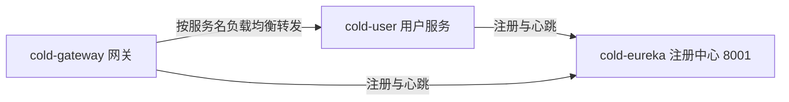

# Spring Boot 集成 Eureka：把注册中心真正跑起来

三个角色理清之后就是动手环节。注册中心在冷链监控平台里是一个独立的 Spring Boot 工程 `cold-eureka`，这一节从空白的 Maven 工程开始，把它一步步搭到浏览器里能看到服务实例为止。课程演示里还留了一个真实的坑：依赖明明引入了，启动却报错，原因出在一个注解上。

## 先给结论

- 注册中心工程三件套：`spring-cloud-starter-netflix-eureka-server` 依赖、`@EnableEurekaServer` 注解、`application.yml` 配置，缺一不可。
- 真实工程固定在 Spring Boot 2.1.8.RELEASE 加 Spring Cloud Greenwich.SR2 上，版本由 `dependencyManagement` 锁定。
- 单机部署要把 `register-with-eureka` 与 `fetch-registry` 置为 false，注册中心不注册自己、不拉取自己。
- 客户端只需引入 eureka client 依赖并把 `defaultZone` 指向注册中心，`cold-user` 与 `cold-gateway` 都是这么接入的。
- 启动后访问 8001 端口的 Dashboard，能看到实例清单就算验收通过。

## 一、建工程：两种入口，一个落点

建工程有两种入口，课程里都演示了：一种在 IDE 里新建 Maven 工程手写配置，另一种用 Spring 骨架生成器填好 Group 与 Artifact 一键生成，生成的 `pom.xml` 直接拷进工程即可。不管走哪条路，落点是同一个：Artifact 叫 `cold-eureka`，`pom.xml` 引入 Eureka Server 的 starter。真实工程的关键片段如下：

```xml
<parent>
    <groupId>org.springframework.boot</groupId>
    <artifactId>spring-boot-starter-parent</artifactId>
    <version>2.1.8.RELEASE</version>
</parent>

<properties>
    <java.version>1.8</java.version>
    <spring-cloud.version>Greenwich.SR2</spring-cloud.version>
</properties>

<dependencies>
    <dependency>
        <groupId>org.springframework.cloud</groupId>
        <artifactId>spring-cloud-starter-netflix-eureka-server</artifactId>
    </dependency>
    <dependency>
        <groupId>org.springframework.boot</groupId>
        <artifactId>spring-boot-starter-test</artifactId>
        <scope>test</scope>
    </dependency>
</dependencies>

<dependencyManagement>
    <dependencies>
        <dependency>
            <groupId>org.springframework.cloud</groupId>
            <artifactId>spring-cloud-dependencies</artifactId>
            <version>${spring-cloud.version}</version>
            <type>pom</type>
            <scope>import</scope>
        </dependency>
    </dependencies>
</dependencyManagement>
```

两个版本号值得留意。`spring-boot-starter-parent` 2.1.8.RELEASE 是整个平台所有工程共用的底座；Spring Cloud 的版本号不在依赖里写死，而是放到 `dependencyManagement` 里用 `${spring-cloud.version}` 统一引用，starter 只负责把 Eureka Server 的整包组件带进 classpath，不掺版本问题。课程讲解时骨架生成器里选过更高的 2.2 版本，随包工程实际落在 2.1.8 加 Greenwich.SR2，两者都能跑，以真实工程为准。

## 二、启动类：两道注解缺一不可

工程是空白骨架，启动类要自己建。真实工程的启动类叫 `EurekaApplication`，全部代码只有一段：

```java
package com.study.coldchain.eureka;

import org.springframework.boot.SpringApplication;
import org.springframework.boot.autoconfigure.SpringBootApplication;
import org.springframework.cloud.netflix.eureka.server.EnableEurekaServer;

@SpringBootApplication
@EnableEurekaServer
public class EurekaApplication {

    public static void main(String[] args) {
        SpringApplication.run(EurekaApplication.class, args);
    }
}
```

`@SpringBootApplication` 把它声明为 Spring Boot 应用，主方法用 `SpringApplication.run` 拉起进程；`@EnableEurekaServer` 才是让它变成注册中心的那一笔。课程现场的真实现象是：`pom.xml` 里已经引入了 Eureka 的依赖，启动却报错，排查下来就是这道注解没加，starter 把服务端组件带进了 classpath，却没有注解去声明装配，工程第一次启动直接失败。补上 `@EnableEurekaServer` 之后，这个进程才以注册中心的身份工作。

## 三、application.yml：单机注册中心的配置

注册中心的配置集中在 `application.yml`，真实工程的完整内容如下，主机名按示例域名占位：

```yaml
server:
  port: 8001

eureka:
  instance:
    hostname: eureka.example.com   # Eureka 实例所在的主机名
  client:
    service-url:
      defaultZone: http://eureka.example.com:8001/eureka
    register-with-eureka: false    # 是否将自己注册到 Eureka Server，默认 true
    fetch-registry: false          # 是否从 Eureka Server 获取注册信息，默认 true

spring:
  application:
    name: cold-eureka-server
```

逐项拆开看。`server.port` 是注册中心对外服务的端口，取 8001；`spring.application.name` 是服务名，起名要有业务含义，指明这是冷链监控平台的 Eureka 服务端；`eureka.instance.hostname` 是实例所在主机名，这个名字要能被解析，单机开发时通常在本机 hosts 里把示例主机名指回本机；`eureka.client.service-url.defaultZone` 是注册中心的访问地址，注意它由主机名加端口加 `/eureka` 路径组成。

hosts 映射按本课写法补全如下：

```bash
# 本机 hosts 中把注册中心主机名指回本机，否则 hostname 无法解析（示例）
127.0.0.1 eureka.example.com
```

两个 false 是单机部署的关键。`register-with-eureka` 表示是否把自己注册到注册中心，`fetch-registry` 表示是否从注册中心拉取注册信息，默认都是 true。注册中心自己也是一台 Eureka 应用，单机模式下自己注册自己、自己拉自己没有意义，所以都关掉；集群部署时这两项要按需打开，让节点互相注册、互相感知。

## 四、客户端接入：业务服务怎么注册进来

注册中心就绪之后，业务服务作为 Service Provider 接入。以用户服务为例，`cold-user` 的 `pom.xml` 引入的是 client 端 starter：

```xml
<dependency>
    <groupId>org.springframework.cloud</groupId>
    <artifactId>spring-cloud-starter-netflix-eureka-client</artifactId>
</dependency>
```

配置上只需要把 `defaultZone` 指向同一个注册中心，`cold-user` 在环境配置文件里就是这么写的：

```yaml
eureka:
  client:
    service-url:
      defaultZone: http://eureka.example.com:8001/eureka

spring:
  application:
    name: cold-user
```

网关 `cold-gateway` 的接入方式完全一样，同一个 `defaultZone`，服务名 `cold-gateway`。三个进程之间的关系如下。



网关这一笔是注册中心价值的直接体现：网关的路由用服务名指向目标，例如 `lb://cold-user`，注册中心负责把服务名解析成实际地址，网关才能完成负载均衡转发。业务服务换端口、换机器，网关一行配置都不用动。

## 五、启动与 Dashboard 验收

启动 `EurekaApplication`，控制台出现启动日志后，浏览器访问 `http://localhost:8001`（或者直接用配置里的地址加端口），就能看到 Eureka 的 Dashboard 页面：上部是系统状态信息，下部有一张注册实例表格，列为 Application、Status 等，当前注册了哪些服务、实例状态如何，一眼可查。用户服务上线后，表格里就会出现 `COLD-USER` 一行。

单机演示时页面顶部常出现一条红色提示，说明自我保护机制被触发。原因是演示环境实例太少，心跳占比稍有波动就容易触发保护，剔除迟迟不生效。演示环境可以按主流写法补全如下配置关掉它，生产环境保留默认：

```yaml
eureka:
  server:
    enable-self-preservation: false   # 单机演示关闭自我保护（按本课写法补全的示例）
```

到这里，注册中心的搭建、接入、验收就完整走通了：服务端进程跑在 8001，客户端服务陆续注册上来，Dashboard 给出全平台的实例视图。

## 常见误区

- **只加依赖不加注解。** 错例是以为引入 starter 就自动成为注册中心。正解是 `@EnableEurekaServer` 负责声明装配，缺了它启动直接报错，这正是课程演示里踩过的坑。
- **hostname 配了却不做解析。** 错例是 `eureka.instance.hostname` 随手写一个域名，本机无法解析，服务起不来或注册失败。正解是在 hosts 里把该主机名指向本机，或直接用可解析的地址。
- **客户端引错 starter。** 错例是把 `eureka-server` 的依赖引进业务服务。正解是服务端用 server starter，业务服务用 client starter，两套依赖各归各位。
- **单机不关自我注册。** 错例是不理解两个 false 的含义，照默认值跑，注册中心把自己注册又拉取自己，Dashboard 出现莫名的实例条目。正解是单机把 `register-with-eureka` 与 `fetch-registry` 都置为 false。

## 面试可能被问到的问题

1. 面试官追问：「搭一个 Eureka 注册中心最少需要哪几步？」
   答：四步。建 Spring Boot 工程并引入 eureka server starter；启动类加 `@SpringBootApplication` 与 `@EnableEurekaServer`；`application.yml` 里配端口、服务名、hostname、`defaultZone`，单机再关掉自我注册与自我拉取；启动后访问端口看 Dashboard 验收。
2. 面试官追问：「register-with-eureka 和 fetch-registry 是干什么的，单机为什么要关？」
   答：前者表示是否把自己注册到注册中心，后者表示是否从注册中心拉取注册信息，默认都是 true。单机模式下注册中心就是自己，注册自己、拉取自己都没有意义，所以置为 false；集群部署时节点间要互相感知，这两项要按需打开。
3. 面试官追问：「一个业务服务要注册到 Eureka，需要做什么？」
   答：引入 eureka client 依赖，配置里把 `eureka.client.service-url.defaultZone` 指向注册中心地址，并用 `spring.application.name` 起一个有意义的服务名。启动后客户端自动完成注册与心跳续约，不需要写任何注册代码。
4. 面试官追问：「网关为什么必须依赖注册中心？」
   答：网关按服务名路由，路由目标写成 `lb://服务名`，转发时需要把服务名解析成实际实例地址并做负载均衡，这个解析能力来自注册中心的服务列表。没有注册中心，网关只能写死地址，实例变化就失去弹性。
5. 面试官追问：「Dashboard 上的红色提示代表什么？」
   答：代表自我保护机制被触发。Eureka 发现在单位时间内丢失心跳的实例比例过高时，会认为是网络问题而非服务全部宕机，暂停剔除保护注册表。单机演示环境实例少容易触发，可临时关闭；生产环境应保留默认开启。

## 配套资料

- 代码：`materials/code/06/day2 微服务框架与基础服务/`，注册中心工程 `cold-eureka` 的 `pom.xml`、启动类 `EurekaApplication`、`application.yml`，以及客户端 `cold-user` 的 `pom.xml` 与 `application-dev.yml`、`cold-gateway` 的 `application.yaml` 与网关路由配置，均为真实随包文件。
- 说明：引用路径截至 `materials/code/06/` 的 day 目录层级；包名与 groupId 已改写为 `com.study.coldchain`，示例主机名以 `example.com` 占位；hosts 映射与关闭自我保护两处为按本课写法补全的示例。
